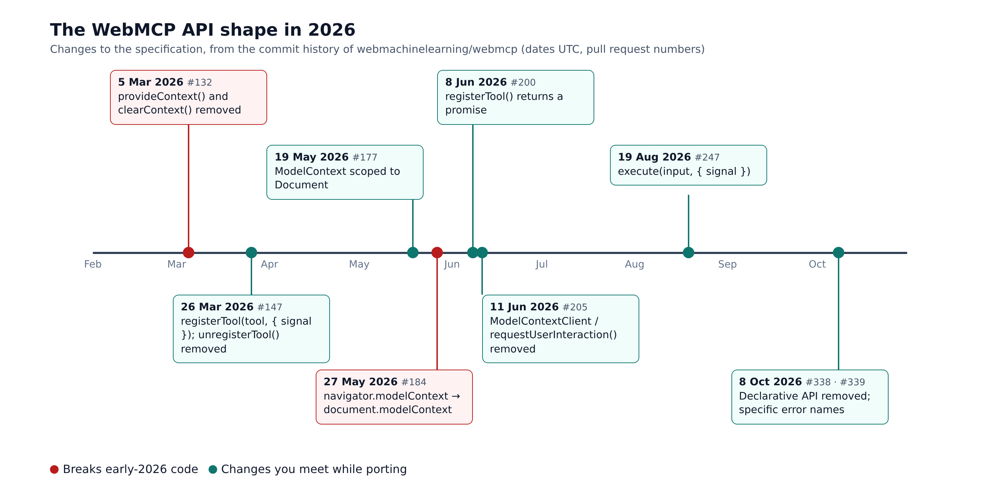

*Appendices*

# Appendix D: Migration Notes: navigator.modelContext and provideContext() to document.modelContext

> *“WebMCP is currently focused on the imperative `document.modelContext.registerTool()` API described above, which is what the specification defines.”*
>
> — WebMCP README, October 2026[^1]

If you wrote WebMCP code in the first half of 2026, or you’re reading a tutorial from then, it probably starts with `navigator.modelContext.provideContext({ tools: [...] })`. None of that runs in a current browser. This appendix shows what changed, when, and how to port the code, with the same Fjord Table tools in both shapes. Chapter 5 tells the story behind the two big changes; this appendix is the practical checklist.

The dates come from the commit history of the specification repository, `webmachinelearning/webmcp`, read on 14 October 2026; the merge times of the key pull requests were checked against GitHub’s own records the same day.[^2] The specification has no changelog section of its own, so the commit log is the record. The “after” code was tested in Chromium 156.0.8078.4 with `--enable-features=WebMCPTesting`; the listings and their tests are in the book’s demos repository, in `appendices/d-migration/`, and all 20 checks pass.

## D.1 What changed, and when

**Table D.1 — API-shape changes in the WebMCP specification, February to October 2026**

| Date (UTC) | Change | Pull request / commit |
|---|---|---|
| 5 March 2026 | `provideContext()` and `clearContext()` removed | #132, `fe84c67`[^3] |
| 26 March 2026 | `registerTool()` takes an optional `AbortSignal`; `unregisterTool(name)` removed | #147, `6708e33`[^4] |
| 19 May 2026 | `ModelContext` scoped to the `Document` instead of the `Navigator` | #177, `986f461`[^5] |
| 27 May 2026 | The `modelContext` getter moved from `Navigator` to `Document` | #184, `c7b5c70`[^6] |
| 8 June 2026 | `registerTool()` returns a promise | #200, `ec37ec4`[^7] |
| 11 June 2026 | `ModelContextClient` (the execute callback’s second argument, with `requestUserInteraction()`) removed | #205, `067a1c9`[^8] |
| 19 August 2026 | The execute callback receives `{ signal }` for cancellation | #247, `83e893a`[^9] |
| 8 October 2026 | Declarative API removed from the specification | #338, `14ae813`[^10] |
| 8 October 2026 | `UnknownError` replaced by specific exception names in `executeTool()` | #339, `b206dae`[^11] |

Two of these rows break old code outright: 5 March and 27 May. The others change details you’ll meet while porting. The two October rows don’t affect migration from `navigator`, but they explain what you’ll see in Chrome today (Appendix A, Tables A.7 and A.8).



*Figure D.1 — The API’s shape over 2026, from the commit history. The two breaking changes are 5 March (`provideContext()` and `clearContext()` removed) and 27 May (`navigator.modelContext` became `document.modelContext`).*

## D.2 Before: the early-2026 shape

Listing D.1 is Fjord Table’s two tools written the way the explainer and early tutorials wrote them, close to the example in the explainer of November 2025.[^12] It uses everything that has since gone: the `navigator` namespace, `provideContext()` to set the whole tool list in one call, `clearContext()` to drop it, and a second `execute` argument, a `ModelContextClient`, whose `requestUserInteraction()` asked the browser to let the page talk to the user mid-call.

**Listing D.1 — Before: Fjord Table’s tools with `provideContext()` (before/fjord-tools.before.js)**

```js
// BEFORE (navigator.modelContext, early 2026). Does not run in current browsers.
// provideContext() replaced the page's whole tool set; clearContext() removed it.
if ('modelContext' in navigator) {
  navigator.modelContext.provideContext({
    tools: [
      {
        name: 'search_availability',
        description: 'Find open tables at Fjord Table for a date, time and party size.',
        inputSchema: {
          type: 'object',
          properties: {
            date: { type: 'string', description: 'Visit date, YYYY-MM-DD' },
            time: { type: 'string', description: 'Preferred time, 24h HH:MM' },
            partySize: { type: 'integer', minimum: 1, maximum: 12 }
          },
          required: ['date', 'partySize']
        },
        async execute({ date, time, partySize }) {
          const slots = await availability.search({ date, time, partySize });
          return { date, partySize, slots: slots.map((s) => s.time) };
        }
      },
      {
        name: 'book_table',
        description: 'Book a table at Fjord Table. Asks the user to confirm first.',
        inputSchema: {
          type: 'object',
          properties: {
            date: { type: 'string' },
            time: { type: 'string' },
            partySize: { type: 'integer', minimum: 1, maximum: 12 },
            name: { type: 'string' }
          },
          required: ['date', 'time', 'partySize', 'name']
        },
        // The second argument was a ModelContextClient.
        async execute(booking, client) {
          const ok = await client.requestUserInteraction(() => confirmBooking(booking));
          if (!ok) return { booked: false, reason: 'The user declined.' };
          return { booked: true, reference: await bookings.create(booking) };
        }
      }
    ]
  });

  // Leaving the booking view: drop every tool on the page.
  window.addEventListener('pagehide', () => navigator.modelContext.clearContext());
}
```

Listing D.2 is the other early pattern: adding and removing single tools with `registerTool()` and `unregisterTool(name)`. `registerTool()` returned nothing then.[^4][^7]

**Listing D.2 — Before: registering and unregistering by name (before/register-unregister.before.js)**

```js
// BEFORE (navigator.modelContext, February 2026). Does not run in current browsers.
// registerTool() returned nothing, and tools were removed by name.
navigator.modelContext.registerTool({
  name: 'search_availability',
  description: 'Find open tables at Fjord Table for a date, time and party size.',
  inputSchema: { type: 'object', properties: { date: { type: 'string' } }, required: ['date'] },
  async execute({ date }) {
    return { date, slots: (await availability.search({ date })).map((s) => s.time) };
  }
});

// Any script on the page could do this, including to tools it didn't register.
navigator.modelContext.unregisterTool('search_availability');
```

In Chromium 156 neither listing works (tested). `'modelContext' in navigator` is `false`, so Listing D.1’s guard quietly skips everything: no error, and no tools. Listing D.2 has no guard and throws a `TypeError` on its first line. The quiet failure is the dangerous one: the page keeps working for people, and agents simply find nothing.

## D.3 After: the current shape

Listing D.3 is the same two tools for the 14 October 2026 draft.[^13] It is close to chapter 5’s Listing 5.1, wrapped in a function so the test can call it.

**Listing D.3 — After: Fjord Table’s tools on `document.modelContext` (after/fjord-tools.js)**

```js
// AFTER (document.modelContext, 14 October 2026 draft; Chromium 156).
// One registerTool() call per tool, one AbortController per view.
export async function registerFjordTools({ availability, bookings, confirmBooking }) {
  if (!('modelContext' in document)) return null;   // progressive enhancement
  const view = new AbortController();
  const options = { signal: view.signal };

  await document.modelContext.registerTool({
    name: 'search_availability',
    description: 'Find open tables at Fjord Table for a date, time and party size.',
    inputSchema: {
      type: 'object',
      properties: {
        date: { type: 'string', description: 'Visit date, YYYY-MM-DD' },
        time: { type: 'string', description: 'Preferred time, 24h HH:MM' },
        partySize: { type: 'integer', minimum: 1, maximum: 12 }
      },
      required: ['date', 'partySize']
    },
    annotations: { readOnlyHint: true },
    async execute({ date, time, partySize }, { signal }) {
      const slots = await availability.search({ date, time, partySize, signal });
      return { date, partySize, slots: slots.map((s) => s.time) };
    }
  }, options);

  await document.modelContext.registerTool({
    name: 'book_table',
    description: 'Book a table at Fjord Table. The user confirms in the page first.',
    inputSchema: {
      type: 'object',
      properties: {
        date: { type: 'string' },
        time: { type: 'string' },
        partySize: { type: 'integer', minimum: 1, maximum: 12 },
        name: { type: 'string' }
      },
      required: ['date', 'time', 'partySize', 'name']
    },
    annotations: { consequentialHint: true },
    // The second argument is now { signal }. Confirmation is the page's own UI.
    async execute(booking, { signal }) {
      const ok = await confirmBooking(booking, { signal });
      if (!ok) return { booked: false, reason: 'The user declined.' };
      return { booked: true, reference: await bookings.create(booking) };
    }
  }, options);

  // Leaving the booking view: abort() unregisters exactly these two tools.
  window.addEventListener('pagehide', () => view.abort(), { once: true });
  return view;
}
```

Table D.2 lists the changes one by one.

**Table D.2 — Porting map: early-2026 shape to the 14 October 2026 draft**

| Before | After | Notes |
|---|---|---|
| `'modelContext' in navigator` | `'modelContext' in document` | The getter lives on `Document` and exists only in secure contexts.[^13] |
| `navigator.modelContext.provideContext({ tools })` | One `document.modelContext.registerTool(tool, { signal })` per tool | Duplicate names reject with `InvalidStateError` instead of silently replacing a tool. |
| `navigator.modelContext.clearContext()` | `controller.abort()` on the signal(s) you registered with | You can only remove tools you registered yourself. |
| `navigator.modelContext.unregisterTool(name)` | `controller.abort()` | Unregistering doesn’t cancel calls already running (chapter 6). |
| `registerTool(tool)` returns `undefined` | `await registerTool(tool, options)` | Errors arrive as a rejected promise, not a throw. |
| `execute(input, client)` | `execute(input, { signal })` | The second argument is now options with an `AbortSignal`. |
| `client.requestUserInteraction(cb)` | The page’s own confirmation UI, plus `annotations: { consequentialHint: true }` | See the callout below. |
| Results: any value | Return an object | The browser serializes it to a JSON string; Chromium 156 passes plain strings through unquoted (Appendix A, Table A.5). |
| `executeTool(tool, '{"date":"…"}')` (string input) | `executeTool(tool, { date: '…' })` | Chrome deprecated JSON-string input from Chrome 155.[^14] |

Tested in Chromium 156: both tools register, `getTools()` returns them with their annotations, `search_availability` returns its slots through `executeTool()`, `book_table` goes through the page’s confirmation (both the yes and the no path), and `view.abort()` removes both tools and fires `toolchange`.

> **Still in flux: asking the user mid-call**
>
> `requestUserInteraction()` was removed on 11 June 2026 because, in the words of the pull request, “this interface and its only method are not fully specified and not implemented yet”; the removal is meant to last until issue #165 and pull request #204 settle a more permanent design.[^8] Listing D.1’s `book_table` therefore never worked anywhere as written. Until a replacement lands, confirm consequential actions in your own UI, as Listing D.3 does and chapter 13 explains.

## D.4 Keeping the “swap the tool set” pattern

`provideContext()` had one genuinely useful property: a single-page app could switch views and replace the whole tool list in one call. It was removed because the same call let any script on the page wipe out tools it didn’t own.[^3] Chapter 5 tells that story. Listing D.4 keeps the useful half. A tool set owns one `AbortController`; `replace()` aborts it and registers the new tools under a fresh one. It can only ever remove its own tools.

**Listing D.4 — A view-scoped tool set that replaces `provideContext()` (after/tool-set.js)**

```js
// AFTER: the useful half of provideContext(), "swap this view's tools",
// without the dangerous half. It can only remove tools it registered itself.
export function createToolSet(modelContext = document.modelContext) {
  let current = null;
  return {
    async replace(tools) {
      current?.abort();                        // drop the previous set (ours only)
      current = new AbortController();
      const { signal } = current;
      await Promise.all(tools.map((tool) => modelContext.registerTool(tool, { signal })));
    },
    clear() {
      current?.abort();
      current = null;
    }
  };
}
```

Tested in Chromium 156: with a tool registered by other code on the same page, `replace([menu_search, opening_hours])` followed by `replace([book_table])` leaves exactly `book_table` and the other code’s tool; `clear()` leaves only the other code’s tool. Two tools with the same name in one `replace()` call reject with `InvalidStateError`, which `provideContext()` would have accepted without complaint.

## D.5 Finding old code paths

A site that ported half its code, or a library that still has a `navigator` branch, fails quietly. Listing D.5 tells the cases apart, so you can log them.

**Listing D.5 — Feature detection that spots the legacy namespace (after/detect.js)**

```js
// AFTER: feature detection that also spots outdated code paths.
export function webmcpStatus() {
  if ('modelContext' in document) return 'current';           // document.modelContext
  if ('modelContext' in navigator) return 'legacy-navigator'; // a pre-May-2026 build
  return 'unavailable';
}
```

In Chromium 156 with `WebMCPTesting`, `webmcpStatus()` returns `'current'` (tested). `'legacy-navigator'` should only appear in old builds. A quick search of your codebase for `navigator.modelContext`, `provideContext`, `clearContext`, `unregisterTool` and `requestUserInteraction` finds the rest.

## D.6 Checklist

1. Replace `navigator.modelContext` with `document.modelContext`, and the feature test with `'modelContext' in document`.
2. Turn each `provideContext({ tools })` into one `registerTool(tool, { signal })` per tool, sharing one `AbortController` per view or component.
3. Replace `clearContext()` and `unregisterTool(name)` with `abort()`.
4. `await` every `registerTool()` and handle rejections (`InvalidStateError`, `NotAllowedError`, `SecurityError`; Appendix A, Table A.7).
5. Change `execute(input, client)` to `execute(input, { signal })`, and pass the signal to anything long-running.
6. Remove `requestUserInteraction()`; confirm in your own UI and mark the tool `consequentialHint: true`.
7. Return objects, not strings or `undefined`.
8. Pass objects, not JSON strings, to `executeTool()`.
9. Re-test in Chrome with `chrome://flags/#enable-webmcp-testing` enabled.[^15]

## D.7 Summary

- Two changes break early-2026 code: `provideContext()` and `clearContext()` were removed on 5 March 2026, and `navigator.modelContext` moved to `document.modelContext` on 27 May 2026.
- In Chromium 156 old code fails quietly: `navigator.modelContext` doesn’t exist, guarded code registers nothing, and unguarded code throws.
- Register one tool per call and unregister by aborting the signal you passed. A small tool-set helper (Listing D.4) keeps the view-switching convenience of `provideContext()` without its risk.
- The execute callback’s second argument is `{ signal }`; `requestUserInteraction()` is gone until a new design lands, so confirmation belongs in your page.

[^1]: webmachinelearning/webmcp README, section “Future Exploration: Declarative API”, as changed on 8 October 2026 and read 14 October 2026. <https://github.com/webmachinelearning/webmcp#future-exploration-declarative-api>
[^2]: webmachinelearning/webmcp commit history (`git log` of `main` and `index.bs`), read 14 October 2026; head at that time was commit 1636b33 of 14 October 2026. Merge times for pull requests #132, #184 and #205 were read from the GitHub API the same day. <https://github.com/webmachinelearning/webmcp/commits/main/index.bs>
[^3]: webmachinelearning/webmcp pull request #132, “Remove `provideContext()` and `clearContext()`”, by Dominic Farolino, merged 5 March 2026 at 19:47 UTC (commit fe84c67). Its description says it closes issue #101 and follows the proposal made there, with tool unregistration to be designed in issue #130. Read 14 October 2026. <https://github.com/webmachinelearning/webmcp/pull/132>
[^4]: webmachinelearning/webmcp commit 6708e33, “`registerTool()` takes an optional `AbortSignal` (#147)”, 26 March 2026: adds `ModelContextRegisterToolOptions.signal` and removes `unregisterTool(DOMString name)` from the IDL. Read 14 October 2026. <https://github.com/webmachinelearning/webmcp/commit/6708e3399871458c07ed4cddc04057dec2549955>
[^5]: webmachinelearning/webmcp commit 986f461, “Scope `ModelContext` to `Document`, and handle detached documents (#177)”, committed 18 May 2026 at 22:19 −04:00 (19 May UTC). Read 14 October 2026. <https://github.com/webmachinelearning/webmcp/commit/986f4611d6696843c4ba86c96b7623a5cf2e5413>
[^6]: webmachinelearning/webmcp pull request #184, “Move the `modelContext` getter to `Document`”, by Dominic Farolino, merged 27 May 2026 at 15:04 UTC (commit c7b5c70); it closes issue #173 and replaces `partial interface Navigator` with `partial interface Document`. Read 14 October 2026. <https://github.com/webmachinelearning/webmcp/pull/184>
[^7]: webmachinelearning/webmcp commit ec37ec4, “Make `registerTool()` return a promise (#200)”, 8 June 2026: `undefined registerTool(…)` becomes `Promise<undefined> registerTool(…)`. Read 14 October 2026. <https://github.com/webmachinelearning/webmcp/commit/ec37ec4878e08a166f1460ac40b1ca4ab8096d14>
[^8]: webmachinelearning/webmcp pull request #205, “Remove `ModelContextClient` for now”, merged 11 June 2026 (commit 067a1c9): the callback changes from `(object input, ModelContextClient client)` to `(object input)`. Quoted from its description, read 14 October 2026. <https://github.com/webmachinelearning/webmcp/pull/205>
[^9]: webmachinelearning/webmcp commit 83e893a, “Spec `AbortSignal` integration with tool execution (#247)”, 19 August 2026: introduces `ToolExecuteCallbackOptions` with `signal`. Read 14 October 2026. <https://github.com/webmachinelearning/webmcp/commit/83e893ac3eaa8d72610062933c33a79494bf4fb5>
[^10]: webmachinelearning/webmcp commit 14ae813, “Remove declarative API from the spec for now (#338)”, by François Beaufort, committed 8 October 2026. Read 14 October 2026. <https://github.com/webmachinelearning/webmcp/commit/14ae813cc4e9fe0d39313f4b1ee5b231746731ad>
[^11]: webmachinelearning/webmcp commit b206dae, “Replace UnknownError with specific DOMException types. (#339)”, by Mark Foltz, committed 8 October 2026. Read 14 October 2026. <https://github.com/webmachinelearning/webmcp/commit/b206dae8bad34ea8e6ff7213b417b50b14a37e9a>
[^12]: webmachinelearning/webmcp `docs/proposal.md` as of commit adbc2c5, “Fix provideContext API example”, 17 November 2025: the `window.navigator.modelContext.provideContext({ tools: [...] })` example, `execute({ text }, agent)`, and `registerTool` / `unregisterTool("add-todo")`. Read 14 October 2026. <https://github.com/webmachinelearning/webmcp/blob/adbc2c5374ec898d54bc312a871f9de62e582671/docs/proposal.md>
[^13]: WebMCP specification, Draft Community Group Report, 14 October 2026, §4.1 Extensions to Document, §4.2 ModelContext interface and the IDL index. Read 14 October 2026. <https://webmachinelearning.github.io/webmcp/#idl-index>
[^14]: Chrome for Developers, “Imperative API” (published 18 May 2026, last updated 21 September 2026): “JSON stringified input arguments are deprecated from Chrome 155.” Read 14 October 2026. <https://developer.chrome.com/docs/ai/webmcp/imperative-api>
[^15]: Chrome for Developers, “WebMCP” overview (published 18 May 2026, last updated 7 October 2026), section “Local WebMCP”. Read 14 October 2026. <https://developer.chrome.com/docs/ai/webmcp>
