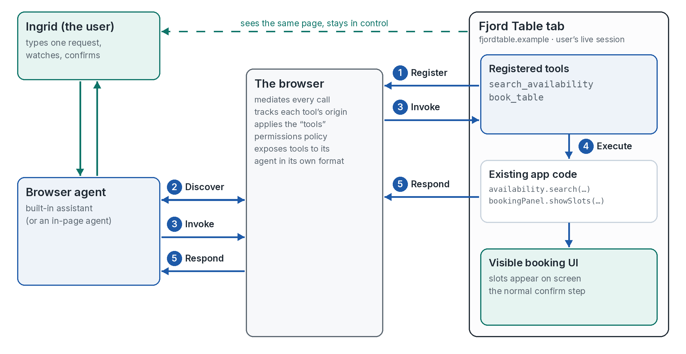

*Part I · Why the web needs an agent interface*

# Chapter 4: Enter WebMCP

> *“Instead of your application being a guest within an agent, the agent is a guest on your platform.”*
>
> — Chrome for Developers, “WebMCP and MCP compared”[^1]

## Two Fridays at Fjord Table

It is Wednesday evening in Oslo, and Ingrid wants a table for four at Fjord Table on Friday, around seven, by the window if possible. She doesn’t open the site and click through its date picker. She types one sentence into the assistant panel of her browser and goes back to her email.

Here is how that request plays out on most of the web today. The agent takes a screenshot of the Fjord Table homepage, reads the accessibility tree, and decides that the blue button saying “Reserve” is probably the way in. It clicks. A modal opens with a calendar widget built from forty nested `div` elements. The agent counts squares to find Friday, clicks what it thinks is the 20th, takes another screenshot to check, notices the month header says October, finds the small arrow, and tries again. The party-size control is a custom stepper, so it clicks “+” three times and checks. The time slots load asynchronously, and on the first attempt the agent reads them before they arrive. Eventually, after a dozen model round trips, it gets to a confirmation screen. Or it doesn’t, because Fjord Table shipped a redesign on Tuesday and the button now says “Book”.

Now replay the same Friday on a version of Fjord Table that has been made agent-ready. When Ingrid’s browser agent looks at the tab, it doesn’t only see pixels and markup. It also sees that the page offers two tools: `search_availability`, which takes a date, a time and a party size, and `book_table`, which takes a slot and a seating preference. Each one has a plain-language description and a JSON Schema for its inputs. The agent calls `search_availability` once. Fjord Table’s own JavaScript (the same code the date picker already uses) runs the search, updates the booking panel on screen so Ingrid can see the options, and hands back three time slots. The agent proposes 19:00 at a window table. Ingrid glances over, sees the familiar Fjord Table booking panel already filled in, and confirms.

Nothing about the second Friday needs a new server, a new login, or a new app inside the agent. The restaurant’s website did the work, in the user’s own session, while the user watched. That is the whole idea of WebMCP in one scene. The rest of this chapter takes it apart: what WebMCP is, what problem it solves, how it relates to the Model Context Protocol from Chapter 3, where it came from, who is building it, and how contested it still is. Part II then goes deep on the API itself.

## What WebMCP is

The specification opens with one sentence: “The WebMCP API enables web applications to provide JavaScript-based tools to AI agents.”[^2] Its introduction then gives the mental model the rest of the design follows. Pages that use WebMCP “can be thought of as Model Context Protocol servers that implement tools in client-side script instead of on the backend.”[^2]

Three ideas are packed into that description.

- *Tools, not clicks.* A tool is a JavaScript function with a name, a natural-language description and a structured input schema. The page declares what it can do, and the agent stops guessing from the layout.
- *Client-side.* The tool runs in the page, in the browser tab the user already has open. It can reuse the application’s existing front-end logic and its state, and it inherits the user’s logged-in session.
- *MCP-shaped.* The vocabulary (tools, descriptions, input schemas, results) is borrowed from MCP, so anyone who read Chapter 3 will recognise it. As we’ll see, though, WebMCP is not MCP running in a browser.

In API terms the surface is small. Every document gets a `modelContext` object (`document.modelContext`), and a page calls `registerTool()` on it to offer a tool.[^3] The browser’s own agent, or an agent embedded in the page, can then discover the tool and call it. The page’s callback does the work and returns a result. That’s the core of it. Annotations, cancellation, cross-origin frames and the rest are refinements on that loop, and they get their own chapters.

Formally, WebMCP is a Draft Community Group Report of the W3C Web Machine Learning Community Group. The version this chapter was checked against is dated 13 October 2026, and its status section is blunt: “It is not a W3C Standard nor is it on the W3C Standards Track.”[^2] Chrome and Edge are running time-limited origin trials. That status shapes how you should read everything that follows, and we come back to it near the end of the chapter.

## The problem: the actuation tax

Chapter 1 described *actuation*, which Chrome’s documentation defines as “the act of an agent simulating manual mouse clicks and text input, as though it were the human user engaging with your website.”[^4] It is how today’s general-purpose browser agents get things done when nothing better is available. The WebMCP explainer describes the technique plainly: agents observe “the browser state through a combination of screenshots, and DOM and accessibility tree snapshots, and then interact with the page by simulating human user input.”[^5]

Actuation is remarkable when it works, and it carries a tax that every site and every agent pays.

- *It is brittle.* The agent infers intent from presentation. Rename a button, move a field, swap a native `<select>` for a custom component, and an agent that worked yesterday fails today. Your design team has no idea it broke anything.
- *It is slow and expensive.* Each step is a model call over a screenshot or a large DOM snapshot. Booking a table can take a dozen round trips. The explainer notes that “even when agents succeed, simple operations often require multiple steps and can be slow or unreliable.”[^5]
- *It is ambiguous.* Does “Name” mean full name, or first name with a separate surname field? Is this date picker showing check-in or check-out? Humans resolve this from context. Agents guess.
- *The site has no say.* The site owner can’t tell the agent “this is the right way to book” or “don’t touch the admin menu”. It can only hope the agent infers the intended path.

The obvious alternative is to skip the page and give the agent an API. That is what MCP servers, OpenAPI descriptions and platform plug-ins do. The explainer calls these *backend integrations*, and it is candid about why they don’t fit interactive web apps.[^5] They cause UI disintermediation and context loss: the conversation happens between the agent and your server, and your interface, the thing you designed and the place where the user sees what is happening, is bypassed. They force replication of state and authentication: the user is already signed in to the tab, but the backend integration needs its own credentials and its own copy of whatever the user was looking at. And they add developer burden, because exposing something your front end already does means writing and running a separate server.

The explainer illustrates the mismatch with a browser agent that combines both worlds. It scrapes the page, calls a backend MCP tool, and then has to “scrape / actuate DOM to reconcile visible UI”, because the server’s state and the screen have drifted apart.[^5] Anyone who has watched an agent book something through an API and then try to show the user what it did will recognise the problem.

WebMCP’s answer sits between the two approaches. Keep the page, keep the session and keep the user’s view, but let the page describe its capabilities as tools so the agent doesn’t have to reverse-engineer them. The explainer’s phrase is a “lightweight way to adapt web content for use by AI agents”.[^5]

## The core idea: tools that live in the tab

The most important property of a WebMCP tool is where it runs. It lives in a document’s event loop, the same main thread as the rest of your page script.[^6] When an agent calls it, your code runs with everything the page already has: the signed-in session and its cookies, the application state in memory, the components on screen. Chrome’s comparison guide sums it up: WebMCP “accesses live session data, cookies, and DOM elements that are available only in a live browser tab.”[^1]

The explainer’s lifecycle of a tool call has five steps, shown in Figure 4.1 for Fjord Table.[^5]

1. *Registration.* The page registers one or more tools with `document.modelContext.registerTool()`.
1. *Discovery.* An agent connected to the page asks the browser which tools are active and what their schemas are.
1. *Invocation.* The agent requests a tool call, with structured arguments that match the tool’s input schema.
1. *Execution.* The browser mediates the call and runs the tool’s `execute` callback in the page.
1. *Response.* The callback returns a result, which goes back to the agent so it can carry on with the user.



*Figure 4.1 — A WebMCP tool call at Fjord Table. The browser mediates between the agent and the page. The tool runs in the user’s live tab, reuses the site’s own code and updates the UI the user is looking at.*

Three consequences follow from running in the tab, and together they explain most of WebMCP’s design.

### The user stays in the loop

The explainer’s first stated goal is to “enable human-in-the-loop workflows”, cooperative scenarios in which users delegate tasks while “maintaining visibility, history, and control over web pages.”[^7] Because the tool runs in the visible page, it can and should update the visible page. When Ingrid’s agent calls `search_availability`, the booking panel shows the slots. When it calls `book_table`, Fjord Table’s normal confirmation screen appears. The agent becomes a fast pair of hands on an interface the user can still see and correct. The spec’s introduction describes WebMCP as enabling “collaborative workflows where users and agents work together within the same web interface”.[^2]

### Tools are ephemeral and tab-bound

A WebMCP tool exists while the page that registered it exists. Chrome’s guide puts it plainly: “WebMCP tools are ephemeral. They exist only when your page is open. Once the user navigates away from your site or closes the tab, the agent cannot access your site or take actions.”[^1] Pages can also add and remove tools as the user moves around. Fjord Table might offer `book_table` only once a restaurant and date are on screen. That is a feature, not a limitation: the set of tools reflects what the user could do right now in the UI.

### The browser is the broker

Agents don’t talk to your page directly. The browser mediates. It knows which origin registered each tool, applies a permissions policy (a feature called `tools`, allowed by default only for the page itself and same-origin frames), and decides how to present the tools to its agent.[^8] The spec deliberately leaves that last part open. Despite the name, it “does not prescribe the format in which tools are exposed to the browser agent. Browsers are free to distill and expose tools via Model Context Protocol, other proprietary ‘function calling’ methods, or any other way it deems appropriate.”[^6] For a page author this means you write to one web API, and each browser’s agent consumes your tools in whatever form its model prefers.

There are two kinds of consumer. One is the *browser agent*, built into or hosted by the browser (think of a sidebar assistant), which reads a snapshot of the page’s tools alongside screenshots and other context. The other is an *in-page agent* written in JavaScript, such as a chat widget, possibly running in an iframe, which discovers tools with `getTools()` and calls them with `executeTool()`.[^3] Mozilla’s standards-position thread contains a revealing admission from the editors: WebMCP “was conceived with only the first use case in mind”, and support for agents in cross-origin iframes was added “due to developer demand.”[^9] Chapter 7 covers that second world in detail.

### Goals, and what WebMCP is deliberately not

The explainer lists six goals: human-in-the-loop workflows, simpler and more reliable agent integration, preventing web content disintermediation, reusing existing client-side code, improving accessibility through agents, and headless scenarios that reuse the same tools.[^7] The non-goals matter just as much, because they mark the edges of the design.

- *Not for fully autonomous workflows.* The API “is not intended for fully autonomous agents where a browser UI is not present.” Chrome’s own limitations note says that while headless use may be possible, the API “is primarily designed for local browser workflows with a human in the loop.”[4,7]
- *Not a replacement for backend integrations.* WebMCP is designed to “complement, not replace” protocols like MCP.[^7]
- *Not a replacement for human interfaces.* “The human web interface remains primary; agent tools augment rather than replace user interaction.”[^7]
- *Not a replacement for actuation.* An agent that can’t do the job with a page’s tools can still fall back to screenshots and clicks. The explainer says WebMCP “will not conflict with these existing automation techniques.”[^5]

There are two more things it is not, and it helps to say them early. WebMCP isn’t an accessibility API: the explainer says it is not designed for ingestion by assistive technology or to interact with the accessibility tree.[^7] And it isn’t a trust mechanism. The spec’s security section admits that “there is no guarantee that a WebMCP tool’s declared intent matches its actual behavior.”[^10] A tool description is a claim made by the site, and agents and browsers still have to decide how far to believe it. Part IV is devoted to that problem.

## A first taste of code

Chapter 5 covers registration properly. Still, it is easier to reason about an API once you’ve seen it, so here is the smallest useful WebMCP tool for Fjord Table, written against the 13 October 2026 draft. It offers a read-only availability search that reuses the code behind the site’s date picker.

**Listing 4.1 — Fjord Table’s first tool (agent-tools.js, loaded as a module)**

```js
// Progressive enhancement: do nothing where WebMCP isn't available.
if ('modelContext' in document) {
  const agentTools = new AbortController();

  await document.modelContext.registerTool({
    name: 'search_availability',
    title: 'Search available tables',
    description:
      'Find open tables at Fjord Table for a date, time and party size. ' +
      'Returns up to five nearby time slots. Does not make a booking.',
    inputSchema: {
      type: 'object',
      properties: {
        date:      { type: 'string', description: 'Visit date, YYYY-MM-DD' },
        time:      { type: 'string', description: 'Preferred time, 24h HH:MM' },
        partySize: { type: 'integer', minimum: 1, maximum: 12 }
      },
      required: ['date', 'partySize']
    },
    annotations: { readOnlyHint: true },
    async execute({ date, time, partySize }, { signal }) {
      // The same function the date picker calls when a human searches.
      const slots = await availability.search({ date, time, partySize, signal });
      bookingPanel.showSlots(slots);   // the user sees what the agent found
      return { date, partySize, slots: slots.map((s) => s.time) };
    }
  }, { signal: agentTools.signal });

  // Later, e.g. when the user leaves the booking view:
  // agentTools.abort();   // unregisters the tool
}
```

Most of what matters is visible in those few lines. The name must be 1 to 128 characters from a small ASCII set (letters, digits, underscore, hyphen and full stop), and the description may not be empty.[^3] The `inputSchema` is ordinary JSON Schema. The `execute` callback receives the agent’s arguments as an object, plus a signal the browser uses to cancel the call. Whatever the callback returns is serialized to JSON for the agent. `readOnlyHint` tells the agent this tool changes nothing. Registration returns a promise, which rejects if the name is already taken or the inputs are invalid. To unregister, you don’t call a method: you abort the `AbortSignal` passed at registration.[^3]

The second listing shows the other side of the loop. Suppose Fjord Table embeds its own assistant widget. That in-page agent can find the tool and call it with two methods.

**Listing 4.2 — An in-page agent calling the tool**

```js
const tools  = await document.modelContext.getTools();
const search = tools.find((t) => t.name === 'search_availability');

const json = await document.modelContext.executeTool(search, {
  date: '2026-11-20', time: '19:00', partySize: 4
});
console.log(JSON.parse(json).slots);   // e.g. ["18:30", "19:00", "20:15"]
```

`executeTool()` resolves to the stringified result, which is why the widget parses it. A browser’s built-in agent doesn’t use these methods. It gets the page’s tools through the browser’s own internal mechanism, which the spec calls an *observation*.[^6]

> **Still in flux: the API you may have seen elsewhere**
>
> If you’ve read older blog posts, you’ve probably seen `navigator.modelContext` and methods called `provideContext()` and `clearContext()`. Both are gone. The two methods were removed from the draft on 5 March 2026 (pull request #132), and in May 2026 the `modelContext` object moved from `navigator` to `document`, scoped to each document (pull requests #177 and #184).[^11] Some community polyfills and tutorials still use the old shapes. Every listing in this book follows the current draft, and Appendix D collects the migration notes. Treat any WebMCP snippet without a date on it with suspicion.

Notice what Listing 4.1 doesn’t do. It doesn’t open a port, mint a token, or describe Fjord Table’s backend. It wraps a function the site already had and shows its result on screen. The explainer calls this goal *code reuse*: “Any task that a user can accomplish through a page’s UI can be turned into a tool by reusing much of the page’s existing client-side code.”[^7]

## WebMCP and MCP: siblings, not twins

The name invites the obvious question, and Google has a whole page answering it: “Will WebMCP replace Model Context Protocol (MCP)?” Its answer is no: “WebMCP is not an extension or a replacement of MCP. WebMCP and MCP address different needs.”[^1]

Chrome’s analogy is useful. MCP is a company’s customer-service call centre: available on any platform at any time, pulling up data and handling core tasks. WebMCP is the in-store expert: available only when you are in the shop, but able to walk you to the right shelf and hand you the thing.[^1] The two share a philosophy. Both offer structured tool discovery, predictable execution and explicit intent in place of guesswork. The key difference, in Google’s words, “is where the application functionality lives.”[^1]

| Aspect | MCP (Chapter 3) | WebMCP |
|---|---|---|
| Where tools run | On a server or local process you operate | In the page’s script, in the user’s tab |
| Lifecycle | Persistent (server or daemon) | Ephemeral and tab-bound |
| Transport | JSON-RPC 2.0 between client and server | No wire protocol; the browser mediates, in a format the spec leaves open |
| Identity and auth | The server needs its own credentials and auth flow | Inherits the user’s logged-in browser session |
| Discovery | Agent-specific registration and configuration | Tools registered by the page while the user visits it |
| Feature set | Tools, resources, prompts, plus client features such as elicitation | Tools only, in a web-native API with origins and permissions policy |
| User’s view | Headless, outside your UI | DOM-aware, inside your UI |
| Governance | Versioned protocol (current version 2026-07-28) | W3C Community Group draft |

Sources for the table: Chrome’s comparison page, the WebMCP explainer and spec, and the MCP versioning page.[1,5,12] A few rows deserve a sentence each.

*No JSON-RPC.* WebMCP borrows MCP’s vocabulary, not its wire format. Chrome’s guide describes it as “a set of ‘MCP-inspired’ APIs, rather than a direct JavaScript implementation of MCP,” and notes that it omits server-side concepts such as resources.[^1] A browser could translate your tools into MCP for its agent, or into something else entirely.

*Tools only.* Chapter 3 spent time on MCP resources and prompts. Today’s WebMCP has neither. Its open questions include output schemas, progress reporting, streaming and a higher-level notion of “skills”, several of them explicitly modelled on MCP features.[^5] The two vocabularies may converge over time, but they haven’t yet.

*Different lifecycles, complementary jobs.* Google’s recommendation is to use both: “Manage core logic with MCP” as a platform-agnostic service layer that is always available, and “Build a contextual UI with WebMCP” for the moments when the user has your site open.[^1] For Fjord Table that split is natural. A backend MCP server, like the one built for Trailhead in Chapter 3, could let an assistant check opening hours or cancel a booking from anywhere. The WebMCP tools handle the rich, visual work of choosing a table with the user watching.

The relationship also runs through people and history, not just design. Some of WebMCP’s earliest code was an attempt to put MCP itself into the browser, and the decision *not* to adopt MCP wholesale is one of the most important choices in the design. That is where we turn next.

## Roads not taken

Good standards proposals explain the designs they rejected, and the WebMCP explainer lists three.[^13] They are worth knowing because each one comes back regularly in issue threads and conference questions.

### 1. Just adopt MCP

Why not run the Model Context Protocol in the browser and be done? The explainer gives two reasons. MCP “was built primarily for server-to-client and stdio/SSE process communication” and “lacks native web concepts like origins, standard browser permissions, DOM integration, and tab-level lifecycle management.” And “coupling a web API directly to an actively evolving backend protocol would hinder backward compatibility and platform stability.”[^13] Web APIs are effectively forever, while MCP is a fast-moving protocol with dated revisions. WebMCP keeps a “common vocabulary” with MCP and leaves the browser free to bridge to whatever protocol its agent speaks.

### 2. Static manifests

Could sites list their tools in a static file, like the Web App Manifest? It would help background discovery, but static manifests “prevent web developers from dynamically adding, updating, or removing tools based on the active page state or user authentication status,” and manifests can’t contain the code that runs the tool.[^13] The explainer leaves the door open to layering static declarations on top later, and a separate service-worker explainer explores how agents might discover tools on sites the user doesn’t have open.[^5]

### 3. A toolcall event

A third design would have pages listen for a `toolcall` event and respond, much like a service worker’s `fetch` handler. It was rejected because it separates a tool’s declaration from its implementation and leads to sprawling `switch` statements. A hybrid, an interceptable event dispatched before the registered callback runs, is still on the table.[^13]

### The alternative WebMCP’s critics prefer

There is a fourth alternative that the explainer doesn’t list, and it is central to the politics. Apple’s WebKit team argues that “when a site’s actions are hard for an agent to use, that is a gap in the page’s own semantics,” and that the fix belongs in HTML and ARIA, “where the user, assistive technology, and agents all benefit,” rather than in a parallel layer of JavaScript tools.[^14] The declarative form API, which annotates existing HTML forms, is partly an attempt to meet that argument halfway. We look at it in Chapter 8, and at the wider dispute below.

## Where WebMCP came from

> **A note on sources**
>
> This section mixes two kinds of evidence. Dates of repositories, explainers, specification changes and browser milestones come from primary sources: the GitHub repositories themselves, the explainer’s acknowledgments, chromestatus and the spec. The personal story of MCP-B’s creation, and how the browser teams came to work with its author, comes from secondary sources, mainly interviews and community write-ups. It is presented as community history, not established fact.

WebMCP has the usual messy origins of a web feature: independent tinkering, parallel efforts inside browser vendors, and a convergence in a standards venue.

*An early proposal (March 2025).* Developer Jason McGhee published a repository called WebMCP in early March 2025, describing “a proposal and code for websites to support client side LLMs” in which “a website [can] be an MCP server.”[^15] His README now redirects readers to the W3C work and says, with some charm, “I was just a guy with a dream.”[^15]

*MCP-B (mid-2025).* Around the same time, Alex Nahas built MCP-B, the “B” standing for browser. His repository dates from June 2025, and its implementation of MCP transports between a page and a browser extension became the best-known prototype of the idea.[^16] According to an interview published by Arcade in February 2026, Nahas was a backend engineer at Amazon when MCP arrived. Faced with an unwieldy internal MCP setup, he tried running MCP in the browser, where single sign-on and session cookies already handled identity, using the MCP TypeScript SDK and a custom `postMessage` transport to a Chrome extension.[^17] The same account says that teams at Google’s Chrome and Microsoft’s Edge had been exploring parallel ideas and joined forces with him through the W3C, and that Nahas initially pushed to port the full protocol to the browser before the group chose a looser coupling. Treat these details as the community’s account: they are consistent with the primary record but not documented by it.

*Script tools at Google (July 2025).* The primary record does show Google working in parallel. The Chrome Platform Status entry for WebMCP was created on 8 July 2025 and lists its “initial public proposal” as an explainer called *script-tools* in Google’s explainers repository, created later that month.[18,19]

*The joint explainer (August 2025).* The WebMCP explainer in the Web Machine Learning Community Group’s GitHub organization was “first published August 13, 2025.” Its authors are three engineers from Microsoft (Brandon Walderman, Leo Lee and Andrew Nolan) and three from Google (David Bokan, Khushal Sagar and Hannah Van Opstal).[^20] The explainer credits MCP-B as prior art, and both the explainer and the spec thank Alex Nahas and Jason McGhee for sharing their implementation experience.[2,20]

*From explainer to spec (late 2025 to 2026).* The explainer notes that the specification “has evolved significantly, primarily driven by Dominic Farolino” of Google.[^20] Chrome shipped a developer trial behind a flag from Chrome 146 and opened an origin trial in Chrome 149, announced in June 2026.[18,21] Meanwhile the API went through the churn described in the callout above. The MCP-B project’s own README now sends developers to the Community Group’s repository, and its extension is no longer open source.[^16]

## Who decides, and how

Understanding WebMCP’s governance helps you predict how it will change, which matters if you’re building on it.

*The venue.* WebMCP is incubated in the W3C Web Machine Learning Community Group.[^22] Community Groups are open: anyone can join after agreeing to the W3C Community Contributor License Agreement, and they can publish reports. A Community Group report isn’t a standard. To get on the standards track, the work would need to be taken up by a Working Group, which requires broader agreement, including from other browser vendors.

*The editors.* The 13 October 2026 draft lists three editors: Brandon Walderman (Microsoft), Khushal Sagar (Google) and Dominic Farolino (Google).[^2] In the W3C’s architecture review, the TAG review request names Google and Microsoft as the organizations driving the design.[^23]

*The workflow.* Day to day, decisions happen in the open on GitHub. Issues collect use cases and objections, pull requests change the spec, and the group’s calls record resolutions in minutes. The removal of the declarative API on 8 October 2026 is a typical example: one pull request, merged after discussion, with the explainer updated to match.[^24] If you want to influence WebMCP, an issue with a concrete use case from a real product is the most effective tool you have, and origin-trial feedback is explicitly invited for that purpose.[^21]

*The browser processes.* Running alongside the Community Group are each vendor’s own shipping processes. In Chromium, a feature moves through public “intents” on the blink-dev mailing list, developer trials and origin trials. The chromestatus entry lists the owners and links each step.[^18] An origin trial lets real sites use an experimental feature on their own origin with a token, for a limited number of releases. It exists to gather feedback, and the API can change between releases.

## Status and standards politics, October 2026

Everything in this section was checked on 14 October 2026, and much of it will have moved by the time you read it. Chapter 15 returns to it in depth. For now, here is the picture.

| Party | Position or state | Source |
|---|---|---|
| Specification | Draft Community Group Report, 13 Oct 2026; not on the W3C standards track | Spec[^2] |
| Chrome | Origin trial from Chrome 149, originally through 156, extended through Chrome 162 | chromestatus[^18] |
| Microsoft Edge | Origin trial in Edge 150; expires 30 March 2027 | Edge origin trials[^25] |
| Mozilla (Firefox) | Position recorded as “neutral” | standards-positions #1412[^9] |
| Apple (WebKit) | Position recorded as “oppose” | standards-positions #670[^14] |
| W3C TAG | Early review open; labelled “Missing: Multi-stakeholder support” | design-reviews #1238[^23] |
| Agents | Brave Leo (experimental), ChatGPT Desktop, Meta Ray-Ban Display (“coming soon”) | Project status page only[^26] |

### The Chromium side

Google’s chromestatus entry records the origin trial as running from Chrome 149 to 156, with an extension through Chrome 162 added in late September 2026. Its stated reason: “OT feedback has suggested improvements to the API, which we are implementing.”[^18] Microsoft runs its own origin trial in Edge 150, which expires on 30 March 2027.[^25] For developers, local testing is a flag (`chrome://flags/#enable-webmcp-testing`), and Chrome publishes inspector and example-agent extensions for trying tools out.[^4]

### Mozilla: neutral, with conditions

Mozilla’s position is neutral. Its reviewer, Benjamin VanderSloot, framed WebMCP as a way for websites to declare dedicated “lanes” for automated interaction. With honest participants, he wrote, that helps both agents and developers. But “in an adversarial setting there is a risk that sites will provide tools that do not match the experience of a user on the page,” whether to trap agents, to hide prompt injection from users or to harvest data from tool inputs.[^9] Later in the thread, Mozilla engineers said their position was not driven by the declarative variant, and pointed to issue #236, which proposes repositioning WebMCP more generally as a way to call functions between environments (windows, workers and origins), with agents as one consumer among several.[9,27]

### WebKit: opposed, from first principles

WebKit’s opposition is the most substantial critique on record and deserves to be read in full. It has two parts. The first is practical: a parallel tool layer doesn’t deliver the promised reliability, because “the agent still selects and interprets a tool from its natural-language name and description,” so “the brittleness just moves from the DOM into the tool descriptions.” The second is architectural: an agent acting for a user “is, in effect, assistive technology,” and the site should not treat it differently. WebMCP makes “an agent is driving” an observable fact.[^14] When the editors replied with questions, WebKit declined to evaluate the proposal piece by piece and asked instead for the underlying problem to be established first: is HTML insufficient, or how authors write it, or today’s models?[^14] The issue’s labels list concerns about duplication, privacy, security, internationalization, portability, venue, use cases and API design, and tag it with the topic of meaningful user consent.

### The TAG and “multi-stakeholder support”

The W3C’s Technical Architecture Group opened an early review of the Community Group work in June 2026. As of mid-October it is still in progress, with pending focus areas covering API design, web architecture, security, privacy, accessibility and internationalization, and a label that sums up the political situation: “Missing: Multi-stakeholder support.”[^23] With two Chromium-based browsers in favour, Firefox neutral and WebKit opposed, WebMCP lacks the cross-engine agreement a standard normally needs.

> **Still in flux: what may have changed by the time you read this**
>
> *The declarative API.* On 8 October 2026 the HTML-forms version of WebMCP was removed from the spec and moved to a separate explainer (pull request #338). Chrome’s documentation, updated a day earlier, still describes it as one of the “two APIs you can use”, and the trial ships it.[4,24] Chapter 8 treats it as an experimental extension, not part of the standard.
> *User confirmation.* Chrome’s security guidance mentions a `requestUserInteraction()` method for asking the user for input during a tool call, but the current draft contains no such method. Issue #165 is still discussing elicitation, and issue #204 proposes replacing it with a `requestUserInput()` method modelled on MCP elicitation.[^28]
> *Who sees which tools.* An open question proposes a keyword that would let authors control whether the built-in browser agent can see a tool, with different defaults for top-level pages and iframes.[^5]
> *What WebMCP is for.* Issue #236 asks whether WebMCP should become a general cross-environment function-calling API, a shift that Mozilla called “pretty significant”.[9,27]
> *Agent support.* Support from ChatGPT Desktop, Brave and Meta is claimed only on the project’s implementation-status page, not in those vendors’ own documentation.[^26]

None of this means WebMCP is going away. It means the honest description of WebMCP in late 2026 is a well-resourced, actively developed proposal with two shipping trials and a serious, unresolved debate about whether the web needs it in this form. The way to build on it is the way you build on any experimental web feature: as a progressive enhancement over a site that works without it, with your tools kept close to logic you already have, so that if the API shape changes the cost of following it is small.

## What this means for your product

Product and technical leads can take three practical points from this chapter.

- *WebMCP is an enhancement, not a channel.* It doesn’t put your product inside an agent’s marketplace. It makes your existing site cheaper, faster and more reliable to use for agents that visit it with a user, and it keeps that user on your interface, under your brand and your design.
- *Start from your highest-value journeys.* The candidates are the flows where actuation hurts most and where the user wants to stay in control: search and filtering, configuration, multi-step forms, bookings. For Fjord Table, that means availability search and the booking itself, not the “About us” page.
- *Keep MCP in the plan.* If agents also need to reach you when your site isn’t open, a backend MCP server is still the right tool. The two share a vocabulary, so a well-designed tool can often be offered in both places.

For web developers, the message is simpler. The API surface is small, the hard parts are design and trust, and the details are still moving, so write your tools as thin wrappers over code you already have.

## Bridge to Part II

We now have the idea, the history and the politics. Part II turns to the API in detail. Chapter 5 takes Listing 4.1 apart line by line: feature detection and secure contexts, the name and schema rules, what happens to return values, and how unregistration works. Chapter 6 covers the four annotation hints, the step-by-step lifecycle of a call, cancellation and errors. Chapter 7 moves to the multi-frame world of `exposedTo`, `getTools()` and page-embedded agents. Chapter 8 returns to Fjord Table’s plain HTML forms and the declarative API, which is out of the spec but still in the browser.

## Chapter summary

- WebMCP is a proposed web API that lets a page register JavaScript *tools* (a name, a description, a JSON Schema for inputs and an async callback) through `document.modelContext.registerTool()`, so agents can call them instead of scraping and clicking.
- It addresses the *actuation tax* (brittle, slow, ambiguous agent interaction with human-first UIs) without the costs of backend integrations: bypassing your interface, duplicating state and auth, and running a separate server.
- Tools run in the user’s live tab, with the user’s session and in view of the user. They are ephemeral and tab-bound, and the browser mediates every call.
- WebMCP borrows MCP’s vocabulary but not its protocol: there is no JSON-RPC, it offers tools only, and the format for agents is left to the browser. Google frames them as complementary, with MCP as the call centre and WebMCP as the in-store expert.
- The design rejected adopting MCP directly, static manifests and a pure `toolcall` event. WebKit argues for a different alternative altogether: better HTML and ARIA.
- Its roots include community prototypes by Jason McGhee and Alex Nahas (MCP-B), Google’s script-tools work and a joint Microsoft–Google explainer published in August 2025, now incubated in the W3C Web Machine Learning Community Group.
- As of 14 October 2026 it is a Community Group draft in origin trials in Chrome (149 to 162) and Edge 150, with Mozilla neutral, WebKit opposed and a TAG review noting missing multi-stakeholder support. Build on it as a progressive enhancement.

## Notes

[^1]: Chrome for Developers, “WebMCP and MCP compared” (published 11 March 2026, updated 19 May 2026). <https://developer.chrome.com/docs/ai/webmcp/compare-mcp>
[^2]: WebMCP specification, Draft Community Group Report, 13 October 2026, Abstract, Status of this document, §1 Introduction and §8 Acknowledgements. <https://webmachinelearning.github.io/webmcp/>
[^3]: WebMCP specification, §4.1–4.2 (Document extension, ModelContext interface, registerTool(), getTools(), executeTool() and the IDL index). <https://webmachinelearning.github.io/webmcp/#api>
[^4]: Chrome for Developers, “WebMCP” (published 18 May 2026, updated 7 October 2026), including “Limitations”. <https://developer.chrome.com/docs/ai/webmcp>
[^5]: WebMCP explainer (README), “Background and Motivation” and “Existing web actuation techniques”, webmachinelearning/webmcp. <https://github.com/webmachinelearning/webmcp>
[^6]: WebMCP specification, §5.1 Event loop integration and §5.2 Page observations. <https://webmachinelearning.github.io/webmcp/#interaction-with-agents>
[^7]: WebMCP explainer, “Goals & Non-Goals”. <https://github.com/webmachinelearning/webmcp#goals--non-goals>
[^8]: WebMCP specification, §4.4 Permissions policy integration (policy-controlled feature “tools”, default allowlist 'self'). <https://webmachinelearning.github.io/webmcp/#permissions-policy>
[^9]: Mozilla standards-positions issue #1412, “WebMCP” (position: neutral; comments June–August 2026). <https://github.com/mozilla/standards-positions/issues/1412>
[^10]: WebMCP specification, §6.3.2 Misrepresentation of Intent. <https://webmachinelearning.github.io/webmcp/#security-privacy>
[^11]: webmachinelearning/webmcp pull requests #132 (removed provideContext() and clearContext(), merged 5 March 2026), #177 (merged 19 May 2026) and #184 (moved the modelContext getter to Document, merged 27 May 2026). <https://github.com/webmachinelearning/webmcp/pull/184>
[^12]: Model Context Protocol, “Versioning” (current protocol version 2026-07-28). <https://modelcontextprotocol.io/specification/versioning>
[^13]: WebMCP explainer, “Alternatives Considered”. <https://github.com/webmachinelearning/webmcp#alternatives-considered>
[^14]: WebKit standards-positions issue #670, “WebMCP” (position: oppose; WebKit comments of 3 June and 17 June 2026). <https://github.com/WebKit/standards-positions/issues/670>
[^15]: Jason McGhee, jasonjmcghee/WebMCP (repository created March 2025; README note added 12 February 2026). <https://github.com/jasonjmcghee/WebMCP>
[^16]: Alex Nahas, MiguelsPizza/WebMCP (MCP-B; repository created June 2025; README status notes). See also mcp-b.ai. <https://github.com/MiguelsPizza/WebMCP>
[^17]: R. Nabors, “WebMCP: The Web Standard That Makes Every Website a Tool for Agents”, Arcade.dev, 11 February 2026 (secondary source; interview with Alex Nahas). <https://www.arcade.dev/blog/web-mcp-alex-nahas-interview/>
[^18]: Chrome Platform Status, “WebMCP” (feature 5117755740913664): owners, developer trial from M146, origin trial M149–M156, extension to M162 recorded 28 September 2026. <https://chromestatus.com/feature/5117755740913664>
[^19]: Google, explainers-by-googlers/script-tools (repository created July 2025), listed by chromestatus as the initial public proposal. <https://github.com/explainers-by-googlers/script-tools>
[^20]: WebMCP explainer, “Acknowledgments” (first published 13 August 2025; authors and credits) and “Prior Art”. <https://github.com/webmachinelearning/webmcp#acknowledgments>
[^21]: Chrome for Developers blog, “Join the WebMCP origin trial” (9 June 2026). <https://developer.chrome.com/blog/ai-webmcp-origin-trial>
[^22]: W3C Web Machine Learning Community Group. <https://www.w3.org/community/webmachinelearning/>
[^23]: W3C TAG design review #1238, “Incubation: WebMCP” (opened 11 June 2026; open as of 14 October 2026). <https://github.com/w3ctag/design-reviews/issues/1238>
[^24]: webmachinelearning/webmcp pull request #338, “Remove declarative API from spec” (merged 8 October 2026), and the Declarative API Explainer. <https://github.com/webmachinelearning/webmcp/pull/338>
[^25]: Microsoft Edge Origin Trials, “WebMCP” (trial expiration date 30 March 2027). <https://developer.microsoft.com/en-us/microsoft-edge/origin-trials/trials/0b76fe60-b266-458e-a285-04e375c0c31a>
[^26]: WebMCP, “Browser and Agent Implementation Status” (the project’s own page; vendor claims not independently confirmed). <https://github.com/webmachinelearning/webmcp/blob/main/implementation-status.md>
[^27]: webmachinelearning/webmcp issue #236, “Reposition feature as a generic communication tool?” (opened 3 August 2026). <https://github.com/webmachinelearning/webmcp/issues/236>
[^28]: Chrome for Developers, “WebMCP tool security” (updated 1 September 2026); webmachinelearning/webmcp issues #165 and #204. <https://github.com/webmachinelearning/webmcp/issues/165>
