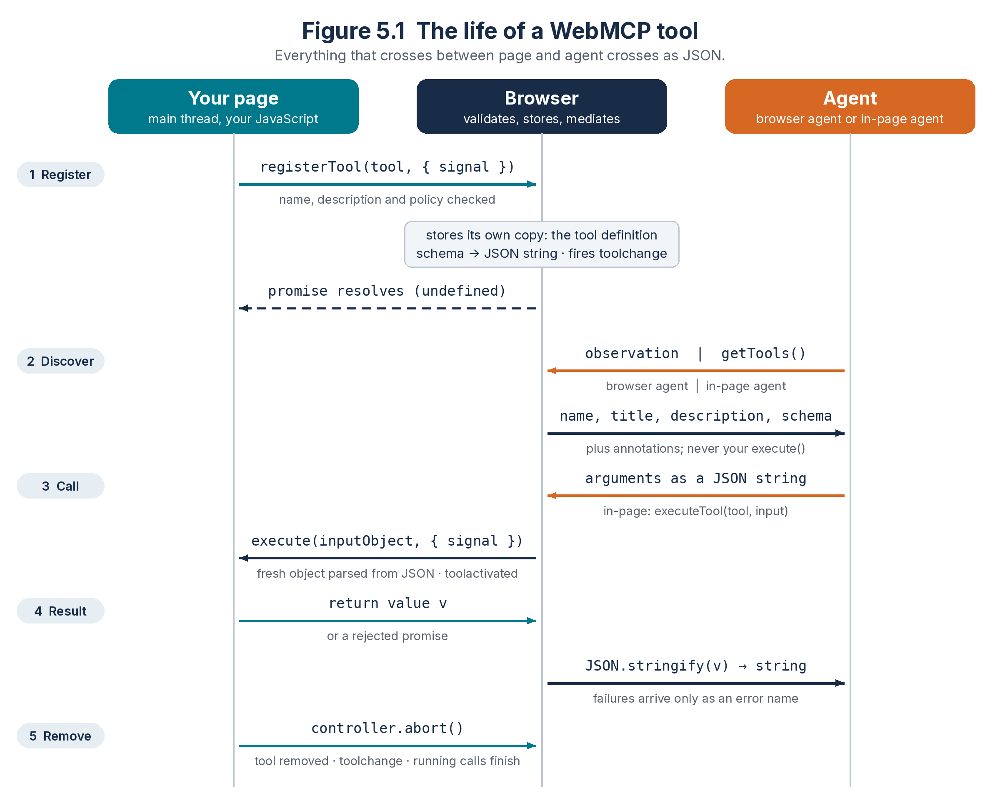
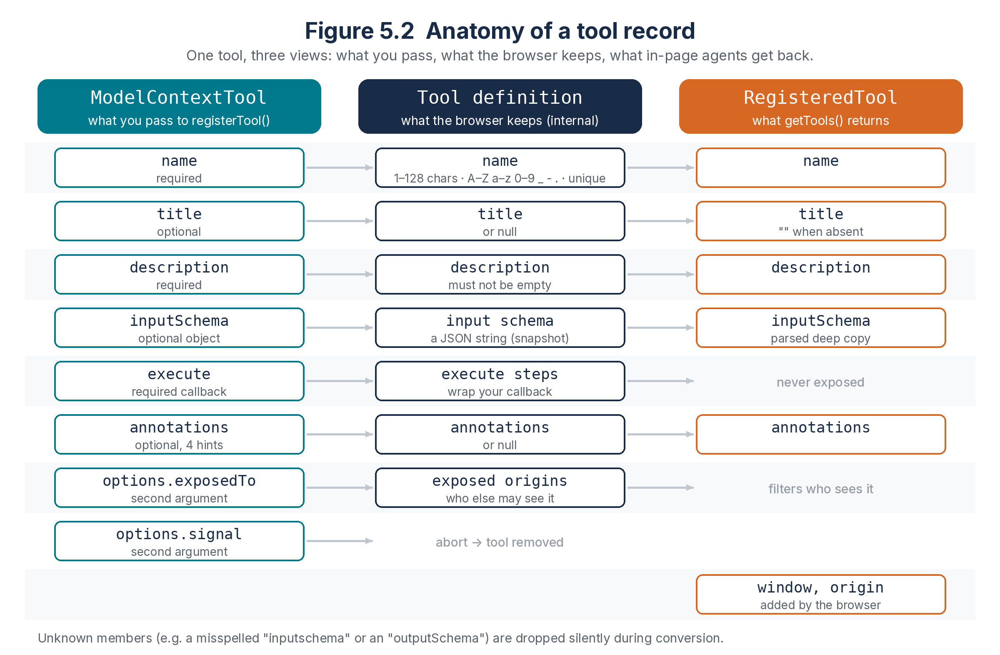

*Part II · The WebMCP API in depth*

# Chapter 5: Registering Tools with `document.modelContext`

> *“WebMCP tool declaration should be clear, without a need for developers or agents to look at outputs and retry.”*
>
> — Chrome for Developers, “WebMCP best practices”[^1]

## Back to Listing 4.1

Chapter 4 ended with about twenty-five lines of JavaScript: Fjord Table’s first tool, `search_availability`, registered on `document.modelContext` and wrapped around the same function the site’s date picker already calls. It was meant to give you a feel for the API, so the chapter moved past most of the details quickly. This chapter goes back over it slowly.

Here is the listing again, unchanged except for numbered markers. Each marker matches a section of this chapter.

**Listing 5.1 — Listing 4.1 again, annotated (agent-tools.js, loaded as a module)**

```js
// Progressive enhancement: do nothing where WebMCP isn't available.
if ('modelContext' in document) {                                   // ①
  const agentTools = new AbortController();                         // ⑥

  await document.modelContext.registerTool({                        // ② ⑤
    name: 'search_availability',                                    // ③
    title: 'Search available tables',                               // ③
    description:
      'Find open tables at Fjord Table for a date, time and party size. ' +
      'Returns up to five nearby time slots. Does not make a booking.',
    inputSchema: {                                                  // ④
      type: 'object',
      properties: {
        date:      { type: 'string', description: 'Visit date, YYYY-MM-DD' },
        time:      { type: 'string', description: 'Preferred time, 24h HH:MM' },
        partySize: { type: 'integer', minimum: 1, maximum: 12 }
      },
      required: ['date', 'partySize']
    },
    annotations: { readOnlyHint: true },                            // → Chapter 6
    async execute({ date, time, partySize }, { signal }) {          // ⑤
      // The same function the date picker calls when a human searches.
      const slots = await availability.search({ date, time, partySize, signal });
      bookingPanel.showSlots(slots);   // the user sees what the agent found
      return { date, partySize, slots: slots.map((s) => s.time) };  // ⑤
    }
  }, { signal: agentTools.signal });                                // ⑥

  // Later, e.g. when the user leaves the booking view:
  // agentTools.abort();   // unregisters the tool                  // ⑥
}
```

The markers are ① feature detection and secure contexts, ② the shape of `registerTool()` and the dictionary it takes, ③ names, titles and descriptions, ④ the input schema, ⑤ the `execute` callback and what happens to its return value, and ⑥ unregistration with an `AbortSignal`. Along the way Fjord Table gets its second tool, `book_table`, which is the one that actually changes something. The annotation line and the `signal` inside `execute` get a brief mention here and a full treatment in Chapter 6.

Everything below was checked against the WebMCP Draft Community Group Report dated 15 October 2026, the newest draft when this chapter was reviewed on 15 October 2026. Where the chapter says what Chrome does, that was observed in Chromium 156 with the `WebMCPTesting` feature switched on. Chrome’s developer documentation and the open issues in the `webmachinelearning/webmcp` repository were checked on the same day. Where Chrome and the draft disagree, the text says so.



*Figure 5.1 — From registration to result. The page registers a tool; the browser stores a copy of its definition and announces the change; an agent discovers it (a browser agent through an internal observation, an in-page agent through `getTools()`); a call arrives as a JSON string, is parsed into a fresh object for your callback, and your return value goes back as a JSON string.*

Figure 5.1 is a map of the whole chapter. Notice where the boundaries are. Your page never hands the agent a live JavaScript object, and the agent never hands your page one either. Your schema is turned into a string at registration time, the agent’s arguments arrive as a string that the browser parses for you, and your result leaves as a string. Most of the rules in this chapter follow from that.

## Where the API lives

### One `ModelContext` per document

The specification adds a single attribute to `Document`:

**Listing 5.2 — The registration surface, from the specification’s IDL (15 October 2026)**

```webidl
partial interface Document {
  [SecureContext, SameObject] readonly attribute ModelContext modelContext;
};

[Exposed=Window, SecureContext]
interface ModelContext : EventTarget {
  Promise<undefined> registerTool(ModelContextTool tool,
                                  optional ModelContextRegisterToolOptions options = {});
  // getTools(), executeTool() and three event handlers omitted (Chapter 7, Chapter 6)
};

dictionary ModelContextTool {
  required DOMString name;
  USVString title;
  required DOMString description;
  object inputSchema;
  required ToolExecuteCallback execute;
  ToolAnnotations annotations;
};

dictionary ToolExecuteCallbackOptions {
  required AbortSignal signal;
};

callback ToolExecuteCallback = Promise<any> (object inputObject,
                                             ToolExecuteCallbackOptions options);

dictionary ModelContextRegisterToolOptions {
  sequence<USVString> exposedTo;
  AbortSignal signal;
};
```

Every `Document` gets its own `ModelContext` object when it is created, and the getter always returns that same object.[^2] Inside it the browser keeps what the spec calls a *model context*: a *tool map* whose keys are tool names and whose values are *tool definitions*.[^3] When the document goes away, its tool map goes with it. Chapter 4 called tools *ephemeral and tab-bound*. This is what that means at the API level: a tool belongs to one document, and a navigation to a new page starts with an empty map. You never have to clean up tools on `pagehide`.

`ModelContext` is also an `EventTarget`. It fires `toolchange` when the set of tools changes, `toolactivated` when a call begins and `toolcancel` when one is cancelled.[^2] We’ll use the first in Chapter 6 and the others when we look at the lifecycle of a call.

### Why `document`, and why there is no `provideContext()`

You will still find tutorials that start with `navigator.modelContext.provideContext({ tools: [...] })`. That code reflects two decisions that were later reversed, and the reasons for both explain the shape of the current API.

The first was `provideContext()`. It replaced the whole set of tools in one call, and its partner `clearContext()` removed them all. In February 2026 issue #101 pointed out a problem for sites that run third-party scripts: `registerTool()` refused a duplicate name, but `provideContext()` cleared existing tools first, so any script on the page could wipe out the site’s “official” tool and register a look-alike that proxied every call, seeing whatever the user and agent exchanged.[^4] The editors concluded that the methods should go. Pull request #132 removed both on 5 March 2026, and the editors said that new kinds of context, if they come, should arrive as new APIs.[^4] The same discussion set a principle that still shapes the API: you shouldn’t be able to unregister a tool you didn’t register, just as you can’t remove an event listener you didn’t add.[^5] We come back to that principle below when we look at unregistration.

The second decision was `navigator`. Issue #173 noted that a `Window` (and therefore its `Navigator`) can outlive the document it started with: when a frame navigates away from its initial `about:blank` document, the new document reuses the same `Window`. With tools attached to `navigator`, tools registered on the blank document would leak into the next one. Chromium had already moved its internal storage to the document. The spec followed in pull request #177, merged 19 May 2026, and pull request #184 then moved the getter itself to `Document` on 27 May.[^6]

**Table 5.1 — Old shapes you may meet in older code, and their current equivalents**

| You may see | Status | Current draft |
|---|---|---|
| `navigator.modelContext` | Moved, May 2026 | `document.modelContext` |
| `provideContext({ tools })` | Removed, March 2026 | One `registerTool()` call per tool |
| `clearContext()` | Removed, March 2026 | Abort the signal(s) you registered with |
| `unregisterTool(name)` | Replaced by the signal (2026) | `registerTool(tool, { signal })`, then `abort()` |
| `executeTool(tool, '{"a":1}')` (string input) | Deprecated in Chrome 155 | `executeTool(tool, { a: 1 })` |

Sources: the pull requests cited above; Chrome’s Imperative API guide for the string-input deprecation.[^7]

## ① Feature detection and secure contexts

The first line of Listing 5.1 does more work than it looks.

```js
if ('modelContext' in document) { … }
```

Both the `modelContext` attribute and the `ModelContext` interface carry the Web IDL `[SecureContext]` extended attribute.[^2] In a context that isn’t secure, the attribute isn’t exposed at all, so the `in` test returns `false`, exactly as it does in a browser with no WebMCP support.[^8] A secure context, roughly speaking, is a document delivered over HTTPS (or from `http://localhost` and other origins the Secure Contexts specification treats as potentially trustworthy) whose ancestors are secure too.[^9] So one test covers three cases:

- the browser has no WebMCP implementation;
- the browser has one, but it isn’t switched on for this page (in Chrome, neither the origin-trial token nor the local `chrome://flags/#enable-webmcp-testing` flag is active);[^10]
- the page isn’t a secure context, which in practice usually means a staging server on plain `http://`.

The third case is the one that catches people out, because the symptom is identical to the first two. When the tools don’t appear, check `window.isSecureContext` before you start suspecting the trial token.

### Presence isn’t permission

Passing the feature test does not guarantee that registration will succeed. The `registerTool()` algorithm checks two more things before it looks at your tool.[^11]

- *The document must be fully active.* A document that has been detached, or is sitting in the back/forward cache, gets a promise rejected with `InvalidStateError`.
- *The document must be allowed to use the `tools` feature.* Access is gated by a Permissions Policy feature named `"tools"` whose default allowlist is `'self'`.[^12] Top-level pages and same-origin frames are allowed by default. A cross-origin iframe is not, unless its embedder delegates with `allow="tools"`.[^10] Without that delegation the frame still sees `document.modelContext`, but `registerTool()` rejects with `NotAllowedError`. Chapter 7 covers frames properly.

The practical rule is: detect first, then *await and catch*. Listing 5.3 wraps that rule in a small helper that the rest of the chapter uses.

**Listing 5.3 — A defensive registration helper (agent-tools.js)**

```js
// agent-tools.js, loaded with <script type="module">
export const webmcpAvailable = 'modelContext' in document;

if (!webmcpAvailable && !window.isSecureContext) {
  console.info('WebMCP needs a secure context (HTTPS or localhost).');
}

// Registers one tool. Resolves to true if it was registered, false otherwise.
export async function registerAgentTool(tool, options = {}) {
  if (!webmcpAvailable) return false;
  try {
    await document.modelContext.registerTool(tool, options);
    return true;
  } catch (err) {
    // The view closed (signal aborted) before registration finished: not an error.
    if (options.signal?.aborted) return false;
    // NotAllowedError   – the "tools" permissions policy blocks this frame
    // InvalidStateError – duplicate or malformed name, empty description,
    //                     or a document that is no longer fully active
    // TypeError         – a required member is missing, or the schema
    //                     can't be serialized to JSON
    // SecurityError     – an exposedTo entry isn't a secure origin (Chapter 7)
    console.warn(`WebMCP: "${tool.name}" was not registered`, err.name, err.message);
    return false;
  }
}
```

Two small notes on the listing. It is a module, so it can use top-level `await`. In a classic script, put the registration inside an `async` function. And it treats WebMCP as optional. If registration fails, Fjord Table loses its agent tools, not its booking flow. That is the progressive-enhancement stance Chapter 4 recommended, written as code.

## ② The shape of `registerTool()`

`registerTool()` takes two arguments, and the split between them is deliberate. The first, a `ModelContextTool` dictionary, *is* the tool: what agents will read and what runs when they call it. The second, `ModelContextRegisterToolOptions`, is about the *registration*: who can see it (`exposedTo`, Chapter 7) and how long it lasts (`signal`, below).[^13]

**Table 5.2 — The members of `ModelContextTool`**

| Member | IDL type | Required | What the browser does with it |
|---|---|---|---|
| `name` | `DOMString` | Yes | Validates it (1–128 characters from `A–Z a–z 0–9 _ - .`), rejects duplicates, uses it as the key in the tool map |
| `title` | `USVString` | No | Stores it for display in browser UI; exposed to in-page agents as `""` when absent |
| `description` | `DOMString` | Yes | Rejects the empty string; otherwise passes it to agents unchanged |
| `inputSchema` | `object` | No | Serializes it to a JSON string at registration time |
| `execute` | `ToolExecuteCallback` | Yes | Calls it with a parsed input object and `{ signal }` |
| `annotations` | `ToolAnnotations` | No | Copies four boolean hints (Chapter 6) |

Sources: the specification’s ModelContextTool dictionary, tool definition concept and registerTool() steps.[^13][^3][^11]

Because `ModelContextTool` is a Web IDL dictionary, two general rules of Web IDL apply before any WebMCP-specific check runs.[^8] First, a missing required member, or an `execute` that isn’t callable, fails argument conversion with a `TypeError`. Because `registerTool()` returns a promise, that error arrives as a rejected promise, not a synchronous throw. Second, members the dictionary doesn’t define are ignored without complaint. If you write `inputschema` (lower-case “s”) or add an `outputSchema` because a blog post mentioned one, the browser drops it. Your tool registers without a schema, and nothing tells you. A typed setup (see the TypeScript section later in this chapter) catches this at compile time.



*Figure 5.2 — Three views of one tool. The `ModelContextTool` dictionary you pass in; the internal tool definition the browser keeps (with the schema already stringified and the exposed origins attached); and the `RegisteredTool` dictionary an in-page agent receives, which adds the owning `window` and `origin` but never includes your `execute` function.*

Figure 5.2 shows what happens to the dictionary after you hand it over. The browser doesn’t keep your object. It builds a new *tool definition* from it: the name, the title, the description, the schema *as a string*, a reference to your callback wrapped in the browser’s own execution steps, the annotations and the list of exposed origins.[^3] That copy is what agents see. Changing your original object afterwards (editing the description, pushing a new property into the schema) has no effect on the registered tool.

## ③ Names, titles and descriptions

### The name

The name is the only member the browser checks closely. The rule in the registration algorithm is exact: the name must be between 1 and 128 characters long, and every character must be an ASCII letter or digit, an underscore, a hyphen or a full stop. Anything else, including an empty string, rejects the promise with `InvalidStateError`. So does a name already present in this document’s tool map.[^11]

**Table 5.3 — Tool names under the current rules**

| Name | Result | Why |
|---|---|---|
| `search_availability` | Accepted | Letters and underscore |
| `fjordtable.book-table` | Accepted | Full stops and hyphens are allowed |
| `getTablesV2` | Accepted | Case is preserved; mixed case is fine |
| `book table` | `InvalidStateError` | Space |
| `bestill_bord_på_nett` | `InvalidStateError` | `å` is not ASCII |
| `""` | `InvalidStateError` | Empty |
| a second `search_availability` in the same document | `InvalidStateError` | Duplicate name |

The character set isn’t arbitrary. MCP’s current tools specification recommends the same set and the same 1–128 length, but only as SHOULD-level advice.[^14] WebMCP enforces it. If your site also runs a backend MCP server (Chapter 3), you can give a tool the same name in both places.

Uniqueness is per document, not per tab. Issue #234 records a developer finding that a top-level page and a same-origin iframe can each register `search`, and an in-page agent’s `getTools()` then returns two tools with the same name and origin, distinguished only by their `window`.[^15] Chapter 7 deals with that. For a single page, the duplicate check also has a security purpose: it is what stops a later script from silently replacing a tool you registered first, which was the problem `provideContext()` had (see “Why `document`” above). The 15 October 2026 draft makes the check twice: once on entry, and again after the schema has been serialized, because a `toJSON()` method inside the schema can run script that registers another tool under the same name in between (pull request #347).[^44] That is an edge case, but not a harmless one: in Chromium 156 the same sequence crashed the page’s renderer.[^41][^45]

The rules say what the browser will accept. Chrome’s guidance covers what agents handle well. Name tools with verbs that say exactly what happens, and separate doing something from starting something: `create-event` should create the event, while `start-event-creation-process` should only open the form.[^1] Chrome’s security guide also suggests keeping tool and parameter names to about 30 characters (Table 5.4).[^16] Fjord Table uses `snake_case` verbs: `search_availability` searches, `book_table` books.

### The title

`title` is optional. It is meant for people, not models: the spec says the browser uses it “to reference the tool in the user interface,” and recommends localizing it into the user’s language.[^13] Think of a confirmation prompt that says “Fjord Table wants to *Book a table*”, as opposed to showing `book_table`. If you leave it out, the browser can display something else instead. In-page agents calling `getTools()` will see an empty string.[^17] Issue #224 asks whether that should change to `undefined`, which would match MCP clients, where an absent title is simply missing.[^18] Its IDL type is `USVString`, a string type that can’t contain unpaired surrogates, because it may be shown in native browser UI.[^2]

### The description

`description` is required, and the only check on it is that it can’t be empty.[^11] This is the text a model reads when deciding whether to call your tool, which makes it the most important prose in your integration. Chrome’s best-practices guide gives three rules: say what the tool does and when to use it; prefer positive statements of capability over prohibitions (“This tool can create a calendar event…” rather than “Don’t use this tool for weather”); and explain your choices where the reason helps the agent.[^1]

Listing 5.1’s description follows a pattern worth copying. It names the action (“Find open tables…”), the inputs in plain words (“for a date, time and party size”), the output (“Returns up to five nearby time slots”), and one boundary stated as a fact (“Does not make a booking”). That final sentence matters because Fjord Table now has a second tool that *does* make bookings, and the agent needs to know which is which.

Descriptions are also an attack surface. Section 6 of the spec lists “tool poisoning”, meaning instructions hidden in names, descriptions and parameter descriptions, as a prompt-injection risk. It notes that so far the spec limits only the name, to 128 characters, and that limits for titles and other inputs are still being studied (issue #73).[^19][^20] In the meantime, Chrome publishes recommended budgets.

**Table 5.4 — Chrome’s recommended character budgets (guidance, not enforced)**

| Field | Recommended maximum |
|---|---|
| Tool description | 500 characters |
| Parameter description | 150 characters |
| Tool name and parameter name | 30 characters |
| A single tool output | 1,500 characters |

Source: Chrome for Developers, “WebMCP tool security”, which notes that the figures may change and that limits may later be added to the specification.[^16]

## ④ The input schema

### What the browser does with it

`inputSchema` is an optional `object` that the spec describes as “a JSON Schema object describing the expected input parameters for the tool.”[^13] What the registration algorithm actually does with it is narrower than that description suggests. If you provide a schema, the browser serializes it to a JSON string, using the same operation as `JSON.stringify()`, and stores the string.[^11][^21] If serialization throws (a circular reference, say) the promise rejects with that exception. If it produces nothing (an object whose `toJSON()` returns `undefined`) the promise rejects with a `TypeError`.[^11]

That is all the checking there is. The draft doesn’t check that the object is valid JSON Schema, and it doesn’t check calls against it. When an agent calls your tool, the browser parses the arguments, confirms that they form a JavaScript object, and passes them to `execute`. A malformed argument string or a non-object fails with the platform error `DataError`, but an object that violates your schema reaches your code unchanged.[^22] Missing required fields, a `partySize` of 40, and a date written as “next Friday” will all get through.

Two more consequences follow from the stringification. The schema is a snapshot, so changing it later requires re-registration (see ⑥). And only JSON survives: a `RegExp` in a `pattern` keyword, a function, or a `Map` won’t come through the way you wrote it. Write schemas as plain JSON literals.

> **Still in flux: is the schema optional, and who validates?**
>
> *Required or optional.* The draft makes `inputSchema` optional.[^13] Chrome’s Imperative API guide says that tool registration “requires a name, description, and input schema.”[^7] Chromium 156 doesn’t enforce that: it registers a tool with no `inputSchema`, and `getTools()` then lists the tool with no `inputSchema` member at all.[^41] Other agents may not be so forgiving, so include a schema in every tool, even if it is only `{ type: 'object', properties: {} }`. The question is open in the working group too: on 13 October 2026 a participant argued in issue #92 that both `inputSchema` and a future `outputSchema` should be required, and on 14 October François Beaufort, a co-author of Chrome’s WebMCP documentation, replied that they should stay optional, with spec-defined defaults.[^23]
>
> *Validation.* The same issue, “Who owns the validation layer?”, led to a working group resolution on 5 March 2026 that the browser should be responsible for schema validation and that the spec should codify a subset of JSON Schema. A pull request implementing that (#289) was closed unmerged on 1 October.[^23] As of this draft, validating input is your job, and Chromium 156 confirms it: called with `{ partySize: 'forty', extra: true }` against a schema that requires an integer, or with `{}` against a schema with a `required` list, it passed the arguments to `execute` exactly as given.[^41]
>
> *Dialect.* The draft cites JSON Schema without naming a draft or a subset. MCP’s tools specification assumes the 2020-12 dialect when `$schema` is absent.[^14] Until WebMCP decides, stick to the core keywords every validator agrees on: `type`, `properties`, `required`, `enum`, `description`, `minimum` and `maximum`, `items`. This is my recommendation, not a rule from the spec.

### Writing schemas agents can fill

Since the schema is advice to the model, not a contract the browser enforces, write it as advice. Chrome’s guidance and the explainer agree on a few rules.[^1][^24]

- *Accept raw user input.* If the user says “eleven to three,” the tool should accept times as strings and leave the conversion to your code. Don’t ask the model to calculate.
- *Prefer self-explanatory enums.* `seating: "window"` beats `seatingId: 3`, and `shipping: "Express"` beats `shipping_id: 1`.
- *Describe every parameter.* Each property gets a `description`, and the format goes in it: “Visit date, YYYY-MM-DD.”
- *Validate strictly in code, loosely in schema.* Schema constraints help the model but aren’t guaranteed, and the explainer warns that strict schema failures “can cause agents to stall.” Put the real checks in `execute` and return messages the agent can act on.

Chapter 11 goes further into tool design. These rules are enough for Fjord Table.

There is one more rule, which comes from the spec’s privacy section: *ask only for what the tool needs*. Section 6.3.3 describes “over-parameterization”: a dress-search tool that adds optional parameters for age, pregnancy, skin tone and location, each with a plausible description. A helpful agent with access to the user’s personal context fills them in, and the site quietly builds a profile.[^25] Agents may start treating long lists of personal parameters with suspicion, and they should. For Fjord Table, the rule is concrete: the user is signed in, so the site already knows their name, phone number and email. `book_table` shouldn’t ask the agent for any of them.

### Fjord Table’s second tool: `book_table`

Listing 5.4 applies these rules to the tool that makes the booking. It is longer than Listing 5.1 because it is a tool that changes something.

**Listing 5.4 — `book_table`, with a careful schema and validation in code (booking-tools.js)**

```js
import { registerAgentTool } from './agent-tools.js';

export const bookTable = {
  name: 'book_table',
  title: 'Book a table',
  description:
    'Book a table at Fjord Table for a slot returned by search_availability. ' +
    'Opens the filled-in booking form for the user to confirm. ' +
    'Returns the booking status and, if booked, a reference.',
  inputSchema: {
    type: 'object',
    properties: {
      date:      { type: 'string', description: 'Visit date, YYYY-MM-DD' },
      time:      { type: 'string', description: 'Slot time from search_availability, 24h HH:MM' },
      partySize: { type: 'integer', minimum: 1, maximum: 12,
                   description: 'Number of guests, including children' },
      seating:   { type: 'string', enum: ['window', 'indoor', 'terrace', 'no preference'],
                   description: 'Seating preference; use "no preference" if the user has none' },
      notes:     { type: 'string',
                   description: 'Allergies or occasion, in the user’s own words' }
    },
    required: ['date', 'time', 'partySize']
  },
  annotations: { consequentialHint: true },          // a real-world action: Chapter 6
  async execute(input, { signal }) {
    const problem = checkBookingInput(input);         // validate strictly in code
    if (problem) return { status: 'error', code: 'INVALID_INPUT', message: problem };

    const slot = await availability.find(input, { signal });
    if (!slot) {
      return {
        status: 'refused', code: 'SLOT_UNAVAILABLE',    // the guest picks another time
        message: `No table for ${input.partySize} at ${input.time} on ${input.date}. ` +
                 'Call search_availability for current slots.'
      };
    }

    // Fjord Table's own UI: the booking form, pre-filled, on screen.
    // The guest's name and contact details come from their signed-in account.
    const outcome = await bookingPanel.confirmWithUser({ ...input, slot }, { signal });
    if (!outcome.confirmed) return { status: 'cancelled_by_user', message: 'The guest closed the booking form without confirming. Nothing was booked.' };

    return { status: 'booked', reference: outcome.reference,
             date: input.date, time: slot.time, partySize: input.partySize };
  }
};

function checkBookingInput({ date, time, partySize }) {
  if (!/^\d{4}-\d{2}-\d{2}$/.test(date ?? ''))
    return 'Invalid date. Use YYYY-MM-DD, for example 2026-11-20.';
  if (!/^\d{2}:\d{2}$/.test(time ?? ''))
    return 'Invalid time. Use 24-hour HH:MM, for example 19:00.';
  if (!Number.isInteger(partySize) || partySize < 1 || partySize > 12)
    return 'partySize must be a whole number from 1 to 12. ' +
           'For larger groups, ask the user to call the restaurant.';
  return null;
}
```

Look at what the schema leaves out. There is no name, phone or email, for the privacy reasons just described, and no `additionalProperties: false`, in line with “loosely in schema.” The `time` description tells the agent where valid values come from (“from search_availability”), which links the two tools without a scripted sequence. Chrome’s guide calls that “trust the agent”.[^1]

Look also at what `execute` does when something goes wrong. It doesn’t throw. It returns a result with a `status`, a `code` and a sentence telling the agent what to do next, using the result vocabulary Chapter 11 sets out in full. The reason is in the next section.

Finally, note the confirmation step. `bookingPanel.confirmWithUser()` isn’t a WebMCP API. It is Fjord Table’s ordinary booking form, filled in and shown to the user, who presses Confirm the same way they would without an agent. The draft has no standard API for asking the user something in the middle of a call. Chapter 4 described the `requestUserInteraction()` debate, and Part IV returns to it. Until that is settled, the site’s own UI is the most dependable way to keep the user in the loop for a consequential tool.

## ⑤ The `execute` callback and its return value

### What your callback receives

The callback type in Listing 5.2 is short: `Promise<any> (object inputObject, ToolExecuteCallbackOptions options)`. The algorithm that calls it explains what each part means.[^22]

1. The browser receives the agent’s arguments as a JSON string and parses it. If parsing fails, or the result isn’t an object, the call fails with the platform error *invalid input* and your callback never runs.
2. It fires `toolactivated` at your `ModelContext`, with the tool’s name. (Chromium 156 fires it just after `execute` has started; Chapter 6 shows the order.)
3. It creates a fresh `AbortController` for this one call.
4. It calls `execute(inputObject, { signal })`.

So `inputObject` is always a *new* plain object built from JSON. It is never the caller’s object, and it can only contain JSON types: strings, numbers, booleans, `null`, arrays and objects. A date arrives as whatever string the agent wrote. When an in-page agent calls `executeTool()` without arguments, the tool receives an empty object, not `undefined`. That rule was added by pull request #324 in September 2026.[^26][^27] Destructuring in the parameter list, as both Fjord Table tools do, is therefore safe.

The `signal` in the second argument belongs to this call. It aborts if the call is cancelled, for example when the user stops the agent or the in-page caller aborts its own signal. Passing it on to `fetch()` and other cancellable work, as Listing 5.1 does, costs nothing and saves wasted work.[^7] Chapter 6 covers cancellation in full.

The callback type returns a `Promise`, but you don’t have to write an `async` function. Under Web IDL’s rules for promise-returning callbacks, a plain return value is wrapped in a resolved promise, and a synchronous `throw` becomes a rejection.[^8] Your callback runs on the page’s main thread, in your document’s realm, with full access to your application state and DOM. That is why `bookingPanel.showSlots()` in Listing 5.1 just works: the agent’s call and the user’s view of it happen in the same place.

### What happens to your return value

When your promise fulfils with a value `v`, the browser serializes `v` with the Infra standard’s *serialize a JavaScript value to a JSON string* operation, which is a call to `JSON.stringify()` that throws if the result is `undefined`.[^22][^21] That string is the result. An in-page agent receives it as the resolved value of `executeTool()`, which is why the IDL declares `Promise<DOMString>`.[^26] A browser agent receives it through whatever channel the browser uses. The spec deliberately doesn’t prescribe the format its model sees: browsers may expose tools “via Model Context Protocol, other proprietary ‘function calling’ methods, or any other way.”[^28]

Because the serializer is `JSON.stringify()`, its edge cases are WebMCP’s edge cases.

**Table 5.5 — What different return values become, per the 15 October 2026 draft and in Chromium 156**

| Your callback returns | The caller receives (draft) | What Chromium 156 returned |
|---|---|---|
| `{ status: 'booked', reference: 'FT-1042' }` | The string `{"status":"booked","reference":"FT-1042"}` | The same |
| `'Booked for 19:00'` | A JSON string literal: `"Booked for 19:00"` (with the quotes) | `Booked for 19:00` (no quotes) |
| `42`, `true`, `null` | `42`, `true`, `null` | The same |
| An object containing a `Date` | The date as an ISO string (via `Date.prototype.toJSON`) | The same |
| An object containing a `Map`, `Set` or class instance | Only own enumerable properties, so a `Map` becomes `{}` | The same |
| `NaN` or `Infinity` | `null` | `NaN` |
| `undefined` (including a callback with no `return`) | Failure: *unserializable result*, surfaced as `OperationError` | The string `undefined`, as a success |
| A value containing a `BigInt` or a circular reference | Failure: *unserializable result*, surfaced as `OperationError` | Rejected with `UnknownError` |
| A rejected promise or a thrown error | Failure: *tool rejected*, surfaced as `OperationError` | Rejected with `UnknownError` |

Sources: the specification’s “invoke the execute callback” steps and tool execution error table; the Infra standard; the Chromium column was observed in Chromium 156.0.8078.4 with `--enable-features=WebMCPTesting` on 15 October 2026.[^22][^3][^21][^41]

Sources: the specification’s “invoke the execute callback” steps and tool execution error table; the Infra standard.[^22][^3][^21]

Two rows deserve emphasis.

*A callback that returns nothing fails.* Under the draft, a tool that does its job and falls off the end of the function produces an error for the caller, not an empty success, because `JSON.stringify(undefined)` is `undefined`. Always return something, even if it is only `{ status: 'ok' }`. Chromium 156 doesn’t follow the draft here: it resolves the call with the four-character string `undefined`, which an agent will read as a strange success.[^41] Returning a value avoids the question in both.

*Throwing tells the agent almost nothing.* When your callback rejects, the caller gets a `DOMException` named `OperationError` (in Chromium 156, `UnknownError`; see the box below), and that is all. The spec passes only the name of the failure across, “rather than any internal JavaScript exception object or message,” so that implementation details and stack traces don’t leak across origins.[^26] Your carefully worded error message never reaches the agent, and an agent that can’t see why a call failed can’t fix it. That is why Listing 5.4 *returns* its failures. Chrome’s tool-design guide gives the same advice: a response to a bad call “should act as a guide rather than a dead end”, with messages such as “Invalid date format. Provide the date in YYYY-MM-DD format.”[^29] Keep `throw` for real bugs. Anything the agent can recover from should be a return value.

The platform-defined failures, which you don’t control, form a short list in the spec: *tool not found* (`NotFoundError`), *invalid input* (`DataError`), *tool rejected* and *unserializable result* (both `OperationError`), and *target document unloaded* (`AbortError`). The draft has used these specific names only since 8 October 2026, when pull request #339 replaced a single `UnknownError` with them.[^42] Everything else is up to you to report in the result itself.[^3] Chapter 6 covers how agents and in-page callers handle these errors.

### Strings, objects or MCP content?

What *shape* should a result have? The draft doesn’t say. Chrome’s Imperative API examples return plain strings (“Booked 2 passenger(s) on flight …”).[^7] The explainer’s main example returns an MCP-style `{ content: [{ type: 'text', text: '…' }] }` object.[^30] Fjord Table returns small JSON objects. All three are valid under the draft, because all three serialize. The differences show up downstream: how a given browser agent presents your string to its model, and how much your in-page agent has to parse.

My advice for now: return a small, flat object with a `status` field and short, readable values. It reads well to a model when stringified, it is easy for an in-page agent to parse (Listing 4.2 already does `JSON.parse(json).slots`), and it fits Chrome’s 1,500-character output budget without a truncation scheme of your own.

> **Still in flux: results**
>
> *Output schemas.* MCP tools can declare an `outputSchema` and return `structuredContent`.[^14] WebMCP has neither. Issue #9 has asked for one since August 2025, and pull request #254 (opened 21 August 2026, still open on 15 October) would add `outputSchema` to both `ModelContextTool` and `RegisteredTool`.[^31] Until it lands, a dictionary member named `outputSchema` is silently ignored (see ②). Chromium 156 behaves exactly that way: a tool registered with an `outputSchema` registers without complaint, and the `RegisteredTool` an in-page agent gets back has no trace of it.[^41] A developer’s September 2026 issue described having to invent a size budget and a `RESULT_TOO_LARGE` error for 18 tools because results are untyped.[^32]
>
> *No continuation tokens.* A tool call is one document and one promise, so a tool can’t hand the agent a second page of results or finish its work after a navigation. On 2 October 2026 the editors merged an explainer for *tool continuations*, which proposes a `ModelContextToolInvocation` object passed to `execute` through its options.[^43] It is a proposal only: the draft’s `ToolExecuteCallbackOptions` still has just `signal`, and in Chromium 156 the options object `execute` receives has only `signal` too.[^13][^41] For now, keep each result small and let the agent ask again with narrower input, the way `search_availability` takes one date and returns at most five slots.
>
> *Errors are spec lag.* Since 8 October 2026 the draft names each platform failure (`NotFoundError`, `DataError`, `OperationError`, `AbortError`); before that it used `UnknownError` for all of them.[^42] Chromium 156 still follows the old text: a thrown error, an unserializable result and a call to an unregistered tool all reject with `UnknownError`, while a call the caller aborts rejects with `AbortError`.[^41] That is the browser lagging the spec, not a bug in your page. Code that catches these should check for both names until Chrome catches up, or better, not depend on the name at all.
>
> *Null after navigation.* The draft types `executeTool()` as `Promise<DOMString>` and reports a call interrupted by its document unloading as `AbortError`.[^26][^3] Chrome’s guide says that `executeTool()` returns “the result of the tool execution, or null when a navigation is triggered,” and the discussion on pull request #336 confirmed that Blink’s IDL is `Promise<DOMString?>`, because the declarative API returns `null` on cross-document navigation.[^7][^33] The editors closed that pull request on 7 October, saying the spec can revisit it when the declarative API is specified again. If you write an in-page agent, handle `null`.
>
> *Plain strings.* Chrome’s guide shows `executeTool()` resolving to `'Added to-do: Buy milk'` for a tool that returned that string.[^7] By the draft’s algorithm, the caller should receive the JSON-encoded string, with quotes. Chromium 156 does what the guide shows: it returns the string as is, without quotes, so `JSON.parse()` on it throws. It also turns `undefined` and `NaN` into the strings `undefined` and `NaN` (Table 5.5).[^41] Objects avoid the ambiguity.

### The registration promise

`registerTool()` itself returns `Promise<undefined>`. If the checks pass, the browser adds the definition to the tool map immediately and returns. Then, in parallel, it notifies documents that can see the tool by firing `toolchange` at them, and queues a task to resolve your promise.[^11][^34] So once your `await` returns, the tool is registered. The spec’s own example notes that the `toolchange` events in the page and its frames fire before the promise resolves, but that ordering relative to other tasks, such as a `setTimeout`, isn’t guaranteed.[^34]

**Table 5.6 — Why `registerTool()` rejects**

| Rejection | Cause |
|---|---|
| `TypeError` | A required member (`name`, `description`, `execute`) is missing, or `execute` isn’t callable (Web IDL conversion); or the schema serializes to nothing |
| The serializer’s own exception | The schema can’t be serialized, e.g. it contains a circular reference |
| `InvalidStateError` | The document isn’t fully active; the name is a duplicate; the name is empty, too long or has a disallowed character; the description is empty |
| `NotAllowedError` | The document isn’t allowed to use the `tools` permissions policy feature |
| `SecurityError` | An `exposedTo` entry doesn’t parse or isn’t a potentially trustworthy origin (Chapter 7) |
| The signal’s abort reason | `options.signal` was already aborted, or was aborted before the promise settled |

Sources: the specification’s registerTool() steps; Web IDL.[^11][^8]

Resolving to `undefined` was a deliberate choice, and it is being questioned. Issue #234 asks for `registerTool()` to resolve to the registered tool so that it can be passed straight to `executeTool()`. The editors replied that `getTools()` and the `toolchange` event already cover the use cases offered so far, and the issue remains open.[^15]

## ⑥ Unregistering with `AbortSignal`

### The pattern

There is no `unregisterTool()`. To make a tool removable, pass an `AbortSignal` in the options. To remove it, abort the controller.

```js
const agentTools = new AbortController();
await document.modelContext.registerTool(tool, { signal: agentTools.signal });
// …
agentTools.abort();   // the tool is gone
```

When the signal aborts, the browser runs its abort steps. It removes the tool from the map, then notifies documents with `toolchange` as it does for registration, and rejects the registration promise with the signal’s reason (which has no effect if the promise already resolved).[^11][^35] Pull request #147 introduced the signal on 26 March 2026, and pull request #202 added the rejection on 17 June.[^5][^36]

The design follows from the principle in issue #130: only the code that registered a tool should be able to unregister it. An `unregisterTool(name)` method would let any script on the page remove any tool whose name it could guess. The platform already had a model for this: `addEventListener()` accepts a `signal` that removes the listener when aborted, and the editors pointed to that precedent.[^5] Whoever holds the controller holds the right to remove the tool.

Three behaviours are worth knowing before you build on this.

- *One controller can remove many tools.* Register several tools with the same signal and a single `abort()` removes them all. That suits a view that owns a group of tools.
- *An aborted signal doesn’t register.* If the signal is already aborted when you call `registerTool()`, nothing is registered and the promise rejects with the abort reason. If you abort before the promise settles, the tool is removed and the promise rejects. Listing 5.3 treats both cases as normal.[^11]
- *Unregistering doesn’t cancel calls already running.* The spec is explicit: unregistration “does not cancel an execution that has already invoked its `ToolExecuteCallback`,” even when the callback unregisters its own tool. The registration signal controls whether the tool is *available*, and the per-call signal controls one *call*.[^35] Chrome’s guide says the same: since Chrome 153, unregistering a tool no longer cancels in-flight executions.[^7] If Ingrid closes the booking view while `book_table` is waiting for her to confirm, the call carries on until the view’s own code ends it.

### Registering by page state

Chrome’s guidance is to register tools “when they’re useful in a certain page state, then unregister when the tool is no longer usable,” while keeping static registration as the default for simple apps.[^1] Fjord Table has both kinds. `search_availability` makes sense anywhere on the site, so Listing 5.1 registers it once at startup. `book_table` only makes sense when the booking view is open. Listing 5.5 ties it to that view.

**Listing 5.5 — Registering `book_table` only while the booking view is open (booking-view.js)**

```js
import { registerAgentTool } from './agent-tools.js';
import { bookTable } from './booking-tools.js';

let bookingTools = null;   // AbortController for tools owned by this view

export async function onBookingViewOpened() {
  bookingTools = new AbortController();
  await registerAgentTool(bookTable, { signal: bookingTools.signal });
}

export function onBookingViewClosed() {
  bookingTools?.abort();   // removes book_table; a call already running carries on
  bookingTools = null;
}

// Agents read a tool's name, description and schema when they observe it.
// To change any of them (here: a localized title and description),
// unregister and register again; each step fires a toolchange event.
export async function relabelBookingTools(locale) {
  if (!bookingTools) return;
  onBookingViewClosed();
  bookingTools = new AbortController();
  await registerAgentTool(localizeTool(bookTable, locale), { signal: bookingTools.signal });
}
```

The last function covers the remaining lifecycle question: how to *update* a tool. The draft has no `updateTool()`. The explainer’s guidance is that a tool’s implementation can change freely (your `execute` can call a function you replace later), but the parts the model reads, its name, description and schema, are “loaded into the model’s context statically,” so changing them means unregistering and registering again.[^24] Both steps fire `toolchange`, which tells agents to refresh. The spec warns about one race in this pattern: if a call arrives just as you re-register under the same name with a different schema, arguments written for the old schema can reach the new tool.[^22] Validation in code (Listing 5.4) handles that case too.

A proposal for dynamic tool definitions, with lazily resolved schemas and an `updateTool()` method that toggles a `disabled` flag (issue #167), was closed on 29 September 2026, the same day the explainer gained the re-registration guidance quoted above. A proposal for grouping tools with progressive disclosure is still open (issue #255).[^24][^37]

> **Still in flux: small names that may still change**
>
> A few details of the registration surface are still being argued in open issues. *What `registerTool()` resolves to*: `undefined` today; issue #234 asks for the registered tool.[^15] *What an absent title looks like to in-page agents*: `""` today; issue #224 suggests `undefined`.[^18] *The callback’s name*: issue #158, open since April 2026, proposes renaming `execute` to `run`, citing Google’s and Microsoft’s style guides.[^38] None of these has a pull request merged into the draft. If one lands, the change to your code should be mechanical, which is one more argument for keeping registration inside a single helper like Listing 5.3.

## Types for the Imperative API

Chrome’s guide recommends the `webmcp-types` npm package for TypeScript users.[^7] It is published from the `webmachinelearning` GitHub organization, version 0.1.10 at the time of writing, needs TypeScript 5.0 or newer, and extends the standard DOM typings with `document.modelContext` and the dictionaries in Listing 5.2.[^39] It does two useful things. It types `document.modelContext` as *optional* (“May be undefined if the browser doesn’t support WebMCP”), which forces the feature check from ① into your code. And it overloads `registerTool()` so that the type of `execute`’s input is *inferred from your schema*.

**Listing 5.6 — `search_availability` in TypeScript with webmcp-types (agent-tools.ts)**

```ts
/// <reference types="webmcp-types" />

const searchSchema = {
  type: 'object',
  properties: {
    date:      { type: 'string', description: 'Visit date, YYYY-MM-DD' },
    time:      { type: 'string', description: 'Preferred time, 24h HH:MM' },
    partySize: { type: 'integer', minimum: 1, maximum: 12 },
  },
  required: ['date', 'partySize'],
} as const;   // keep literal types so the input can be inferred

await document.modelContext?.registerTool({
  name: 'search_availability',
  title: 'Search available tables',
  description:
    'Find open tables at Fjord Table for a date, time and party size. ' +
    'Returns up to five nearby time slots. Does not make a booking.',
  inputSchema: searchSchema,
  annotations: { readOnlyHint: true },
  async execute({ date, time, partySize }, { signal }) {
    // Inferred: date: string, partySize: number, time: string | undefined
    const slots = await availability.search({ date, time, partySize, signal });
    bookingPanel.showSlots(slots);
    return { date, partySize, slots: slots.map((s) => s.time) };
  },
});
```

The inference depends on the schema keeping its literal types: write it inline, or mark a separate constant `as const`, as here. A property listed in `required` becomes a required field and the rest become optional, so the compiler makes you handle a missing `time`. (I checked this listing with TypeScript 5 and webmcp-types 0.1.10, using stub declarations for Fjord Table’s own objects.) The types also catch the silent-drop problem from ②: a misspelled member such as `inputschema` is a compile error in an object literal. But the types describe *your* side of the boundary only. At run time the agent can still send anything, so `checkBookingInput()` stays.

## Seeing your tools

Before you hand your tools to an agent, look at them yourself. Chrome DevTools has a WebMCP pane in the Application panel. It lists the tools registered on the current tab with their names and descriptions as agents see them, logs every call with its input, output and status, and lets you run a tool by hand with parameters you enter.[^40] Running `book_table` with `partySize: 40` and confirming that you get back a helpful `{ status: 'error', code: 'INVALID_INPUT' }` result, not a rejected call, takes a minute and tests what this chapter has been about. Chapter 14 covers testing and evals properly.

## Fjord Table so far

**Table 5.7 — Fjord Table’s tools at the end of Chapter 5**

| Tool | Registered | Inputs | Returns | Annotation |
|---|---|---|---|---|
| `search_availability` | At startup, for the life of the page | `date`, `partySize` (required), `time` | `{ date, partySize, slots }` | `readOnlyHint` |
| `book_table` | While the booking view is open | `date`, `time`, `partySize` (required), `seating`, `notes` | `{ status: 'booked', reference, … }`, or `{ status, code, message }` for a recoverable failure (Chapter 11’s vocabulary) | `consequentialHint` |

Both tools wrap code Fjord Table already had, both put their results on screen, and neither asks the agent for anything the site already knows. Both return values for anything the agent can fix and keep exceptions for bugs. Both are registered through one helper that treats WebMCP as optional.

## Chapter summary

- `document.modelContext` is one `ModelContext` per document, exposed only in secure contexts. Its tools belong to the document and disappear with it. It moved from `navigator` in May 2026 because a `Window` can outlive its first document, and `provideContext()` and `clearContext()` were removed in March 2026 because they let any script replace a site’s tools.
- `'modelContext' in document` detects support, trial or flag status and secure context in one test. It doesn’t guarantee permission: registration can still reject with `NotAllowedError` (Permissions Policy `tools`, default `'self'`) or `InvalidStateError` (a document that isn’t fully active). Detect, then await and catch.
- `registerTool(tool, options)` takes a `ModelContextTool` (`name`, `description` and `execute` required; `title`, `inputSchema` and `annotations` optional) and options (`signal`, `exposedTo`). It resolves to `undefined` once the tool is registered. Unknown dictionary members are silently ignored.
- Names must be 1–128 characters of ASCII letters, digits, `_`, `-` and `.`, unique within the document. These are MCP’s recommended rules, enforced. Descriptions can’t be empty and are the most important text you write. Chrome suggests keeping descriptions under 500 characters and outputs under 1,500.
- The schema is stringified at registration and isn’t validated, and neither are calls against it. Validate strictly in code, keep schemas simple and descriptive, and ask only for what the tool needs.
- `execute(input, { signal })` receives a fresh object parsed from JSON. Its return value is serialized with `JSON.stringify()`: under the draft, `undefined`, `BigInt` and circular values fail, and thrown errors reach the caller only as `OperationError` (Chromium 156 still says `UnknownError`, which is spec lag, and returns `undefined` as the string `undefined`). Chromium 156 also drops an `outputSchema` member silently. Return recoverable failures as values the agent can act on.
- Unregister by aborting the `AbortSignal` passed at registration. One controller can remove many tools; unregistering doesn’t cancel a call that is already running; and changing what the model reads means unregistering and registering again.
- Still open: whether `inputSchema` becomes required and who validates it, `outputSchema`, continuation tokens (an explainer, not yet in the draft or in Chrome), `null` results and the old `UnknownError` in Chrome, and small naming questions (`registerTool()`’s return value, empty titles, `execute` versus `run`).

Chapter 6 picks up where this one stops: the four annotation hints Fjord Table has been setting without explanation, the step-by-step lifecycle of a call with its `toolactivated` and `toolcancel` events, cancellation through the per-call signal, and how the platform errors in Table 5.5 reach the caller.

## Notes

[^1]: Chrome for Developers, “WebMCP best practices” (published 18 May 2026). <https://developer.chrome.com/docs/ai/webmcp/best-practices>
[^2]: WebMCP specification, Draft Community Group Report, 15 October 2026 (fetched 15 October 2026), §4.1 Extensions to Document, §4.2 ModelContext interface, §4.3 Events and the IDL index. <https://webmachinelearning.github.io/webmcp/#dom-document-modelcontext>
[^3]: WebMCP specification, §3 Supporting concepts (model context, tool map, tool definition, tool execution error table). <https://webmachinelearning.github.io/webmcp/#supporting-concepts>
[^4]: webmachinelearning/webmcp issue #101, “`navigator.modelContext.provideContext` allows overwriting of previously registered tools in the same environment” (opened 20 February 2026), including the editor’s comment of 3 March 2026; and pull request #132, “Remove `provideContext()` and `clearContext()`” (merged 5 March 2026). <https://github.com/webmachinelearning/webmcp/issues/101>
[^5]: webmachinelearning/webmcp issue #130, “Tool unregistration design” (opened 5 March 2026, closed 26 March 2026), and pull request #147, “Spec `registerTool()` takes an optional `AbortSignal`” (merged 26 March 2026). <https://github.com/webmachinelearning/webmcp/issues/130>
[^6]: webmachinelearning/webmcp issue #173, “Make tools Document-scoped instead of Window-scoped” (opened 28 April 2026); pull requests #177, “Scope `ModelContext` to `Document`” (merged 19 May 2026), and #184, “Move the `modelContext` getter to `Document`” (merged 27 May 2026). <https://github.com/webmachinelearning/webmcp/issues/173>
[^7]: Chrome for Developers, “Imperative API” (published 18 May 2026, updated 21 September 2026). <https://developer.chrome.com/docs/ai/webmcp/imperative-api>
[^8]: Web IDL Standard (WHATWG): the `[SecureContext]` extended attribute, dictionary conversion (unknown members ignored, missing required members throw `TypeError`), and exception handling for operations and callbacks that return promises. <https://webidl.spec.whatwg.org/>
[^9]: W3C, “Secure Contexts” (Candidate Recommendation Draft), on secure contexts and potentially trustworthy origins. <https://w3c.github.io/webappsec-secure-contexts/>
[^10]: Chrome for Developers, “WebMCP” (published 18 May 2026, updated 7 October 2026), sections “Get started”, “Local WebMCP” and “Permissions policy”. <https://developer.chrome.com/docs/ai/webmcp>
[^11]: WebMCP specification, §4.2, the `registerTool(tool, options)` method steps. <https://webmachinelearning.github.io/webmcp/#dom-modelcontext-registertool>
[^12]: WebMCP specification, §4.4 Permissions policy integration (policy-controlled feature “tools”, default allowlist `'self'`). <https://webmachinelearning.github.io/webmcp/#permissions-policy>
[^13]: WebMCP specification, §4.2.1 ModelContextTool dictionary (including ToolAnnotations) and §4.2.3 ModelContextRegisterToolOptions dictionary. <https://webmachinelearning.github.io/webmcp/#dictdef-modelcontexttool>
[^14]: Model Context Protocol specification, version 2026-07-28, “Tools” (tool names, `inputSchema` dialect, `outputSchema` and structured content). <https://modelcontextprotocol.io/specification/2026-07-28/server/tools>
[^15]: webmachinelearning/webmcp issue #234, “registerTool should return registered tool instead of undefined” (opened 29 July 2026; comments of 10 and 14 August and 3 October 2026). <https://github.com/webmachinelearning/webmcp/issues/234>
[^16]: Chrome for Developers, “WebMCP tool security” (published 9 June 2026, updated 1 September 2026), section “Set character budgets”. <https://developer.chrome.com/docs/ai/webmcp/secure-tools>
[^17]: WebMCP specification, §4.2.6 RegisteredTool dictionary, and the getTools() steps that fill it. <https://webmachinelearning.github.io/webmcp/#dictdef-registeredtool>
[^18]: webmachinelearning/webmcp issue #224, “Tool `title` and `inputSchema`: what to expose when not provided?” (opened 21 July 2026). <https://github.com/webmachinelearning/webmcp/issues/224>
[^19]: WebMCP specification, §6.3.1.1 Metadata / Description Attacks (Tool Poisoning) and §6.4.2 Restricting maximum input lengths. <https://webmachinelearning.github.io/webmcp/#mitigation-restrict-input-lengths>
[^20]: webmachinelearning/webmcp issue #73, “Consider restricting maximum input lengths” (opened 30 January 2026). <https://github.com/webmachinelearning/webmcp/issues/73>
[^21]: WHATWG Infra Standard, “serialize a JavaScript value to a JSON string” (calls `JSON.stringify()` and throws a `TypeError` if the result is `undefined`). <https://infra.spec.whatwg.org/#serialize-a-javascript-value-to-a-json-string>
[^22]: WebMCP specification, §3, “tool execute steps” and “invoke the execute callback” (including the note on unregistration and re-registration races). <https://webmachinelearning.github.io/webmcp/#invoke-the-execute-callback>
[^23]: webmachinelearning/webmcp issue #92, “Who owns the validation layer?” (opened 17 February 2026), including the working group resolution recorded on 5 March 2026 and comments of 13 and 14 October 2026; pull request #289, “Input validation” (closed without merging, 1 October 2026). <https://github.com/webmachinelearning/webmcp/issues/92>
[^24]: WebMCP explainer (README), “Best Practices”, including “Keeping agent-facing parts of a tool definition updated” and “Reliability and Error Handling”. <https://github.com/webmachinelearning/webmcp#best-practices>
[^25]: WebMCP specification, §6.3.3 Privacy Leakage Through Over-Parameterization. <https://webmachinelearning.github.io/webmcp/#privacy-leakage-over-parameterization>
[^26]: WebMCP specification, §4.2, the `executeTool(tool, inputObject, options)` method steps and the accompanying note on cross-origin error reporting. <https://webmachinelearning.github.io/webmcp/#dom-modelcontext-executetool>
[^27]: webmachinelearning/webmcp pull request #324, “Treat an omitted `executeTool()` input as an empty object” (merged 29 September 2026). <https://github.com/webmachinelearning/webmcp/pull/324>
[^28]: WebMCP specification, §5 Interaction with agents, §5.2 Page observations. <https://webmachinelearning.github.io/webmcp/#interaction-with-agents>
[^29]: Chrome for Developers, “Build your user’s agentic workflows with WebMCP tools” (published 26 August 2026), section “Fail gracefully and enable recovery”. <https://developer.chrome.com/docs/ai/webmcp/build-tools>
[^30]: WebMCP explainer (README), “Imperative Tool Registration: `document.modelContext`”. <https://github.com/webmachinelearning/webmcp>
[^31]: webmachinelearning/webmcp issue #9, “Introduce `outputSchema`” (opened 12 August 2025), and pull request #254, “Add `outputSchema` to `ModelContextTool` and `RegisteredTool`” (opened 21 August 2026; still open on 15 October 2026). <https://github.com/webmachinelearning/webmcp/pull/254>
[^32]: webmachinelearning/webmcp issue #292, “Tool results are untyped, so every page invents its own truncation contract” (opened and closed 4 September 2026). <https://github.com/webmachinelearning/webmcp/issues/292>
[^33]: webmachinelearning/webmcp pull request #336, “Allow executeTool() to return null.” (closed without merging, 7 October 2026), including comments by Chrome and spec editors on Blink’s `Promise<DOMString?>`. <https://github.com/webmachinelearning/webmcp/pull/336>
[^34]: WebMCP specification, §3, “notify documents of a tool change”, including the note and example on task ordering. <https://webmachinelearning.github.io/webmcp/#notify-documents-of-a-tool-change>
[^35]: WebMCP specification, §3, “unregister a tool”, including the note on in-flight executions. <https://webmachinelearning.github.io/webmcp/#model-context-unregister-a-tool>
[^36]: webmachinelearning/webmcp pull request #202, “Reject registerTool() promise when signal is aborted” (merged 17 June 2026). <https://github.com/webmachinelearning/webmcp/pull/202>
[^37]: webmachinelearning/webmcp issue #167, “Proposal: Dynamic Tool Definitions in WebMCP” (closed 29 September 2026), and issue #255, “Tool collections: coarse-grained grouping with progressive disclosure” (opened 22 August 2026, open). <https://github.com/webmachinelearning/webmcp/issues/255>
[^38]: webmachinelearning/webmcp issue #158, “Rename `execute` to `run`” (opened 1 April 2026). <https://github.com/webmachinelearning/webmcp/issues/158>
[^39]: webmcp-types on npm (version 0.1.10, published 28 September 2026; source at github.com/webmachinelearning/webmcp-types). <https://www.npmjs.com/package/webmcp-types>
[^40]: Chrome for Developers, “WebMCP” pane in Chrome DevTools (Application panel). <https://developer.chrome.com/docs/devtools/application/webmcp>
[^41]: Observed by the author in Chromium 156.0.8078.4 (Playwright 1.64.1, headless) with `--enable-features=WebMCPTesting`, on a localhost page, 15 October 2026. The probe script, `fjord-table/tests/chromium-probe.mjs`, is in the book’s demos repository; run it with `npm run probe:chrome`. <https://github.com/vibeprogrammer/webmcp-book-demos/blob/main/fjord-table/tests/chromium-probe.mjs>
[^42]: webmachinelearning/webmcp pull request #339, “Replace UnknownError with specific DOMException types.” (merged 8 October 2026 as commit b206dae). <https://github.com/webmachinelearning/webmcp/pull/339>
[^43]: webmachinelearning/webmcp, “Continuation Tokens” explainer by Mark Foltz (pull request #327, merged 2 October 2026). <https://github.com/webmachinelearning/webmcp/blob/main/continuations-explainer.md>
[^44]: webmachinelearning/webmcp pull request #347, “Handle re-registration during input serialization” (merged 15 October 2026 as commit 3279798). <https://github.com/webmachinelearning/webmcp/pull/347>
[^45]: Chromium issue 573722078, “WebMCP: Renderer killed when `registerTool()`'s `inputSchema` serialization registers a tool with the same name” (filed 14 October 2026). Chromium marked it Fixed, but the fix (crrev.com/c/8583183) was reverted (crrev.com/c/8575491) and hadn’t relanded as of 15 October 2026. <https://issues.chromium.org/issues/573722078>
