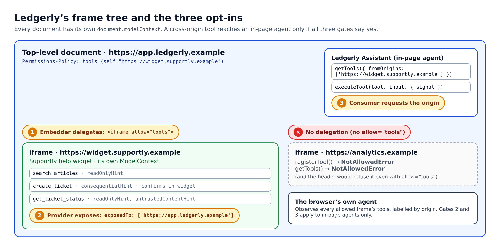
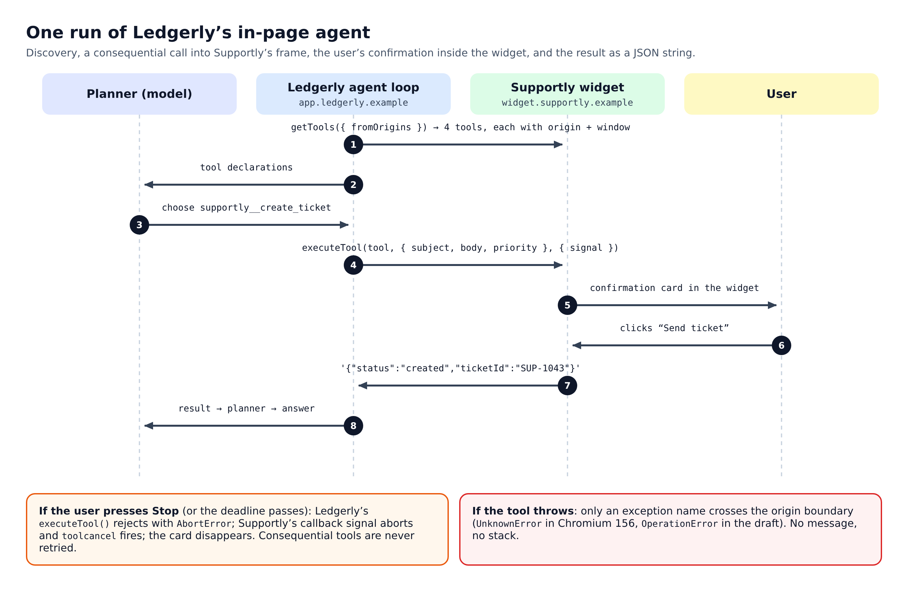

*Part II · The WebMCP API in depth*

# Chapter 7: Frames, Origins and Page-Embedded Agents

> *“I wonder if it would be better to reposition this idea as a general way to call functions in other environments.”*
>
> — Jake Archibald, webmachinelearning/webmcp issue #236[^1]

## A page is more than one document

Chapters 4 to 6 treated a WebMCP site as a single page: Fjord Table registers its tools on `document.modelContext`, and an agent in the browser finds and calls them. That is the common case, but plenty of real pages aren't one document. A SaaS dashboard embeds a payments form from its processor, a chat bubble from a support vendor, a map, a video player and two analytics frames. Every `<iframe>` holds a document of its own, often from a different origin, and every document has its own `ModelContext`.[^2]

This chapter is about what happens to tools in that tree of documents. It answers three questions:

- **Who may register tools?** The `tools` Permissions Policy decides which frames get to use the API at all.
- **Who may see and call them?** `exposedTo` on the provider’s side and `fromOrigins` on the consumer’s side decide whether tools cross an origin boundary.
- **Who is the agent?** Besides the browser’s own agent, the specification has room for agents written in JavaScript that live in the page (`getTools()` and `executeTool()`) and, in practice, for agents that live in browser extensions.

The running example is the book’s third project, the **Helpdesk Widget**. Supportly, a fictional support-software vendor, serves an embeddable help widget from `https://widget.supportly.example`. Ledgerly, a fictional invoicing dashboard at `https://app.ledgerly.example`, embeds it. The widget registers three tools: `search_articles` and `get_ticket_status`, which only read, and `create_ticket`, which opens a ticket with Supportly’s staff. Ledgerly has an assistant of its own, a small in-page agent that should be able to use Supportly’s tools as well as Ledgerly’s. Nobody else on the page should be able to.

Everything below was checked against the WebMCP Draft Community Group Report dated 14 October 2026, Chrome’s developer documentation and the open issues and pull requests in the `webmachinelearning/webmcp` repository, all read on 14 October 2026.[^3] Every behaviour marked “tested” was observed in Chromium 156.0.8078.4 with the `WebMCPTesting` feature switched on (the switch behind `chrome://flags/#enable-webmcp-testing`[^4]), with Ledgerly and Supportly served from two different local origins. The tests are in the book’s demos repository, in `chapters/07-frames-origins-agents/`, and all 29 of them pass. Where Chromium and the draft disagree, the text says so.



*Figure 7.1 — The Helpdesk Widget’s frame tree. Ledgerly (top-level) delegates the `tools` feature to Supportly’s iframe (gate 1). Supportly registers its tools with `exposedTo: ['https://app.ledgerly.example']` (gate 2). Ledgerly’s agent asks for them with `getTools({ fromOrigins: ['https://widget.supportly.example'] })` (gate 3). The analytics frame has no delegation, so it can’t use WebMCP at all.*

Figure 7.1 shows the shape of the whole chapter. A cross-origin tool reaches an agent only if three different parties have each said yes: the embedder, the tool provider and the tool consumer. If any of them says nothing, the answer is no.

## Two kinds of agent, two ways to see tools

Before the gates, it helps to be precise about who is looking.

The specification describes a **browser agent**: the assistant built into the browser, which “does not run JavaScript on the page.” It gets a view of the page by performing an *observation*, an implementation-defined snapshot that includes, at minimum, a tool map. The observation algorithm walks every document in the tab’s frame tree and records, for each document, an *observed tool collection* holding that document’s origin and its tools. A note in the draft adds that user agents “are expected to include the origin field to avoid confusion that could be exploited by an attacker.”[^5] In other words, the browser agent sees the tools of every frame, labelled by origin. The `exposedTo` and `fromOrigins` options described below don’t apply to it, because it isn’t a document; only the Permissions Policy decides which frames can register tools in the first place.

The second kind is an **in-page agent**: an agent written in JavaScript that runs inside a document, “and possibly living in iframes,” in the draft’s words.[^2] It uses two methods that Chapter 5 set aside: `getTools()` to discover tools and `executeTool()` to call one. Because an in-page agent is just script in some origin, it is subject to the same-origin policy like any other script, and that is what the two-sided opt-in is for.

A third kind, the extension agent, sits between the two. It runs JavaScript, but with the privileges of a browser extension. It gets its own section later in this chapter.

## Gate 1: the `tools` Permissions Policy

### The default is `'self'`

Access to the whole API is gated behind a policy-controlled feature called `"tools"`, “which has a default allowlist of `'self'`.”[^6] Every method checks it first. `registerTool()`, `getTools()` and `executeTool()` each begin by asking whether the calling document “is allowed to use the `tools` feature” and, if not, return a promise rejected with a `NotAllowedError` `DOMException`.[^7] `getTools()` also skips any document in the tree that isn’t allowed to use the feature, and the tool-change notification skips them too.[^8]

With the default allowlist, that means:

- the top-level document can use WebMCP;
- same-origin iframes can use it, with no markup needed;
- cross-origin iframes can’t, unless the embedder delegates the feature to them.

Chrome’s Imperative API guide puts it the same way: “Tool registration is disabled by default in cross-origin iframes. A page must delegate access using the `tools` Permissions Policy.”[^9]

### Delegating to one frame with `allow="tools"`

Ledgerly delegates the feature to Supportly’s frame with the iframe’s `allow` attribute. Listing 7.1 is Ledgerly’s whole page.

**Listing 7.1 — Ledgerly embeds Supportly’s widget and delegates `tools` to it (ledgerly/index.html)**

```html
<!doctype html>
<html lang="en">
<head>
  <meta charset="utf-8">
  <title>Ledgerly · Invoices</title>
  <link rel="stylesheet" href="ledgerly.css">
</head>
<body>
  <header><strong>Ledgerly</strong> · Invoices</header>
  <main id="dashboard">…</main>

  <aside id="assistant" aria-label="Ledgerly Assistant">
    <form id="ask"><input name="goal" placeholder="Ask the assistant"><button>Ask</button></form>
    <ol id="transcript"></ol>
  </aside>

  <!-- Supportly's help widget, from a third-party origin. -->
  <iframe id="supportly"
          title="Supportly help"
          src="https://widget.supportly.example/embed.html?customer=ledgerly"
          allow="tools"></iframe>

  <script type="module" src="agent/assistant.js"></script>
</body>
</html>
```

In an `allow` attribute, a feature name with no allowlist uses the default value `src`: the feature is allowed in this iframe “as long as the document loaded into it comes from the same origin as the URL in its `src` attribute.”[^10] So `allow="tools"` here means “Supportly’s documents in this frame may use WebMCP.” If the widget navigates somewhere else, the delegation doesn’t follow it.

### Setting the policy for the whole page

The `allow` attribute delegates, but it doesn’t restrict. Any other iframe on the page with `allow="tools"` would get the same power, and a marketing team’s tag manager can add iframes. The `Permissions-Policy` response header sets the ceiling for the document and everything inside it. Listing 7.2 is the header Ledgerly sends with its HTML.

**Listing 7.2 — Ledgerly’s response header (ledgerly/permissions-policy.txt)**

```http
Permissions-Policy: tools=(self "https://widget.supportly.example")
```

The header’s allowlist uses quoted origins, `self` and `*`; an empty list, `()`, disables the feature in the top-level document and in every nested frame.[^10] With Listing 7.2 in place, only Ledgerly itself and Supportly’s origin can ever be granted `tools`, whatever iframes appear later. The iframe still needs its own `allow="tools"`: the header says who *may* be granted the feature, and the attribute grants it to a particular frame.

For pages that shouldn’t expose tools at all, the specification lists the empty allowlist as a mitigation in its own right. A `Permissions-Policy: tools=()` header makes the feature “unavailable to the document and its descendants,” it applies “to every descendant frame, including both same-origin and cross-origin ones,” and the user agent “enforces this before script runs on the page, protecting against malicious scripts or dependencies from using WebMCP APIs.”[^11] Ledgerly’s settings pages, where nobody needs an agent, are good candidates.

Table 7.1 shows what Supportly’s widget experienced under each configuration in the tests.

**Table 7.1 — Can Supportly’s cross-origin iframe register tools? (tested, Chromium 156)**

| Ledgerly’s header | `allow` on the iframe | Result inside the widget |
|---|---|---|
| none | none | `registerTool()` rejects with `NotAllowedError` |
| none | `allow="tools"` | Registers |
| `tools=(self "https://widget.supportly.example")` (Listing 7.2) | `allow="tools"` | Registers |
| `tools=(self)` | `allow="tools"` | `NotAllowedError`: the header wins over the attribute |
| `tools=()` | `allow="tools"` | `NotAllowedError` in the widget, and Ledgerly’s own `getTools()` rejects with `NotAllowedError` too |

The error message Chromium gives is: `Access to the feature "tools" is disallowed by permissions policy.` A same-origin iframe with no `allow` attribute registered its tools without complaint, as the `'self'` default predicts.

### Feature detection doesn’t see the policy

One result in those tests deserves its own paragraph. In every blocked case, `'modelContext' in document` was still `true` inside the widget. The `modelContext` attribute exists on every `Document` in a secure context where the browser supports WebMCP;[^2] the policy is checked when you call a method, not when you look for the attribute. Chapter 5 recommended detecting the API, then awaiting registration and catching errors. In an embeddable widget that advice is no longer optional. A widget is embedded by customers you don’t control, and some of them will forget `allow="tools"`. Listing 7.3 returns `'blocked'` in that case instead of throwing, so the widget can still work as an ordinary help widget for humans.

> **Still in flux: one switch or two?**
>
> Today one feature, `tools`, covers both providing tools and consuming them. On 23 September 2026 issue #317 described a host that composes several cross-origin apps and one agent in iframes, and wants the apps to provide tools but not use each other’s. It asked whether the policy should be split into two independently delegatable features, “conceptually” `allow="tools-provide"` and `allow="tools-consume"`.[^12] The issue was open on 14 October 2026. If it lands, Listing 7.1’s single `allow="tools"` may need to become something more specific.

## Gates 2 and 3: `exposedTo` and `fromOrigins`

Getting past the Permissions Policy only means the widget can register tools. By default nobody outside Supportly’s origin can see them. Chrome’s security guide says it directly: “By default, other websites or cross-origin iframes can’t observe or interact with your tools.”[^13] Crossing that line takes one opt-in from each side.

### The provider’s side: `exposedTo`

`registerTool()` takes a second argument, the `ModelContextRegisterToolOptions` dictionary. Chapter 5 used its `signal` member. The other member is `exposedTo`, “an array of origins that control which documents this tool is exposed to, in the current document’s tree.”[^14] Listing 7.3 is the widget’s registration code.

**Listing 7.3 — Supportly registers three tools for the embedding page’s agent (supportly/widget-tools.js)**

```js
// Supportly help widget: tools for the embedding page's agent.
// Runs inside https://widget.supportly.example/embed.html.
import { helpdesk } from './helpdesk-api.js';
import { confirmTicket } from './widget-ui.js';

// Which origins each customer has registered with Supportly.
const CUSTOMER_ORIGINS = {
  ledgerly: ['https://app.ledgerly.example'],
};

export async function registerWidgetTools(signal) {
  if (!('modelContext' in document)) return 'unsupported';

  const customer = new URLSearchParams(location.search).get('customer');
  const exposedTo = CUSTOMER_ORIGINS[customer] ?? [];   // ①
  const mc = document.modelContext;

  try {
    await mc.registerTool({
      name: 'search_articles',
      title: 'Search help articles',
      description:
        'Search the Supportly help centre for articles that answer a ' +
        'question about the product. Returns titles, links and a short excerpt.',
      inputSchema: {
        type: 'object',
        properties: { query: { type: 'string', maxLength: 200 } },
        required: ['query'],
      },
      annotations: { readOnlyHint: true },
      async execute({ query }) {
        if (typeof query !== 'string' || !query.trim()) {
          return { error: 'query must be a non-empty string' };
        }
        return { articles: await helpdesk.search(query.slice(0, 200)) };
      },
    }, { signal, exposedTo });                                   // ②

    await mc.registerTool({
      name: 'create_ticket',
      title: 'Open a support ticket',
      description:
        'Open a support ticket with the Supportly team on the user\'s behalf. ' +
        'The user reviews and sends it in the help widget. Returns the ticket ID.',
      inputSchema: {
        type: 'object',
        properties: {
          subject: { type: 'string', maxLength: 120 },
          body: { type: 'string', maxLength: 4000 },
          priority: { type: 'string', enum: ['low', 'normal', 'high'] },
        },
        required: ['subject', 'body', 'priority'],
      },
      annotations: { consequentialHint: true },
      async execute({ subject, body, priority }, { signal }) {
        if (!subject?.trim() || !body?.trim()) {
          return { error: 'subject and body are required' };
        }
        if (!['low', 'normal', 'high'].includes(priority)) {
          return { error: 'priority must be low, normal or high' };
        }
        const draft = { subject: subject.slice(0, 120), body: body.slice(0, 4000), priority };
        const sent = await confirmTicket(draft, signal);          // ③
        if (!sent) return { status: 'cancelled_by_user' };
        const ticket = await helpdesk.createTicket(draft);
        return { status: 'created', ticketId: ticket.id };
      },
    }, { signal, exposedTo });

    await mc.registerTool({
      name: 'get_ticket_status',
      title: 'Check a support ticket',
      description:
        'Get the status and latest reply of a Supportly ticket by its ID ' +
        '(for example SUP-1042).',
      inputSchema: {
        type: 'object',
        properties: { ticketId: { type: 'string', pattern: '^SUP-[0-9]+$' } },
        required: ['ticketId'],
      },
      annotations: { readOnlyHint: true, untrustedContentHint: true },  // ④
      async execute({ ticketId }) {
        if (!/^SUP-[0-9]+$/.test(ticketId ?? '')) {
          return { error: 'ticketId looks like SUP-1042' };
        }
        const ticket = await helpdesk.getTicket(ticketId);
        if (!ticket) return { error: `no ticket ${ticketId}` };
        return { ticketId, status: ticket.status, latestReply: ticket.latestReply };
      },
    }, { signal, exposedTo });

    return 'registered';
  } catch (err) {
    if (err.name === 'NotAllowedError') return 'blocked';         // ⑤
    throw err;
  }
}
```

The markers point at the parts that matter for this chapter.

① **Who gets the tools.** The widget doesn’t trust the page that embeds it to say who it is. It reads a customer ID from its own URL and looks up the origins that customer registered with Supportly. In a real product the table would come from Supportly’s server, keyed by the customer’s account. If someone embeds the widget with `?customer=ledgerly` on a site that isn’t Ledgerly, nothing leaks: `exposedTo` names the origin that may *consume* the tools, and the browser checks it against the caller’s actual origin. An unknown customer gets an empty list, which exposes the tools to nobody outside Supportly. The tests cover that case: the widget still registers its tools, and Ledgerly’s agent sees none of them.

② **One option per registration.** Each `registerTool()` call gets the same `signal` and the same `exposedTo`. Exposure is per tool, so a vendor could expose `search_articles` widely and keep `create_ticket` for a shorter list.

③ **The provider confirms.** `create_ticket` has consequences, so it carries `consequentialHint` (Chapter 6) and asks the user in the widget’s own UI before anything is sent. Who should ask is a real design question once two companies are involved. Here the answer is the tool’s owner: Supportly can’t know whether Ledgerly’s agent asked the user, but it can always ask in its own frame. The confirmation card is wired to the call’s `signal`, so if the agent cancels, the card disappears.

④ **Content Supportly doesn’t vouch for.** Ticket replies are typed by people, and a customer can type anything, including text written to steer an agent. `untrustedContentHint` tells the consumer that this output shouldn’t be read as instructions (Chapters 6 and 12).

⑤ **The policy failure is a value.** As discussed above, a missing `allow="tools"` surfaces as `NotAllowedError` from the first `registerTool()` call. The widget reports `'blocked'` and carries on as a widget for humans.

The draft is strict about the origins themselves. Each entry is run through the URL parser, and if parsing fails “or its origin is not potentially trustworthy,” registration rejects with a `SecurityError`.[^7] “Potentially trustworthy” means, roughly, HTTPS or a local origin such as `http://localhost`, which is why the tests can run on two local ports. In Chromium 156 both a plain-HTTP origin and a string that isn’t a URL at all were refused with `SecurityError: Only secure origins are allowed in the exposedTo list.` (tested).

### The consumer’s side: `fromOrigins`

The second opt-in belongs to the agent. `getTools()` takes a `ModelContextGetToolOptions` dictionary with one member, `fromOrigins`: “Documents whose origin appears in this list, or are same-origin with the caller, have their tools queried. An empty list only includes same-origin documents.”[^15] Its entries are validated like `exposedTo`’s, and an insecure origin rejects with `SecurityError`.

The rule fits in a sentence from the method steps. For each document in the tree, a tool is included only if the document is allowed to use `tools`, the document is same-origin with the caller *or* listed in `fromOrigins`, and the tool “is exposed to” the caller’s origin.[^8] The last check is a four-line algorithm: return true if the tool’s owner is same-origin with the caller, or if the caller’s origin is in the tool’s exposed origins; otherwise return false.[^16]

Chrome’s guide sums up the effect for developers: “Even if a tool is exposed to your origin, you must still explicitly request it from the hosting origin using the `fromOrigins` option in `getTools()`.”[^9] Table 7.2 lists the three opt-ins side by side.

**Table 7.2 — The three opt-ins for a cross-origin tool**

| Gate | Who decides | Mechanism | Default | Failure |
|---|---|---|---|---|
| 1. Delegation | The embedder (Ledgerly) | `Permissions-Policy` header and `allow="tools"` on the iframe | `'self'`: top-level and same-origin frames only | `NotAllowedError` from any method |
| 2. Exposure | The tool provider (Supportly) | `registerTool(tool, { exposedTo })` | Same-origin callers only | The tool is silently absent from the consumer’s list |
| 3. Request | The tool consumer (Ledgerly’s agent) | `getTools({ fromOrigins })` | Same-origin documents only | The document’s tools are silently absent |

Two things about the table are easy to miss. First, gates 2 and 3 fail silently. A tool you didn’t expose, or an origin you didn’t ask for, simply isn’t in the list; no error tells you why. When a cross-origin tool is missing, check all three gates in order. Second, gate 3 exists so that a page isn’t flooded with tools it never asked for. A pull request that would document all of this in the specification’s security section says the mutual consent “prevents unsolicited tool-list pollution and unauthorized cross-origin tool invocation.”[^17]

Both directions work. Exposure is about origins, not about who embeds whom. In the tests, Ledgerly registered a tool with `exposedTo: [Supportly’s origin]`, and the widget, asking with `fromOrigins: [Ledgerly’s origin]`, found and called it. A vendor widget could use that to ask the host for context (“which invoice is the user looking at?”) without a custom `postMessage` protocol. A tool Ledgerly registered without `exposedTo` stayed invisible to the widget.

`exposedTo` also drives events. When a tool is registered, the browser notifies every document in the tree that is allowed to use `tools` and to which the tool is exposed, by firing `toolchange` at its `ModelContext`.[^18] In the tests, Ledgerly’s `toolchange` listener fired when the widget registered its exposed tools. The event carries no details, so a listener has to call `getTools()` again to find out what changed. Listing 7.5 does exactly that.

> **Still in flux: the security section is still a TODO**
>
> In the 14 October 2026 draft, §6.3.4, “Violation of Same-Origin Boundaries,” reads in full: “TODO: Document risks and implications of agents carrying state from one origin to another,” followed by a note that the section “should probably talk about the WebMCP permissions policy and other cross-origin opt in mechanisms.”[^19] Pull request #326, opened on 28 September 2026, would fill it in with the two-sided opt-in model described here and with the residual risk that an agent itself may carry state from one origin to another. A reviewer has asked for the section to be retitled “Cross-origin tool exposure.”[^17] The pull request was still open on 14 October. The mechanism is in the normative algorithms already; the rationale and the threat discussion are what is pending.

## `getTools()` and `executeTool()`: building an in-page agent

With the gates open, Ledgerly can build its assistant. The two methods are small. Listing 7.4 shows their shape from the specification’s IDL.

**Listing 7.4 — Discovery and execution, from the specification’s IDL (14 October 2026, abridged)**

```webidl
partial interface ModelContext {
  Promise<sequence<RegisteredTool>> getTools(optional ModelContextGetToolOptions options = {});
  Promise<DOMString> executeTool(RegisteredTool tool,
                                 optional object inputObject,
                                 optional ModelContextExecuteToolOptions options = {});
};

dictionary ModelContextGetToolOptions { sequence<USVString> fromOrigins; };
dictionary ModelContextExecuteToolOptions { AbortSignal signal; };

dictionary RegisteredTool {
  required DOMString name;
  DOMString title;
  required DOMString description;
  object inputSchema;
  required Window window;
  required USVString origin;
  ToolAnnotations annotations;
};
```

(The real IDL declares both methods on `ModelContext` itself; `partial` here just leaves out what Chapter 5 already covered.)[^20]

### What `getTools()` returns

`getTools()` resolves to a list of `RegisteredTool` dictionaries.[^21] Most members repeat what the tool’s owner registered: `name`, `title`, `description`, a deep copy of `inputSchema`, and the four annotation hints. Two members are new:

- `window` is the `Window` of the document that registered the tool. In the tests it was strictly equal to the iframe’s `contentWindow`.
- `origin` is the serialized origin of that document. The draft explains that it matters for cross-origin tools, because the consumer “cannot otherwise get the tool’s origin from its window.”[^21]

The list covers every document in the caller’s *top-level* frame tree: the method walks the inclusive descendants of the tab’s top-level document, not just the caller’s own descendants.[^8] That is why the widget, a child frame, could find Ledgerly’s tools above it. Documents in other tabs, popups and openers aren’t included; issue #227, open since 21 July 2026, argues that discovery should cover the whole browsing context group.[^22] The list is sorted by tool name across all frames, which the tests confirmed: Ledgerly’s `find_invoice` came back between Supportly’s `create_ticket` and `get_ticket_status`. Don’t rely on list position to tell frames apart.

That last point leads to a practical problem. Two frames can register tools with the same name. Supportly has `search_articles`; a documentation widget from another vendor might have one too. Names are unique only within one document’s tool map. A consumer that hands tools to a language model needs names that are unique across the page, so Listing 7.5 keys each tool by vendor and name.

**Listing 7.5 — Ledgerly’s agent discovers the tools it may use (ledgerly/agent/discover.js)**

```js
// Ledgerly's in-page agent: find the tools it is allowed to use.
const SUPPORTLY = 'https://widget.supportly.example';

export async function discoverTools() {
  // Same-origin tools come back by default; Supportly's only if we ask
  // for its origin AND Supportly exposed them to us.
  const tools = await document.modelContext.getTools({ fromOrigins: [SUPPORTLY] });

  // Key every tool by origin + name: two frames may both register "search".
  const catalog = new Map();
  for (const tool of tools) {
    const vendor = tool.origin === location.origin ? 'ledgerly' : 'supportly';
    catalog.set(`${vendor}__${tool.name}`, tool);
  }
  return catalog;
}

export function watchTools(onChange, signal) {
  let pending = null;
  document.modelContext.addEventListener('toolchange', () => {
    // toolchange carries no details, and frames register tools one by one,
    // so coalesce bursts and re-read the whole list.
    clearTimeout(pending);
    pending = setTimeout(async () => onChange(await discoverTools()), 50);
  }, { signal });
}
```

`watchTools()` debounces `toolchange`. In the tests the widget registered its three tools one after another, and Ledgerly received a separate event for each. Re-reading the list once after the burst is cheaper than three times, and the draft itself warns that the timing of `toolchange` relative to other tasks “cannot be relied upon.”[^18]

### What `executeTool()` does

`executeTool(tool, input, { signal })` runs a tool “on the document it was registered on” and resolves to “the stringified result of the tool’s execution.”[^20] Chapter 6 followed a call from the agent’s side; the cross-origin details are what is new here.

**It takes a dictionary, not a handle.** The first argument is a `RegisteredTool` dictionary. Because it’s a dictionary, any object with the right members will do. In Chromium a shallow copy of a tool from `getTools()` executed normally (tested). What the browser checks is that `window` is a real `Window` in the same tab, that the target document’s origin matches `origin`, that a tool with that `name` exists there, and that it is exposed to the caller.[^23] You can only get a cross-origin `Window` reference from the frame tree, so in practice the dictionary comes from `getTools()`.

**It doesn’t let you probe.** If any of those last three checks fails, the draft rejects with the same `NotFoundError`, on purpose. A note explains that this “prevents a cross-origin caller from using fabricated `RegisteredTool` dictionaries to probe” the target’s current origin or to “enumerate private tools not exposed” to the caller.[^23] Chromium 156 gives the same answer for all of them too, but the name is different: a copy with a made-up `name`, and a copy with a forged `origin`, both rejected with `UnknownError` and the same message, “The operation failed for an unknown transient reason” (tested). The spirit of the rule holds; the exception name doesn’t match the draft yet.

**Only a name crosses back.** When a tool fails, the caller sees a `DOMException` whose name comes from a small table of platform failures. The draft says that passing only the error’s name, rather than “any internal JavaScript exception object or message thrown in targetDocument,” prevents “leaking provider implementation details or stack traces across origins.”[^23] The tests checked this from the attacker’s side: the widget registered a tool that threw `new Error('db password is hunter2')`, and Ledgerly’s agent got `UnknownError: Tool was executed but the invocation failed…` with no trace of the message. Recoverable failures still belong in the return value, as Listing 7.3 does with `{ error: 'priority must be low, normal or high' }`.

**Cancellation crosses origins.** The caller’s `signal` is wired to the target. In the tests, aborting Ledgerly’s controller rejected `executeTool()` with an `AbortError` in Ledgerly, aborted the `signal` that Supportly’s `execute` callback received, and fired `toolcancel` at the widget’s `ModelContext`. The widget’s confirmation card disappeared, as Listing 7.3 intended. This matches the draft’s cancellation steps exactly.[^24]

Listing 7.6 wraps all of that into one function the agent loop can call.

**Listing 7.6 — Running a tool with a deadline, a stop button and honest errors (ledgerly/agent/run-tool.js)**

```js
// Run one tool for the in-page agent, with a deadline and a stop button.
export async function runTool(tool, input, { stop, timeoutMs = 15000 } = {}) {
  const signal = AbortSignal.any([stop, AbortSignal.timeout(timeoutMs)]);
  const hints = tool.annotations ?? {};
  try {
    const text = await document.modelContext.executeTool(tool, input, { signal });
    let value = text;
    try { value = JSON.parse(text); } catch { /* plain string result */ }
    return {
      ok: true,
      origin: tool.origin,
      // Content the tool owner itself doesn't vouch for: label it, never obey it.
      untrusted: hints.untrustedContentHint === true,
      value,
    };
  } catch (err) {
    // Across origins you only ever get an exception name, never the message
    // or stack from the other document.
    const reason = signal.aborted
      ? (stop.aborted ? 'stopped by user' : 'timed out')
      : err.name;
    return {
      ok: false,
      origin: tool.origin,
      reason,
      // Never retry something with real-world effects on your own.
      retryable: !hints.consequentialHint && reason !== 'stopped by user',
    };
  }
}
```

`AbortSignal.any()` combines the user’s stop button with a timeout, so one signal covers both. When the call fails, the code checks the signal first: a timeout and a user’s stop both reject with an abort-type error, and the agent needs to know which. Results flagged with `untrustedContentHint` are labelled so the planner can treat them as data rather than instructions, and tools flagged as consequential are never retried automatically: if `create_ticket` timed out, the user may have clicked Send a moment too late, and a retry could open a second ticket.

Table 7.3 collects what the tests observed when cross-origin calls went wrong, next to what the draft specifies.

**Table 7.3 — Cross-origin call failures: the 14 October draft and Chromium 156 (tested)**

| Situation | Draft | Chromium 156 |
|---|---|---|
| The tool’s `execute` throws | `OperationError` (“tool rejected”) | `UnknownError`, generic message |
| Forged `name` or forged `origin` | `NotFoundError` | `UnknownError` (same message for both) |
| Caller aborts its signal | Rejects with the signal’s reason; target gets `toolcancel` | `AbortError`; target’s signal aborted; `toolcancel` fired |
| Target iframe navigates away mid-call | `AbortError` (“target document unloaded”) | `UnknownError` |
| Target iframe removed mid-call | `AbortError` (“target document unloaded”) | `UnknownError` |
| Non-secure origin in `exposedTo` / `fromOrigins` | `SecurityError` | `SecurityError` |
| Calling document blocked by policy | `NotAllowedError` | `NotAllowedError` |

Sources: the draft’s tool execution error table and method steps;[^25] Chromium results from this chapter’s tests.

Chrome’s guide adds one more case: `executeTool()` returns “null when a navigation is triggered.”[^9] In this chapter’s test, where the *widget’s* tool navigated the widget’s own frame, the caller got `UnknownError`, not `null`. Treat both as “the call didn’t complete; check the page,” and design consequential tools so that a lost answer can be checked afterwards: `create_ticket` returns a ticket ID, and `get_ticket_status` can confirm it.

### The loop

An in-page agent is a loop: show the model the tools, let it choose, run the choice, feed the result back, repeat. Listing 7.7 is Ledgerly’s. The planner is deliberately abstract. It could be a server-side model, Chrome’s built-in Prompt API (whose tool-use mode the Chrome team’s example extension can use behind a flag[^26]), or, as in the demos repository, a rule-based stand-in that makes the tests deterministic. Chapter 14 builds a real test agent.

**Listing 7.7 — A minimal in-page agent loop (ledgerly/agent/agent-loop.js)**

```js
// A minimal in-page agent loop. The planner (a model) chooses; this code acts.
import { discoverTools } from './discover.js';
import { runTool } from './run-tool.js';

export function toFunctionDeclarations(catalog) {
  return [...catalog].map(([alias, tool]) => ({
    name: alias,
    description: `${tool.description} (provided by ${tool.origin})`,
    parameters: tool.inputSchema ?? { type: 'object', properties: {} },
  }));
}

export async function runAgent(goal, planner, { stop, maxSteps = 6, onStep = () => {} }) {
  const history = [{ role: 'user', text: goal }];
  for (let step = 0; step < maxSteps && !stop.aborted; step++) {
    const catalog = await discoverTools();          // tools can change between steps
    const decision = await planner.next({ history, tools: toFunctionDeclarations(catalog) });

    if (decision.answer !== undefined) {
      history.push({ role: 'agent', text: decision.answer });
      onStep({ type: 'answer', text: decision.answer });
      return history;
    }

    const tool = catalog.get(decision.call);
    const result = tool
      ? await runTool(tool, decision.args ?? {}, { stop })
      : { ok: false, reason: `no tool called ${decision.call}`, retryable: false };
    history.push({ role: 'tool', name: decision.call, result });
    onStep({ type: 'tool', name: decision.call, result });
  }
  return history;
}
```

Three choices in Listing 7.7 are worth copying. The catalog is rebuilt on every step, because frames come and go and tools appear after navigations. The tool’s origin is appended to the description the model sees, so a tool called `delete_everything` from an unexpected origin at least looks unexpected. And the planner never touches `executeTool()` itself: it returns a decision, and code that knows the rules about consequential tools and timeouts carries it out.



*Figure 7.2 — One run of the in-page agent. ① `getTools({ fromOrigins })` returns Ledgerly’s tool and Supportly’s three exposed tools, each with its `origin` and `window`. ② The loop hands the planner the tool declarations, and ③ the planner chooses `supportly__create_ticket`. ④ `executeTool()` runs the callback in Supportly’s frame, which ⑤ shows its own confirmation card. ⑥ The user clicks Send. ⑦ The result comes back to Ledgerly as a JSON string, and ⑧ goes to the planner for an answer. If the user presses Stop instead, the abort reaches the widget as `toolcancel`.*

The demos repository runs exactly this flow. A test asks Ledgerly’s agent to “open a ticket: CSV export is missing the VAT column,” waits for the confirmation card to appear inside Supportly’s frame, clicks Send there and checks that the agent got back `{ status: 'created' }` with a ticket ID such as `SUP-1043`.

## Extensions as agents

The specification names two consumers: the browser agent and in-page agents. The explainer names a third. Its opening says that tools “can be invoked by AI agents, including those built into the browser, hosted in iframes, or running in extensions.”[^27] The extension is the shape most early WebMCP agents have taken, including the Chrome team’s own example: an agent in a side panel that “reads `document.modelContext.getTools()` and listens for `ontoolchange`, in the top page and in same-origin and cross-origin iframes.”[^26]

### Content scripts can already use the API

There is no extension-specific WebMCP API yet. An extension uses the page API through a content script. Content scripts “live in an isolated world,” a private JavaScript environment that shares the page’s DOM but not its globals, and a manifest can inject them into every frame with `"all_frames": true`.[^28] Whether `document.modelContext` works from an isolated world wasn’t stated in any source I could find, so I tested it. It does: in Chromium 156, a content script of an unpacked Manifest V3 extension called `getTools()` and `executeTool()` successfully, from the top frame and from inside Supportly’s cross-origin frame (tested).

Listings 7.8 to 7.10 are a minimal tool inspector built that way.

**Listing 7.8 — The extension’s manifest (extension/manifest.json)**

```json
{
  "manifest_version": 3,
  "name": "Tool Inspector",
  "version": "0.1.0",
  "description": "Lists and runs the WebMCP tools of every frame on a page.",
  "background": { "service_worker": "background.js" },
  "content_scripts": [{
    "matches": ["https://app.ledgerly.example/*", "https://widget.supportly.example/*"],
    "js": ["content-script.js"],
    "all_frames": true,
    "run_at": "document_idle"
  }]
}
```

**Listing 7.9 — The content script, one instance per frame (extension/content-script.js)**

```js
// Runs in every matching frame, in the extension's isolated world.
// It shares the frame's DOM and origin, so it sees the frame's own tools.
async function report() {
  if (!('modelContext' in document)) return;
  try {
    const tools = await document.modelContext.getTools();
    chrome.runtime.sendMessage({
      type: 'tools',
      origin: location.origin,
      tools: tools
        .filter((t) => t.window === window)      // this frame's tools only
        .map(({ name, description, inputSchema, annotations }) =>
          ({ name, description, inputSchema, annotations })),
    });
  } catch (err) {
    chrome.runtime.sendMessage({ type: 'tools', origin: location.origin, error: err.name });
  }
}

chrome.runtime.onMessage.addListener((msg, _sender, reply) => {
  if (msg.type !== 'execute') return;
  (async () => {
    const tools = await document.modelContext.getTools();
    const tool = tools.find((t) => t.name === msg.name && t.window === window);
    if (!tool) return reply({ error: 'NotFound' });
    try {
      reply({ result: await document.modelContext.executeTool(tool, msg.args) });
    } catch (err) {
      reply({ error: err.name });
    }
  })();
  return true;   // we will reply asynchronously
});

document.modelContext?.addEventListener('toolchange', report);
report();
```

**Listing 7.10 — The service worker keeps the catalog and runs tools (extension/background.js)**

```js
// Service worker: keeps the latest tool list per frame, runs tools on request.
const frames = new Map();   // "tabId:frameId" -> { origin, tools }

chrome.runtime.onMessage.addListener((msg, sender) => {
  if (msg.type !== 'tools') return;
  frames.set(`${sender.tab.id}:${sender.frameId}`, {
    origin: msg.origin, tools: msg.tools ?? [], error: msg.error,
  });
});

// Called by the extension's own UI (a side panel, say) with a user's request.
async function runTool(tabId, frameId, name, args) {
  return chrome.tabs.sendMessage(tabId, { type: 'execute', name, args }, { frameId });
}

self.toolInspector = { frames, runTool };
```

The design runs one content script in each frame and has each script report only its own frame’s tools, filtered with `tool.window === window`. That comparison works across the isolated world: the `window` member of a tool from the content script’s own frame was strictly equal to the content script’s `window` (tested). The service worker then knows every frame’s tools, keyed by tab and frame ID, and can run a tool in a specific frame with `chrome.tabs.sendMessage(…, { frameId })`. In the test, the worker’s catalog showed Ledgerly’s frame with `find_invoice` and Supportly’s frame with its three tools, and a `search_articles` call routed to Supportly’s frame came back with the article about bank feeds.

### Notice what that bypassed

Look again at what the content script in Supportly’s frame did. It called `getTools()` with no `fromOrigins`, and it saw Supportly’s tools anyway. A content script runs with the origin of the frame it’s injected into, so to the browser it is a same-origin caller, and same-origin callers see every tool in the document, exposed or not. Gates 2 and 3 are about origins on the page; an extension with access to both origins simply stands on both sides. Gate 1 still applies, because a frame that isn’t allowed to use `tools` can’t register anything for the extension to find.

This isn’t a hole in WebMCP. Chrome’s security guide points out that extensions with host permissions “can manipulate the page by running custom JavaScript, even without WebMCP.”[^13] An extension that can inject scripts into Supportly’s frame could click Supportly’s buttons too. But it changes what `exposedTo` means: it limits which *web origins* can use your tools, not which *software on the user’s machine* can. Treat it as an access-control list for in-page agents, not as a secret. The consequential parts of your tools, such as Listing 7.3’s confirmation card, are what protect the user from any agent.

### A WebExtensions API, maybe

Issue #74, opened on 3 February 2026, suggests that the specification’s authors work with the WebExtensions Community Group on “an API exposed to browser extensions that allows them to enumerate and invoke tools defined with WebMCP.” A later comment asks whether such an API is still needed, given that an extension can already run script that calls `executeTool()` in the page.[^29] The issue was open on 14 October 2026. Listing 7.9 is the answer to that comment in practice: it works, but every extension has to reinvent per-frame bookkeeping and cross-world messaging, and the browser can’t tell an extension’s calls apart from the page’s own.

> **Still in flux: extension agents**
>
> Nothing in the 14 October 2026 draft mentions extensions. Whether content scripts keep their access, whether extension calls will be labelled or permission-gated, and whether a dedicated `chrome.*` or `browser.*` API appears are all open (issue #74).[^29] The behaviour described above was observed in Chromium 156 only.

## Design note: is this really a general communication primitive?

Strip away the language-model vocabulary and look at what this chapter built. One document registers named functions with JSON-described inputs. Another document, in a different origin, lists them, calls one with a JSON object, can cancel the call, and gets a string back. Both sides opt in by origin, and the embedder holds a veto. That is a cross-origin remote procedure call mechanism, with better access control than most hand-written `postMessage` protocols.

Jake Archibald made that observation in issue #236 on 3 August 2026. Calling functions across windows and workers is “a pain,” he wrote, which is why libraries such as Comlink exist; WebMCP’s registration plus per-origin exposure is most of a built-in Comlink, and the language-model use could “just fall out of the other capabilities.” He went further: service workers could register tools without any window open, and tools could be exposed “to the browser,” and through it to WebDriver and other tooling.[^1] The issue was still open on 14 October 2026, last updated on 24 September.

There are good arguments both ways. In favour: a general primitive would get more scrutiny and more users, the same cross-origin rules would serve the Helpdesk Widget whether or not a model is involved, and Ledgerly’s widget-to-host context tool from earlier in this chapter is already a non-agent use. Against: everything about WebMCP’s design is shaped by the fact that a probabilistic model is choosing the calls. Natural-language descriptions, annotations such as `untrustedContentHint` and `consequentialHint`, and the security section’s long discussion of prompt injection make little sense for a plain RPC library, and a general primitive would invite developers to expose functions that were never written with an agent in mind.

My view, for what it’s worth to a reader in 2026: build your tools as if the general reading might win, because good practice is the same either way. Validate every input in code, make consequential actions confirm in your own UI, return errors as values, and expose tools to as few origins as you can. Those habits hold up whether the caller is Chrome’s assistant, Ledgerly’s agent, an extension or a test harness.

> **Still in flux: the scope of discovery and exposure**
>
> Three open issues could change this chapter’s API surface: #236 (reposition WebMCP as a general cross-environment call mechanism),[^1] #227 (discover tools across the whole browsing context group, not just one tab’s frame tree)[^22] and #317 (let the host, rather than providers and consumers, decide which frames may expose and use tools).[^12] All three were open on 14 October 2026.

## The Helpdesk Widget so far

The demos repository folder `chapters/07-frames-origins-agents/` contains everything in this chapter as runnable code. `npm start` serves Ledgerly on `http://localhost:47101` and Supportly on `http://127.0.0.1:47102`, two different origins that are both potentially trustworthy, and rewrites the production origins in the listings to those local ones as it serves them. The files themselves are byte-for-byte the listings. A few small files that the book doesn’t print fill the gaps: the widget’s page and its in-memory helpdesk backend, the confirmation card, Ledgerly’s assistant wiring and its rule-based planner, and a dev-only `document.modelContext` mock. The folder’s README maps every file to its listing.

`npm test` runs 29 checks: syntax checks for every script, a unit test of the agent loop against the mock, 16 behavioural tests in Chromium 156 with WebMCP enabled across the two origins (Tables 7.1 and 7.3 come from them), and one test that loads Listings 7.8 to 7.10 as an unpacked extension in full Chromium.

Chapter 11 returns to the widget to ask how its tools should be designed and described, Chapter 12 uses it to model cross-origin threats, and Chapter 14 tests it.

## Chapter summary

- A page is a tree of documents, each with its own `ModelContext`. The browser agent observes the tools of every frame, labelled by origin. In-page agents use `getTools()` and `executeTool()` and are bound by the same-origin rules below.
- **Gate 1, delegation.** The `tools` Permissions Policy defaults to `'self'`. Cross-origin iframes need `allow="tools"`, and the `Permissions-Policy` header sets the ceiling for the whole page: `tools=(self "https://widget.supportly.example")` limits delegation to one vendor, and `tools=()` turns WebMCP off for the page and every frame. A blocked call rejects with `NotAllowedError`, while `'modelContext' in document` stays `true`, so catch the error.
- **Gate 2, exposure.** `registerTool(tool, { exposedTo })` lists the origins that may see and call a tool. Same-origin callers always can. Non-secure origins reject with `SecurityError`.
- **Gate 3, request.** `getTools({ fromOrigins })` lists the origins the caller wants tools from. Gates 2 and 3 fail silently: a missing tool just isn’t in the list.
- `getTools()` covers the whole top-level frame tree, sorted by name, and each `RegisteredTool` carries `window` and `origin`. Key tools by origin and name, because names are unique only per document. `toolchange` tells you to re-read the list, not what changed.
- `executeTool()` returns a string, passes cancellation through to the target (`toolcancel`), and lets only an exception name cross origins. The draft uses one `NotFoundError` for forged names, forged origins and unexposed tools; Chromium 156 uses `UnknownError` for those and for thrown errors, navigations and removed frames.
- Extensions can use the page API from content scripts, in every frame. A content script counts as same-origin with its frame, so it sees tools whatever their `exposedTo`. `exposedTo` limits web origins, not installed software.
- Still open: a dedicated WebExtensions API (#74), discovery beyond one tab (#227), splitting the policy into provide and consume (#317), the security section on cross-origin exposure (PR #326), and whether WebMCP becomes a general cross-environment call mechanism (#236).

Chapter 8 turns from JavaScript to HTML: the declarative API, which lets a form become a tool.

## Notes

[^1]: Jake Archibald, “Reposition feature as a generic communication tool?”, webmachinelearning/webmcp issue #236, opened 3 August 2026, open and last updated 24 September 2026 (read 14 October 2026). <https://github.com/webmachinelearning/webmcp/issues/236>
[^2]: WebMCP specification, Draft Community Group Report, 14 October 2026, §4.1 Extensions to Document and §4.2 ModelContext interface (including the non-normative descriptions of `getTools()` and `executeTool()`). <https://webmachinelearning.github.io/webmcp/#model-context-container>
[^3]: WebMCP specification, Draft Community Group Report dated 14 October 2026, editors Brandon Walderman (Microsoft), Khushal Sagar and Dominic Farolino (Google), published by the W3C Web Machine Learning Community Group. Read 14 October 2026. <https://webmachinelearning.github.io/webmcp/>
[^4]: Chrome for Developers, “WebMCP” overview (published 18 May 2026, last updated 7 October 2026), section “Local WebMCP”: the `chrome://flags/#enable-webmcp-testing` flag. <https://developer.chrome.com/docs/ai/webmcp>
[^5]: WebMCP specification, §5.2 Page observations (non-normative): the browser agent “does not run JavaScript on the page”, the observation walks the inclusive descendant navigables, and each observed tool collection carries an origin. <https://webmachinelearning.github.io/webmcp/#observations>
[^6]: WebMCP specification, §4.4 Permissions policy integration. <https://webmachinelearning.github.io/webmcp/#permissions-policy>
[^7]: WebMCP specification, §4.2, the `registerTool()`, `getTools()` and `executeTool()` method steps (`NotAllowedError` when the document is not allowed to use “tools”; `SecurityError` for origins that fail to parse or are not potentially trustworthy). <https://webmachinelearning.github.io/webmcp/#dom-modelcontext-registertool>
[^8]: WebMCP specification, §4.2, `getTools()` method steps: traversal of the top-level traversable’s inclusive descendant navigables, the “tools” check per document, the same-origin-or-`fromOrigins` check, the exposure check, and sorting by name. <https://webmachinelearning.github.io/webmcp/#dom-modelcontext-gettools>
[^9]: Chrome for Developers, “WebMCP Imperative API” (published 18 May 2026, last updated 21 September 2026), sections “Discover tools”, “Execute tool” and “Cross-origin iframes”. <https://developer.chrome.com/docs/ai/webmcp/imperative-api>
[^10]: MDN Web Docs, “Permissions-Policy header”: syntax, allowlist values (`*`, `()`, `self`, `src`, quoted origins), and `src` as the default allowlist in an `<iframe>` `allow` attribute. Read 14 October 2026. <https://developer.mozilla.org/en-US/docs/Web/HTTP/Reference/Headers/Permissions-Policy>
[^11]: WebMCP specification, §6.4.1 Disabling WebMCP with Permissions Policy. <https://webmachinelearning.github.io/webmcp/#mitigation-disable-permissions-policy>
[^12]: “Host-controlled WebMCP access between iframes”, webmachinelearning/webmcp issue #317, opened 23 September 2026, open on 14 October 2026. <https://github.com/webmachinelearning/webmcp/issues/317>
[^13]: Chrome for Developers, “Secure your WebMCP tools” (published 9 June 2026, last updated 1 September 2026), section “Expose your tools carefully” and its note on Chrome Extensions. <https://developer.chrome.com/docs/ai/webmcp/secure-tools>
[^14]: WebMCP specification, §4.2.3 ModelContextRegisterToolOptions Dictionary. <https://webmachinelearning.github.io/webmcp/#model-context-register-tool-options>
[^15]: WebMCP specification, §4.2.4 ModelContextGetToolOptions Dictionary. <https://webmachinelearning.github.io/webmcp/#model-context-get-tool-options>
[^16]: WebMCP specification, §4.2, “determine if a tool is exposed to an origin”. <https://webmachinelearning.github.io/webmcp/#tool-is-exposed-to-an-origin>
[^17]: Julia Pagnucco, “Document cross-origin tool exposure and two-sided opt-in in Section 6.3.4”, webmachinelearning/webmcp pull request #326, opened 28 September 2026, open on 14 October 2026, with review comments. <https://github.com/webmachinelearning/webmcp/pull/326>
[^18]: WebMCP specification, §4.2, “notify documents of a tool change”, including the note on `toolchange` timing. <https://webmachinelearning.github.io/webmcp/#notify-documents-of-a-tool-change>
[^19]: WebMCP specification, §6.3.4 Violation of Same-Origin Boundaries (14 October 2026 draft). <https://webmachinelearning.github.io/webmcp/#violation-same-origin-boundaries>
[^20]: WebMCP specification, §4.2 ModelContext Interface (IDL) and §4.2.4–§4.2.6. <https://webmachinelearning.github.io/webmcp/#model-context-container>
[^21]: WebMCP specification, §4.2.6 RegisteredTool Dictionary. <https://webmachinelearning.github.io/webmcp/#registered-tool>
[^22]: “Tool discovery should not be limited to a single traversable navigable”, webmachinelearning/webmcp issue #227, opened 21 July 2026, open on 14 October 2026. <https://github.com/webmachinelearning/webmcp/issues/227>
[^23]: WebMCP specification, §4.2, `executeTool()` method steps and their notes on fabricated `RegisteredTool` dictionaries and on passing only a tool execution error across origins. <https://webmachinelearning.github.io/webmcp/#dom-modelcontext-executetool>
[^24]: WebMCP specification, §3.1 Pending tool executions (“cancel a pending tool execution”) and §4.3.2 ToolCancelEvent Interface. <https://webmachinelearning.github.io/webmcp/#pending-tool-executions>
[^25]: WebMCP specification, §3 Supporting concepts, the tool execution error table, and §3.1 unloading document cleanup steps. <https://webmachinelearning.github.io/webmcp/#supporting-concepts>
[^26]: GoogleChromeLabs, “Example Agentic Chrome Extension to test WebMCP”, README (read 14 October 2026), including the on-device backend’s `chrome://flags/#prompt-api-tool-use` requirement. <https://github.com/GoogleChromeLabs/webmcp-extension>
[^27]: WebMCP explainer, README of webmachinelearning/webmcp (read 14 October 2026). <https://github.com/webmachinelearning/webmcp>
[^28]: Chrome for Developers, “Content scripts” (Chrome Extensions documentation), sections “Work in isolated worlds” and “Specify frames” (`all_frames`). Read 14 October 2026. <https://developer.chrome.com/docs/extensions/develop/concepts/content-scripts>
[^29]: “WebExtensions API to enumerate and invoke tools”, webmachinelearning/webmcp issue #74, opened 3 February 2026, open on 14 October 2026, with comments. <https://github.com/webmachinelearning/webmcp/issues/74>
