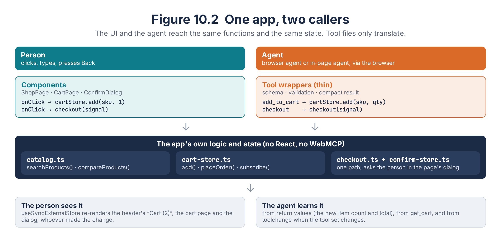
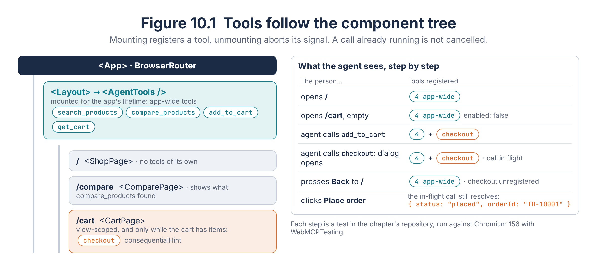
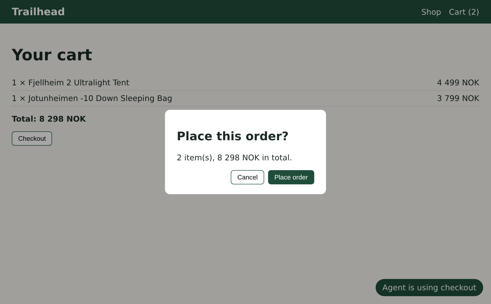

*Part III · Building Agent-Ready Apps*

# Chapter 10: WebMCP in Frameworks

> *“Register tools when they’re useful in a certain page state, then unregister when the tool is no longer usable.”*
>
> — Chrome for Developers, “WebMCP best practices”[^1]

## From a page to an app

Fjord Table is a page. Its tools live in a few module scripts, its booking view opens and closes, and Listing 5.5 registered `book_table` only while that view was on screen. That is about as much lifecycle as a small site has.

Most of the web you’ll make agent-ready doesn’t look like that. It looks like Trailhead: a single-page store written in React, where “the page” is a tree of components that mount and unmount as the person searches, compares and checks out, where state lives in stores that several components share, and where the URL changes without a document ever reloading. In that world `registerTool()` raises questions Fjord Table never had to answer. Which component owns a tool? What happens to it when that component unmounts? What does React’s development mode do to code that registers something in an effect? And when an agent is halfway through a checkout and the person presses Back, who is responsible for the dialog that is still waiting for an answer?

The API itself doesn’t change in a framework. `document.modelContext` is still one object per document, tools are still registered with a dictionary and removed by aborting a signal, and calls still arrive with their own cancellation signal.[^2] What changes is who calls those methods and when. This chapter is about getting that right: tying registration to component and dependency-injection lifecycles, keeping tools thin over the app logic you already have, letting the set of tools follow the route, unregistering without breaking calls that are already running, and keeping the agent and the person in step about what changed.

The main example is Trailhead, the outdoor-gear store that runs through Parts III to VI. Table 10.1 lists the tools it ends this chapter with and where each one lives.

**Table 10.1 — Trailhead’s WebMCP tools at the end of Chapter 10**

| Tool | Registered by | Lifetime | Annotations |
|---|---|---|---|
| `search_products` | `<AgentTools>` in the layout | whole app | `readOnlyHint` |
| `compare_products` | `<AgentTools>` in the layout | whole app | `readOnlyHint` |
| `add_to_cart` | `<AgentTools>` in the layout | whole app | none |
| `get_cart` | `<AgentTools>` in the layout | whole app | `readOnlyHint` |
| `checkout` | `<CartPage>` | while `/cart` is open and the cart isn’t empty | `consequentialHint` |

The React code builds with Vite 8.3.4 and TypeScript 7.0.2 against React 19.3.1, React Router 8.4.0 and `usewebmcp` 6.0.3, the versions current on npm on 14 October 2026.[^3] Every listing is in the book’s companion repository, together with Playwright tests that run the built app twice: once against a small mock of `document.modelContext`, and once against Chromium 156’s own implementation with the `WebMCPTesting` feature switched on.[^4] Where this chapter says “in Chromium 156”, it means one of those tests.

Later in the chapter we leave React for Angular, which ships its own experimental WebMCP support built on dependency injection and Signal Forms.

## What a framework integration has to do

Before reaching for a library, it helps to see the whole job. A component that offers a tool has to do five things:

1. **Detect support.** Do nothing where `document.modelContext` doesn’t exist, so the component still works as an ordinary UI.
2. **Register on mount and unregister on unmount.** The tool should exist exactly as long as the component that can honour it.
3. **Re-register when what the agent reads changes.** A tool’s name, description and schema are loaded into the model’s context when it’s observed. The explainer says that to change them you unregister the tool and register it again, and each step fires a `toolchange` event.[^5]
4. **Not re-register when nothing the agent reads has changed.** Components re-render constantly. If every render produced a new registration, the agent would see a stream of `toolchange` events, and a call could land on a tool that had just been replaced.
5. **Run calls against current state.** When the agent calls the tool, the handler should see the props and state of the latest render, not the render in which the tool was first registered.

Points 4 and 5 pull against each other. The `execute` function a component defines is a new closure on every render, and it closes over that render’s state. Register that closure once and calls will see stale state; register every new closure and you churn. The explainer points at the way out: the browser holds on to whatever function you passed, and as long as the name, description and schema stay accurate, that function can delegate to another one that the application changes over time.[^5]

Listing 10.1 does all five in about thirty lines. You won’t ship it, since the packages in the next section do the same job and more, but it shows exactly what they do for you.

**Listing 10.1 — A minimal hook that ties a tool to a component (src/agent/use-agent-tool.ts)**

```ts
import { useEffect, useLayoutEffect, useRef } from 'react';

export interface AgentTool {
  name: string;
  description: string;
  inputSchema?: object;
  annotations?: WebMCP.ToolAnnotations;
  execute: (input: Record<string, unknown>, options: { signal: AbortSignal }) => unknown;
}

// What a WebMCP hook has to do, in about thirty lines.
export function useAgentTool(tool: AgentTool, enabled = true): void {
  // ① Keep the latest render's tool, so calls see current props and state.
  const latest = useRef(tool);
  useLayoutEffect(() => { latest.current = tool; });

  // ② Re-register only when what the agent reads changes.
  const metadata = JSON.stringify([tool.name, tool.description, tool.inputSchema, tool.annotations]);

  useEffect(() => {
    const modelContext = document.modelContext;
    if (!enabled || !modelContext) return;          // ③ progressive enhancement
    const { name, description, inputSchema, annotations } = latest.current;
    const controller = new AbortController();
    modelContext
      .registerTool(
        { name, description, inputSchema, annotations,
          execute: (input, options) => latest.current.execute(input as Record<string, unknown>, options) },
        { signal: controller.signal },
      )
      .catch((error: unknown) => {
        if (!controller.signal.aborted) console.warn(`registerTool("${name}") failed`, error);
      });
    return () => controller.abort();                // ④ unmount or change: unregister
  }, [metadata, enabled]);
}
```

① A ref holds the tool from the latest render, updated in a layout effect so it’s current before any passive effect or agent call can read it. The function registered with the browser never changes; it looks up `latest.current.execute` at call time, so every call runs against current state.

② The effect’s dependency is a serialized copy of the agent-facing metadata. A re-render that changes only state leaves the string the same, so nothing is re-registered. A new description produces a new string, and React runs the cleanup (unregister) and then the effect again (register).

③ Without the API the hook does nothing, and the component renders as it always did.

④ The cleanup aborts the registration signal. That is the only way to unregister a tool: the specification has no `unregisterTool()`; aborting the signal passed in the options removes the tool and fires `toolchange`.[^2]

### What StrictMode does to registration

In development, React’s `<StrictMode>` runs “one extra setup+cleanup cycle in development for every Effect”.[^6] For Listing 10.1 that means register, abort, register, all in the same tick, with the same name. If unregistration were asynchronous, the second `registerTool()` would hit the first tool and reject because the name is taken.

It doesn’t. The specification runs the abort steps synchronously when the signal fires, removing the tool from the document’s tool map before the next line runs.[^2] In Chromium 156 the first registration promise rejects with an `AbortError` (“signal is aborted without reason”), the second resolves, and `getTools()` lists the tool once. That rejection is why the hook ignores errors from a registration whose own signal was aborted: it’s the expected result of cleaning up, not a failure. Trailhead mounts inside `<StrictMode>`, and its tests check that no tool is ever registered twice and nothing is logged.

### The bug only a real browser caught

The first version of Listing 10.1 copied the metadata out of the serialized string with `JSON.parse()`. It passed every test against the mock and failed against Chromium. The reason is a small one. `JSON.stringify()` turns a missing `inputSchema` into `null`, and Chromium 156 rejects `inputSchema: null` with a `TypeError`: “Failed to read the 'inputSchema' property from 'ModelContextTool': Failed to convert value to 'object'.” An `undefined` member is simply treated as absent, which is what Web IDL dictionaries do.[^7] The mock had been more forgiving than the browser. The fix was to read the metadata from the ref instead, and the mock now rejects `null` the way Chromium does. Run your tests against a real implementation as well as a mock; Chapter 14 comes back to this.

## React: the `usewebmcp` hook

Chrome’s documentation for the imperative API now has a “React support” section. It says React “has experimental support for WebMCP using the usewebmcp package”, with “standalone hooks tied to your component’s mount and unmount lifecycle”, schema-driven type inference and local execution state.[^8] The package is published from the WebMCP-org `npm-packages` repository, the same community project behind the MCP-B polyfill and bridges you met in Chapter 9, under the MIT licence.[^3]

Version numbers matter here, because the package moves fast. On 14 October 2026 the latest release was 6.0.3, published that afternoon. Version 6.0.0 had come out on 8 October, so this was the fourth release in a week.[^3] Version 6 slimmed the package down: Zod and other Standard Schema validators, `outputSchema`, MCP-style result formatting, prompts and resources moved to a sibling package, `@mcp-b/react-webmcp`, and `usewebmcp` became a hook for the core browser contract only.[^9] Table 10.2 lists the React-related packages you’re likely to meet.

**Table 10.2 — React packages for WebMCP, as published on npm on 14 October 2026**

| Package | Version | What it is |
|---|---|---|
| `usewebmcp` | 6.0.3 | `useWebMCP()` hook for the core `document.modelContext` contract; JSON Schema input inference; no validation; depends on `webmcp-types` |
| `@mcp-b/react-webmcp` | 6.0.3 | Hook with Standard Schema (for example Zod) validation, `outputSchema`, MCP result formatting, prompts, resources and client hooks |
| `@mcp-b/webmcp-polyfill` | 6.0.3 | A `document.modelContext` implementation for browsers without one; recommended for tests |
| `use-webmcp-tool` | 0.3.0 | Chrome’s own hook (GoogleChromeLabs), which normalizes results to MCP `content` blocks |
| `webmcp-types` | 0.1.10 | The Community Group’s TypeScript definitions (Chapter 5) |

Sources: the npm registry entries for each package, read on 14 October 2026.[^3] [^10] [^11]

The `usewebmcp` README names Chrome’s `use-webmcp-tool` as prior art.[^9] The two take different positions on results. Chrome’s hook turns a returned string into an MCP `content` block, wraps thrown errors as `isError` results, and turns `undefined` into an empty `content` list.[^11] `usewebmcp` hands your return value to the browser untouched, except that `undefined` becomes `null`, because the browser can’t serialize `undefined`.[^12] Trailhead uses `usewebmcp`, because Chrome’s documentation points to it and because its results are exactly what Chapter 5 described.

### Trailhead’s app-wide tools

Listing 10.2 is the component that gives Trailhead its four app-wide tools. It renders nothing. It is mounted once, in the layout route, so the tools live as long as the app does.

**Listing 10.2 — App-wide tools with `useWebMCP` (src/agent/AgentTools.tsx)**

```tsx
import { useNavigate } from 'react-router';
import { useWebMCP } from 'usewebmcp';
import { addToCartSchema, addToCartTool, getCartTool } from './cart-tools';
import { compareProductsSchema, compareProductsTool } from './compare-products';
import { searchProductsSchema, searchProductsTool } from './search-products';

// App-wide tools. Mounted once in the layout, so they live as long as the app.
export function AgentTools() {
  const navigate = useNavigate();

  useWebMCP({
    name: 'search_products',
    description: 'Search the Trailhead catalog of outdoor gear. Returns matching products with SKU, name, price in NOK, rating and stock status.',
    inputSchema: searchProductsSchema,
    annotations: { readOnlyHint: true },
    execute: searchProductsTool,
  });

  useWebMCP({
    name: 'compare_products',
    description: 'Compare 2 to 4 products side by side by price, rating, weight and stock. Also shows the comparison to the user.',
    inputSchema: compareProductsSchema,
    annotations: { readOnlyHint: true },
    execute: (input) => {
      const result = compareProductsTool(input);
      if (!('error' in result)) navigate(`/compare?skus=${input.skus.join(',')}`);
      return result;
    },
  });

  useWebMCP({
    name: 'add_to_cart',
    description: 'Add a product to the shopping cart by SKU. Returns the updated item count and total.',
    inputSchema: addToCartSchema,
    execute: addToCartTool,
  });

  useWebMCP({
    name: 'get_cart',
    description: 'Read the current shopping cart: lines, item count and total in NOK.',
    annotations: { readOnlyHint: true },
    execute: getCartTool,
  });

  return null;
}
```

Compare it with Listing 10.1 and you’ll see the same contract. The hook registers after React commits the component and aborts the registration when it unmounts, so you never manage an `AbortController` yourself.[^13] It re-registers when the serialized metadata (name, title, description, schema, annotations), `enabled` or `exposedTo` changes, and not otherwise. It publishes the latest committed callback with a layout effect, so `compare_products` always calls the current `navigate` function without a new registration.[^12] When a registration is rejected, for example because another tool already has the name, it logs one `console.warn` naming the tool and exposes the error as `registrationError`.[^12]

Two details in the listing deserve a closer look.

**Schema-driven types.** The schemas are imported from modules where they are declared `as const`. With a literal schema, `useWebMCP` infers the type of the handler’s `input` from it, using the `webmcp-types` definitions. That is why `input.skus.join(',')` in `compare_products` type-checks: TypeScript knows `skus` is an array of strings.[^12] The inference is only a type. The package says plainly that the schema “is registered as metadata; the hook passes runtime input to the handler without validation or transformation”.[^12] The browser doesn’t validate calls either (Chapter 5), so every handler in Trailhead still checks its input in code.

**No `inputSchema` on `get_cart`.** A tool that takes no input can leave the schema out. Chromium 156 accepts that, and the hook only passes the member when you set it.

> **Still in flux: React packages**
>
> All the React integrations are community or experimental code following a draft specification. `usewebmcp` moved a whole feature set to another package in its 6.0 release, and shipped four releases in the week before this was written. Chrome’s `use-webmcp-tool` describes itself as maintained by Chrome and updated with spec changes. Pin exact versions, read the changelog before upgrading, and keep your tool logic out of the hook call so that swapping one hook for another touches a single file.[^3] [^11]

## Tools as thin wrappers, not a second app

The easiest way to add tools to an existing app is also the worst: write each tool as a little program of its own. The tool handler fetches products its own way, keeps its own copy of the cart, or, worse, finds the “Add to cart” button and clicks it. You end up with two apps sharing a page. They disagree about rules, they drift apart with every release, and the agent sees a store that behaves differently from the one the person sees.

The alternative is a strict division of labour. Everything the store does lives in plain modules that know nothing about React or WebMCP. The UI calls them from event handlers. Tools call the same functions from `execute`. The tool layer is allowed to do only three things: describe the input (the schema), check it (validation), and translate (map the input to a call, and the result to something compact for the model). Figure 10.2 shows the shape.



Listing 10.3 is `search_products` written that way. It is the whole file.

**Listing 10.3 — `search_products` as a thin wrapper over the catalog (src/agent/search-products.ts)**

```ts
// Agent-facing wrapper: a schema, validation in code, one call into the store's own search, a compact result.
import { CATEGORIES, searchProducts, type Category } from '../catalog';

export const searchProductsSchema = {
  type: 'object',
  properties: {
    query: { type: 'string', description: 'Keywords, for example "down sleeping bag".' },
    category: { type: 'string', enum: CATEGORIES, description: 'Optional product category.' },
    maxPrice: { type: 'number', minimum: 0, description: 'Optional maximum price in NOK.' },
    inStockOnly: { type: 'boolean', description: 'Only return products that are in stock.' },
  },
  required: ['query'],
  additionalProperties: false,
} as const;

export function searchProductsTool({ query, category, maxPrice, inStockOnly }: Record<string, unknown>) {
  if (typeof query !== 'string') return { error: 'query must be a string.' };
  if (category !== undefined && !CATEGORIES.includes(category as Category)) {
    return { error: `category must be one of: ${CATEGORIES.join(', ')}.` };
  }
  if (maxPrice !== undefined && (typeof maxPrice !== 'number' || maxPrice < 0)) {
    return { error: 'maxPrice must be a non-negative number of NOK.' };
  }
  const products = searchProducts({
    query,
    category: category as Category | undefined,
    maxPrice: maxPrice as number | undefined,
    inStockOnly: inStockOnly === true,
  });
  return {
    products: products.map(({ sku, name, price, rating, inStock }) => ({ sku, name, price, rating, inStock })),
  };
}
```

The schema follows Chapter 5’s advice: plain types, an `enum` for the category, a description for every field, `additionalProperties: false`. The validation repeats the schema’s rules in code, because nothing else enforces them, and returns failures as values the model can act on. The actual work is one call to `searchProducts()`, the function the search box on the shop page calls on every keystroke. The result is trimmed to what an agent needs to choose a product: no weights, no categories, no image URLs.

`compare_products` and `add_to_cart` follow the same pattern in their own files in the repository. `add_to_cart` refuses out-of-stock products and quantities outside 1–10 with a message, then calls `cartStore.add()`, the same method the “Add to cart” buttons call.

### Shared state with an external store

“The same method” only helps if there is one cart. In a component-based app, the place where the cart lives decides who can reach it. If it lived in `useState` inside `<CartPage>`, a tool registered in the layout couldn’t see it, and it would vanish when the person left the cart page. Trailhead keeps it in a small external store that React subscribes to with `useSyncExternalStore`, the hook React provides “to subscribe to an external store”.[^14]

**Listing 10.4 — One cart for the buttons and the tools (src/cart-store.ts)**

```ts
import { useSyncExternalStore } from 'react';
import { getProduct, type Price } from './catalog';

export interface CartLine { sku: string; name: string; quantity: number; unitPrice: Price }
export interface Cart { lines: readonly CartLine[]; itemCount: number; total: Price }
export interface Order { orderId: string; total: Price; itemCount: number }

let cart: Cart = { lines: [], itemCount: 0, total: { amount: 0, currency: 'NOK' } };
let lastOrder: Order | null = null;
let nextOrderNumber = 10001;
const listeners = new Set<() => void>();

function commit(lines: CartLine[]): void {
  cart = {
    lines,
    itemCount: lines.reduce((n, l) => n + l.quantity, 0),
    total: { amount: lines.reduce((s, l) => s + l.quantity * l.unitPrice.amount, 0), currency: 'NOK' },
  };
  listeners.forEach((notify) => notify());
}

// One store, two callers: the page's buttons and the agent's tools.
export const cartStore = {
  subscribe(listener: () => void): () => void {
    listeners.add(listener);
    return () => listeners.delete(listener);
  },
  getSnapshot: (): Cart => cart,
  getLastOrder: (): Order | null => lastOrder,

  add(sku: string, quantity: number): Cart {
    const product = getProduct(sku);
    if (!product) throw new Error(`Unknown SKU: ${sku}`);
    const existing = cart.lines.find((l) => l.sku === sku);
    commit(existing
      ? cart.lines.map((l) => (l.sku === sku ? { ...l, quantity: l.quantity + quantity } : l))
      : [...cart.lines, { sku, name: product.name, quantity, unitPrice: product.price }]);
    return cart;
  },

  placeOrder(): Order {
    if (cart.itemCount === 0) throw new Error('The cart is empty.');
    lastOrder = { orderId: `TH-${nextOrderNumber++}`, total: cart.total, itemCount: cart.itemCount };
    commit([]);
    return lastOrder;
  },
};

export function useCart(): Cart {
  return useSyncExternalStore(cartStore.subscribe, cartStore.getSnapshot);
}
```

The store is ordinary TypeScript. `add()` and `placeOrder()` update a snapshot and notify subscribers. `useCart()` lets any component read the snapshot and re-render when it changes. Because the agent’s `add_to_cart` goes through `cartStore.add()`, the header’s “Cart (2)” updates the moment the tool runs, with no extra code. The tests check both directions: an agent’s `add_to_cart` updates the header, and an item the person adds with a click shows up in the agent’s next `get_cart`.

You can use whatever state library your app already has. What matters is that the state a tool needs doesn’t belong to a component that might unmount.

## Routing and per-view tool sets

In a single-page app, a route change replaces components without replacing the document. Tools registered by those components come and go with them, and the browser fires `toolchange` each time. That gives you a natural way to offer view-specific tools: put the hook in the route’s component. Figure 10.1 shows how Trailhead does it, and what the agent sees as the person moves around.



Should you? Chrome’s best-practices page answers both ways in a few lines. It tells you to “manage tool registration”, registering tools “when they’re useful in a certain page state”, and then adds: “Reduce complexity: For most applications, static registration should be the default approach.” It also notes that while there is no maximum number of tools, “each tool takes up part of the context window”, and overlapping tools make it harder for the agent to choose.[^1]

Trailhead follows that advice. Search, compare, add to cart and read the cart make sense on every page, so they are registered once. Only `checkout` is tied to a view, for a reason that has more to do with consent than with tool counts: an order should be placed from the page where the person can see what they’re buying. Listing 10.5 shows the cart page.

**Listing 10.5 — A view-scoped, consequential tool (src/pages/CartPage.tsx)**

```tsx
import { useSyncExternalStore } from 'react';
import { useWebMCP } from 'usewebmcp';
import { cartStore, useCart } from '../cart-store';
import { checkout } from '../checkout';

export function CartPage() {
  const cart = useCart();
  const lastOrder = useSyncExternalStore(cartStore.subscribe, cartStore.getLastOrder);

  // A view-scoped, consequential tool: it exists only on this page, and only with items in the cart.
  useWebMCP({
    name: 'checkout',
    description: 'Place the order for everything in the cart. The user must confirm in the page\'s own dialog; nothing is ordered until they click "Place order". Returns the order ID, or status "cancelled" if the user declines.',
    annotations: { consequentialHint: true },
    enabled: cart.itemCount > 0,
    execute: (_input, { signal }) => checkout(signal),
  });

  return (
    <section>
      <h1>Your cart</h1>
      {lastOrder && cart.itemCount === 0 && (
        <p className="notice" data-testid="order-placed">Order {lastOrder.orderId} placed. Takk!</p>
      )}
      {cart.itemCount === 0 ? <p>Your cart is empty.</p> : (
        <>
          <ul className="lines">
            {cart.lines.map((l) => (
              <li key={l.sku}>{l.quantity} × {l.name} <span>{(l.quantity * l.unitPrice.amount).toLocaleString('nb-NO')} NOK</span></li>
            ))}
          </ul>
          <p className="total">Total: {cart.total.amount.toLocaleString('nb-NO')} NOK</p>
          <button type="button" onClick={() => void checkout(new AbortController().signal)}>Checkout</button>
        </>
      )}
    </section>
  );
}
```

The tool exists only while `<CartPage>` is mounted, and `enabled: cart.itemCount > 0` removes it whenever the cart is empty. The option unregisters the tool without unmounting anything, and re-registers it when the condition becomes true again.[^12] So an agent can’t try to check out an empty cart: the tool simply isn’t there. The `consequentialHint` annotation tells the agent and the browser that calling it has effects in the world (Chapter 6).

The tool and the “Checkout” button both call `checkout()`. The button passes a signal that never aborts; the tool passes the execution signal the browser gives every call. That one difference is the subject of the next section.

The tests walk through Figure 10.1 step by step in Chromium 156: four tools on `/`, still four on an empty `/cart`, five once `add_to_cart` has run, and four again after the person goes back to the shop.

## Unregistering without breaking in-flight calls

Here is the case that makes framework code different from page scripts. An agent calls `checkout`. Trailhead opens its confirmation dialog and waits for the person. While the dialog is open, the person presses Back. React Router renders the shop, `<CartPage>` unmounts, and the hook aborts the registration. What happens to the call?

The specification is explicit: “Unregistering a tool does not cancel an execution that has already invoked its ToolExecuteCallback, including when the callback itself performs the unregistration. The registration-time signal only controls tool availability, while the execution-time signal controls the lifetime of an specific invocation.”[^15] Chromium 156 behaves that way. In a probe, a tool unregistered 50 milliseconds into a 400-millisecond call disappeared from `getTools()` at once, and the call still resolved with its value; its execution signal was never aborted.

So the browser won’t break the call. Your app can. If the pending confirmation lived in `<CartPage>`’s state, the dialog would unmount with the page, nobody could answer it, and the agent’s call would hang forever, or until the agent gave up. Table 10.3 separates the two signals that are easy to confuse.

**Table 10.3 — The two signals a tool deals with**

| | Registration signal | Execution signal |
|---|---|---|
| Who creates it | Your code (the hook does it for you) | The browser, one per call |
| Where you get it | `registerTool(tool, { signal })` | `execute(input, { signal })` |
| Aborting it means | The tool is no longer available | This call is cancelled |
| Typical cause | Component unmounts, route changes, `enabled` turns false | The agent or the person cancels, the agent times out, the caller passes its own signal to `executeTool()` |
| What happens to running calls | Nothing; they finish | This call should stop and clean up |

Sources: WebMCP specification, Draft Community Group Report, 14 October 2026.[^2] [^15]

The rule that follows is simple: **anything an in-flight call depends on must outlive the component that registered the tool.** Trailhead puts the checkout flow in a module, not a component (Listing 10.6), and the pending question in a store rendered by the layout (Listing 10.7).

**Listing 10.6 — One checkout path for the button and the tool (src/checkout.ts)**

```ts
import { cartStore } from './cart-store';
import { requestConfirmation } from './confirm-store';

export type CheckoutResult =
  | { status: 'placed'; orderId: string; total: { amount: number; currency: 'NOK' } }
  | { status: 'cancelled'; message: string }
  | { status: 'empty'; message: string };

// The one checkout path. The Checkout button and the checkout tool both call it.
export async function checkout(signal: AbortSignal): Promise<CheckoutResult> {
  const cart = cartStore.getSnapshot();
  if (cart.itemCount === 0) {
    return { status: 'empty', message: 'The cart is empty. Add products with add_to_cart first.' };
  }
  const confirmed = await requestConfirmation(
    'Place this order?',
    `${cart.itemCount} item(s), ${cart.total.amount.toLocaleString('nb-NO')} NOK in total.`,
    signal,
  );
  if (!confirmed) {
    return { status: 'cancelled', message: 'The user declined the order in the confirmation dialog.' };
  }
  const order = cartStore.placeOrder();
  return { status: 'placed', orderId: order.orderId, total: order.total };
}
```

**Listing 10.7 — A confirmation that survives navigation and honours cancellation (src/confirm-store.ts)**

```ts
import { useSyncExternalStore } from 'react';

export interface PendingConfirmation {
  id: number;
  title: string;
  detail: string;
  answer: (confirmed: boolean) => void;
}

let pending: PendingConfirmation | null = null;
let nextId = 1;
const listeners = new Set<() => void>();
const emit = () => listeners.forEach((notify) => notify());

// Ask the person, in the page's own UI, and wait for their click.
// The question lives here, not in a route component, so it survives navigation.
export function requestConfirmation(title: string, detail: string, signal: AbortSignal): Promise<boolean> {
  return new Promise((resolve, reject) => {
    if (signal.aborted) return reject(signal.reason);
    pending?.answer(false);                // only one question on screen at a time
    const id = nextId++;
    const close = () => {
      signal.removeEventListener('abort', onAbort);
      if (pending?.id === id) { pending = null; emit(); }
    };
    const onAbort = () => { close(); reject(signal.reason); };
    signal.addEventListener('abort', onAbort, { once: true });
    pending = { id, title, detail, answer: (confirmed) => { close(); resolve(confirmed); } };
    emit();
  });
}

export function usePendingConfirmation(): PendingConfirmation | null {
  return useSyncExternalStore(
    (listener) => { listeners.add(listener); return () => listeners.delete(listener); },
    () => pending,
  );
}
```

`requestConfirmation()` stores the question in module state, and `<ConfirmDialog>`, which the layout renders on every route, shows it. The question is tied to the call, not to the page. If the person presses Back, the dialog stays on screen over the shop, and clicking “Place order” resolves the agent’s call with an order ID. The test for exactly that sequence passes in Chromium 156 and against the mock.

The execution signal is handled the other way round. If it aborts, the dialog closes and the promise rejects with the signal’s reason, so the agent can’t leave a stale question on the person’s screen. In Chromium 156, aborting the signal passed to `executeTool()` rejects the caller’s promise with an `AbortError`, aborts the signal the tool received, and fires a `toolcancel` event at `document.modelContext`.[^16] The dialog disappears and nothing is ordered.

Two smaller points complete the picture. First, the hook’s registration signal and the call’s execution signal are independent, so never use one in place of the other. A tool that aborted its work when its component unmounted would turn every navigation into a cancelled order. Second, don’t route a result through the state of the component that registered the tool. A handler that returns its result through the store or the promise, as Listing 10.6 does, works whether that component is still mounted or not.

## State sync: telling the agent what changed

An agent works from snapshots. The specification’s non-normative section on page observations describes the browser agent getting “an observation”, an implementation-defined structure containing at least a tool map, and notes that it “often includes screenshots of the page, not just a DOM serialization”.[^17] Between observations, the agent knows only what it was told. In a component app the page changes constantly, so it’s worth being deliberate about how changes reach the agent. Trailhead uses four channels.

**Return values describe the new state.** `add_to_cart` doesn’t return `"OK"`. It returns what was added and the cart’s new item count and total, so the agent can plan its next step without another call. `checkout` returns a status the agent can act on: `placed` with an order ID, `cancelled` with an explanation, or `empty`.

**A read-only tool answers “what is the state now?”.** `get_cart` costs little, can be called at any time, and reflects changes the person made by hand. Chrome’s best practices add a related point: agents may rely on the interface to plan their next steps, so “update the interface state after functions are completed”.[^1] Trailhead’s tools change the same store the UI renders, so by the time a tool returns, the screen already matches.

**The tool set itself is information.** When `checkout` appears or disappears, the browser fires `toolchange`, and agents and in-page tool consumers that listen for it refresh their list.[^5] A tool’s availability tells the agent what is possible now; `enabled: cart.itemCount > 0` says “there is something to check out” without a word of description.

**Descriptions stay still.** Don’t put live state, such as a cart total or a count of results, into a description. Every change would mean unregistering and registering again, with a `toolchange` each time, and the model would read the description only when it next observed the page anyway.[^5] Put state in results and read tools; reserve re-registration for real changes to what a tool is or does, such as a language switch. The test page for Listing 10.1 shows the difference: three clicks that change state produce zero `toolchange` events, while switching the description to Norwegian produces an unregistration and a registration.

### And telling the person what the agent did

State sync runs the other way too. When an agent adds a sleeping bag to the cart, the person should be able to see that it happened and who did it. The specification now defines two events for this, dispatched at `document.modelContext`: `toolactivated`, “when the execution of a tool begins”, and `toolcancel`, “when the execution of a tool is cancelled”. Each carries the tool’s name in `toolName`.[^16] Listing 10.8 turns them into a small status pill.

**Listing 10.8 — Showing the person what the agent is doing (src/agent/AgentActivity.tsx)**

```tsx
import { useEffect, useState } from 'react';

// Shows the person what the agent just did, using the toolactivated and toolcancel events.
export function AgentActivity() {
  const [message, setMessage] = useState<string | null>(null);

  useEffect(() => {
    const modelContext = document.modelContext;
    if (!modelContext) return;
    let timer: ReturnType<typeof setTimeout> | undefined;
    const show = (text: string) => {
      setMessage(text);
      clearTimeout(timer);
      timer = setTimeout(() => setMessage(null), 4000);
    };
    const onActivated = (e: WebMCP.ToolActivatedEvent) => show(`Agent is using ${e.toolName}`);
    const onCancel = (e: WebMCP.ToolCancelEvent) => show(`Agent cancelled ${e.toolName}`);
    modelContext.addEventListener('toolactivated', onActivated);
    modelContext.addEventListener('toolcancel', onCancel);
    return () => {
      clearTimeout(timer);
      modelContext.removeEventListener('toolactivated', onActivated);
      modelContext.removeEventListener('toolcancel', onCancel);
    };
  }, []);

  return message ? <p className="agent-activity" role="status">{message}</p> : null;
}
```

Chromium 156 dispatches both events. `toolactivated` arrives as a `ToolActivatedEvent` when a call starts, and `toolcancel` as a `ToolCancelEvent` when the caller aborts. Figure 10.3 is a screenshot from the test run: an agent has added two products, the person has opened the cart, and the agent has called `checkout`. The pill names the tool, and the order waits for the person’s click.



> **Still in flux: tool events**
>
> `toolactivated` and `toolcancel` are in the 14 October 2026 draft, and Chromium 156 fires both. There is no matching “completed” event, so a pill like Listing 10.8’s has to fade on a timer, or your own `execute` wrappers have to report completion. Treat the events as a convenience for the UI, not as the source of truth for what happened.[^16]

## Angular: tools in the injector

Angular took a different route to the same place. Its WebMCP support is part of the framework itself, in `@angular/core` and `@angular/forms`, rather than a community package. Angular’s guide describes it as experimental support that lets you “easily register tools tied to your application’s dependency injection lifecycle and automatically turn your Signal Forms into AI-ready tools”, and warns that the APIs “are subject to change even outside of major versions”.[^18] Chrome’s imperative-API page links to the same guide.[^8] The examples below were written and tested against Angular 22.2.2, the current release on 14 October 2026, in which every WebMCP function is marked `@experimental`.[^19]

Where React ties a tool to a component, Angular ties it to an injector. Three APIs cover the cases:

- `provideExperimentalWebMcpTools([...])` in the application’s providers registers tools for the whole life of the app. Each tool’s `execute` runs in the injection context of the associated injector, so it can call `inject()` directly.[^18]
- The same function in a route’s `providers` registers tools for that route. Angular’s guide recommends `withAutoCleanupInjectors()` on the router, because without it route tools “will remain accessible to AI agents even after the user has navigated to a different route”.[^18]
- `declareExperimentalWebMcpTool()` registers a tool from inside any injection context, such as a service constructor, and unregisters it when that context is destroyed.[^18]

Listing 10.9 is Trailhead’s `search_products` as an Angular app-wide tool. The catalog module is the same file the React app uses; only the wrapper changes.

**Listing 10.9 — An app-wide tool in the application config (angular/src/app.config.ts)**

```ts
import { type ApplicationConfig, inject, provideExperimentalWebMcpTools } from '@angular/core';
import { provideExperimentalWebMcpForms } from '@angular/forms/signals';
import { provideRouter, withAutoCleanupInjectors } from '@angular/router';
import { CatalogService } from './catalog.service';
import { CATEGORIES } from './catalog';
import { routes } from './routes';

export const appConfig: ApplicationConfig = {
  providers: [
    provideRouter(routes, withAutoCleanupInjectors()),   // route tools go away with their route
    provideExperimentalWebMcpForms(),                     // lets Signal Forms opt in as tools
    provideExperimentalWebMcpTools([                      // app-wide: registered for the app's lifetime
      {
        name: 'search_products',
        description: 'Search the Trailhead catalog of outdoor gear. Returns matching products with SKU, name, price in NOK, rating and stock status.',
        inputSchema: {
          type: 'object',
          properties: {
            query: { type: 'string', description: 'Keywords, for example "down sleeping bag".' },
            category: { type: 'string', enum: [...CATEGORIES] },
            maxPrice: { type: 'number', description: 'Optional maximum price in NOK.' },
          },
          required: ['query'],
          additionalProperties: false,
        },
        annotations: { readOnlyHint: true },
        execute: ({ query, category, maxPrice }) => {
          if (typeof query !== 'string') return { error: 'query must be a string.' };
          if (category !== undefined && !CATEGORIES.includes(category)) {
            return { error: `category must be one of: ${CATEGORIES.join(', ')}.` };
          }
          return { products: inject(CatalogService).search({ query, category, maxPrice }) };
        },
      },
    ]),
  ],
};
```

The `execute` function asks the injector for `CatalogService` at call time. Like `usewebmcp`, Angular infers the argument types from the schema, which is why `category` arrives typed as one of the enum’s strings, and like `usewebmcp` it doesn’t check them. The guide is clear that inputs “may not be validated to match the schema”, and recommends validating arguments explicitly.[^18] The handler also receives a second argument with the call’s `signal`, a change Angular made in August 2026 so that tools can handle cancellation.[^20]

Listing 10.10 adds a route-scoped tool.

**Listing 10.10 — A tool that lives with its route (angular/src/routes.ts)**

```ts
import { inject, provideExperimentalWebMcpTools } from '@angular/core';
import type { Routes } from '@angular/router';
import { CartService } from './cart.service';
import { CartPage, ShopPage } from './pages';
import { StockAlertPage } from './stock-alert';

export const routes: Routes = [
  { path: '', component: ShopPage },
  {
    path: 'cart',
    component: CartPage,
    providers: [
      provideExperimentalWebMcpTools([   // registered while /cart is active
        {
          name: 'get_cart',
          description: 'Read the current shopping cart: lines and total in NOK.',
          inputSchema: { type: 'object', properties: {} },
          annotations: { readOnlyHint: true },
          execute: () => inject(CartService).snapshot(),
        },
      ]),
    ],
  },
  { path: 'stock-alert', component: StockAlertPage },
];
```

When the router activates `/cart`, it creates the route’s environment injector and the tool registers. With `withAutoCleanupInjectors()` (Listing 10.9), leaving the route destroys that injector and the tool unregisters. In Chromium 156 with WebMCPTesting, `get_cart` appears when the test clicks the Cart link and disappears again when it clicks Shop. Annotations such as `readOnlyHint` arrived in Angular’s API in September 2026, and `consequentialHint` a few days later.[^20]

### Signal Forms as tools

The most distinctive part of Angular’s support turns an existing form into a tool. Add `provideExperimentalWebMcpForms()` to the providers (Listing 10.9 already does), then pass `experimentalWebMcpTool` with a name and description when you create a Signal Form. Angular infers the JSON Schema from the form’s model, marks fields with a `required` validator as required, and connects the tool to the form’s validation and submission, so “the agent will observe any validation errors triggered by its inputs or any failures which happen during submission”.[^18] Listing 10.11 gives Trailhead a back-in-stock alert this way.

**Listing 10.11 — A Signal Form that is also a tool (angular/src/stock-alert.ts)**

```ts
import { Component, inject, signal } from '@angular/core';
import { email, form, FormField, min, required } from '@angular/forms/signals';
import { StockAlertService } from './stock-alert.service';

@Component({
  selector: 'th-stock-alert',
  imports: [FormField],
  template: `
    <h1>Tell me when it's back</h1>
    <label>Email <input type="email" [formField]="alertForm.email" /></label>
    <label>SKU <input [formField]="alertForm.sku" /></label>
    <label>Quantity <input type="number" [formField]="alertForm.quantity" /></label>
  `,
})
export class StockAlertPage {
  private readonly alerts = inject(StockAlertService);
  private readonly model = signal({ email: '', sku: '', quantity: 1 });   // concrete initial values

  readonly alertForm = form(
    this.model,
    (f) => {
      required(f.email, { message: 'An email address is required.' });
      email(f.email, { message: 'Enter a valid email address.' });
      required(f.sku, { message: 'Give the product SKU from search_products.' });
      min(f.quantity, 1, { message: 'Quantity must be at least 1.' });
    },
    {
      experimentalWebMcpTool: {
        name: 'request_stock_alert',
        description: 'Ask Trailhead to email the user when an out-of-stock product is back in stock.',
      },
      submission: {
        action: async (field) => {
          await this.alerts.subscribe(field().value());
          return undefined;
        },
      },
    },
  );
}
```

This is what Chromium 156 reported for that form. `getTools()` listed `request_stock_alert` with this inferred schema:

```json
{"type":"object","properties":{"email":{"type":"string"},"sku":{"type":"string"},"quantity":{"type":"number"}},"required":["email","sku"],"additionalProperties":false}
```

A call with `email: "not-an-email"` came back as `{"content":[{"type":"text","text":"Form submission failed:\nemail: Enter a valid email address."}]}` and saved nothing. A valid call returned “Form submitted successfully.”, ran the submission action, and filled the visible form with the agent’s values, so the person could see what had been submitted for them.

Three constraints come with the convenience, all from Angular’s guide. The schema is inferred from the model’s initial value, so every field needs a concrete starting value (`''`, `0`, `false`) and arrays need at least one element. Async validators don’t run for tool calls; handle those checks in the submission action.[^18] And because WebMCP rejects duplicate names, a component that registers a tool, including a form-backed one, must never be on the page more than once at a time. Angular recommends putting tools in application providers, route providers or root services wherever possible.[^18]

Notice also what the inferred schema lacks: descriptions. The field names are all the model gets. For a form that agents will use often, a hand-written schema (Listing 10.9’s style) with a description for every field may be worth the duplication; Chapter 11 looks at why.

> **Still in flux: Angular’s WebMCP APIs**
>
> Every function used in this section carries “Experimental” in its name and an `@experimental` tag, and the guide warns they may change outside major versions. Their history shows how quickly they move: registration became asynchronous in July 2026, tools gained a cancellation signal in August, and annotations arrived in September.[^18] [^20]

## Server rendering and other frameworks

Two more situations are worth a paragraph each.

**Server rendering.** `document.modelContext` exists only in a browser, and only in a secure context. The MCP-B framework guide’s advice holds for any server-rendered app: mount tool hooks only in client-rendered components, and run anything that touches `document`, `window` or page state on the client. `usewebmcp` keeps its `'use client'` directive and doesn’t register tools during a server render.[^13]

**Other frameworks.** This chapter covers the two frameworks that Chrome’s imperative-API page names.[^8] The MCP-B guide suggests using the WebMCP API “with that framework’s native lifecycle guidance” for everything else.[^13] The five jobs at the start of this chapter are that guidance in framework-neutral form: detect, register on mount, abort on unmount, re-register only on metadata changes, and call through to current state. Any framework with a mount hook and a cleanup hook can do all five, and Listing 10.1 shows the shape to copy.

## Trailhead so far

Trailhead now has five tools, organised the way Table 10.1 shows: four registered once for the whole app and one tied to the cart route and to the cart having items. Every tool is a thin wrapper over the same modules the UI uses. The cart lives in a store outside the component tree, and the checkout confirmation lives in another, so neither can be lost when a component unmounts. The layout shows the person which tool the agent is using. The Angular listings show the same tools expressed through Angular’s injector and Signal Forms.

In the repository, 11 Playwright tests cover the React app and 5 cover the Angular listings. All of them passed against both the mock and Chromium 156 (156.0.8078.4) with WebMCPTesting on 14 October 2026.[^4]

Chapter 11 steps back from mechanics to design. Trailhead’s tools work, but are they the right tools? How many should a store have, how coarse should they be, and what should they say and return so that a model picks the right one and uses it well?

## Chapter summary

- In a framework, the WebMCP API is unchanged; what changes is who calls it and when. A component or injector that offers a tool must detect support, register on mount, unregister on unmount, re-register only when the agent-facing metadata changes, and run calls against current state.
- The trick behind every hook is a stable registered function that delegates to the latest render’s `execute`. Re-registering on every render churns `toolchange` events; registering once without delegation gives calls stale state.
- React’s StrictMode registers, aborts and registers again in one tick. That works because abort steps run synchronously: in Chromium 156 the first promise rejects with `AbortError` and the tool is listed once. Test against a real browser as well as a mock; Chromium rejects `inputSchema: null` with a `TypeError`, which a lenient mock missed.
- `usewebmcp` 6.0.3 is the React hook Chrome’s documentation points to. It infers input types from `as const` schemas but doesn’t validate, passes results through (turning `undefined` into `null`), supports `enabled` and `exposedTo`, and moved Zod, `outputSchema` and MCP formatting to `@mcp-b/react-webmcp` in version 6. Pin versions.
- Keep tools thin: schema, validation and translation over the app logic the UI already uses. Keep shared state in stores outside the component tree, so tools registered anywhere see the same cart as the person.
- Let the route decide view-specific tools, but make static registration the default, as Chrome recommends. Trailhead ties only `checkout` to a view, and `enabled` hides it while the cart is empty.
- Unregistering never cancels a running call; only the execution signal does. Anything an in-flight call depends on, such as a pending confirmation, must outlive the component that registered the tool. Honour the execution signal by closing dialogs and rejecting.
- Tell the agent what changed through return values, read-only tools and the tool set itself, and keep descriptions free of live state. Tell the person what the agent did with `toolactivated` and `toolcancel`, which Chromium 156 fires.
- Angular 22.2.2 ships experimental WebMCP support: `provideExperimentalWebMcpTools()` for app-wide and route-scoped tools (with `withAutoCleanupInjectors()`), `declareExperimentalWebMcpTool()` for services, and Signal Forms that become tools with an inferred schema and validation errors returned to the agent.

## Notes

[^1]: Chrome for Developers, “WebMCP best practices” (published 18 May 2026), sections “Create a tool strategy” (“Manage tool registration”, “Reduce complexity”) and “Prioritize reliability” (“Update the interface state after functions are completed”). <https://developer.chrome.com/docs/ai/webmcp/best-practices>
[^2]: WebMCP specification, Draft Community Group Report, 14 October 2026: §4.2 the `ModelContext` interface (`registerTool()`, `getTools()`, `executeTool()`, `ontoolchange`, `ontoolactivated`, `ontoolcancel`), §4.2.3 `ModelContextRegisterToolOptions` (“An AbortSignal that unregisters the tool when aborted”) and the abort steps in `registerTool()`. <https://webmachinelearning.github.io/webmcp/#dom-modelcontext-registertool>
[^3]: npm registry entries read on 14 October 2026: `usewebmcp` 6.0.3 (published 14 October 2026; 6.0.0 published 8 October, 6.0.1 on 12 October, 6.0.2 on 13 October; repository WebMCP-org/npm-packages; MIT; peer dependency React ^18 || ^19), `@mcp-b/react-webmcp` 6.0.3, `@mcp-b/webmcp-polyfill` 6.0.3, `react` 19.3.1, `react-router` 8.4.0, `vite` 8.3.4, `@vitejs/plugin-react` 6.1.2, `typescript` 7.0.2. <https://www.npmjs.com/package/usewebmcp>
[^4]: The book’s companion repository, folder `chapters/10-webmcp-in-frameworks/` (`trailhead-react/tests/run-tests.mjs` and `angular/tests/run-tests.mjs`; Playwright 1.64.1 with Chromium 156.0.8078.4). <https://github.com/vibeprogrammer/webmcp-book-demos/tree/main/chapters/10-webmcp-in-frameworks>
[^5]: WebMCP explainer (README), “Best Practices”, “Keeping agent-facing parts of a tool definition updated” (“A tool’s implementation can by dynamic”, “Re-register changed agent-facing metadata”, “Validation at execution time”). <https://github.com/webmachinelearning/webmcp#best-practices>
[^6]: React documentation, “&lt;StrictMode&gt;”: “React will also run one extra setup+cleanup cycle in development for every Effect.” <https://react.dev/reference/react/StrictMode>
[^7]: WebMCP specification, §4.2.1 `ModelContextTool` dictionary (`object inputSchema`), read with Web IDL’s dictionary conversion rules. <https://webmachinelearning.github.io/webmcp/#dictdef-modelcontexttool>
[^8]: Chrome for Developers, “Imperative API” (published 18 May 2026, last updated 21 September 2026), sections “React support” and “Angular support”. <https://developer.chrome.com/docs/ai/webmcp/imperative-api>
[^9]: `usewebmcp` README, version 6.0.3 (sections “Input schemas”, “State and lifecycle”, “Upgrading from 5.x”), as published in the npm package. <https://www.npmjs.com/package/usewebmcp>
[^10]: `webmcp-types` on npm (version 0.1.10, published 28 September 2026). <https://www.npmjs.com/package/webmcp-types>
[^11]: GoogleChromeLabs, `use-webmcp-tool` README (“This is maintained by Chrome, and will be updated with any spec changes”; return-value normalization), and the npm entry for version 0.3.0. <https://github.com/GoogleChromeLabs/use-webmcp-tool>
[^12]: MCP-B documentation, “usewebmcp reference” (sections “Hook”, “Config fields”, “JSON Schema and inference”, “Re-registration triggers”, “Results”). <https://docs.mcp-b.ai/packages/usewebmcp/reference>
[^13]: MCP-B documentation, “Integrate with your framework” (sections “Choose a React hook”, “Handle server rendering”, “Use framework-owned guidance elsewhere”). <https://docs.mcp-b.ai/how-to/frameworks>
[^14]: React documentation, “useSyncExternalStore”. <https://react.dev/reference/react/useSyncExternalStore>
[^15]: WebMCP specification, §3, “unregister a tool”, including the note on executions already in progress. <https://webmachinelearning.github.io/webmcp/#model-context-unregister-a-tool>
[^16]: WebMCP specification, §4.3 Events: §4.3.1 `ToolActivatedEvent` and §4.3.2 `ToolCancelEvent`; §4.2.5 `ModelContextExecuteToolOptions` (“An AbortSignal that can be used to cancel the execution of the tool”). <https://webmachinelearning.github.io/webmcp/#events>
[^17]: WebMCP specification, §5.2 Page observations (non-normative). <https://webmachinelearning.github.io/webmcp/#interaction-with-agents>
[^18]: Angular documentation, “WebMCP” (source `adev/src/content/ai/webmcp.md`, added 20 May 2026, last changed 10 October 2026), sections “Provide tools for the application”, “Provide tools for a route”, “Provide tools within services”, “Implicit tools in Signal Forms” and “Best practices”. <https://angular.dev/ai/webmcp>
[^19]: `@angular/core` and `@angular/forms` 22.2.2 on npm (published 8 October 2026); type definitions for `provideExperimentalWebMcpTools`, `declareExperimentalWebMcpTool` (`@experimental`), the tool `Annotations` interface (`@experimental 22.2`) and the `experimentalWebMcpTool` form option. <https://www.npmjs.com/package/@angular/core>
[^20]: angular/angular pull requests #69720 “Update WebMCP tool registration to be asynchronous” (merged 10 July 2026), #70258 “refactor(core): pass AbortSignal to WebMCP tools to handle cancellation” (merged 19 August 2026), #70496 “WebMCP annotations” (merged 1 September 2026) and #70654 “Add WebMCP `consequentialHint` annotation” (merged 10 September 2026). <https://github.com/angular/angular/pull/70258>
