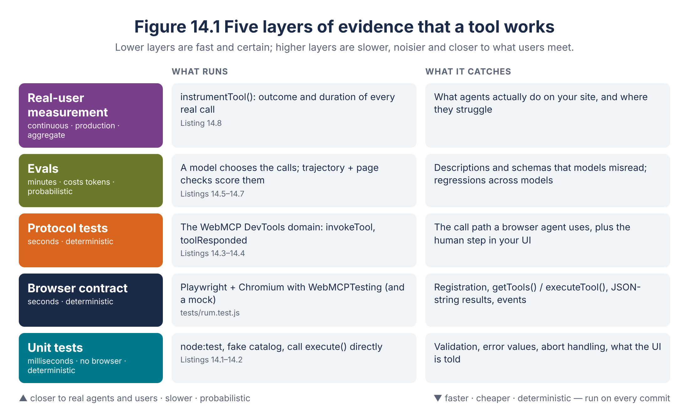
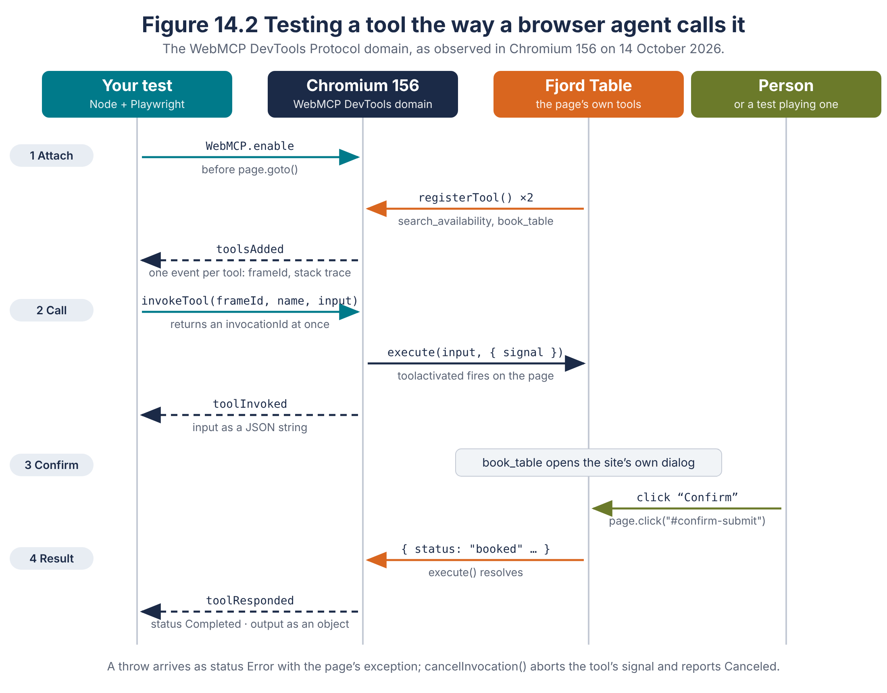

*Part V · Shipping and the ecosystem*

# Chapter 14: Testing, Debugging and Evals

> *“When testing systems that use generative AI, you must account for probabilistic outcomes that don't match your expectations.”*
>
> — Chrome for Developers, “Build your user’s agentic workflows with WebMCP tools”[^1]

## Two kinds of “it works”

By now Fjord Table has two tools and Trailhead has five. Each one is a small piece of JavaScript with a name, a description, a schema and an `execute` callback. You could test them the way you test any function: call it with some input and check what comes back. That is necessary, and this chapter starts there. It is not enough, though, because a WebMCP tool has a second kind of correctness that ordinary functions don’t have.

The first kind is the one you already know. Given valid input, does `book_table` open the confirmation dialog and return a reference? Given a date in the wrong format, does it say so in a way an agent can act on? When the agent gives up halfway, does the dialog close and nothing get booked? These questions have yes-or-no answers, and you can check them on every commit.

The second kind is about the caller. A person who wants a table for two adults and three children on Saturday says so in words. Somewhere between those words and your `execute` callback, a language model has to pick the right tool, turn “three kids” into part of `partySize`, and turn “Saturday 28 November” into `2026-11-28`. You don’t control that model, it may behave differently tomorrow, and it may be a different model on a different user’s machine. Your descriptions and schemas are the only part of that step you own, so they are what you test, by running real models against them many times and counting how often they get it right. That kind of test is called an *eval*.

This chapter builds both, in five layers (Figure 14.1). The lower layers are fast, cheap and certain. The upper ones are slower and noisier, and closer to what your users will actually experience. A good test suite uses all five, and it runs the lower ones far more often than the upper ones.



*Figure 14.1 — Five layers of evidence. Unit tests and browser tests tell you the code is right. Protocol tests tell you it is right when called the way a browser agent calls it. Evals tell you whether models can use it. Real-user measurement tells you whether they do.*

Every API detail below was checked on 14 October 2026 against the WebMCP Draft Community Group Report published that day, one day after the 13 October draft used in Chapter 5,[^2] and against Chrome’s documentation and the Chrome DevTools Protocol as published on the same day. All behaviour described as *observed* was observed in Chromium 156.0.8078.4, launched by Playwright with the `WebMCPTesting` feature switched on (the switch behind `chrome://flags/#enable-webmcp-testing`).[^3] Every listing in this chapter is in the book’s companion repository, `vibeprogrammer/webmcp-book-demos`, under `chapters/14-testing-debugging-evals/`, and its test script runs every one of them.

## Seeing your tools

Before you write a single test, look at what the browser actually received. Most first bugs with WebMCP are not logic bugs. A tool never registered because the code ran before the feature check, or registered twice and the second call rejected, or registered on the wrong view, or has a schema that isn’t quite what you meant. All of these are visible in a few seconds with the right tool.

### The WebMCP pane in Chrome DevTools

Chrome DevTools has a **WebMCP** pane inside the **Application** panel.[^4] It has two halves. **Available Tools** is a live list of the tools on the current tab, with each tool’s name and description as the agent sees them and an invocation counter. **Invoked Tools** is a log of every call, and selecting an entry shows its status (Completed, Canceled, In Progress or Error), the exact input the agent sent and the output or error your tool returned. You can filter the log by name, by status and by tool type, declarative or imperative.[^4]

Two features make the pane more than a viewer. The first is manual testing: click a tool in **Available Tools**, or the play icon next to a logged call, and DevTools opens a form where you can edit the input and press **Run tool**. Starting from a logged call pre-fills the form with the agent’s input, which is the fastest way to reproduce “the agent called it with *this* and it went wrong”. The second is troubleshooting: according to the documentation, the output pane shows error messages when parameters or return values don’t match the defined schema, and the invocation counter tells you whether an agent ever chose your tool for a given prompt.[^4]

Microsoft Edge lists “WebMCP debugging” among the updates Edge 149 took from the Chromium project, so the same pane is available in Edge.[^5]

> **Still in flux: what the pane checks.** Chrome’s page says the output pane reports schema violations. The specification, however, gives the browser no role in validating input against `inputSchema`, and issue #92, which asks whether the browser should own validation, was still open on 14 October 2026.[^6] Treat anything the pane flags as a debugging aid, not as a guarantee that the browser will reject bad calls in production. Your `execute` callback still has to validate.

### An agent of your own: the Inspector extension and DevTools for agents

The pane lets *you* call tools. To see what a *model* does with them, you need an agent. Chrome’s documentation points to two. The Model Context Tool Inspector is a Chrome extension that lists a page’s tools, shows their input schemas and lets you try natural-language prompts against them, with Gemini through an API key or, if you enable `chrome://flags/#prompt-api-tool-use`, with an on-device model through the Prompt API.[^3] The Chrome team publishes it alongside a set of demos, a polyfill and the eval tool we use later in this chapter, in the `GoogleChromeLabs/webmcp-tools` repository.[^7]

The second is aimed at coding agents. Chrome DevTools for agents, published on npm as `chrome-devtools-mcp` (version 1.10.1 on 14 October 2026), is an MCP server that lets an AI coding assistant drive a Chrome instance. It has two WebMCP tools, `list_webmcp_tools` and `execute_webmcp_tool`, which are off by default and turned on with the `--categoryExperimentalWebmcp` server argument.[^4][^8] With that flag, the assistant you write code with can call the tools you just wrote and read the results, which closes a useful loop while you are still designing a tool. It also tells you what both of these tools are built on: the DevTools Protocol, which we use directly later in this chapter.

### Tools that exist only for tooling: the `debugging` annotation

Chrome 156 added a fourth annotation alongside `readOnlyHint`, `untrustedContentHint` and `consequentialHint`. When `debugging` is `true`, the tool is meant for inspection and developer tooling, such as testing frameworks or DevTools’ own AI assistance, and general-purpose agents can filter it out.[^9] That makes it the right home for helpers you want during development but don’t want a shopper’s assistant to call, for example a tool that seeds Trailhead’s cart with test data or dumps the current view’s state.

In Chromium 156 the annotation comes back from `getTools()` with the other three, filled in with defaults. A tool registered with `annotations: { readOnlyHint: true, debugging: true }` was returned with `{ consequentialHint: false, debugging: true, readOnlyHint: true, untrustedContentHint: false }`, and the DevTools Protocol reported it as `{ readOnly: true, untrustedContent: false, consequential: false, debugging: true }`. A tool registered with no annotations had no `annotations` member at all, in either place.

The 14 October 2026 draft defines `debugging` in its `ToolAnnotations` dictionary next to the other three hints, with a default of `false`.[^10]

> **Still in flux: a hint, not a lock.** Like every annotation, `debugging` is a hint. The draft stores it and hands it to agents, but what an agent does with it is up to the agent, and Chrome’s documentation only says that agents *can* filter such tools out.[^9][^10] Never rely on it to hide anything sensitive. A debugging tool should not ship to production at all, or should only be registered behind a development-only check.

## Layer 1: unit tests for `execute` callbacks

### Write tools as data

The easiest WebMCP code to test is code that doesn’t touch `document.modelContext` at all. A tool is a plain object: name, description, schema, annotations and a function. If you build that object in a factory that takes its dependencies as arguments, a test can build the same object with fakes and call `execute()` directly in Node, with no browser involved.

Listing 14.1 does that for two of Trailhead’s tools. Everything the tools need from the rest of the store (the catalogue, the cart and the part of the UI that shows results) arrives as an argument. The schema follows the canonical Trailhead definitions used throughout the book, and the validation in `checkSearchInput()` repeats every rule the schema states, because nothing else will enforce them.

**Listing 14.1 — Trailhead’s tools built by a factory, so tests can inject fakes (trailhead-tools.js)**

```js
// Trailhead's tools, built by a factory. Every dependency arrives as an
// argument, so a unit test can pass fakes and call execute() directly.
export function createTrailheadTools({ catalog, cart, ui }) {
  const searchProducts = {
    name: 'search_products',
    title: 'Search products',
    description:
      'Search the Trailhead catalogue by keyword, with an optional category, ' +
      'maximum price in NOK and in-stock filter. Returns up to 10 products. ' +
      'Does not change the cart.',
    inputSchema: {
      type: 'object',
      properties: {
        query:       { type: 'string', description: 'Keywords, e.g. "2-person tent"' },
        category:    { type: 'string', enum: CATEGORIES },
        maxPrice:    { type: 'number', minimum: 0, description: 'Maximum price in NOK' },
        inStockOnly: { type: 'boolean', description: 'Only products that are in stock' }
      },
      required: ['query']
    },
    annotations: { readOnlyHint: true },
    async execute(input, { signal }) {
      const problem = checkSearchInput(input);              // the browser won't check
      if (problem) return { error: 'invalid_input', message: problem };
      const hits = await catalog.search(input, { signal });
      ui.showResults(hits);                                 // the user sees it too
      return {
        products: hits.slice(0, 10).map((p) => ({
          sku: p.sku, name: p.name,
          price: { amount: p.price, currency: 'NOK' },
          rating: p.rating, inStock: p.stock > 0
        }))
      };
    }
  };

  const addToCart = {
    name: 'add_to_cart',
    title: 'Add to cart',
    description:
      'Add a product to the cart by its SKU from search_products. ' +
      'Returns the updated cart line, or an error the agent can recover from.',
    inputSchema: {
      type: 'object',
      properties: {
        sku:      { type: 'string', description: 'SKU from search_products' },
        quantity: { type: 'integer', minimum: 1, maximum: 10 }
      },
      required: ['sku', 'quantity']
    },
    async execute({ sku, quantity }, { signal }) {
      if (typeof sku !== 'string' || sku === '')
        return { error: 'invalid_input', message: 'sku must be a SKU from search_products.' };
      if (!Number.isInteger(quantity) || quantity < 1 || quantity > 10)
        return { error: 'invalid_input', message: 'quantity must be a whole number from 1 to 10.' };
      const product = await catalog.get(sku, { signal });
      if (!product)
        return { error: 'unknown_sku', message: `No product ${sku}. Call search_products first.` };
      if (product.stock < quantity)
        return { error: 'out_of_stock', available: product.stock,
                 message: `Only ${product.stock} of ${product.name} in stock.` };
      const line = cart.add(product, quantity);
      ui.showCart(cart);
      return { sku, quantity: line.quantity,
               lineTotal: { amount: line.quantity * product.price, currency: 'NOK' } };
    }
  };

  return [searchProducts, addToCart];
}

export const CATEGORIES = ['tents', 'sleeping-bags', 'backpacks', 'footwear', 'clothing'];

function checkSearchInput({ query, category, maxPrice, inStockOnly }) {
  if (typeof query !== 'string' || query.trim() === '')
    return 'query must be a non-empty string, e.g. "tent".';
  if (category !== undefined && !CATEGORIES.includes(category))
    return `category must be one of: ${CATEGORIES.join(', ')}.`;
  if (maxPrice !== undefined && !(typeof maxPrice === 'number' && maxPrice >= 0))
    return 'maxPrice must be a number of NOK, 0 or more.';
  if (inStockOnly !== undefined && typeof inStockOnly !== 'boolean')
    return 'inStockOnly must be true or false.';
  return null;
}
```

Registering these tools in the real store is one line per tool, the same pattern as Chapter 5: `for (const tool of createTrailheadTools(deps)) await document.modelContext.registerTool(tool, { signal });`. The factory is what changes. In Chapter 10’s React version the dependencies come from the component tree; here they could come from anywhere.

### What to test

Listing 14.2 is the unit test file. It uses `node:test`, the test runner built into Node.js, which has been stable since Node 20, so it needs no dependencies.[^11] The fakes in `tests/fixtures/fakes.js` are about sixty lines: an in-memory catalogue of six products, a cart and a UI object that records what it was asked to show.

**Listing 14.2 — Unit tests for the execute callbacks (tests/trailhead-tools.test.js)**

```js
// Unit tests for Trailhead's execute callbacks. No browser, no WebMCP:
// node --test tests/trailhead-tools.test.js
import { test } from 'node:test';
import assert from 'node:assert/strict';
import { createTrailheadTools } from '../trailhead-tools.js';
import { fakeCatalog, fakeCart, recordingUi } from './fixtures/fakes.js';

function setup() {
  const catalog = fakeCatalog();
  const ui = recordingUi();
  const [search, addToCart] = createTrailheadTools({ catalog, cart: fakeCart(), ui });
  return { catalog, ui, search, addToCart };
}
const run = (tool, input, signal = new AbortController().signal) =>
  tool.execute(input, { signal });

test('search_products returns NOK prices and shows the same results', async () => {
  const { search, ui } = setup();
  const { products } = await run(search, { query: 'tent', maxPrice: 3000 });
  assert.ok(products.length > 0);
  for (const p of products) {
    assert.equal(p.price.currency, 'NOK');
    assert.ok(p.price.amount <= 3000);
  }
  assert.equal(ui.calls.at(-1)[0], 'showResults');           // the user sees it too
});

test('input the schema forbids comes back as a value, not a throw', async () => {
  const { search, catalog } = setup();
  for (const input of [{}, { query: '' }, { query: 'tent', maxPrice: '3000' },
                       { query: 'tent', category: 'kayaks' }]) {
    const result = await run(search, input);
    assert.equal(result.error, 'invalid_input', JSON.stringify(input));
    assert.match(result.message, /must/);                    // tells the agent how to fix it
  }
  assert.equal(catalog.searches, 0);                         // never reached the backend
});

test('add_to_cart explains a stock problem the agent can act on', async () => {
  const { addToCart } = setup();
  const result = await run(addToCart, { sku: 'TH-TENT-2P', quantity: 9 });
  assert.equal(result.error, 'out_of_stock');
  assert.equal(result.available, 3);
});

test('an aborted call stops before touching the backend', async () => {
  const { search, catalog } = setup();
  const controller = new AbortController();
  controller.abort();
  await assert.rejects(run(search, { query: 'tent' }, controller.signal),
                       { name: 'AbortError' });
  assert.equal(catalog.searches, 0);
});
```

Each test targets a specific way a tool can let an agent down.

**The result is shaped the way the description promises.** Prices are in NOK, at most ten products come back, and the same results reach the page. The last check matters more than it looks. Chapter 4 argued that a tool should drive the same UI a person uses, so the user can see what the agent sees. A unit test is the cheapest place to keep that promise from quietly breaking.

**Input the schema forbids is answered with a value.** This is the most important test in the file. The browser passes your callback whatever object the agent sent, as long as it parses as a JSON object. It does not check it against `inputSchema`; the draft’s tool execute steps only reject input that isn’t an object.[^12] Whether the browser *should* validate is still being debated in issue #92, which was opened in February 2026 and was still open on 14 October.[^6] Until that changes, a missing `query`, a price sent as the string `'3000'` or a category the store doesn’t have will all reach your code. The test sends each of them and checks two things: the tool returns `invalid_input` with a message that says how to fix the call, and the backend was never touched.

**Stock problems are explained, not thrown.** An `out_of_stock` result that includes `available: 3` lets an agent offer the user three tents instead of failing. Chapter 6 covered why recoverable failures should be return values. This is where you check that they stay that way.

**An aborted call stops early.** An agent that gives up aborts the signal it passed to your callback. The test hands the tool an already-aborted signal and checks that it rejects with `AbortError` before reaching the catalogue. In the real page this is what keeps a cancelled search from overwriting the results of the user’s next one.

Run the file with `node --test tests/trailhead-tools.test.js`. On the machine used for this chapter the four tests took about 80 milliseconds in total. That speed is the point of this layer. These tests can run on every save, and they cover most of the logic in your tools.

> **A schema contract test.** Validation code and schemas drift apart. Someone raises the maximum quantity to 20 in the schema and forgets the check, or the other way round. A cheap guard is a test that walks the schema and, for every constraint it declares (`required`, `enum`, `minimum`, `maximum`), sends one input that breaks it and expects `invalid_input`. The second test in Listing 14.2 is a hand-written version of that idea for `search_products`.

## Layer 2: the browser contract

Unit tests stop at the edge of your code. The next layer checks the part between your code and the agent: that the tool actually registers, that `getTools()` lists it with the schema and annotations you meant, and that a call made through the browser comes back the way you expect.

There are two ways to get a `document.modelContext` into a test browser, and the companion repository uses both. The first is a mock: a small script injected before the page loads that implements `registerTool()`, `getTools()` and `executeTool()` in plain JavaScript. It works in any browser and on any CI machine, and it lets you test pages long before the browsers you care about ship the API. The second is the real thing: Chromium launched with `--enable-features=WebMCPTesting`. Playwright’s bundled Chromium 156 accepts the switch, so the same test file can run against either, chosen by an environment variable.

The test for Listing 14.8, later in this chapter, is written that way. `tests/rum.test.js` loads a page that registers Trailhead’s tools, calls them with `getTools()` and `executeTool()` from inside the page, and runs once with the mock and once with Chromium’s own implementation. Running both is not redundant. The mock tells you that your page uses the API as specified. Chromium tells you what will actually happen today, and the two disagree in more places than you might expect.

**Table 14.1 — Things a browser contract test should pin down, as observed in Chromium 156, against the 14 October 2026 draft**

| Behaviour | Draft (14 October 2026) | Chromium 156 (observed) |
|---|---|---|
| A tool returns a plain string | JSON-serialized, so it arrives quoted | Arrives as the bare string |
| A tool returns `undefined` | `OperationError` | The string `"undefined"` |
| A tool throws | `OperationError` | `UnknownError` |
| Calling a tool that was unregistered | `NotFoundError` | `UnknownError` |
| What `executeTool()` resolves to | A string (`Promise<DOMString>`) | A string; parse it with `JSON.parse()` |
| Invalid name, empty description, duplicate name | `InvalidStateError` | `InvalidStateError` |

Sources: the specification’s IDL, execute steps and table of tool execution errors;[^12] the Chromium observations come from the Fjord Table test suite in the companion repository, run against Chromium 156 with WebMCPTesting on 14 October 2026.[^13]

Some of these differences are history catching up. The draft replaced its generic `UnknownError` rejections with specific `DOMException` types on 8 October 2026, in pull request #339. The Chromium 156 build used here still reports `UnknownError`.[^14] The practical rule is to assert on the shape your *page* controls, a JSON object with a `status` or `error` field, and to avoid tests that depend on how the browser wraps strings, `undefined` or exceptions. Those are exactly the details most likely to change before WebMCP ships anywhere.

### What the web-platform-tests already cover

The browsers have their own contract tests, and they are worth reading. The specification names its test suite in its header: the `webmcp/` directory of web-platform-tests (WPT), with results on wpt.fyi.[^2] On 14 October 2026 that directory held an IDL test, tests for the `toolactivated` and `toolcancel` events, a `declarative/` folder and an `imperative/` folder with 47 HTML test files.[^15] Their names read like a list of edge cases you would otherwise discover in production: `executeTool-abort`, `unregister-during-executeTool`, `executeTool-target-navigation`, `exposedTo-cross-origin-child`, `register_tool_name_validation`, `non-secure`.

The tests use `testharness.js`, so each one is a short page you can open and read. They are often the most precise description of a behaviour you will find anywhere. The `toolcancel` event test, for example, carries a comment explaining that aborting the caller’s signal rejects the `executeTool()` promise first and only then cancels the tool’s own execution, which queues the task that fires `toolcancel`, so awaiting the rejection alone isn’t enough to observe the event.[^16] If your page listens for `toolcancel` to clean up, that ordering is exactly what your own tests need to wait for.

When you find a behaviour the WPT suite doesn’t cover, and the observations in this chapter include a few, a WPT-style test page is also the most useful bug report you can write. We come back to that at the end of the chapter.

## Layer 3: calling tools the way a browser agent does

A test that calls `executeTool()` from inside the page is calling your tool the way an *in-page* agent would (Chapter 7). Chrome’s built-in agent and agent extensions don’t live in your page. They reach your tools through the browser. If you want a test that exercises that path, including the part where a person clicks a button in your UI halfway through a call, you need to stand where the browser agent stands. The Chrome DevTools Protocol lets you do that.

### The WebMCP domain

The DevTools Protocol (CDP) is the interface Chrome DevTools uses to inspect and control the browser, and the one that automation libraries such as Playwright and Puppeteer let you talk to directly. Its tip-of-tree version has an experimental `WebMCP` domain with four commands and four events (Table 14.2).[^17] DevTools’ WebMCP pane is, in effect, a user interface for this domain.

**Table 14.2 — The WebMCP domain of the Chrome DevTools Protocol (experimental, tip-of-tree, 14 October 2026)**

| Name | Kind | What it does |
|---|---|---|
| `WebMCP.enable` | command | Starts sending events, and fires `toolsAdded` for every tool already registered |
| `WebMCP.disable` | command | Stops sending events |
| `WebMCP.invokeTool` | command | Calls a tool by `frameId` and `toolName` with an `input` object; returns an `invocationId` |
| `WebMCP.cancelInvocation` | command | Cancels a pending invocation by `invocationId` |
| `WebMCP.toolsAdded` | event | Tools were registered: name, description, `inputSchema`, annotations, `frameId`, and the registration’s stack trace |
| `WebMCP.toolsRemoved` | event | Tools were unregistered: name and `frameId` |
| `WebMCP.toolInvoked` | event | A call started: tool name, frame, `invocationId` and the input as a JSON string |
| `WebMCP.toolResponded` | event | A call ended with status `Completed`, `Canceled` or `Error`, plus `output`, `errorText` or the thrown exception |

Source: the protocol definition.[^17]

Two details in the definition are worth noticing. The `invokeTool` response, which carries the `invocationId`, “is sent before tool events”, so a client always learns the ID before the result arrives. And the description of `output` warns that it is untrusted and “poses a prompt injection risk”, so clients should treat it as potentially malicious input.[^17] Your test harness is a client too. If you ever feed tool output back into a model, as the eval runner later in this chapter does, that warning applies to you.

### A small driver

Listing 14.3 wraps the domain in about fifty lines. It keeps a live map of tools from `toolsAdded` and `toolsRemoved`, records every call, and turns the asynchronous `invokeTool` + `toolResponded` pair into something a test can `await`. It works with any CDP session that has `send()` and `on()`, which includes Playwright’s `CDPSession` (created with `page.context().newCDPSession(page)`)[^18] and Puppeteer’s.

**Listing 14.3 — A driver for the WebMCP DevTools Protocol domain (webmcp-cdp.js)**

```js
// A small driver for the WebMCP domain of the Chrome DevTools Protocol
// (experimental). Takes any CDP session with send() and on(), such as
// Playwright's CDPSession or Puppeteer's CDPSession.
export async function attachWebMCP(cdp) {
  const tools = new Map();        // name -> Tool, as DevTools reports it
  const calls = [];               // one record per invocation, for reports
  const waiting = new Map();      // invocationId -> resolve()
  const early = new Map();        // responses that beat the waiter

  cdp.on('WebMCP.toolsAdded', (e) => { for (const t of e.tools) tools.set(t.name, t); });
  cdp.on('WebMCP.toolsRemoved', (e) => { for (const t of e.tools) tools.delete(t.name); });
  cdp.on('WebMCP.toolInvoked', (e) => calls.push({ ...e, input: JSON.parse(e.input) }));
  cdp.on('WebMCP.toolResponded', (e) => {
    Object.assign(calls.find((c) => c.invocationId === e.invocationId) ?? {}, e);
    const resolve = waiting.get(e.invocationId);
    if (resolve) resolve(e); else early.set(e.invocationId, e);
  });
  await cdp.send('WebMCP.enable');  // replays toolsAdded for tools already registered

  async function start(name, input = {}, { timeout = 15_000 } = {}) {
    const tool = tools.get(name);
    if (!tool) throw new Error(`No WebMCP tool named "${name}"`);
    const { invocationId } = await cdp.send('WebMCP.invokeTool',
      { frameId: tool.frameId, toolName: name, input });
    const response = early.has(invocationId)
      ? Promise.resolve(early.get(invocationId))
      : new Promise((resolve, reject) => {
          const timer = setTimeout(() => reject(new Error(`${name}: no response`)), timeout);
          waiting.set(invocationId, (e) => { clearTimeout(timer); resolve(e); });
        });
    return { invocationId, response };   // response: { status, output?, errorText?, exception? }
  }

  return {
    tools,
    calls,
    start,
    async invoke(name, input, options) {
      return (await start(name, input, options)).response;
    },
    cancel: (invocationId) => cdp.send('WebMCP.cancelInvocation', { invocationId }),
    async waitForTool(name, { timeout = 5_000 } = {}) {
      for (const end = Date.now() + timeout; !tools.has(name); ) {
        if (Date.now() > end) throw new Error(`Tool "${name}" never appeared`);
        await new Promise((r) => setTimeout(r, 50));
      }
      return tools.get(name);
    }
  };
}
```

There are two ways to call a tool. `invoke()` waits for the result, which suits most tests. `start()` returns as soon as the browser has accepted the call, with the `invocationId` and a promise for the response, so a test can do something in the middle: click a button, check the screen, or cancel the call.

The `early` map is defensive. The protocol promises that the `invokeTool` response comes before the tool’s events, but a fast tool can finish before the test’s own code has registered its waiter, and the map makes sure that response isn’t lost.

### Fjord Table under test

Listing 14.4 uses the driver to test Fjord Table’s booking flow end to end. It serves the Fjord Table demo from the companion repository, launches Chromium with WebMCP on and attaches the driver to each new page *before* navigating, so that `toolsAdded` reports both tools as the page registers them.

**Listing 14.4 — Fjord Table driven over the DevTools Protocol, with a human click in the middle (tests/fjord-table.cdp.test.js)**

```js
// Fjord Table, driven the way a browser agent drives it: over the WebMCP
// DevTools Protocol domain, with a human click in the site's own dialog.
// Needs Chromium with WebMCP on:  node --test tests/fjord-table.cdp.test.js
import { test, before, after } from 'node:test';
import assert from 'node:assert/strict';
import { chromium } from 'playwright';
import { attachWebMCP } from '../webmcp-cdp.js';
import { serve, nextOpenDate } from './fixtures/serve.js';

let browser, site;
before(async () => {
  site = await serve(new URL('../../../fjord-table/', import.meta.url));
  browser = await chromium.launch({ args: ['--enable-features=WebMCPTesting'] });
});
after(async () => { await browser?.close(); await site?.close(); });

async function openBookingView() {
  const page = await browser.newPage();
  const webmcp = await attachWebMCP(await page.context().newCDPSession(page));
  await page.goto(`${site.url}#/book`);
  await webmcp.waitForTool('search_availability');
  await webmcp.waitForTool('book_table');      // registered only on this view
  return { page, webmcp };
}
const DATE = nextOpenDate();

test('agent books, person confirms in the site dialog', async () => {
  const { page, webmcp } = await openBookingView();
  const found = await webmcp.invoke('search_availability', { date: DATE, partySize: 2 });
  assert.equal(found.status, 'Completed');
  const time = found.output.slots[0];

  const call = await webmcp.start('book_table', { date: DATE, time, partySize: 2 });
  await page.waitForSelector('#confirm-dialog[open]');    // Fjord Table's own UI
  await page.click('#confirm-submit');                     // the human's decision
  const { status, output } = await call.response;

  assert.equal(status, 'Completed');
  assert.equal(output.status, 'booked');
  assert.match(output.reference, /^FT-\d+$/);
  assert.equal(webmcp.calls.at(-1).input.partySize, 2);    // what the agent sent
});

test('bad input is answered with a value the agent can fix', async () => {
  const { webmcp } = await openBookingView();
  const { status, output } =
    await webmcp.invoke('book_table', { date: '20/11/2026', time: '19:00', partySize: 2 });
  assert.equal(status, 'Completed');                       // not an Error
  assert.equal(output.status, 'invalid_input');
  assert.match(output.message, /YYYY-MM-DD/);
});

test('cancelling a call aborts the tool and closes the dialog', async () => {
  const { page, webmcp } = await openBookingView();
  const { output } = await webmcp.invoke('search_availability', { date: DATE, partySize: 4 });
  const call = await webmcp.start('book_table',
    { date: DATE, time: output.slots[0], partySize: 4 });
  await page.waitForSelector('#confirm-dialog[open]');
  await webmcp.cancel(call.invocationId);                  // the agent gives up

  assert.equal((await call.response).status, 'Canceled');
  await page.waitForFunction(() => !document.querySelector('#confirm-dialog').open);
  assert.equal(await page.isHidden('#confirmation'), true); // nothing was booked
});
```

The first test is the whole of Figure 14.2 in a dozen lines. The agent searches, starts a booking, and the test waits for Fjord Table’s own confirmation dialog to open before playing the person who presses **Confirm booking**. Only then does `toolResponded` arrive, with status `Completed` and Fjord Table’s result as the output. The second test checks that a malformed date comes back as a *successful* call whose output says `invalid_input`, which is what Chapter 6 asked for: from the protocol’s point of view, a recoverable failure is not an error. The third starts a booking, cancels it from the agent’s side while the dialog is open, and checks three things: the protocol reports `Canceled`, the dialog closes because the tool’s own `signal` was aborted, and nothing was booked.



*Figure 14.2 — The sequence behind the first test in Listing 14.4, as observed in Chromium 156. Solid arrows are calls; dashed arrows are protocol events.*

All three tests passed against Chromium 156. Writing them also turned up a few behaviours that the protocol definition doesn’t spell out, which are worth knowing before you rely on them.

**`toolsAdded` arrives once per registration.** Fjord Table registers two tools, and the driver saw two separate `toolsAdded` events, each with one tool. Because `book_table` is registered as soon as the booking view opens, while `search_availability` waits for its module’s top-level `await`, `book_table` was reported first. A first version of the test waited only for `book_table` and then failed to find `search_availability`. Wait for each tool you are about to call by name, as `openBookingView()` does, rather than for “some tools”.

**Calling a tool that doesn’t exist fails the command itself.** `invokeTool` with an unknown name was rejected with the protocol error `Tool not found`, rather than returning an `invocationId` and reporting an error later.

**A throw arrives with the exception.** A tool that threw `new Error('kaput')` produced a `toolResponded` with status `Error`, an empty `errorText`, and an `exception` object whose description was the error’s message and stack trace, pointing at the line in the page that threw. That is far more useful in a test log than the `UnknownError` an in-page caller gets (Table 14.1).

**Cancelling aborts the tool’s signal and fires `toolcancel`.** After `cancelInvocation`, the tool’s `signal` fired `abort`, `toolcancel` was dispatched on the page’s `document.modelContext`, and the protocol reported `Canceled`.

**Object results arrive as objects.** For a tool that returned `{ got: { x: 3 } }`, the `output` field of `toolResponded` was that object, not a JSON string. The protocol declares `output` as type `any`, so a different build could send a string. The driver passes it through unchanged.

**`toolactivated` fired after `execute` had started.** The draft’s tool execute steps fire `toolactivated` at the page before the execute callback is invoked.[^12] In Chromium 156, the synchronous start of an `async execute` function ran *before* the page’s `toolactivated` listener. If you use the event to set up state that `execute` relies on, you will hit that difference. Use it for logging and UI hints, not for setup.

> **Still in flux: the protocol domain.** The `WebMCP` domain is marked experimental and lives only in the tip-of-tree version of the protocol, which changes with Chrome.[^17] Its annotation names (`readOnly`, `consequential`) already differ from the page API’s (`readOnlyHint`, `consequentialHint`), and its `Annotation` type still has an `autosubmit` field for declarative tools, which the specification removed on 8 October 2026 (pull request #338).[^19] Keep protocol access in one module, as Listing 14.3 does, so that a rename costs you one file. And keep a small set of in-page tests next to the protocol tests, because only those use a surface the specification defines.

The same driver works for tools registered inside frames, at least on paper: every `Tool` in `toolsAdded` carries the `frameId` of the frame that registered it, and `invokeTool` takes that ID.[^17] The Helpdesk Widget of Chapter 7 registers its tools inside a cross-origin iframe. We haven’t yet tested that combination through the protocol, so treat it as the next experiment rather than a known result.

## Layer 4: evals

Everything so far has been deterministic. Each test calls a tool with input *you* chose. An eval hands that choice to a model. You give the model a user’s request and your page’s tools, let it decide what to call, run those calls against the real page, and score what happened. Chrome’s guidance on building tools puts it in one sentence: evals can help you verify consistent tool selection, parameter extraction, and state management.[^1] Those three phrases are a good checklist for what a suite should cover.

- **Tool selection.** Given “is there a table for two on Friday?”, does the model call `search_availability`, not `book_table`?
- **Parameter extraction.** Does “two adults and three kids” become `partySize: 5`? Does “21 November” become `2026-11-21`, not `21/11/2026`?
- **State management.** After a search, does the model book the slot the user asked for, and does the page end up showing a booking?

### A task suite

You don’t have to invent a format. The Chrome team’s `webmcp-evals` tool, published in `GoogleChromeLabs/webmcp-tools` and on npm (version 0.0.4, marked experimental), reads test cases from an `evals.json` file.[^20] Each case has a name, the conversation so far and the tool calls you expect, with argument values that can be exact or constraints such as `$pattern`, `$contains`, `$gte` or `$type`. Expected calls can be marked `optional`.[^20] Listing 14.5 is Fjord Table’s first suite in that format.

**Listing 14.5 — A task suite for Fjord Table (evals/fjord-table.evals.json)**

```json
[
  {
    "name": "Find a table for two on a named date",
    "messages": [
      { "role": "user", "type": "message",
        "content": "Is there a table for two at Fjord Table on Friday 20 November 2026, around 7 in the evening?" }
    ],
    "expectedCall": [
      { "functionName": "search_availability",
        "arguments": { "date": "2026-11-20", "partySize": 2,
                       "time": { "$pattern": "^(18|19|20):\\d{2}$" } } }
    ]
  },
  {
    "name": "Search, then book the slot the user asked for",
    "messages": [
      { "role": "user", "type": "message",
        "content": "Book us a window table for four at 19:30 on 21 November 2026. It's my mum's birthday." }
    ],
    "expectedCall": [
      { "functionName": "search_availability",
        "arguments": { "date": "2026-11-21", "partySize": 4 }, "optional": true },
      { "functionName": "book_table",
        "arguments": { "date": "2026-11-21", "time": "19:30", "partySize": 4,
                       "seating": "window", "notes": { "$contains": "birthday" } } }
    ],
    "assertions": [
      { "type": "dom", "selector": "#confirmation",
        "expect": { "text": { "$contains": "Booked: FT-" } } }
    ]
  },
  {
    "name": "Children count as guests",
    "messages": [
      { "role": "user", "type": "message",
        "content": "Two adults and three kids, Saturday 28 November 2026 at 17:30 please. Any table is fine." }
    ],
    "expectedCall": [
      { "functionName": "search_availability",
        "arguments": { "date": "2026-11-28", "partySize": 5 }, "optional": true },
      { "functionName": "book_table",
        "arguments": { "date": "2026-11-28", "time": "17:30", "partySize": 5 } }
    ],
    "assertions": [
      { "type": "dom", "selector": "#my-bookings li", "expect": { "count": 1 } }
    ]
  }
]
```

The three cases follow the three phrases above. The first is pure tool selection and extraction, with a regular expression that accepts any time between 18:00 and 20:59 for “around 7 in the evening”. The second and third test the full search-then-book flow, with the search marked `optional` because a model that books directly from an unambiguous request isn’t wrong. The `assertions` arrays are explained in a moment; they are the lesson of the first run.

`webmcp-evals` can run a suite like this in several ways. Its `local` mode sends static tool schemas to a model without a browser. Its `browser` mode runs the model against tools on a live page through Puppeteer. Its `smoke` mode needs no model at all: it executes the expected calls directly against the page, which makes it a deterministic check that the suite and the page still agree. And its `simulate` mode lets a second model play the user over several turns, then checks the final page with DOM assertions, a judge model, or both.[^20] The README is clear about what to rely on: conversations driven by a simulated user “remain non-deterministic, so keep `smoke` as the fully deterministic, API-key-free CI signal”.[^20]

### A minimal runner

To show what is going on inside such a tool, and to have something you can run against any model with an OpenAI-compatible endpoint, the companion repository has a small runner of its own. It reads the same `evals.json` format, executes calls over the driver from Listing 14.3, and scores the results. Listing 14.6 is the argument matcher. It deliberately follows the semantics of `webmcp-evals`’ own matcher: objects match as subsets, so a model that adds an extra field isn’t penalized; arrays match strictly by position; and an object whose keys all start with `$` is a constraint.[^21]

**Listing 14.6 — Matching expected arguments (evals/matcher.js)**

```js
// Argument matching for evals.json suites, with the semantics of
// webmcp-evals' matcher: objects match as subsets, arrays match strictly,
// and an object whose keys all start with "$" is a constraint.
export function matchesArgument(expected, actual) {
  if (isConstraint(expected)) return matchesConstraint(expected, actual);
  if (expected === actual) return true;
  if (typeof expected !== 'object' || expected === null ||
      typeof actual !== 'object' || actual === null) return false;
  if (Array.isArray(expected) !== Array.isArray(actual)) return false;
  if (Array.isArray(expected)) {
    return expected.length === actual.length &&
           expected.every((e, i) => matchesArgument(e, actual[i]));
  }
  return Object.keys(expected).every((key) =>
    Object.hasOwn(actual, key) && matchesArgument(expected[key], actual[key]));
}

const isConstraint = (v) => typeof v === 'object' && v !== null && !Array.isArray(v) &&
  Object.keys(v).length > 0 && Object.keys(v).every((k) => k.startsWith('$'));

function matchesConstraint(c, actual) {
  const num = typeof actual === 'number';
  const str = typeof actual === 'string';
  return Object.entries(c).every(([op, value]) => {
    switch (op) {
      case '$pattern':  return str && new RegExp(value).test(actual);
      case '$contains': return str && actual.includes(value);
      case '$gt':  return num && actual > value;
      case '$gte': return num && actual >= value;
      case '$lt':  return num && actual < value;
      case '$lte': return num && actual <= value;
      case '$type':
        if (value === 'array') return Array.isArray(actual);
        if (value === 'null') return actual === null;
        if (value === 'object') return typeof actual === 'object' && actual !== null && !Array.isArray(actual);
        return typeof actual === value;
      case '$any':  return true;          // presence was checked by the caller
      default: throw new Error(`Unknown constraint ${op}`);
    }
  });
}
```

Listing 14.7 is the runner. For each case and each run it opens a fresh page, asks the agent for its next call, executes it, feeds the result back, and repeats until the agent stops calling tools or runs out of steps. Then it scores the *trajectory*, the ordered list of calls, against `expectedCall`, and finally checks the page.

**Listing 14.7 — Running a suite against a live page (evals/run-evals.js)**

```js
// Run an evals.json suite against a live page: an agent proposes tool calls,
// the page executes them over CDP, and the trajectory is scored.
import { matchesArgument } from './matcher.js';

export async function runSuite({ suite, openPage, agent, runs = 5, maxSteps = 6 }) {
  const report = [];
  for (const testCase of suite) {
    const result = { name: testCase.name, runs, passed: 0, failures: [] };
    for (let run = 0; run < runs; run++) {
      const { page, webmcp, close } = await openPage();    // a fresh page every run
      const trajectory = [];
      let verdict;
      try {
        const messages = [...testCase.messages];
        for (let step = 0; step < maxSteps; step++) {
          const tools = [...webmcp.tools.values()];
          const { call } = await agent.next({ messages, tools });
          if (!call) break;                                 // the agent has answered
          const reply = await webmcp.invoke(call.functionName, call.arguments);
          trajectory.push({ ...call, status: reply.status, output: reply.output });
          messages.push({ role: 'tool', name: call.functionName, call,
                          content: JSON.stringify(reply.output ?? reply.errorText ?? null) });
        }
        verdict = scoreTrajectory(testCase.expectedCall, trajectory);
        if (verdict.ok) verdict = await checkPage(page, testCase.assertions ?? []);
      } finally {
        await close();
      }
      if (verdict.ok) result.passed++; else result.failures.push(verdict.reason);
    }
    report.push({ ...result, passRate: result.passed / runs });
  }
  return report;
}

// Expected calls must appear in order. Optional ones may be missing.
// Extra calls in between are allowed: agents often look before they leap.
export function scoreTrajectory(expected, actual) {
  let from = 0;
  for (const exp of expected) {
    const at = actual.findIndex((a, i) => i >= from &&
      a.functionName === exp.functionName && matchesArgument(exp.arguments, a.arguments));
    if (at === -1) {
      if (exp.optional) continue;
      const got = actual.map((a) => `${a.functionName}(${JSON.stringify(a.arguments)})`);
      return { ok: false,
               reason: `expected ${exp.functionName}; got ${got.join(' → ') || 'no calls'}` };
    }
    from = at + 1;
  }
  return { ok: true };
}

// The right calls are not enough: did the page end up where the user wanted?
// Same shape as webmcp-evals' DOM assertions: one expectation per assertion.
async function checkPage(page, assertions) {
  for (const { selector, expect } of assertions) {
    const [key, want] = Object.entries(expect)[0];
    const seen = await page.$$eval(selector, (els) => ({
      exists: els.length > 0, count: els.length, text: els[0]?.textContent.trim() ?? null }));
    if (!matchesArgument(want, seen[key]))
      return { ok: false, reason: `${selector}: expected ${key} ${JSON.stringify(want)}, saw ${JSON.stringify(seen[key])}` };
  }
  return { ok: true };
}
```

The agent is anything with a `next({ messages, tools })` method that returns `{ call }` or `{ call: null }`. The repository has three. Two are scripted stand-ins with no model behind them: a “careful” agent that does what a good agent should, and a “sloppy” one that makes two classic mistakes, a European date format and forgetting the children. They exist to test the runner itself, and `tests/evals.test.js` checks that the careful one passes, the sloppy one fails with a readable reason, and the matcher and scorer behave as described. The third, `evals/chat-agent.js`, turns the page’s tools into function definitions for any OpenAI-compatible Chat Completions endpoint, configured through environment variables, so you can run `node evals/run.js --agent=chat --runs=5` against whichever model you want to measure.

### What the first run taught us

The first version of Listing 14.5 had no `assertions`, and the third case asked for 17:00, not 17:30. We ran it five times against one hosted model (OpenAI’s `gpt-6-sol`, through its Chat Completions API, with reasoning turned off because that endpoint doesn’t accept function tools with reasoning enabled for this model) on 14 October 2026. The first two cases passed five times out of five. The third failed all five times, always the same way: the model searched for a table for five at 17:00 and then stopped without booking.

The model’s final message explained why: “There’s no 17:00 table for five on Saturday 28 November. The earliest available is **17:30**. Would you like me to open the booking form for that time?” Fjord Table’s demo backend opens at 17:00 but, for that date and party size, had nothing before 17:30. The model was right. The eval was wrong.

Then we noticed something worse. The scripted “careful” agent had passed that same case. It had called `book_table` with exactly the expected arguments, Fjord Table had answered `slot_unavailable`, and the scorer, which only compared calls, had counted it as a success. A trajectory can be perfect and the user can still end up with nothing.

Both problems have the same fix: check the outcome as well as the calls. `webmcp-evals` does this in its `simulate` mode with DOM assertions, deterministic checks against the final page, evaluated once after the conversation ends.[^20] Listing 14.7’s `checkPage()` borrows that shape: a CSS selector and one expectation (`exists`, `count` or `text`), with the same constraint operators as the arguments. The second case now requires the confirmation banner to read “Booked: FT-…”, and the third requires exactly one entry in the user’s list of bookings. A new test in `tests/evals.test.js` runs the careful agent against a page where the simulated person cancels every confirmation, and checks that both booking cases now fail with a message that names the selector.

With the third case corrected to 17:30 and the assertions in place, the same model passed all three cases five times out of five, 15 runs in total. The raw reports from both runs are in the repository under `evals/results/`.

Read those numbers for what they are. Five runs of three cases against one model on one day is a smoke test, not a measurement. It tells you the suite works and the descriptions aren’t obviously broken. It does not tell you that 100 percent of real conversations will succeed.

### Designing suites that keep telling you something

A few habits make the difference between an eval suite that guides your work and one that only produces green ticks.

**Write cases from user language, not from your schema.** Real requests contain “tomorrow”, “around seven”, “me and my partner plus the twins”. If every case already says `2026-11-20` and `partySize 2`, you are testing the model’s ability to copy.

**Check outcomes, not just calls.** The 17:00 case is the reason. Where the page shows the result of an action, assert on the page. Where it doesn’t, assert on the tool’s returned `status`.

**Include cases where the right answer is not to act.** A request for fifteen people is outside `book_table`’s range of 1 to 12, and the tool’s own error message tells the agent to suggest calling the restaurant. A good suite checks that the agent relays that instead of booking two tables. Neither the `evals.json` format nor the runner here has a first-class way to say “expect no call”; a `simulate` case with a judge model and prose success criteria is the closer fit.[^20]

**Run each case many times and report a rate.** One pass proves little and one failure proves little more. Pick a run count you can afford, keep it fixed, and track the pass rate per case over time.

**Run the same suite across models.** Your tools will be called by whatever model sits behind the user’s browser agent, and you won’t get to choose. Running the suite against two or three models of different sizes, including a small on-device model if you can, tells you how much your descriptions depend on a clever caller. Chapter 5’s advice about descriptions and schemas becomes measurable here.

**Treat failing cases as bugs in either place.** Sometimes the model is wrong and your description needs to be clearer. Sometimes, as with 17:00, the eval is wrong. Read the transcript before changing anything.

**Table 14.3 — Where each layer runs**

| When | What to run | Cost |
|---|---|---|
| Every save or commit | Unit tests (Listing 14.2); browser tests with the mock | Seconds, free |
| Every pull request | Browser and protocol tests in Chromium with WebMCPTesting (Listing 14.4); the eval harness with scripted agents, or `webmcp-evals smoke` | A minute or two, free |
| Nightly, or when descriptions change | The eval suite against two or three real models, several runs each | Minutes, costs tokens |
| Before a release | Multi-turn simulations with DOM assertions and a judge model; a manual session with the Inspector extension | Longer, costs tokens and attention |
| Continuously, in production | Real-user measurement (Listing 14.8) | Small, ongoing |

## Layer 5: real-user measurement

Evals tell you whether models *can* use your tools. Only production tells you whether they *do*, which tools they reach for, how often a call comes back with an error the agent has to recover from, and how long users wait. Chrome’s guidance makes the same point: role-playing is good for a first prototype, but in production you should add real-world telemetry, analyze the interaction logs to find where agents struggle or deviate from the expected paths, and use what you learn to update your evals and tool definitions.[^1]

WebMCP makes this easier than measuring agents usually is. An agent that drives your page by clicking looks almost exactly like a person, so analytics can only guess at it. An agent that uses your tools calls your code, so you know exactly when that happens and what came of it.

### Wrapping `execute`

Listing 14.8 wraps a tool so that every call reports one small event: which tool, how it ended, a short code for recoverable failures, and how many milliseconds it took. It distinguishes four outcomes, which map directly onto the patterns from Chapters 5 and 6: `ok`, `recoverable` (a failure returned as a value, such as `out_of_stock`), `aborted` (the caller gave up) and `thrown` (a bug).

**Listing 14.8 — Measuring real tool calls without recording their contents (instrument-tool.js)**

```js
// Real-user measurement for WebMCP tools: wrap execute() to record how each
// call ended and how long it took. No inputs or outputs leave the page.
export function instrumentTool(tool, report, { failureCode = (r) => r?.error } = {}) {
  const execute = tool.execute;
  return {
    ...tool,
    async execute(input, options) {
      const started = performance.now();
      const event = { tool: tool.name, outcome: 'ok', page: location.pathname };
      try {
        const result = await execute.call(tool, input, options);
        const code = failureCode(result);                  // a failure returned as a value
        if (code) Object.assign(event, { outcome: 'recoverable', code: String(code) });
        return result;
      } catch (err) {
        event.outcome = options.signal.aborted ? 'aborted' : 'thrown';
        event.code = err?.name ?? 'Error';
        throw err;
      } finally {
        event.ms = Math.round(performance.now() - started);
        report(event);
      }
    }
  };
}

// One way to report: batch events and send them when the page is hidden.
export function beaconReporter(url) {
  const queue = [];
  addEventListener('visibilitychange', () => {
    if (document.visibilityState === 'hidden' && queue.length)
      navigator.sendBeacon(url, JSON.stringify(queue.splice(0)));
  });
  return (event) => queue.push({ ...event, at: Date.now() });
}
```

Registering an instrumented tool is a one-word change: `registerTool(instrumentTool(tool, report), { signal })`. The wrapper keeps the tool’s name, description, schema and annotations, so agents see exactly the same tool. Because each site encodes recoverable failures differently, the third argument lets you say how to read them. Trailhead uses an `error` field, the default. Fjord Table’s `book_table` uses `status`, so it would pass `{ failureCode: (r) => (r?.status === 'booked' ? null : r?.status) }`.

`beaconReporter()` batches events and sends them with `navigator.sendBeacon()` when the page is hidden. The Beacon API exists for this job: delivering analytics without blocking the page, including when the user is leaving.[^22]

The test for this listing, `tests/rum.test.js`, registers instrumented Trailhead tools on a test page and runs a successful search, an out-of-stock `add_to_cart` and a slow search that the caller aborts after 100 milliseconds. It checks that the three events read `ok`, `recoverable` with code `out_of_stock`, and `aborted`, and that the search term never appears in any event. It passed with the mock and with Chromium 156. Against Chromium it also checks that `toolactivated` fired once for each call, in order.

### What to record, and what not to

Notice what the wrapper leaves out: the input and the output. Tool inputs are whatever the user told their agent, often in their own words. Fjord Table’s `notes` field exists to carry allergies, and a booking carries names and dates. The specification’s privacy section warns about tools that ask for more than they need,[^23] and the same discipline applies to what you log about a call. The outcome, the error code and the duration are enough to answer the questions that matter:

- **Which tools are used, and how often?** A tool no agent calls is either badly described or not needed.
- **How often does each tool return a recoverable failure, and with which code?** A high `invalid_input` rate on one tool almost always means its schema or description is misleading models. Turn the most common bad inputs into new eval cases.
- **How often are calls aborted?** Frequent aborts on a slow tool mean agents, or users, are giving up waiting.
- **How long do calls take?** For a consequential tool, the duration includes the time the person spent looking at your confirmation dialog, which is worth tracking on its own.
- **What happens after an agent call?** Joining tool events with your existing funnel (did a search lead to a booking, a cart to a checkout?) is the start of measuring agent-driven conversion, which Chapter 16 picks up.

The page can also count activations without wrapping anything, by listening for `toolactivated` on `document.modelContext`.[^24] That is a reasonable way to count calls from code you don’t control, but it only tells you that a call started. The wrapper tells you how it ended.

> **Still in flux: knowing who called.** Nothing in the 14 October 2026 draft tells your `execute` callback which agent is calling, or whether the caller is a browser agent, an extension or an in-page agent from another frame.[^2] Your measurements will count calls, not callers, until that changes. Don’t try to infer the agent from the user agent string or timing; you will be wrong often enough to mislead yourself.

## Sending what you learn back

WebMCP is in an origin trial so that its designers can learn from sites like yours. Almost everything in this chapter produces findings that are useful to them: a behaviour that differs from the specification, a DevTools gap, an eval that shows models misreading a pattern the specification encourages. The channels are specific, and using the right one makes it far more likely that your report leads to a change.

**Table 14.4 — Where to send what**

| What you found | Where it goes |
|---|---|
| The API shape itself: a missing feature, a confusing name, an unclear algorithm | An issue on the explainer and specification repository, `webmachinelearning/webmcp`[^25] |
| Chrome behaving differently from the specification, or a crash | A Chromium bug, component `Blink>Agentic Platform>WebMCP`[^25][^26] |
| Feedback on Chrome’s trial and early access to changes | Chrome’s early preview program and its mailing list[^25] |
| Feedback on Edge’s trial | Edge’s trial page and the surveys Microsoft sends to registered participants[^27] |
| A behaviour that should be tested in every browser | A test in the `webmcp/` directory of web-platform-tests[^15] |

Commenting on an issue is open to anyone. Making substantive contributions to the specification itself, such as pull requests with normative text, requires joining the W3C Web Machine Learning Community Group and agreeing to its contributor license agreement.[^28]

A good report has the same parts wherever it goes: the browser and version, the flag or trial token, a minimal page that shows the problem, what you expected with a link to the specification text that says so, and what you observed. For browser behaviour, the best minimal page is a WPT-style test. Here is what a report of one of this chapter’s observations could say:

> *Chromium 156.0.8078.4, `--enable-features=WebMCPTesting`. When a tool is invoked through `WebMCP.invokeTool` or `executeTool()`, the synchronous part of an `async` execute callback runs before a `toolactivated` listener on `document.modelContext`. The tool execute steps fire `toolactivated` before invoking the callback (link). Test page attached; it logs the order of the two.*

Reports like this are short, can be checked in a minute, and point at exactly one sentence of the specification. They are also what turns a team’s private test suite into something that improves the platform for everyone else.

## Chapter summary

- A WebMCP tool has two kinds of correctness: the code does what it promises, and models can work out how to use it. The first is tested with ordinary deterministic tests, the second with evals.
- Chrome’s DevTools has a WebMCP pane in the Application panel that lists available tools, logs every call with its input, output and status, and lets you run a tool by hand. Edge 149 includes the same Chromium feature. The Model Context Tool Inspector extension and Chrome DevTools for agents (`--categoryExperimentalWebmcp`) put a model in front of your tools during development.
- The `debugging` annotation, available from Chrome 156 and defined in the 14 October 2026 draft, marks tools meant for developer tooling. It is a hint, not access control.
- Write tools as data, built by factories that take their dependencies as arguments, and unit-test `execute` directly in Node. Test every input the schema forbids, because the browser doesn’t validate input against `inputSchema` and issue #92 on that question is still open.
- Browser contract tests should run against both a mock and Chromium with WebMCPTesting, and should assert on the result shapes your page controls rather than on how the browser wraps strings, `undefined` and exceptions, where Chromium 156 and the draft differ.
- The web-platform-tests `webmcp/` directory is both the browsers’ contract and a precise reference. A WPT-style test page is the best bug report.
- The experimental `WebMCP` domain of the DevTools Protocol lets a test call tools the way a browser agent does, cancel calls, and read results and exceptions. Combined with Playwright, it can test a consequential flow end to end, including the person’s click in your own dialog.
- Evals score a model’s tool calls, and should also score the outcome. The first run of Fjord Table’s suite found a broken case, not a broken model, and showed that a perfect-looking trajectory can still book nothing. Run cases many times, across several models, and treat five runs as a smoke test.
- In production, wrap `execute` to record each call’s outcome and duration, never its content. Recoverable-failure codes are the most useful signal you have for improving descriptions and schemas.
- Send API feedback to the `webmachinelearning/webmcp` issues, Chrome bugs to the `Blink>Agentic Platform>WebMCP` component, and tests to web-platform-tests.

Chapter 15 steps back from your own code to the platform it runs on: which browsers implement WebMCP, what the origin trials promise and don’t, and how a Community Group draft does or doesn’t become a standard.

## Notes

[^1]: Chrome for Developers, “Build your user’s agentic workflows with WebMCP tools” (published 26 August 2026), sections “Evaluate your tools” and “Deploy to production”. <https://developer.chrome.com/docs/ai/webmcp/build-tools>
[^2]: WebMCP, Draft Community Group Report, 14 October 2026, header (editors, test suite link) and “Status of this document” (“not a W3C Standard nor … on the W3C Standards Track”). <https://webmachinelearning.github.io/webmcp/>
[^3]: Chrome for Developers, “WebMCP” (published 18 May 2026, updated 7 October 2026), sections “Local WebMCP” (the `chrome://flags/#enable-webmcp-testing` flag) and the Model Context Tool Inspector and Prompt API tool-use instructions. <https://developer.chrome.com/docs/ai/webmcp>
[^4]: Chrome DevTools documentation, “Debug WebMCP tools” (last updated 12 May 2026), sections “Open the WebMCP pane”, “Test tools manually”, “Troubleshoot integration issues” and “Command-line flags”. <https://developer.chrome.com/docs/devtools/application/webmcp>
[^5]: Microsoft Edge documentation, “What’s new in DevTools (Microsoft Edge 149)” (dated 4 June 2026, last updated 2 September 2026), listing “WebMCP debugging” among the updates from the Chromium project. <https://learn.microsoft.com/en-us/microsoft-edge/devtools/whats-new/149>
[^6]: webmachinelearning/webmcp issue #92, “Who owns the validation layer?” (opened 17 February 2026; open on 14 October 2026). <https://github.com/webmachinelearning/webmcp/issues/92>
[^7]: GoogleChromeLabs/webmcp-tools, README (read 14 October 2026; latest commit 14 October 2026): the Model Context Tool Inspector, WebMCP Evals, WebMCP Skills and the WebMCP polyfill. <https://github.com/GoogleChromeLabs/webmcp-tools>
[^8]: chrome-devtools-mcp on npm, version 1.10.1 (published 23 September 2026), and its GitHub releases. <https://github.com/ChromeDevTools/chrome-devtools-mcp>
[^9]: Chrome for Developers, “Imperative API” (published 18 May 2026, updated 21 September 2026), section on annotations: `readOnlyHint`, `untrustedContentHint`, `consequentialHint` and `debugging` (“available from Chrome 156”). <https://developer.chrome.com/docs/ai/webmcp/imperative-api>
[^10]: WebMCP specification (14 October 2026), §4.2.1, the `ToolAnnotations` dictionary (`readOnlyHint`, `untrustedContentHint`, `consequentialHint`, `debugging`, each defaulting to `false`); the `debugging` member was added by pull request #253, merged 17 September 2026. <https://webmachinelearning.github.io/webmcp/#dictdef-toolannotations>
[^11]: Node.js documentation, “Test runner” (`node:test`; stable since Node.js 20.0.0). <https://nodejs.org/api/test.html>
[^12]: WebMCP specification (14 October 2026), §3, the “tool execute steps” (input that is not an object is rejected as invalid input; `toolactivated` is fired before the execute callback is invoked), the table of tool execution errors, and the `executeTool()` IDL (`Promise<DOMString>`). <https://webmachinelearning.github.io/webmcp/#tool-execute-steps>
[^13]: vibeprogrammer/webmcp-book-demos, `fjord-table/tests/run-tests.mjs` and `fjord-table/README.md` (“Chromium 156 vs the draft”), run with `npm run test:chrome` on 14 October 2026. <https://github.com/vibeprogrammer/webmcp-book-demos/tree/main/fjord-table>
[^14]: webmachinelearning/webmcp pull request #339, “Replace UnknownError with specific DOMException types.” (merged 8 October 2026). <https://github.com/webmachinelearning/webmcp/pull/339>
[^15]: web-platform-tests, `webmcp/` directory (read 14 October 2026): `META.yml`, `idlharness.https.window.js`, `tool-activated-event.https.html`, `tool-cancel-event.https.html`, `declarative/` and `imperative/` (47 HTML test files). <https://github.com/web-platform-tests/wpt/tree/master/webmcp>
[^16]: web-platform-tests, `webmcp/tool-cancel-event.https.html`, the comment above the final `promise_test`. <https://github.com/web-platform-tests/wpt/blob/master/webmcp/tool-cancel-event.https.html>
[^17]: Chrome DevTools Protocol, tip-of-tree, `WebMCP` domain (experimental): types `Annotation`, `InvocationStatus`, `Tool`, `RemovedTool`; commands `enable`, `disable`, `invokeTool`, `cancelInvocation`; events `toolsAdded`, `toolsRemoved`, `toolInvoked`, `toolResponded`. Definition read from `json/browser_protocol.json` in ChromeDevTools/devtools-protocol on 14 October 2026. <https://chromedevtools.github.io/devtools-protocol/tot/WebMCP/>
[^18]: Playwright documentation, “CDPSession” (`page.context().newCDPSession(page)`, `send()`, `on()`). <https://playwright.dev/docs/api/class-cdpsession>
[^19]: webmachinelearning/webmcp pull request #338, “Remove declarative API from the spec for now” (merged 8 October 2026); the declarative API now lives in `declarative-api-explainer.md`. <https://github.com/webmachinelearning/webmcp/pull/338>
[^20]: GoogleChromeLabs/webmcp-tools, `webmcp-evals/README.md` (read 14 October 2026): commands `local`, `browser`, `smoke`, `simulate` and `analyze`; the `evals.json` and `simulations.json` schemas; argument matching operators; DOM assertions. Published on npm as `webmcp-evals` 0.0.4. <https://github.com/GoogleChromeLabs/webmcp-tools/tree/main/webmcp-evals>
[^21]: GoogleChromeLabs/webmcp-tools, `webmcp-evals/src/matcher.ts` (`matchesArgument`, subset matching for objects, strict matching for arrays, `$`-prefixed constraint objects). <https://github.com/GoogleChromeLabs/webmcp-tools/blob/main/webmcp-evals/src/matcher.ts>
[^22]: W3C, “Beacon” (Editor’s Draft, 11 March 2026), the `sendBeacon()` method and its use for analytics when the page’s visibility state becomes hidden. <https://w3c.github.io/beacon/>
[^23]: WebMCP specification (14 October 2026), §6, Security and privacy considerations, including “Privacy Leakage Through Over-Parameterization”. <https://webmachinelearning.github.io/webmcp/#privacy-leakage-over-parameterization>
[^24]: WebMCP specification (14 October 2026), §4.3, event handlers on `ModelContext` and the `ToolActivatedEvent` interface. <https://webmachinelearning.github.io/webmcp/#tool-activated-event>
[^25]: Chrome for Developers blog, “Join the WebMCP origin trial” (Alexandra Klepper, 9 June 2026), section “Share your feedback”: issues on the WebMCP explainer repository for the API shape, Chromium bugs for Chrome’s implementation, and the early preview program. <https://developer.chrome.com/blog/ai-webmcp-origin-trial>
[^26]: Chrome Platform Status, “WebMCP” (feature 5117755740913664, updated 28 September 2026): Blink component `Blink>Agentic Platform>WebMCP`, tracking bug crbug.com/445637567. <https://chromestatus.com/feature/5117755740913664>
[^27]: Microsoft Edge Origin Trials, “WebMCP” (trial expiration 30 March 2027), terms of use on feedback surveys. <https://developer.microsoft.com/microsoft-edge/origin-trials/trials/0b76fe60-b266-458e-a285-04e375c0c31a>
[^28]: webmachinelearning/webmcp, `CONTRIBUTING.md` (substantive contributions require joining the W3C Web Machine Learning Community Group under the W3C Community Contributor License Agreement). <https://github.com/webmachinelearning/webmcp/blob/main/CONTRIBUTING.md>
