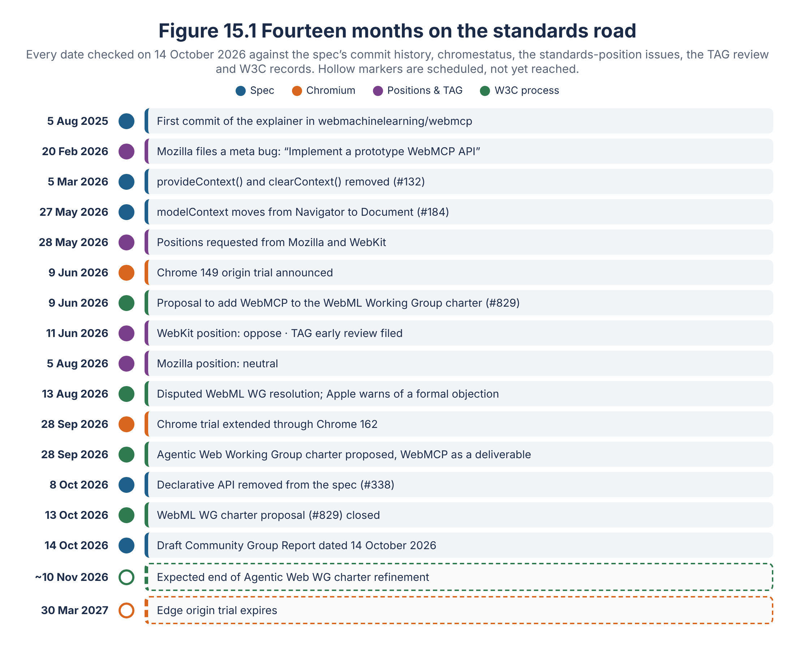
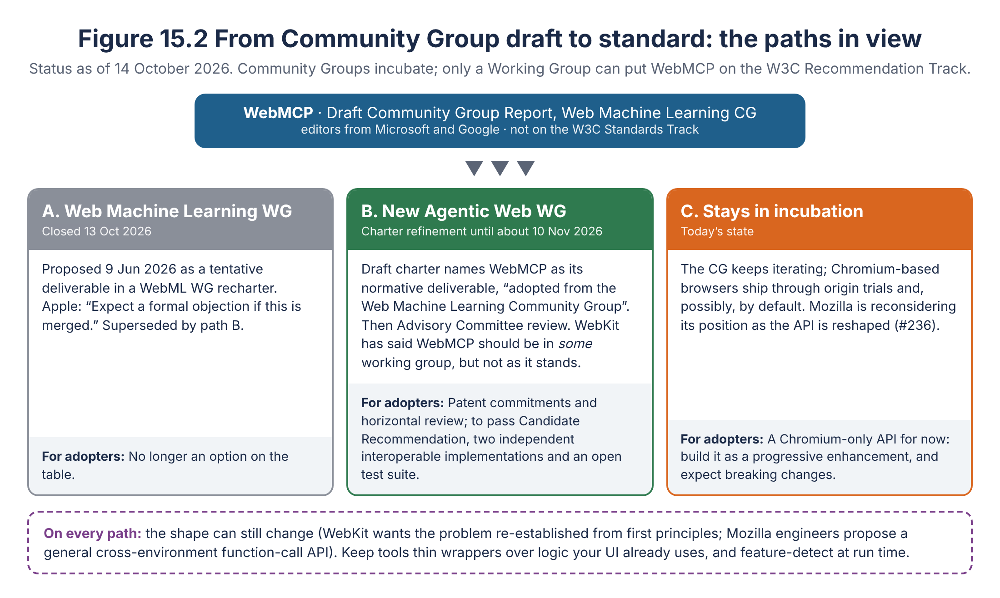

*Part V · Shipping and the ecosystem*

# Chapter 15: Browser Support and the Standards Road

> *“Please note that Community Groups do not create W3C standards.”*
>
> — W3C, Community and Business Groups FAQ[^1]

## Two answers to one question

Suppose the Trailhead team asks the question every web team asks before adopting a new API: *which browsers support it?* There are two honest answers, and they are not the same.

The engineering answer fits in a sentence. Chromium-based browsers run WebMCP behind origin trials, so Chrome and Edge will expose `document.modelContext` on any page that carries a valid trial token. Every other engine doesn’t expose it at all. Chapter 5 showed the feature check that covers this, and this chapter extends it into a small module that tells you exactly which surface you are standing on.

The standards answer takes the rest of the chapter. WebMCP is a Community Group draft whose editors come from Microsoft and Google.[^2] Mozilla recorded a neutral position and Apple’s WebKit team an opposed one.[3,4] The W3C Technical Architecture Group (TAG) has been reviewing it since June and has labelled it “Missing: Multi-stakeholder support”.[^5] An attempt to move the specification into an existing W3C Working Group ran into a threatened formal objection over the summer and was closed on 13 October. Its replacement, a new Agentic Web Working Group, is a draft charter in review as this chapter is written.[6,7]

Chapter 4 sketched this landscape in one table and promised to come back to it. This chapter does so in depth. It explains how to read each signal (a spec’s status line, a chromestatus entry, an origin trial page, a standards-position label, a TAG review), what each party has actually said, which agents and libraries consume WebMCP today, and what the possible routes from Community Group to standard would mean for a team that ships tools now. It closes with a script that re-checks all of it for you, because every fact in the following pages has a date on it.

Everything here was checked on 14 October 2026.

## Reading the signals

Web standards news arrives through a handful of documents, each with its own vocabulary. Before going vendor by vendor, it helps to know what each one can and cannot tell you.

*The specification’s status line.* The top of the WebMCP draft reads “Draft Community Group Report, 14 October 2026”, and its status section says plainly that it “is not a W3C Standard nor is it on the W3C Standards Track.”[^2] The date changes whenever the editors publish, which during 2026 has meant every few days. A *Community Group* is an open forum anyone can join for free, and the W3C’s own FAQ asks members not to call its output “standards work” or “draft standards”. CG reports exist to make a later move to a Working Group easier: the contributor licence agreement is designed so that patent commitments carry over.[^1]

*The commit history.* The status line tells you that the draft changed; the repository tells you what changed. For WebMCP, the history of `webmachinelearning/webmcp` is the most precise record there is of when an API was renamed, added or removed, and it is the source for every date in Table 15.1.[^8]

*chromestatus.* Each Chromium feature has an entry listing its owners, the blink-dev “intent” threads, and its trial stages with milestone numbers. It also has a “browser signals” block for other engines and a standards-maturity field.[^9] Read the stages and milestones as authoritative, since Chromium engineers maintain them. Read the signals block with care: on 14 October 2026 it still said “No signal” for both Firefox and Safari, months after both had published positions. The entry was last edited on 28 September.[^9] The lesson generalises: a status page is only as current as its last edit, so go to the primary record whenever one exists.

*Origin trial pages.* Chrome and Edge each have a registration page per trial, with the trial’s description, its expiry and its terms.[10,11]

*Standards positions.* Mozilla and WebKit both run public GitHub repositories where anyone can ask for an engine’s view of a proposal. The outcome is a label: `position: neutral`, `position: oppose` and so on. The discussion in the issue is where the reasons live.[3,4]

*TAG design reviews.* The TAG reviews proposals for architectural fit. Its labels track progress (“Progress: in progress”), the review type and the focus areas still pending, and, sometimes, a missing prerequisite.[^5]

Figure 15.1 puts the main events from all of these sources on one timeline.



*Figure 15.1 — Fourteen months on the standards road: spec changes, Chromium trials, positions and W3C process events from the first explainer commit in August 2025 to the expiry of Edge’s trial in March 2027.*

## Chrome and Edge: two origin trials

### Timelines

WebMCP reached Chromium in stages. chromestatus records a developer trial (the API behind a flag, for local testing) starting in Chrome 146, followed by an origin trial running from Chrome 149 through Chrome 156.[^9] Google announced the trial on 9 June 2026 with the words “In Chrome 149, you can sign up for the WebMCP origin trial.”[^12] On 28 September 2026 the trial gained an extension through Chrome 162. The reason chromestatus gives is unusually candid: “OT feedback has suggested improvements to the API, which we are implementing. The OT extension would enable us to get data on those improvements as well as to continue getting data on the rest of the feature.”[^9]

Microsoft runs its own trial. The project’s implementation-status page says it is live in Edge 150, and the Edge registration page gives a trial expiration date of 30 March 2027.[13,11] Note that the two trials are measured differently: Chrome counts in milestones and Edge in calendar dates.

For local development no token is needed. Chrome’s documentation tells you to enable `chrome://flags/#enable-webmcp-testing` and relaunch; that flag corresponds to the `WebMCPTesting` feature this book’s demos pass to Chromium on the command line.[^14]

### Tokens

An origin trial lets a site use an experimental feature on its own origin, for real users, without those users touching any flags. You register your origin, receive a token, and serve that token with every page that should get the feature. Chrome’s origin-trial documentation lists three ways to deliver it: a `<meta http-equiv="origin-trial">` tag in the `<head>`, an `Origin-Trial` HTTP response header, or a meta tag injected from script.[^10] Edge’s trial page offers the same meta-tag and header options, and its registration is separate from Chrome’s.[^11]

**Listing 15.1 — Enabling both trials on a page (origin-trial-head.html)**

```html
<!-- In the <head> of every page that should run with WebMCP enabled. -->
<!-- One token per trial; Chrome and Edge register separately. -->
<meta http-equiv="origin-trial" content="CHROME_TRIAL_TOKEN">
<meta http-equiv="origin-trial" content="EDGE_TRIAL_TOKEN">
```

The header form of the same thing, for a server or CDN configuration:

```http
Origin-Trial: CHROME_TRIAL_TOKEN
Origin-Trial: EDGE_TRIAL_TOKEN
```

A page can carry several tokens, and Chrome ignores tokens that are invalid or expired.[^10] That makes Listing 15.1 safe to serve to every browser: each one picks out the token it recognises.

Three details of the token model matter in practice.

- *Third-party tokens.* Both trials accept them: chromestatus records third-party support for the Chrome trial, and the Edge trial record has `supportsThirdParty` set to `true`.[9,11] A third-party token lets a provider of embedded content, such as Supportly’s Helpdesk Widget from Chapter 7, enable the feature in its own script across every customer site. Chrome’s documentation adds a caution: a third-party token works only when injected by an external script, not in a meta tag, inline script or header.[^10]
- *Extensions mean renewal.* When a trial is extended, Chrome emails registrants, and each origin has to renew and deploy a new token.[^10] Anyone who shipped a Chrome 149 token and expects it to work through Chrome 162 should check the registration console now.
- *Measurement.* The trial measures adoption with a Chromium use counter named `kModelContextRegisterTool`.[^9] Google’s stated goal for the experiment is “understanding the API ergonomics for agentic workflows across various verticals such as web commerce and productivity”, along with “metrics for tool usage and latency.”[^9]

### What can change during a trial

Origin trials exist to change an API. Chrome’s announcement calls trials “time-limited programs that offer early access to experimental platform features” whose goal is “informing future iterations of the API.”[^12] The extension reason quoted above says the same about WebMCP specifically. Table 15.1 shows what that meant in 2026. Each row is a change to the specification that could break code written against an earlier draft.

**Table 15.1 — Breaking or behaviour-changing spec changes in 2026, from the commit history[^8]**

| Date | Change | Pull request |
|---|---|---|
| 5 Mar 2026 | `provideContext()` and `clearContext()` removed | #132 |
| 27 May 2026 | `modelContext` getter moved from `Navigator` to `Document` | #184 |
| 8 Jun 2026 | `registerTool()` returns a promise | #200 |
| 21 Jul 2026 | `annotations` moved into a separate object | #225 |
| 17 Aug 2026 | `executeTool()` takes an object instead of a JSON string | #246 |
| 30 Sep 2026 | Origin-keyed agent cluster requirement removed | #330 |
| 8 Oct 2026 | Declarative (HTML forms) API removed from the spec “for now” | #338 |
| 8 Oct 2026 | `UnknownError` replaced with specific `DOMException` types | #339 |

The browser and the draft don’t always move together. Chrome’s WebMCP documentation, updated on 7 October 2026, still says “There are two APIs you can use” and describes the declarative one; the spec removed that API the next day.[14,8] Chapter 8 covers what the trial still ships, and Appendix D walks through migrating code written before the May rename.

> **Still in flux: the trial and the draft**
>
> *Error types.* Pull request #339 replaced `UnknownError` with specific exception types on 8 October 2026.[^8] Chromium 156 still returns `UnknownError` in the cases Chapters 6 and 7 measured, so code that branches on `err.name` should treat both as possible for now.
> *The declarative API.* It is in Chrome’s trial and documentation, and out of the spec.[14,8]
> *Which improvements the extension tests.* chromestatus says the extension exists to gather data on API improvements suggested by trial feedback, but doesn’t list them.[^9]

### Detecting what you are running on

With two trials, a flag, a renamed attribute and a policy that can switch the whole API off, a single `'modelContext' in document` check answers only part of the question. Listing 15.2 is a small module that answers all of it and registers tools only where that is safe.

**Listing 15.2 — Feature detection across WebMCP builds (webmcp-support.js)**

```js
// webmcp-support.js: detect WebMCP without assuming which build you are on.
export function detectWebMCP(win = globalThis) {
  const doc = win.document;
  const mc = doc && 'modelContext' in doc ? doc.modelContext : null;
  const policy = doc?.permissionsPolicy ?? doc?.featurePolicy;
  const knowsTools = !!policy && policy.features().includes('tools');
  return {
    available: !!mc && typeof mc.registerTool === 'function',
    secureContext: !!win.isSecureContext,
    methods: mc
      ? ['registerTool', 'getTools', 'executeTool'].filter((m) => typeof mc[m] === 'function')
      : [],
    events: mc
      ? ['toolchange', 'toolactivated', 'toolcancel'].filter((e) => `on${e}` in mc)
      : [],
    // true or false when the browser knows the "tools" policy; null when it doesn't.
    policyAllows: knowsTools ? policy.allowsFeature('tools') : null,
    // A pre-May-2026 build exposed navigator.modelContext; see Appendix D.
    legacyNavigator: 'modelContext' in (win.navigator ?? {}),
  };
}

// Register tools only where the platform supports them; the page works either way.
export async function registerIfSupported(tools, { signal } = {}, win = globalThis) {
  const support = detectWebMCP(win);
  const registered = [];
  if (!support.available || support.policyAllows === false) return { registered, support };
  for (const tool of tools) {
    try {
      await win.document.modelContext.registerTool(tool, { signal });
      registered.push(tool.name);
    } catch (err) {
      console.warn(`WebMCP: "${tool.name}" was not registered (${err.name}: ${err.message})`);
    }
  }
  return { registered, support };
}
```

Each field maps to something in the draft. `modelContext` is a `[SecureContext]` attribute on `Document`, so it exists only on HTTPS pages and on localhost. The `ModelContext` interface declares the three methods and three event handler attributes the module looks for. Access is gated by a policy-controlled feature named `"tools"`, whose default allowlist is `'self'`.[^15] The spec recommends sending `Permissions-Policy: tools=()` from pages that should never register tools, so a page can find the API present and still be forbidden to use it.[^16]

The book’s companion repository (folder `chapters/15-browser-support-and-standards` in `webmcp-book-demos`) runs Listing 15.2 in Chromium 156.0.8078.4 in three configurations. With `--enable-features=WebMCPTesting`, the module reports all three methods, all three events and `policyAllows: true`, and the Trailhead `search_products` tool registers and shows up in `getTools()`. With the same flag and a `Permissions-Policy: tools=()` header, the API is still present but `policyAllows` is `false`. Calling `registerTool()` anyway is rejected with a `NotAllowedError` whose message reads “Access to the feature "tools" is disallowed by permissions policy.” Without the flag, `document.modelContext` doesn’t exist, the policy doesn’t list a `"tools"` feature, and the page carries on without tools. In all three cases the page itself works, which is the point.

Two caveats. First, the module asks `document.permissionsPolicy` and falls back to `document.featurePolicy`, which is the object Chromium 156 answered on in these tests. Neither is available in every engine, so a `null` result means “unknown”, not “allowed”. Second, a polyfill (discussed later in this chapter) defines `document.modelContext` on purpose, and the module will report it as available. That is the correct answer for your registration code. It tells you nothing about which agent, if any, will call the tools.

## Firefox and WebKit, in their own words

Chapter 4 summarised both positions in a paragraph each. They deserve more than that, because they are the clearest statements anyone outside Google and Microsoft has made about what WebMCP is for, and because each points to a different future for the API.

### Mozilla: neutral, and reopening

Dominic Farolino, one of the spec’s editors, asked Mozilla for a position on 28 May 2026. His request framed WebMCP as serving two use cases: built-in browser agents acting on a site, and in-page agents, “possibly in cross-origin iframes”, calling tools another origin explicitly exposed.[^3] Mozilla’s reviewer, Benjamin VanderSloot, replied on 1 June. His assessment is worth reading as a checklist of what a browser vendor weighs.

He starts with the benefit. The API gives websites a way to declare dedicated “lanes” for automated interaction, and “with honest participants, the benefit is twofold”: agents get a clear signal of what actions are available, and developers no longer have to design a single interface that serves both humans and automation.[^3] Then comes the risk: “in an adversarial setting there is a risk that sites will provide tools that do not match the experience of a user on the page,” whether to “tar pit automated browsers, provide prompt injection that is invisible to typical users, collect user data from the inputs of the tools, or otherwise manipulate a user’s browsing ‘agent’.” He adds a fair qualification: “it is not clear to what extent they are exacerbated by this API or if they are inherent to LLMs consuming content from and driving a browser.”[^3]

Two further points carry practical weight for you. The first is the name. “The name is misleading,” he writes, because developers “(reasonably) assume the MCP spec is involved in any way. There is no MCP here.” He suggests names like “Website Tool API” or “Agent Capability API”.[^3] If the API is ever renamed, this comment is where the pressure came from. The second is openness. “As of now, use of this mechanism is restricted to browser developer’s own products and in-page agents,” and opening it up means “adding WebExtension and WebDriver BiDi integrations.”[^3] In other words, an independent agent shipped as a browser extension has no standard way to call your tools today.

His conclusion: WebMCP “introduces a potentially valuable abstraction” but “opens a surface whose real-world dynamics leave too many open questions to wholeheartedly endorse,” so he proposed neutral, with a willingness “to come back to revisit it once there is more evidence of how it will be used by sites.” The label `position: neutral` was applied on 5 August 2026.[^3]

The story didn’t end there. Mozilla had filed a meta bug in February, “[meta] Implement a prototype WebMCP API”, which is still open.[^17] In August, Jake Archibald opened issue #236 in the WebMCP repository, asking whether the feature should be repositioned “as a general way to call functions in other environments”: windows, workers and other origins, with exposure to “the browser” (and through it to WebDriver or an LLM) as one more target.[^18] Back in the positions thread, Farolino asked whether Mozilla’s support depended on dropping the declarative API. Archibald answered that the declarative form “sounds like a reasonable idea” but shouldn’t come “instead of an imperative way to call functions between environments”. Martin Thomson added that #236 “is pretty significant here. As is naming. But this position is not really based on the declarative variant.”[^3] The editors have been working through #236 since, sketching handles such as `tool.call(…)` that could be passed across `postMessage()`; on 22 September Johann Hofmann summarised the security requirements for that model, starting with the rule that cross-origin exposure “must be opt in on the side of the tool providing origin.”[^18] On 9 October Farolino told the TAG that the editors were “working closely with Mozilla” on these changes “to gain their support”, and asked the TAG to wait for “Mozilla’s refreshed standards position.”[^5]

So Mozilla’s neutral is not a resting state. It is the start of a negotiation whose likely price is an API that looks less like “tools for AI” and more like a general cross-origin function-call mechanism, with agents as one consumer among several.

### WebKit: opposed, and proposing a different process

WebKit’s position, posted on 3 June 2026 and labelled `position: oppose` on 11 June, rests on five arguments.[^4] Chapter 4 quoted the first two: tool descriptions move the brittleness “from the DOM into the tool descriptions”, and an agent acting for a user “is, in effect, assistive technology” that a site should not single out. The remaining three are as important.

- *Unexamined risks.* WebKit calls WebMCP “a new cross-origin invocation path” whose interaction with the platform’s isolation model (COOP, COEP, site isolation) is unexamined, with “no consent or reversibility model for consequential actions”. It warns that a site could over-parameterise a tool so that a helpful agent fills it in from personal data “the user never gave that site”, a pipeline the comment links to cross-site tracking.[^4]
- *Not really MCP.* Because the spec “does not prescribe the format in which tools are exposed”, WebKit reads WebMCP as a general mechanism for a page to register typed, callable functions, which “belongs with the platform’s existing messaging and capability mechanisms (`postMessage` and similar), not a parallel one.”[^4] This is the same observation that led Mozilla to #236, reaching the opposite conclusion.
- *The wrong venue.* “The Machine Learning CG/WG venue is wrong for the work.” The gaps WebMCP identifies, WebKit argues, are in HTML and accessibility semantics, which belong to WHATWG and the W3C’s ARIA and Accessible Platform Architectures groups.[^4]

The issue’s labels record the same objections as concerns about API design, duplication, internationalisation, portability, privacy, security, use cases and venue.[^4]

When Farolino asked follow-up questions, Marcos Cáceres replied on 17 June that WebKit would not answer them point by point, because each question assumed the rest of the approach was sound. Instead WebKit set out “invariants that put users in control” (“an agent acting on a user’s behalf is assistive technology”, sites should not be told that a user relies on an agent, and the result “must not privilege those who have one”), followed by a seven-step path: set WebMCP aside, stand up “a new community group for agent-assisted user agents”, define the problem with “no solutions and no engineering, just use cases”, hold a W3C workshop, perhaps around TPAC 2026 (26–30 October, Dublin), and only then route solutions to HTML, ARIA or elsewhere.[^4]

For an adopter, the practical reading is simple. No WebKit implementation is coming for the API in its current form. Safari’s entry on the implementation-status page links to the position and to nothing else.[^13] And the argument WebKit makes is not about details that a few pull requests could fix. It questions whether a separate tool layer should exist at all.

## The TAG review

The TAG’s early review of the Community Group work was filed on 11 June 2026. Marcos Cáceres suggested expediting it, since a proposal to add WebMCP to a Working Group charter was already on the table, and W3C staff agreed.[^5] On 10 July the TAG labelled it “Progress: in progress” and set six focus areas as pending: API design, web architecture, security, privacy, accessibility and internationalisation. It also added the label that sums up the politics: “Missing: Multi-stakeholder support.”[^5]

The public thread shows where the argument has settled. After a TAG breakout meeting in August, Farolino reported that the question that “keeps coming up over and over” was why WebMCP is shaped as an explicit capability layer rather than “more HTML semantics”. He asked that any negative resolution on those grounds come with evidence that semantics would be a sufficient alternative.[^5] Two adopters weighed in. Yoav Weiss, writing “as someone deploying WebMCP (under an Origin Trial in various Chromium browsers) to a large number of storefronts”, listed the Shopify storefront tools in use (browsing collections, managing orders, searching the catalogue, showing product variants, searching store policies) and said he didn’t “see a feasible declarative alternative to the imperative tools that agents can call.”[^5] A second commenter cited his company’s public benchmark, which reports UI actuation using about 5–10 times the tokens and cost per task, and running 4–5 times slower, than WebMCP. That figure is the vendor’s own; nobody else has reproduced it.[^5] TAG members asked people not to read too much into draft notes. Marcos Cáceres reminded participants that notes shared privately “do not represent the consensus of the TAG in any way, shape, or form.”[^5]

The latest public word from the TAG, on 6 October, is that the review is “taking a bit longer than usual.” On 9 October the editors asked the TAG to hold its position until after Mozilla’s refreshed position and after TPAC.[^5]

> **Still in flux: the review outcomes**
>
> *The TAG’s conclusion.* No position had been published as of 14 October 2026, and the editors have asked for it to wait until after TPAC.[^5]
> *Mozilla’s position.* It is being renegotiated around issue #236, and it could change the TAG’s “Missing: Multi-stakeholder support” label.[18,5]
> *WebKit’s position.* It is `oppose`, and the issue is closed.[^4]

## Who consumes WebMCP today

Exposing tools is only half of the system. Something has to call them. The project’s implementation-status page is the only list of consumers in one place, and it is the project’s own claim rather than each vendor’s.[^13] As of 14 October 2026 it lists:

- *Chrome:* the origin trial, live from Chrome 149. The trial describes itself as letting websites “register tools for use by agents hosted by the site or in Chrome.”[13,9]
- *Edge:* the origin trial, live in Edge 150.[^13]
- *Brave:* “Experimental support is added to Leo AI chat.”[^13] The Brave issue behind it was closed as completed in July 2026. Its test plan turns on `brave://flags/#enable-webmcp-testing` and expects a “tools pill” in Leo’s sidebar when a page offers tools.[^19]
- *ChatGPT Desktop:* “WebMCP is supported in ChatGPT Desktop.”[^13] OpenAI’s earlier agentic browser, ChatGPT Atlas, is gone: OpenAI announced its retirement in July 2026, alongside a desktop app with its own built-in browser.[^20]
- *Meta Ray-Ban Display:* support for web apps is “coming soon”, letting Meta AI on the glasses call tools registered with `document.modelContext.registerTool()`. It is off by default and enabled per device.[^13]
- *Firefox and Safari:* links to their positions, plus Mozilla’s Bugzilla meta bug.[^13]

Then there are extensions. chromestatus notes that the Chrome Web Store “features about 9 different extensions with WebMCP on their title and 4* or more ratings”.[^9] MCP-B’s Rook is one such agent extension.[^21] Remember Mozilla’s point, though: there is no standard extension or WebDriver API for calling page tools yet, so each of these depends on Chromium-specific plumbing.[^3] On the automation side, W3C staff have floated giving the Browser Testing and Tools Working Group the job of “enabling MCP support bidirectional WebDriver protocol for browser automation.”[^6]

For planning, the order of confidence is: Chromium browsers with the trial (verifiable today with a token), Brave behind a flag, then vendors whose support is stated only on the status page. Test against what you can run, and treat the rest as upside.

## Community libraries

Long before the browsers, the community had built WebMCP-shaped libraries. Chapter 4 described MCP-B’s role in the API’s history. Today its packages are the most widely used way to try WebMCP outside a Chromium trial. Each of the three main packages was at version 6.0.3 on 14 October 2026, published that same day, under the MIT licence:[^22]

| Package | Description (from the npm registry) |
|---|---|
| `@mcp-b/global` | “W3C Web Model Context Protocol (WebMCP) API polyfill. Let AI agents like Claude, ChatGPT, and Gemini interact with your website via document.modelCont[ext]…” |
| `@mcp-b/webmcp-polyfill` | “Vendored upstream WebMCP polyfill plus temporary declarative tools” |
| `usewebmcp` | “Standalone React hooks for strict core WebMCP tool registration with document.modelContext” |

The documentation site registers a live tool with `document.modelContext.registerTool()` on its own home page and suggests calling it through “the Rook extension or Chrome’s native WebMCP support.”[^21] The packages live in the `WebMCP-org/npm-packages` repository, which describes them as “Transport layers, React hooks, and browser tools for the Model Context Protocol”.[^23] Chapter 10 uses `usewebmcp` in the Trailhead React app.

Three cautions apply to any library that tracks a moving draft:

1. *A polyfill is a second implementation with its own schedule.* When the spec dropped the declarative API on 8 October, the polyfill kept “temporary declarative tools”.[8,22] That is a reasonable choice for users, but it means the polyfill and the draft can disagree.
2. *Version numbers move as fast as the spec.* All three packages were republished on the day this chapter was checked. Pin exact versions, and read the changelog before upgrading.
3. *A polyfill cannot create consumers.* It gives your page a `document.modelContext` to register on. Calls still need an agent that knows how to reach it, such as a matching extension. The detection code in Listing 15.2 can’t tell native support from a polyfill, and for registration purposes it doesn’t need to.

## From Community Group to Working Group

### What a Working Group would change

The W3C’s rule is short: “Community Groups are for incubation. The Recommendation Track is for standardization.” A technology that gains traction in a CG normally moves to a Working Group (WG) to become a standard, and the CG agreements are written so that participants’ patent commitments carry over.[^1] For adopters, three things change when a WG takes over a specification:

- *Patent commitments.* The W3C designed its CG agreements for “continuity of IPR commitments” when a Working Group adopts a CG specification, so the move itself is meant to be smooth.[^1] A WG brings the W3C Patent Policy with it; the draft charter below has a Patent Policy section.[^24]
- *Horizontal review.* The draft Agentic Web WG charter, discussed below, requires review for accessibility, internationalisation, privacy and security, and by the TAG, “during each major standards-track document transition”.[^24]
- *Interoperability as a bar.* To advance beyond Candidate Recommendation, the draft charter expects “at least two independent interoperable implementations of every feature defined in the specification, where interoperability can be verified by passing open test suites.”[^24] The WebMCP draft already links a test suite on wpt.fyi from its header.[^2] Today, every implementation of WebMCP is built on Chromium.

The last point is the political core of this chapter. Two Chromium-based browsers are not two independent implementations, and the two engines that are independent of Chromium are respectively neutral and opposed. A Working Group would not make WebMCP a standard by itself. It would set a bar that, as of October 2026, nobody has a plan to meet.

### What happened in 2026

The question of a WG came up within a day of the positions being requested. On 28 May 2026, the WebKit engineer who would post WebKit’s position a week later opened issue #192, noting that “Community Groups do not create W3C standards” and asking whether WebMCP should move to the WG.[^25] W3C staff supported an early rechartering of the Web Machine Learning WG to take it in, and on 9 June a pull request proposed adding WebMCP to that group’s charter “as a tentative deliverable.”[6,25] The WebML WG is chartered until 30 April 2027.[^26]

That route ran into trouble almost immediately. WebKit’s position, published the same month, called the machine-learning venue wrong for the work.[^4] On 18 June the author of #192 clarified that they had proposed discussing the move, not supporting it: “We think WebML WG is the incorrect working group, but WebMCP should be part of some working group.”[^25] On 13 August the WG recorded a resolution that it “has reviewed the charter proposal and approves the direction. WebKit position duly noted.” Marcos Cáceres replied that it was “baffling how you can record a resolution when a member of the working group has objected,” and Apple disputed the minutes the next day.[^25] The same day, on the charter pull request, Cáceres recorded “that Apple is opposed to this going working group. Expect a formal objection if this is merged.” He added: “We'd be open to discussing a different venue at the W3C and doing this properly from first principles (i.e., some new agentic web CG/WG).”[^6]

A formal objection is not just a strong comment. Under the W3C Process, Formal Objections “receive formal consideration and a formal response”. If the Team cannot resolve one through investigation and mediation, it goes to the W3C Council.[^27] Any charter that names WebMCP and draws an objection from Apple faces that procedure.

On 28 September W3C staff changed course. The “latest thinking,” wrote Philippe le Hégaret, the W3C’s chartering facilitator, on the charter pull request, “is to have a working group dedicated to develop specifications that facilitate web pages and applications to be leveraged by LLMs and AI agents,” while the WebML WG would “stay focused on developing APIs for enabling efficient machine learning inference in the browser.”[^6] The same day a charter proposal for an Agentic Web Working Group appeared, stated to “replace the previous thinking”, and on 13 October the WebML pull request was closed.[7,6]

### The Agentic Web Working Group charter

The draft charter’s mission is “to develop specifications that facilitate web pages and applications to be leveraged by LLMs and AI agents.” Its scope covers describing site capabilities and context for agents, representing agent identity and delegation, transparency about agent interactions, “expressing permissions, policies, and constraints on agent actions”, and guidance for authors. It explicitly excludes model APIs, crawler controls, bot detection and agent-to-server communications, among others.[^24] Its one named normative deliverable is WebMCP, “adopted from the Web Machine Learning Community Group”.[^24]

It is still very much a draft. On 14 October 2026 the chairs, dates, team contact and timeline were template placeholders, and the deliverables section still carried both template options: whether the group intends to stop at Candidate Recommendation or go on to Recommendation.[^24] The W3C announced the start of charter refinement on 1 October and estimated that it “will last until approximately 10 November 2026.”[^28] The Process Document requires that phase to last at least 28 days, and an Advisory Committee review follows it.[^27] The strategy issue lists the TAG review, the accessibility considerations and a threat model among its “known or potential areas of concern”.[^7]

The draft’s scope is broader than WebMCP, and in places it echoes the critics. Agent transparency and “permissions, policies, and constraints on agent actions” are close to the consent and control questions WebKit raised.[24,4] Whether WebKit would accept this group as the “new agentic web CG/WG” Apple said it was open to, and whether it would accept WebMCP as a starting deliverable rather than a proposal to set aside, is not on the public record. Farolino’s answer to WebKit’s call for a new group was: “I have no objection to moving WebMCP exactly as-is to such a WG.”[^25]

### The paths, and what each means for you

Figure 15.2 lays out the routes visible on 14 October 2026.



*Figure 15.2 — From Community Group draft to standard: the WebML WG route (closed), the proposed Agentic Web WG (in charter refinement) and continued incubation, with what each means for adopters.*

- *The Agentic Web WG charters with WebMCP in scope.* The specification moves to the Recommendation Track with patent commitments and horizontal review. Expect a stream of changes from TAG and accessibility review, and expect the interoperability bar to keep the specification at Candidate Recommendation, or below it, until a second engine implements it. For your code, nothing changes on charter day. Changes come later, through review.
- *The charter is delayed or WebMCP is taken out of it.* WebMCP stays a CG report. Chromium-based browsers can keep running trials or ship it, but it would remain a Chromium-only feature with no standards-track commitments.
- *The API is reshaped before either happens.* If #236 succeeds, the core becomes a general cross-environment function-call mechanism, and agents become one consumer.[^18] Mozilla might move off neutral; WebKit’s objection to a separate agent-facing layer would remain.[3,4] Your tools would survive as functions with names, descriptions and schemas, but registration and invocation code would change.

None of these paths removes the advice from Chapter 4. Build tools as thin wrappers over logic your interface already uses, feature-detect at run time, and treat WebMCP as a progressive enhancement. The cost of following a breaking change is then a few lines in one module.

> **Still in flux: the venue**
>
> *Charter refinement.* It is expected to end around 10 November 2026; extensions are announced on the strategy issue.[28,7]
> *Apple’s response to the new charter.* Apple threatened a formal objection to the WebML route. Its view of the Agentic Web WG draft is not on the public record as of 14 October 2026.[6,7]
> *Recommendation or not.* The draft charter has not yet chosen whether the group will aim for full Recommendation.[^24]

## Keeping this chapter current yourself

Every fact in this chapter has a date on it, and several will have changed before you read this. The responsible way to rely on any of them is to re-check them on a schedule. Listing 15.3 does that. It reads seven primary sources, extracts one status from each, saves a snapshot, and reports what changed since the last run.

**Listing 15.3 — A standards watcher (standards-watch.mjs)**

```js
// standards-watch.mjs: snapshot WebMCP's standards status and report what changed.
// Usage: node standards-watch.mjs [snapshots/last.json]
import { readFile, writeFile } from 'node:fs/promises';

const SOURCES = {
  spec: 'https://webmachinelearning.github.io/webmcp/',
  commits: 'https://github.com/webmachinelearning/webmcp/commits/main.atom',
  chromestatus: 'https://chromestatus.com/api/v0/features/5117755740913664',
  edgeTrial: 'https://developer.microsoft.com/en-us/microsoft-edge/origin-trials/trials/0b76fe60-b266-458e-a285-04e375c0c31a',
  mozilla: 'https://github.com/mozilla/standards-positions/issues/1412',
  webkit: 'https://github.com/WebKit/standards-positions/issues/670',
  tag: 'https://github.com/w3ctag/design-reviews/issues/1238',
};

export const parse = {
  spec: (html) => html.replace(/<[^>]+>/g, ' ').replace(/\s+/g, ' ')
    .match(/(Draft Community Group Report|Final Community Group Report|Working Draft|Editor['’]s Draft)\s*,?\s*(\d{1,2} \w+ \d{4})/)
    ?.slice(1, 3).join(', ') ?? null,
  commits: (xml) => {
    const entry = xml.match(/<entry>[\s\S]*?<\/entry>/)?.[0] ?? '';
    const title = entry.match(/<title>\s*([\s\S]*?)\s*<\/title>/)?.[1]?.replace(/&#39;/g, "'");
    const updated = entry.match(/<updated>([^<]+)<\/updated>/)?.[1];
    return title ? `${updated} ${title}` : null;
  },
  chromestatus: (text) => {
    const feature = JSON.parse(text.replace(/^\)\]\}'\s*/, ''));
    const trial = feature.stages.find((s) => s.stage_type === 150); // origin trial stage
    if (!trial) return null;
    const lasts = [trial.desktop_last, ...trial.extensions.map((e) => e.desktop_last)];
    return { trialFrom: trial.desktop_first, trialThrough: Math.max(...lasts.filter(Boolean)) };
  },
  edgeTrial: (html) => html.match(/Trial Expiration Date<\/strong>\s*<p>([^<]+)<\/p>/)?.[1] ?? null,
  // Current labels only: the issue's "labels" block, not label events in its timeline.
  labels: (prefixes) => (html) => {
    const block = html.match(/"labels":\{"pageInfo":[\s\S]*?\]\}/)?.[0] ?? '';
    return [...block.matchAll(/"name":"([^"]+)"/g)].map((m) => m[1])
      .filter((name) => prefixes.some((p) => name.startsWith(p))).sort();
  },
};
const PARSERS = {
  spec: parse.spec, commits: parse.commits, chromestatus: parse.chromestatus,
  edgeTrial: parse.edgeTrial,
  mozilla: parse.labels(['position:']), webkit: parse.labels(['position:']),
  tag: parse.labels(['Progress:', 'Missing:', 'Resolution:']),
};

async function fetchText(url) {
  const res = await fetch(url, {
    headers: { 'user-agent': 'webmcp-standards-watch/1.0' },
    signal: AbortSignal.timeout(30_000),
  });
  if (!res.ok) throw new Error(`HTTP ${res.status}`);
  return res.text();
}

export async function snapshot() {
  const entries = await Promise.all(Object.entries(SOURCES).map(async ([key, url]) => {
    try { return [key, PARSERS[key](await fetchText(url))]; }
    catch (err) { return [key, { error: err.message }]; }
  }));
  return { checkedAt: new Date().toISOString(), ...Object.fromEntries(entries) };
}

export function diff(before, after) {
  return Object.keys(SOURCES)
    .filter((k) => JSON.stringify(before?.[k]) !== JSON.stringify(after[k]))
    .map((k) => ({ source: k, before: before?.[k] ?? null, after: after[k] }));
}

if (import.meta.url === `file://${process.argv[1]}`) {
  const file = process.argv[2] ?? 'snapshots/last.json';
  const before = await readFile(file, 'utf8').then(JSON.parse).catch(() => null);
  const after = await snapshot();
  const changes = diff(before, after);
  console.log(JSON.stringify(after, null, 2));
  for (const c of changes) console.log(`CHANGED ${c.source}: ${JSON.stringify(c.before)} -> ${JSON.stringify(c.after)}`);
  await writeFile(file, JSON.stringify(after, null, 2) + '\n');
  process.exitCode = before && changes.length ? 2 : 0;
}
```

A few design choices are worth explaining. The script reads GitHub issue pages rather than the GitHub REST API, because unauthenticated API calls are rate-limited, and a weekly job shared by a team quickly hits that limit. It takes only the issue’s current labels block, not the label events in the timeline, so a label that was added and later removed doesn’t show up as current. The test suite has a case for exactly that, using the TAG’s since-removed “Progress: untriaged” label. Each source fails independently: a page that times out becomes an `{ error }` entry rather than a crash. And the exit code is `2` when something changed, so a CI job can open an issue or send a message.

Here is the snapshot it produced when this chapter was checked:

**Listing 15.4 — The watcher’s snapshot on 14 October 2026 (snapshots/2026-10-14.json)**

```json
{
  "checkedAt": "2026-10-14T22:51:34.750Z",
  "spec": "Draft Community Group Report, 14 October 2026",
  "commits": "2026-10-14T22:00:40Z Fix inactive document unregistration's notification algorithm (#345)",
  "chromestatus": {
    "trialFrom": 149,
    "trialThrough": 162
  },
  "edgeTrial": "March 30, 2027",
  "mozilla": [
    "position: neutral"
  ],
  "webkit": [
    "position: oppose"
  ],
  "tag": [
    "Missing: Multi-stakeholder support",
    "Progress: in progress",
    "Progress: untriaged"
  ]
}
```

Run it weekly. The fields that matter most for planning are `chromestatus.trialThrough` (renew your tokens before it passes), `edgeTrial`, and any change to the `mozilla`, `webkit` and `tag` labels. A spec date change on its own is routine; read the commit titles it points to.

## What this means for your product

- *Plan for Chromium only, and design for everyone.* Today’s reachable audience for WebMCP is users of Chromium-based browsers whose sites carry trial tokens, plus agents that consume tools through Chromium. Your site must work fully without tools in every other browser, which progressive enhancement gives you for free.
- *Put the trial on someone’s calendar.* Chrome’s trial runs through Chrome 162, Edge’s through 30 March 2027, and an extension means new tokens. Assign an owner for registration, renewal and the token in your deployment configuration.
- *Budget for churn.* Eight behaviour-changing spec changes in 2026 is the baseline (Table 15.1). Keep WebMCP code in one module, pin library versions, and run the Chapter 14 tests against each new Chromium release.
- *Treat standards politics as a risk, not a verdict.* Neutral can become positive if the API is reshaped, and a Working Group would add review and stability. Opposition from WebKit means no Safari support for this design. Neither changes whether well-designed tools help your users in browsers that have them.
- *Feed the process.* Google’s trial asks for feedback on the API shape, and the TAG thread shows that deployment data carries weight: Shopify storefront tools were cited as an argument.[12,5] Real usage from your product is the most persuasive input you can give.

## Chapter summary

- WebMCP is a Draft Community Group Report (14 October 2026) of the W3C Web Machine Learning CG. It is not a W3C standard and not on the Standards Track. Community Groups incubate; only a Working Group can standardise.
- Chrome’s origin trial runs from Chrome 149, originally through 156 and since 28 September 2026 extended through 162. Edge’s trial runs in Edge 150 until 30 March 2027. Both accept third-party tokens. Tokens go in a meta tag, an HTTP header or, for third parties, an external script, and an extension means renewing them.
- Trials exist to change APIs. In 2026 the spec removed `provideContext()`, moved `modelContext` to `Document`, made `registerTool()` return a promise, removed the declarative API and changed its error types. The trial and the documentation don’t always match the draft.
- Feature detection should cover the secure context, the methods and events, the `"tools"` permissions policy and the old `navigator` surface. In Chromium 156, a page under `Permissions-Policy: tools=()` still sees the API, but calls are rejected with `NotAllowedError`.
- Mozilla is neutral: tools are useful “lanes”, but adversarial sites, a misleading name and a closed set of consumers leave “too many open questions”. It is renegotiating around a more general cross-environment function-call API (#236).
- WebKit is opposed: agents are assistive technology and should not be singled out, the tool layer duplicates HTML and ARIA, the risks are unexamined and the venue is wrong. It proposes starting over in a new group, from use cases.
- The TAG review, open since June 2026, is labelled “Missing: Multi-stakeholder support”, with six focus areas pending and no position yet.
- Consumers listed today: Chrome and Edge trials, Brave Leo (experimental), ChatGPT Desktop (per the project’s status page; ChatGPT Atlas was retired) and Meta Ray-Ban Display (“coming soon”), plus Chromium extensions. Community packages (`@mcp-b/global`, `@mcp-b/webmcp-polyfill`, `usewebmcp`, all at 6.0.3) track the draft quickly, but on their own schedule.
- A move into the WebML Working Group was dropped after Apple warned of a formal objection. A new Agentic Web Working Group charter naming WebMCP is in refinement until about 10 November 2026. Standardisation would still require two independent interoperable implementations.
- Re-check status on a schedule. Listing 15.3 snapshots seven primary sources and flags changes.

Chapter 16 turns from the platform to the business: which journeys to expose first, how to keep the agent a guest on your site, and how to measure what agent-driven traffic is worth.

## Notes

[^1]: W3C, “Community and Business Groups: Frequently Asked Questions”, including “Are Community and Business Group reports W3C standards?”. <https://www.w3.org/community/about/faq/>
[^2]: WebMCP specification, Draft Community Group Report, 14 October 2026, header, “Status of this document” and editors. <https://webmachinelearning.github.io/webmcp/>
[^3]: mozilla/standards-positions issue #1412, “WebMCP”: request (28 May 2026), Benjamin VanderSloot’s assessment (1 June 2026), label “position: neutral” (5 August 2026), and the exchange of 24–26 August 2026. <https://github.com/mozilla/standards-positions/issues/1412>
[^4]: WebKit/standards-positions issue #670, “WebMCP”: WebKit’s position comment (3 June 2026), label “position: oppose” (11 June 2026), concern and topic labels, and the follow-up of 17 June 2026. <https://github.com/WebKit/standards-positions/issues/670>
[^5]: w3ctag/design-reviews issue #1238, “Incubation: WebMCP”: filed 11 June 2026; labels applied 10 July 2026; comments of 6, 18, 19 and 20 August and 6 and 9 October 2026. <https://github.com/w3ctag/design-reviews/issues/1238>
[^6]: w3c/charter-drafts pull request #829, “[wg/webmachinelearning] Adds WebMCP in scope” (opened 9 June 2026; Apple’s comment of 13 August 2026; closed 13 October 2026). <https://github.com/w3c/charter-drafts/pull/829>
[^7]: w3c/strategy issue #576, “[wg/agenticweb] Agentic Web Group Charter” (opened 28 September 2026; label “In Charter Refinement”, 1 October 2026). <https://github.com/w3c/strategy/issues/576>
[^8]: Commit history of webmachinelearning/webmcp, branch `main`, read from a clone on 14 October 2026; the commits named are fe84c67 (#132, 5 March 2026), c7b5c70 (#184, 27 May 2026), ec37ec4 (#200, 8 June 2026), d29b8d7 (#225, 21 July 2026), a724ab1 (#246, 17 August 2026), d61d0e6 (#330, 30 September 2026), 14ae813 (#338, 8 October 2026), b206dae (#339, 8 October 2026) and 1636b33 (#345, 14 October 2026). <https://github.com/webmachinelearning/webmcp/commits/main>
[^9]: chromestatus.com, “WebMCP” (feature 5117755740913664), read through its JSON API: origin-trial stage (Chrome 149 to 156, third-party support, use counter `kModelContextRegisterTool`), extension stage created 28 September 2026 (through Chrome 162, with the stated reason), developer-trial stage (Chrome 146), standards maturity “Incubation”, and browser signals; entry last updated 28 September 2026. <https://chromestatus.com/feature/5117755740913664>
[^10]: Chrome for Developers, “Get started with origin trials” (last updated 7 November 2024): tokens in a meta tag, an HTTP header or script; third-party tokens; multiple tokens per page; renewal when a trial is extended; “Chrome ignores invalid or expired tokens.” <https://developer.chrome.com/docs/web-platform/origin-trials>
[^11]: Microsoft Edge Origin Trials, “WebMCP” trial page: description, “Trial Expiration Date: March 30, 2027”, registration, and the trial record (`supportsThirdParty: true`, `edgeOnly: false`). <https://developer.microsoft.com/en-us/microsoft-edge/origin-trials/trials/0b76fe60-b266-458e-a285-04e375c0c31a>
[^12]: Chrome for Developers, “Join the WebMCP origin trial” (published 9 June 2026). <https://developer.chrome.com/blog/ai-webmcp-origin-trial>
[^13]: webmachinelearning/webmcp, “Browser and Agent Implementation Status” (implementation-status.md). <https://github.com/webmachinelearning/webmcp/blob/main/implementation-status.md>
[^14]: Chrome for Developers, “WebMCP” (published 18 May 2026, updated 7 October 2026): “Get started”, “Local WebMCP” and “Use WebMCP APIs”. <https://developer.chrome.com/docs/ai/webmcp>
[^15]: WebMCP specification, Draft Community Group Report, 14 October 2026, §4.1 (the `[SecureContext]` `modelContext` attribute on `Document`), §4.2 (`ModelContext` IDL) and §4.4 “Permissions policy integration”. <https://webmachinelearning.github.io/webmcp/#api>
[^16]: WebMCP specification, Draft Community Group Report, 14 October 2026, security and privacy considerations: the `Permissions-Policy: tools=()` mitigation. <https://webmachinelearning.github.io/webmcp/>
[^17]: Bugzilla bug 2018306, “[meta] Implement a prototype WebMCP API” (Core :: Machine Learning: General; filed 20 February 2026; status NEW), read through the Bugzilla REST API. <https://bugzilla.mozilla.org/show_bug.cgi?id=2018306>
[^18]: webmachinelearning/webmcp issue #236, “Reposition feature as a generic communication tool?” (opened 3 August 2026 by Jake Archibald), including comments of 26–27 August and 22–24 September 2026. <https://github.com/webmachinelearning/webmcp/issues/236>
[^19]: brave/brave-browser issue #55232, “[AI Chat]: Add support for the WebMCP protocol to Leo” (opened 5 May 2026; closed as completed in brave-core#37660 on 7 July 2026), including its test plan. <https://github.com/brave/brave-browser/issues/55232>
[^20]: Michael Kan, “OpenAI to Retire ChatGPT Atlas Browser Less Than a Year After Launch”, PCMag, 9 July 2026. OpenAI’s own help article, “ChatGPT Atlas retirement”, refused automated fetches on 14 October 2026; its search-result summary reads “ChatGPT Atlas has been retired and no longer receives updates.” <https://www.pcmag.com/news/openai-to-retire-chatgpt-atlas-browser-less-than-a-year-after-launch> and <https://help.openai.com/en/articles/20001371-chatgpt-atlas-retirement>
[^21]: MCP-B, “WebMCP documentation and developer tools” (docs.mcp-b.ai home page, with its live `registerTool()` example and the Rook extension). <https://docs.mcp-b.ai>
[^22]: npm registry records for `@mcp-b/global`, `@mcp-b/webmcp-polyfill` and `usewebmcp` (each at version 6.0.3, published 14 October 2026; MIT licence; package descriptions as quoted). <https://registry.npmjs.org/@mcp-b/global>, <https://registry.npmjs.org/@mcp-b/webmcp-polyfill>, <https://registry.npmjs.org/usewebmcp>
[^23]: WebMCP-org/npm-packages repository, “NPM packages for MCP-B: Transport layers, React hooks, and browser tools for the Model Context Protocol”. <https://github.com/WebMCP-org/npm-packages>
[^24]: W3C, “Agentic Web Working Group Charter” (DRAFT), including Scope, Out of Scope, Deliverables and Success Criteria. <https://w3c.github.io/charter-drafts/2026/agenticweb-wg.html>
[^25]: webmachinelearning/webmcp issue #192, “Transitioning WebMCP to the working group” (opened 28 May 2026), including the comments of 18 June and 13–14 August 2026. <https://github.com/webmachinelearning/webmcp/issues/192>
[^26]: W3C, “Web Machine Learning Working Group” group page (charter until 30 April 2027). <https://www.w3.org/groups/wg/webmachinelearning/>
[^27]: W3C Process Document, 18 August 2025: §4 charter development (refinement of at least 28 days), §5.6 Formal Objections and the W3C Council. <https://www.w3.org/policies/process/>
[^28]: Xueyuan Jia (W3C), “Start of refinement for a draft Agentic Web Working Group charter”, public-new-work mailing list, 1 October 2026. <https://lists.w3.org/Archives/Public/public-new-work/2026Oct/0002.html>
