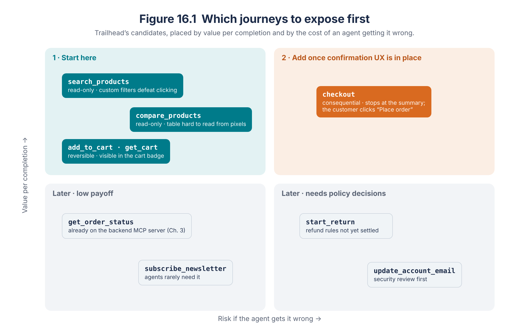
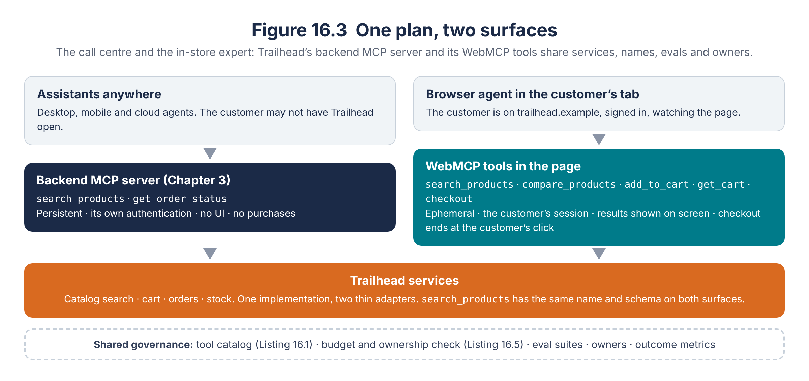

*Part VI · Strategy and the future*

# Chapter 16: Product and Business Implications

> *“Tools execute on your webpage visibly, so users gain trust that tasks are completed as expected. This also keeps your brand and human-centered design choices intact.”*
>
> — Chrome for Developers, “WebMCP”[^1]

## The question on Kari’s whiteboard

Trailhead’s product team meets on Monday mornings in a room above the warehouse in Lillestrøm. This Monday, Kari, who runs product, has written one question on the whiteboard: *What do we ship for agents, and how will we know it worked?*

Jonas, the front-end lead, has spent the last month on the earlier chapters of this book. He has a branch where `search_products` and `add_to_cart` are registered with `document.modelContext`, and he can show an agent finding a two-person tent under 4,000 NOK and putting it in the cart in four tool calls instead of forty clicks. Kari is impressed, and she is also the person who has to explain the work to the rest of the company. So her questions are not about `AbortSignal`. Will agents find us? Which journeys first? Do we lose the customer to the assistant? What do we measure? Who owns the descriptions? What happens if the standard changes or never ships?

This chapter is for the people in that room. Most of it can be read without the code, and the code that is here is short: a catalog that treats tools as product surface, a budget check for CI, a measurement wrapper, and an attribution helper, all for Trailhead. Every listing runs, and the tests for them live in the book’s demos repository.[^2]

## Agent-readiness is not the new SEO (yet)

The comparison comes up in every planning meeting about agents. Twenty-five years ago companies learned to describe their pages for crawlers, and now they will learn to describe their features for agents. Some of that holds. A WebMCP tool’s name and description are text written for a machine reader, and their quality decides whether the reader uses your feature correctly. Chrome’s guidance on descriptions reads like a copywriting brief: “use verbs that describe exactly what happens”, say “what the tool does and when to use it”, and “rely on positive language” rather than lists of limitations.[^3] Agents also choose between tools, and Chrome’s evaluation guide lists “Agent fails to select the correct tool” as the first failure mode to test for.[^4] Writing good tool copy is a skill worth having in-house, as SEO copy once was.

The analogy breaks at the step that made SEO valuable: discovery. A search engine indexes your pages before anyone visits them, and that index sends you visitors you didn’t have. WebMCP has no equivalent. Chrome’s own documentation lists it as a limitation: “Clients and browsers must visit a site directly to know if it has callable tools.”[^1] Chrome’s comparison with MCP says the same thing from the other side. MCP’s discovery happens through “agent-specific registration flows”, while WebMCP’s tools are “registered on the web page during the user’s visit.”[^5] There is no central registry of WebMCP sites, no crawler that reads `registerTool()` calls and no ranking for tools.

This is a design choice, not an oversight. The explainer considered “static declarative manifests”, tools listed in a file such as the Web App Manifest, and set them aside because they “prevent web developers from dynamically adding, updating, or removing tools based on the active page state or user authentication status”. It left the door open: static declarations could be “layered on in the future”.[^6] The supplementary explainer for service workers, which asks how an agent could use a site the user doesn’t have open, discusses discovery directly. It lists possible mechanisms (“installable PWAs”, “web search”, “curated site directories”, “direct links”) and floats the idea of sites advertising “high-level descriptions of the capabilities they offer” in a manifest or in page markup, so that crawlers and directories can recommend them. It also calls discovery “a complex topic which goes beyond the scope of this explainer”.[^7]

**Table 16.1 — Where the SEO analogy holds and where it breaks (October 2026)**

| | Search engine optimization | Agent-readiness with WebMCP |
|---|---|---|
| Who reads your text | A crawler, ahead of time | An agent, during the user’s visit |
| What brings the user | The index sends new visitors | The user is already on your site |
| What you optimize | Pages, titles, structured data | Tool names, descriptions, schemas, results |
| Central registry or ranking | Yes, run by each search engine | None defined |
| How you measure | Impressions, clicks, rankings | Tool calls, outcomes, assisted conversions |
| What it mostly grows | Acquisition | Conversion and task completion |

The business consequence is the most important sentence in this chapter. *WebMCP, as specified today, converts visits you already have. It doesn’t bring new ones.* An agent reaches Trailhead’s tools because the customer opened Trailhead, typed its address, followed a link or clicked a search result. That changes the investment case. You are not buying a new channel, you are cutting friction and failure out of the sessions you already pay to acquire. If agents arriving through actuation today fail half-way through your checkout, every one of those failures is a lost conversion you already paid for. That is a measurable cost, and it is where the case for WebMCP is strongest.

> **Still in flux: discovery**
>
> *Manifests and directories.* Static tool declarations were rejected as the primary mechanism, but the explainer says they could be added on top later, and the service-worker explainer discusses manifest fields and capability descriptions for crawlers and directories. Neither is in the specification.[^6][^7]
> *Sites that aren’t open.* Letting agents call tools on sites the user doesn’t have open is an open question in the main explainer, which points to the service-worker proposal for it.[^8] Chapter 17 covers what that would change.

## Choosing the first journeys

If WebMCP converts visits you already have, the first journeys to expose are the ones where those visits fail today and where success is worth the most. Chrome frames the work around *critical user journeys* (CUJs), defined as “a user’s path to accomplish a goal, including any required context”, and its use-case guide walks through shopping, repeat purchases and form filling.[^9] For retail it suggests tools such as `search_products()`, `add_to_wishlist()` and a `refine_search()` for price ranges, and for repeat purchases a `get_order_history()` tool.[^9] The explainer’s own shopping scenario has an agent fetch product listings, filter them against the user’s request and call a second tool to update the store’s grid, so the shopper sees the agent’s choice on the page.[^10]

Four kinds of journey account for most of the candidates on a typical site.

- *Search and filter.* Finding things in a catalogue, a timetable or an inventory. Read-only, high volume, and painful to actuate when filters are custom widgets. These are the safest place to start.
- *Configure.* Choosing options, sizes, dates, seats or plans: the multi-step forms where agents guess at ambiguous fields. Chrome’s example is a tool that distinguishes “a full name versus a separate first and last name”.[^1]
- *Book and buy.* Adding to a cart, reserving, checking out. High value, and consequential at the final step.
- *Support.* Filing a claim, finding an order, opening a ticket. Chrome’s use-case guide includes a warranty claim, and its overview puts “Help your customers get support” first among its examples.[^9][^1]

Rank candidates on a few questions, in roughly this order.

1. *How badly does actuation fail here today?* If agents already complete the journey reliably, a tool adds little. Custom date pickers, steppers, infinite scroll and multi-step modals are the usual culprits.
1. *What is a completion worth?* An abandoned checkout costs more than an abandoned “About us” page.
1. *Can the existing code be reused?* The explainer’s goal is that “any task that a user can accomplish through a page’s UI can be turned into a tool by reusing much of the page’s existing client-side code.”[^11] Chrome is equally clear about the opposite case: if a site is highly complex, “you likely need to refactor or add JavaScript to handle application and interface state.”[^1] A journey whose logic is tangled into components costs more to expose.
1. *What happens if the agent gets it wrong?* A wrong search is free. A wrong order is a refund, a support call and a customer who won’t try it again. Consequential steps are possible, but they need the confirmation design from Chapter 13.
1. *How many tools does it need?* Chrome notes that while there is no maximum, “each tool takes up part of the context window and adds to the time for completion”, and that overlapping tools make it harder for the agent to choose.[^3] Journeys that need a small, distinct set of tools ship faster and test more easily.



*Figure 16.1 — Prioritizing Trailhead’s candidate journeys. Value per completion runs up; risk if the agent gets it wrong runs right. Start top-left, add the top-right journeys once confirmation UX is in place, and leave the bottom row for later.*

For Trailhead, Figure 16.1 gives an order that Kari can defend. Product search and comparison come first: read-only, heavily used and backed by code the React app already has (Chapter 10 builds them in React). The cart comes next, because adding an item is reversible and the cart badge makes the result visible. Checkout comes third, as a tool that opens the checkout summary and stops. The customer places the order with their own click, which is how the canonical `checkout` tool is defined throughout this book. Order status and returns come later. Order status is already served by the backend MCP server from Chapter 3, and returns involve policy questions the team hasn’t answered yet.

**Table 16.2 — Trailhead’s first release**

| Journey | Tool | Annotation | Why now |
|---|---|---|---|
| Discover | `search_products` | `readOnlyHint` | Custom filter widgets defeat actuation; no risk |
| Decide | `compare_products` | `readOnlyHint` | The comparison table is hard to read from pixels |
| Buy | `add_to_cart`, `get_cart` | — / `readOnlyHint` | Reversible, visible in the cart badge |
| Buy | `checkout` | `consequentialHint` | Opens the summary only; the customer clicks “Place order” |
| Support | `get_order_status` | — | Later on the page; already on the backend MCP server (Chapter 3) |

Five tools is a deliberate number. It is small enough for every one to have an owner and an eval suite, and it covers a complete journey from search to a placed order. A team that exposes fifty tools in its first release is making the agent’s choice harder and giving itself fifty things to test.

## Keeping the agent a guest

The strategic fear behind many agent discussions is disintermediation: the assistant becomes the storefront, your site becomes a supplier behind it, and your brand shrinks to a line in a chat transcript. WebMCP’s authors share the fear and designed against it. One of the explainer’s stated goals is “Prevent web content disintermediation”, which it explains as preventing “disintermediation of web apps by backend integrations by adapting front-ends for use by agents, rather than replacing them”. Its non-goals include “replacement of human interfaces”: “The human web interface remains primary; agent tools augment rather than replace user interaction.”[^11] Chrome puts it more sharply in the line quoted in Chapter 4: “Instead of your application being a guest within an agent, the agent is a guest on your platform.”[^5]

That framing is accurate about the mechanics, and it is worth being precise about what it does and doesn’t give you.

What it gives you is presence. Tools are ephemeral and live in your tab: “Once the user navigates away from your site or closes the tab, the agent cannot access your site or take actions.”[^5] Your tool runs your code and can update your interface while the user watches. That’s why Chrome says tools “execute on your webpage visibly” and keep “your brand and human-centered design choices intact”.[^1] If `search_products` renders its results in Trailhead’s own grid, the customer sees Trailhead’s photography, prices and reviews, not a reformatted list in a chat bubble.

What it doesn’t give you is control over how the agent uses what you return. An agent can call your tools, take the JSON and compare it with three other stores. Chrome’s use-case guide describes exactly that: a shopper asks for “the best prices for the products on my shopping list at two or three local stores”, and each store’s tools feed the comparison.[^9] Structured results make you easier to compare, and in a commodity category easier to compare can mean easier to replace.

So the brand decisions are about what you put in the tool contract and what you keep on the page.

- *Show, don’t just return.* Have every tool that finds something put it on screen. Chapter 5’s rule, “the user sees what the agent found”, is as much a brand rule as a UX rule.
- *Return what helps the agent decide honestly.* Ratings, stock, delivery times, the reasons to buy from you. If your advantage is next-day delivery to Tromsø, put it in the result. If it’s only visible in a banner image, the agent won’t see it.
- *Keep consequential steps on your page.* The spec’s `consequentialHint` signals that a tool performs a significant action, “such as booking a flight or transferring money”, so that clients “can selectively enforce mandatory user confirmation prompts”.[^12] Trailhead goes further: the `checkout` tool opens the summary, and only the customer’s click places the order. Your confirmation screen, your terms, your upsells, your brand.
- *Don’t over-ask.* The spec’s privacy section describes “privacy leakage through over-parameterization”: tools designed with many optional parameters so that helpful agents fill them from the user’s personal context, creating “a personalization-to-fingerprinting pipeline”.[^13] Asking an agent for age, location and previous purchases “for better recommendations” is the kind of thing that will cost you trust when someone notices, and the spec has named it as an attack.

### Tools are product surface

Trust in your tools is a brand asset, and the spec explains why it is fragile. Section 6.3.2, “Misrepresentation of Intent”, starts from the fact that “there is no guarantee that a WebMCP tool’s declared intent matches its actual behavior”, and it lists two causes. One is fraud. The other is “accidental misalignment”: “poorly written descriptions, outdated documentation, or inherent imprecision in natural language.”[^14] A description that says “adds to cart” while the code also applies a promotional bundle is a misrepresentation, even if nobody meant it.

The fix is organizational as much as technical. Trailhead keeps every agent-facing string in one file, reviewed like product copy, with an owner and an eval suite per tool (Listing 16.1).

**Listing 16.1 — Trailhead’s tool catalog: agent-facing text as owned product surface (tool-catalog.ts)**

```ts
// tool-catalog.ts: Trailhead's agent-facing surface, owned like product copy.
export type Journey = 'discover' | 'decide' | 'buy' | 'support';

export interface CatalogEntry {
  name: string;
  title: string;
  description: string;
  journey: Journey;              // which user journey this tool serves
  owner: string;                 // the team that answers for its behaviour
  evalSuite: string;             // the task suite that must pass before it ships
  annotations: WebMCP.ToolAnnotations;
}

export const toolCatalog = [
  {
    name: 'search_products',
    title: 'Search products',
    description:
      'Search Trailhead outdoor gear by keyword, with optional category, ' +
      'maximum price in NOK and an in-stock filter. Shows the results on ' +
      'the page and returns up to 10 products with SKU, name, price and rating.',
    journey: 'discover', owner: 'search', evalSuite: 'evals/search.jsonl',
    annotations: { readOnlyHint: true },
  },
  {
    name: 'compare_products',
    title: 'Compare products',
    description:
      'Compare 2 to 4 products side by side by SKU. Opens the comparison ' +
      'table on the page and returns the same rows: price, weight, rating, stock.',
    journey: 'decide', owner: 'search', evalSuite: 'evals/compare.jsonl',
    annotations: { readOnlyHint: true },
  },
  {
    name: 'add_to_cart',
    title: 'Add to cart',
    description:
      'Add a product to the shopping cart by SKU, quantity 1 to 10. ' +
      'Updates the cart badge and returns the new cart total in NOK.',
    journey: 'buy', owner: 'checkout', evalSuite: 'evals/cart.jsonl',
    annotations: {},
  },
  {
    name: 'get_cart',
    title: 'Show cart',
    description: 'Return the items in the cart with quantities and the total in NOK.',
    journey: 'buy', owner: 'checkout', evalSuite: 'evals/cart.jsonl',
    annotations: { readOnlyHint: true },
  },
  {
    name: 'checkout',
    title: 'Go to checkout',
    description:
      'Open the checkout summary for the current cart. The customer reviews ' +
      'the order and places it with their own click; this tool never pays.',
    journey: 'buy', owner: 'checkout', evalSuite: 'evals/checkout.jsonl',
    annotations: { consequentialHint: true },
  },
] as const satisfies readonly CatalogEntry[];

export type ToolName = (typeof toolCatalog)[number]['name'];
```

Three details matter. The descriptions say what the tool does and what it returns, in positive language, as Chrome recommends.[^3] The `checkout` description states the boundary (“this tool never pays”), because a description is the only promise the agent can read. And `as const satisfies` keeps the literal names as types, so that the registration code in Listing 16.4 can’t register a tool that isn’t in the catalog.

## Measuring agent-driven conversion

Kari’s second question was how they will know it worked. The good news is that WebMCP is unusually measurable. Every tool call runs your own `execute` callback in your own page, so you can see each call, its outcome and its timing with ordinary front-end analytics. The bad news is that you will know *that* an agent called you, but not *which* agent or *why*.

### What the platform tells you

Look at what your callback receives. In the specification’s IDL, `execute` gets the input object and a `ToolExecuteCallbackOptions` dictionary whose only member is the `signal`.[^15] There is no caller identity, no agent name, no model and no conversation. The spec defines agents broadly (its introduction says tools can be invoked by “agents, browser’s agents, and assistive technologies”), and it doesn’t ask any of them to identify themselves to the page.[^16]

The `ModelContext` object also fires two events: `toolactivated`, “dispatched … when the execution of a tool begins”, and `toolcancel`, dispatched when an execution is cancelled. Both carry only a `toolName`.[^17] In our tests on 15 October 2026, Chromium 156 with the WebMCP testing flag fired `toolactivated` on `document.modelContext` for each in-page `executeTool()` call, in the same order as the calls.[^2] The events are useful for a lightweight counter that doesn’t touch tool code, but they can’t tell you whether a call succeeded.

The declarative API, which Chapter 8 covers and which was removed from the specification in October 2026, adds an `agentInvoked` member to `SubmitEvent` so form handlers can tell agent submissions from human ones.[^18] The imperative API has no equivalent because it doesn’t need one: a call to `execute` *is* an agent call.

### Recording outcomes

The most useful single metric is the outcome of each call. Chapter 5 established the rule of returning recoverable failures as values, and Chapter 11 settled their shape for the whole book: `{ status, code, message }`. The `status` says who acts next: `'error'` for something the agent can fix, like an unknown SKU; `'needs_input'` when only the user knows the answer; `'refused'` when a rule says no, as with an out-of-stock item (code `OUT_OF_STOCK`); and `'cancelled_by_user'` when the person declined in the page’s own UI. Exceptions are only for real faults. That convention makes outcomes easy to classify. Listing 16.2 wraps any tool and reports one record per call, without changing what the agent receives.

**Listing 16.2 — Measuring every call without touching the tool (measure.ts)**

```ts
// measure.ts: one wrapper, every outcome, no change to the tool itself.
// Chapter 11's four statuses for a call that fell short, plus two for a call that never returned.
export type Outcome =
  | 'ok' | 'error' | 'needs_input' | 'refused' | 'cancelled_by_user'
  | 'threw' | 'aborted';

const FELL_SHORT = new Set(['error', 'needs_input', 'refused', 'cancelled_by_user']);

export interface ToolCallRecord {
  tool: string;
  outcome: Outcome;
  code?: string;   // the result's stable code, e.g. 'OUT_OF_STOCK'
  ms: number;
}

export function withMeasurement(
  tool: WebMCP.ModelContextTool,
  report: (record: ToolCallRecord) => void,
): WebMCP.ModelContextTool {
  return {
    ...tool,
    async execute(input, options) {
      const started = performance.now();
      const done = (outcome: Outcome, code?: string) =>
        report({ tool: tool.name, outcome, code, ms: Math.round(performance.now() - started) });
      try {
        const result = await tool.execute(input, options);
        // Chapter 11's convention: a call that falls short says so in `status`, with a `code`.
        const { status, code } = (result ?? {}) as { status?: string; code?: string };
        if (options.signal.aborted) done('aborted');
        else if (status && FELL_SHORT.has(status)) done(status as Outcome, code);
        else done('ok');
        return result;
      } catch (err) {
        done(options.signal.aborted ? 'aborted' : 'threw');
        throw err;
      }
    },
  };
}
```

Each outcome starts a different conversation. A falling *ok* rate after a release means a description or schema regressed, and your eval suite should have caught it. A rising *error* rate points the same way: agents are calling the tool with arguments it can’t use. A rising *refused* rate with one dominant code (`OUT_OF_STOCK`, say) is a merchandising problem, not an engineering one. *needs_input* and *cancelled_by_user* show how often the person had to step in. *Threw* is a bug. *Aborted* means the caller aborted the call’s signal, so the agent never sees a result even if your code ran on; Chapter 6 covers what that does to your code. It isn’t a result status: a person who declines in your own UI shows up as *cancelled_by_user*. Durations tell you where agents wait, and Chrome’s best practices remind you that the interface should be updated once the function completes, because “agents may rely on the interface to plan next steps”.[^3]

Note what the record leaves out: the input. The tool name, outcome, code and duration are enough for every metric in this chapter. Logging arguments means logging whatever the agent drew from the user’s context, and that is exactly the data the over-parameterization warning is about.[^13] If you need inputs for debugging, sample them, strip them of personal data and keep them out of your marketing warehouse.

### From calls to conversions

Tool metrics tell you whether the tools work. Conversion is a business number, and it needs to be joined to orders. Trailhead takes the simplest defensible approach. It remembers which tools succeeded in the current tab session and attaches that list to the order when the customer places it (Listing 16.3).

**Listing 16.3 — Attributing an order to agent help (attribution.ts)**

```ts
// attribution.ts: remember which tools helped, attach it to the order.
const KEY = 'trailhead.agentAssist';

export function noteAgentAssist(toolName: string): void {
  const used = new Set<string>(JSON.parse(sessionStorage.getItem(KEY) ?? '[]'));
  used.add(toolName);
  sessionStorage.setItem(KEY, JSON.stringify([...used]));
}

// Called by the checkout page when the customer clicks "Place order".
export function orderAttribution(): { agentAssisted: boolean; toolsUsed: string[] } {
  const toolsUsed: string[] = JSON.parse(sessionStorage.getItem(KEY) ?? '[]');
  return { agentAssisted: toolsUsed.length > 0, toolsUsed };
}
```

`sessionStorage` is scoped to the tab, which matches WebMCP’s own scope: tools belong to a document in a tab, and so does the assistance. An order placed in a tab where the agent searched and added to the cart is *agent-assisted*. An order placed in a fresh tab is not. Listing 16.4 connects the pieces: the catalog decides what is registered, the wrapper measures it, and successful calls are noted for attribution.

**Listing 16.4 — Registering the catalog with measurement and attribution (register-tools.ts)**

```ts
// register-tools.ts: the catalog decides what agents see; code supplies behaviour.
import { toolCatalog, type ToolName } from './tool-catalog.js';
import { withMeasurement, type ToolCallRecord } from './measure.js';
import { noteAgentAssist } from './attribution.js';
import { schemas, handlers } from './trailhead-tools.js';   // the store's own code
import { analytics } from './analytics.js';

function report(record: ToolCallRecord) {
  analytics.send('webmcp_tool_call', record);
  if (record.outcome === 'ok') noteAgentAssist(record.tool);
}

export async function registerTrailheadTools(signal: AbortSignal): Promise<void> {
  const modelContext = document.modelContext;
  if (!modelContext) return;                 // progressive enhancement: no WebMCP, no tools
  for (const entry of toolCatalog) {
    const name: ToolName = entry.name;
    const tool: WebMCP.ModelContextTool = {
      name,
      title: entry.title,
      description: entry.description,
      inputSchema: schemas[name],
      annotations: entry.annotations,
      // Delegate, so the store can swap a handler without re-registering.
      execute: (input, options) => handlers[name](input, options),
    };
    await modelContext.registerTool(withMeasurement(tool, report), { signal });
  }
}
```

The `execute` property delegates to the current handler instead of capturing it. The explainer’s best practices point out that a tool’s implementation can change: as long as the name, description and schema stay accurate, the callback can hand off to code the application changes over time, and the tool doesn’t need to be registered again.[^19] Changing the *description* is different, and the organizational section below comes back to it.


*Figure 16.2 — The agent-assisted funnel at Trailhead. Each stage is measured with code from this chapter: tool outcomes from Listing 16.2, assisted orders from Listing 16.3, compared with sessions that had no tool calls. The order is always placed by the customer’s click.*

Figure 16.2 shows the resulting funnel, and Table 16.3 lists the metrics Trailhead reports weekly.

**Table 16.3 — Agent metrics Trailhead tracks**

| Metric | From | Question it answers |
|---|---|---|
| Calls per tool, per day | Listing 16.2 | Is anyone using it? Which tools do agents reach for? |
| Outcome mix (ok, Chapter 11’s four statuses, threw, aborted) | Listing 16.2 | Does the tool work? Did a release regress it? |
| Top `refused`, `error` and `needs_input` codes | Listing 16.2 | What blocks agents: stock, input, policy? |
| Median and slow-tail duration | Listing 16.2 | Where do agents and customers wait? |
| Assisted order rate and value | Listing 16.3 | Do sessions with agent help end in orders? |
| Checkout opened → order placed | Listings 16.2–16.3 | Do customers confirm what agents prepare? |

Two cautions belong in the report next to these numbers. First, *assisted is not caused*. A customer who uses an agent may be a more determined buyer to begin with, so compare assisted sessions with similar unassisted ones before claiming a lift, and run a holdout (tools off for a sample of sessions) if the decision is big enough. Second, today’s numbers are an origin-trial sample. Only users whose browser runs WebMCP and whose agent consumes it will reach your tools at all. The project’s implementation-status page lists Chrome and Edge trials, experimental support in Brave’s Leo, support in ChatGPT Desktop and a “coming soon” integration for Meta’s Ray-Ban Display glasses.[^20] Treat early volumes as a signal of where the tools work and where they don’t, not as a market forecast.

## Pricing and policy questions

WebMCP doesn’t change your pricing, but it surfaces pricing and policy questions that were easy to postpone while agents only clicked. None of them has a standard answer, and most need a decision from someone above the front-end team.

*Will agents see the same prices as people?* They should. A tool runs in the user’s session and reads the same data as the page, so the natural design shows the same price. Agent-only prices that the page doesn’t show are the “declared intent versus actual behavior” gap the spec warns about.[^14] If you do want agent-specific offers, make them visible on the page the user is looking at.

*Do you welcome price comparison?* Chrome’s best practices assume you do: tools “should allow for reasonable repetition, such as for price comparison”, and a rate-limited tool should “return a meaningful error or advise the user to manually take on the task.”[^3] If your business depends on not being compared, WebMCP makes that harder to maintain, though agents could already compare prices by reading your pages.

*What do your terms of service say about automation?* Many sites’ terms were written to discourage scraping and bots. Browser agents already actuate those sites on users’ behalf. A WebMCP tool is a sanctioned path, and the terms and the tools should agree. It makes little sense to register `add_to_cart` while your terms forbid automated purchasing.

*How autonomous do you allow it to be?* WebMCP’s design assumes a person is present. Chrome describes the API as “primarily designed for local browser workflows with a human in the loop”, and the explainer lists “fully autonomous workflows” as a non-goal.[^1][^11] Your policy can rely on that design. Consequential steps wait for a click, and a session with nobody watching gets nothing it couldn’t get from your public pages.

*Who is responsible when it goes wrong?* If an agent orders the wrong tent, is it the agent’s mistake, your description’s or the customer’s? The spec describes the opposite worry too, malicious tools designed so that a harmful action “can be attributed to the agent”.[^14] Precise descriptions, values for recoverable failures, a confirmation on your own page and an order history that records which steps a tool prepared are the evidence you will want if that conversation ever happens.

*What about content you don’t control?* Product reviews and Q&A are user-generated, and a review can contain instructions aimed at an agent. The spec’s `untrustedContentHint` exists for this. It marks a result whose payload “requires heightened security handling”, and Chrome recommends it for tools that return user-generated or externally sourced content.[^21][^22] Chapter 12 covers the threat model. The business point is that a tool returning reviews needs a security review before it ships.

## WebMCP and backend MCP in one plan

The last strategy question is whether WebMCP replaces Trailhead’s backend MCP server from Chapter 3. It doesn’t, and the explainer says so: WebMCP “is designed to complement, not replace, existing backend-focused protocols like MCP.”[^11] Chrome’s comparison guide offers the clearest way to explain the split to a non-technical audience: “MCP is help call center and WebMCP is the in-store expert.” MCP is persistent and “available on any platform at any time”. WebMCP is ephemeral, tab-bound and “available only on your website”. Chrome’s recommendation is to use both: “manage core logic with MCP” as the platform-agnostic service layer, and “build a contextual UI with WebMCP” for in-browser work while the user has your site open.[^5]



*Figure 16.3 — One plan, two surfaces. Trailhead’s catalog and order services sit behind both its backend MCP server (available anywhere, no UI) and its WebMCP tools (in the open tab, with the customer watching). The same eval suites and owners cover both.*

For Trailhead the division looks like Figure 16.3. The backend MCP server exposes `search_products` and `get_order_status`, the things an assistant might need when the customer is nowhere near the site (“where is my order?”). The page exposes the full journey, from search to the checkout summary, because that journey benefits from the customer’s session, cart and eyes. Three choices keep the two surfaces from drifting apart.

- *One implementation, two adapters.* Both surfaces call the same catalog service. The WebMCP tool adds the page update and the confirmation; the MCP tool adds authentication and pagination.
- *The same name and schema where the tool overlaps.* `search_products` takes the same `query`, `category`, `maxPrice` and `inStockOnly` in both places, so one set of evals and one description review covers both.
- *Different boundaries where the context differs.* The backend server has no `checkout` tool. Purchases need the customer’s confirmation, and the page is where that confirmation lives.

## Who owns the tools

Kari’s last question, who owns all this, is the one most teams get wrong, because a tool looks like code and so gets owned like code. A tool definition has at least four parts, and they belong to different people.

- The *name and description* are copy. The model reads them, and they decide whether a tool gets called. They need the care you give to checkout microcopy, and someone with a product or content role should approve changes.
- The *input schema and result shape* are an API contract. Engineering owns them, with the usual review for breaking changes.
- The *evals* are the acceptance test for both. Chrome’s guide says that before releasing tools into production “you must confirm agents understand when to call the tool, how to execute it, and what answers are acceptable”, and that classic deterministic tests should still cover everything that doesn’t talk to the model.[^4] Chapter 14 builds Trailhead’s suites.
- The *annotations and exposure* (`readOnlyHint`, `consequentialHint`, `untrustedContentHint`, `exposedTo`) are security decisions. They belong in the same review as any change to who can do what on the site.[^22]

A change to the copy is also a deployment event. A tool’s name, description and schema are read into the model’s context when the agent observes the tool. To change them you unregister the tool and register it again, and agents that watch for `toolchange` events refresh their lists.[^19] So a description edit should go through the same eval run as a code change, and Trailhead’s CI enforces the mechanical part with Listing 16.5.

**Listing 16.5 — Enforcing budgets and ownership in CI (check-budgets.ts)**

```ts
// check-budgets.ts: fail the build when agent-facing text outgrows its budget.
import type { CatalogEntry } from './tool-catalog.js';

// Chrome's provisional character budgets (WebMCP tool security guidance).
export const BUDGET = { name: 30, description: 500, parameterDescription: 150 };

export function checkBudgets(catalog: readonly CatalogEntry[]): string[] {
  const problems: string[] = [];
  const seen = new Set<string>();
  for (const tool of catalog) {
    if (tool.name.length > BUDGET.name) {
      problems.push(`${tool.name}: name is ${tool.name.length} characters`);
    }
    if (tool.description.length > BUDGET.description) {
      problems.push(`${tool.name}: description is ${tool.description.length} characters`);
    }
    if (seen.has(tool.name)) problems.push(`${tool.name}: duplicate name`);
    seen.add(tool.name);
    if (!tool.owner || !tool.evalSuite) problems.push(`${tool.name}: no owner or eval suite`);
  }
  return problems;
}
```

The numbers come from Chrome’s tool-security guidance, which recommends 500 characters per tool description, 150 per parameter description and 30 per tool or parameter name, and 1,500 per tool output. Chrome marks them as recommendations that may change and says specific limits “may be added to the API specification in the future”.[^22] The ownership check is Trailhead’s own rule. A tool without an owner and an eval suite doesn’t ship.

**Table 16.4 — Who owns what in Trailhead’s agent surface**

| Part | Owner | Reviewer | Gate |
|---|---|---|---|
| Names and descriptions | Product (per journey) | Content design | Eval suite passes; Listing 16.5 passes |
| Schemas and results | Engineering (per team) | API review | Type check; deterministic tests |
| Annotations, `exposedTo` | Engineering | Security | Threat-model review (Chapter 12) |
| Eval suites | QA / ML | Product | Run on every description or schema change |
| Agent metrics | Analytics | Product | Weekly report (Table 16.3) |
| Spec and trial tracking | One named engineer | Tech lead | Release notes reviewed each Chrome milestone |

The last row deserves emphasis. WebMCP is a Community Group draft in origin trials, and it changes. Chapter 15 records the churn, and Chapter 17 the open questions. Someone has to read the release notes, watch the issues that affect your tools and send the team’s findings back. Chrome’s origin-trial announcement describes the trial as a way of “gathering user feedback, with the goal of informing future iterations of the API”, and its documentation invites feedback on the API shape in the explainer’s repository and Chromium bugs for implementation problems.[^23][^22] A company that runs WebMCP in production and never reports what it learned is leaving its influence on the standard unused.

> **Still in flux: what could change these plans**
>
> *Who sees your tools.* The explainer is considering a `native-agent` keyword for `exposedTo` that would control whether the browser’s built-in agent sees a tool, with different defaults for top-level pages and iframes.[^8] That could change how many agents reach your tools without any change on your side.
> *Agent identity and confirmation.* The page can’t tell which agent is calling, and the design for asking the user for input during a call (`requestUserInteraction()` versus `requestUserInput()`, issues #165 and #204) is unresolved. Chapter 13 tracks both.
> *Budgets.* Chrome’s character budgets are provisional and may become limits in the specification.[^22]
> *Tool grouping.* Proposals for higher-level “skills” (#161) and for tool collections with progressive disclosure (#255) could change how many tools a page can sensibly expose. On 3 September 2026 the Community Group resolved to “seek explicit model harness creator feedback and defer the tool collections feature”.[^24]
> *Browser behaviour.* In our tests Chromium 156 returned `getTools()` in alphabetical order, not registration order, and fired `toolactivated` for in-page calls. Neither is guaranteed, so don’t build reports that depend on them.[^2]

## Trailhead’s plan on one page

By the end of Monday, Kari’s whiteboard has a plan she can take upstairs.

1. *Release 1: discover and decide.* `search_products` and `compare_products`, read-only, results rendered in Trailhead’s own grid and comparison table. Measurement and attribution from day one (Listings 16.2–16.4).
1. *Release 2: the cart and the checkout handoff.* `add_to_cart`, `get_cart` and `checkout`, with checkout stopping at the summary and the customer’s click placing the order. The confirmation design comes from Chapter 13.
1. *In parallel: the backend MCP server.* `search_products` and `get_order_status` for assistants that aren’t in the browser, sharing services, names and evals with the page (Chapter 3).
1. *Governance.* The catalog file (Listing 16.1) with an owner and an eval suite per tool, the CI check (Listing 16.5), the ownership table (Table 16.4) and one engineer tracking the spec.
1. *Success criteria for the quarter.* Tool outcome mix above an agreed ok rate. Assisted orders measured against comparable unassisted sessions. A short list of findings sent back to the Community Group.

None of this needs WebMCP to win the standards debate. The tools wrap code Trailhead already has, the measurement is ordinary analytics and the catalog is good practice for any agent surface, including the backend server. If WebMCP changes shape, the catalog and the evals carry over, and the adapter is the part that changes. Chapter 17 looks at how that adapter might need to change.

## Chapter summary

- WebMCP converts visits you already have. Tools are discovered only during the user’s visit, and there is no central registry. Static manifests were set aside as the primary mechanism, and discovery for sites that aren’t open is an open proposal. Agent-readiness resembles SEO in its need for good machine-facing copy, not in its acquisition power.
- Choose first journeys by actuation pain, value per completion, code reuse, the cost of a wrong action and the number of tools needed. Search and comparison come first, then reversible cart steps, then a checkout that stops at your confirmation screen. Keep the tool count small.
- WebMCP keeps the agent a guest on your site: tools run in your tab, update your UI and disappear when the tab closes. It doesn’t stop agents comparing your structured results with competitors’. Show results on the page, return the facts that make you the right choice, keep consequential steps on your page and never over-ask.
- Every call runs your code, so tools are easy to measure. The page can’t tell which agent is calling: `execute` receives only the input and a signal, and `toolactivated` and `toolcancel` carry only a tool name. Record outcomes (ok, Chapter 11’s four statuses, threw, aborted), codes and durations, not inputs. Attribute orders to agent help by tab session, and treat assisted as different from caused.
- Pricing and policy decisions surface early: same prices for agents and people, rate limits that allow comparison, terms of service that match the tools you register, human-in-the-loop as policy, evidence for disputes, and `untrustedContentHint` for user-generated content.
- Use WebMCP and backend MCP together: one implementation behind two adapters, the same names and schemas where they overlap, and different boundaries where the context differs.
- Tools are product surface. Copy, schema, evals and security annotations have different owners. Description changes need re-registration and an eval run. Enforce Chrome’s provisional budgets in CI, and give one person the job of tracking the spec and reporting back.

Chapter 17 turns from today’s plan to the open questions (output schemas, streaming and multimodal data, cross-document responses, service-worker tools and the competing futures for the API) and ends with a checklist for building now in a way that survives whichever future arrives.

## Notes

[^1]: Chrome for Developers, “WebMCP” (published 18 May 2026, updated 7 October 2026), including “Use cases” and “Limitations”. <https://developer.chrome.com/docs/ai/webmcp>
[^2]: Tested by the author on 15 October 2026 with Playwright 1.64 and Chromium 156.0.8078.4, both with a `document.modelContext` mock and with the browser’s own implementation (`--enable-features=WebMCPTesting`). Code and tests: vibeprogrammer/webmcp-book-demos, folder chapters/16-product-and-business-implications. <https://github.com/vibeprogrammer/webmcp-book-demos/tree/main/chapters/16-product-and-business-implications>
[^3]: Chrome for Developers, “WebMCP best practices” (published 18 May 2026): “Create a tool strategy”, “Use clear language and semantic code” and “Prioritize reliability”. <https://developer.chrome.com/docs/ai/webmcp/best-practices>
[^4]: Chrome for Developers, “Test WebMCP with Evals” (published 19 May 2026, updated 28 May 2026), including “Failure modes”. <https://developer.chrome.com/docs/ai/webmcp/evals>
[^5]: Chrome for Developers, “WebMCP and MCP compared” (published 11 March 2026, updated 19 May 2026), including “Use WebMCP and MCP”. <https://developer.chrome.com/docs/ai/webmcp/compare-mcp>
[^6]: WebMCP explainer, “Alternatives Considered”, §2 “Static Declarative Manifests”, webmachinelearning/webmcp. <https://github.com/webmachinelearning/webmcp#alternatives-considered>
[^7]: Brandon Walderman, “WebMCP for Service Workers” (supplementary explainer, first published 28 August 2025), “Discovery and Installation” and “Appendix A: Discovery”. <https://github.com/webmachinelearning/webmcp/blob/main/docs/service-workers.md>
[^8]: WebMCP explainer, “Open Questions” (built-in agent exposure by default; service workers integration). <https://github.com/webmachinelearning/webmcp#open-questions>
[^9]: Chrome for Developers, “WebMCP use cases” (published 18 May 2026): critical user journeys, “Help users make purchases”, “Support repeat purchases” and the warranty-claim example. <https://developer.chrome.com/docs/ai/webmcp/use-cases>
[^10]: WebMCP explainer, “Use Cases”, “E-Commerce & Tailored Shopping”. <https://github.com/webmachinelearning/webmcp#use-cases>
[^11]: WebMCP explainer, “Goals & Non-Goals”. <https://github.com/webmachinelearning/webmcp#goals--non-goals>
[^12]: WebMCP specification, Draft Community Group Report, 15 October 2026, §6.4.5 Consequential Annotation for Tool Executions. <https://webmachinelearning.github.io/webmcp/#security-privacy>
[^13]: WebMCP specification, §6.3.3 Privacy Leakage Through Over-Parameterization. <https://webmachinelearning.github.io/webmcp/#security-privacy>
[^14]: WebMCP specification, §6.3.2 Misrepresentation of Intent (including §6.3.2.2 Misalignment Types). <https://webmachinelearning.github.io/webmcp/#security-privacy>
[^15]: WebMCP specification, §4.2 ModelContext interface, §4.2.2 ToolExecuteCallbackOptions dictionary and the IDL index. <https://webmachinelearning.github.io/webmcp/#api>
[^16]: WebMCP specification, §1 Introduction and §2 Terminology. <https://webmachinelearning.github.io/webmcp/>
[^17]: WebMCP specification, §4.3 Events (§4.3.1 ToolActivatedEvent, §4.3.2 ToolCancelEvent). <https://webmachinelearning.github.io/webmcp/#api>
[^18]: WebMCP, “Declarative API Explainer”, section “Events” (`SubmitEvent.agentInvoked` and `respondWith()`); removed from the specification by pull request #338. <https://github.com/webmachinelearning/webmcp/blob/main/declarative-api-explainer.md>
[^19]: WebMCP explainer, “Best Practices”: “Tool Strategy and Budget” and “Keeping agent-facing parts of a tool definition updated”. <https://github.com/webmachinelearning/webmcp#best-practices>
[^20]: WebMCP, “Browser and Agent Implementation Status” (the project’s own page, read 15 October 2026; vendor claims not independently confirmed). <https://github.com/webmachinelearning/webmcp/blob/main/implementation-status.md>
[^21]: WebMCP specification, §6.4.4 Untrusted Annotation for Tool Responses. <https://webmachinelearning.github.io/webmcp/#security-privacy>
[^22]: Chrome for Developers, “WebMCP tool security” (published 9 June 2026, updated 1 September 2026): “Use annotation hints”, “Expose your tools carefully”, “Set character budgets” and “Next steps”. <https://developer.chrome.com/docs/ai/webmcp/secure-tools>
[^23]: Chrome for Developers blog, “Join the WebMCP origin trial” (9 June 2026). <https://developer.chrome.com/blog/ai-webmcp-origin-trial>
[^24]: webmachinelearning/webmcp issue #161, “Proposal: Skills — workflow-level context for tool composition” (opened 3 April 2026), and issue #255, “Tool collections: coarse-grained grouping with progressive disclosure” (opened 22 August 2026), including the Community Group resolution of 3 September 2026. <https://github.com/webmachinelearning/webmcp/issues/255>
