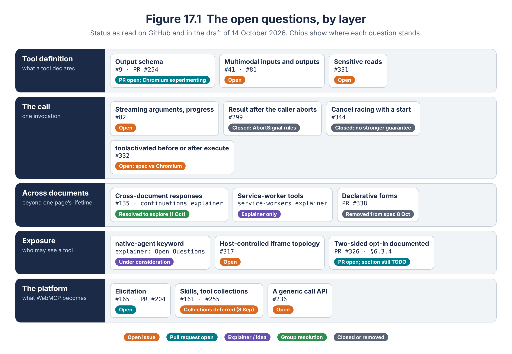
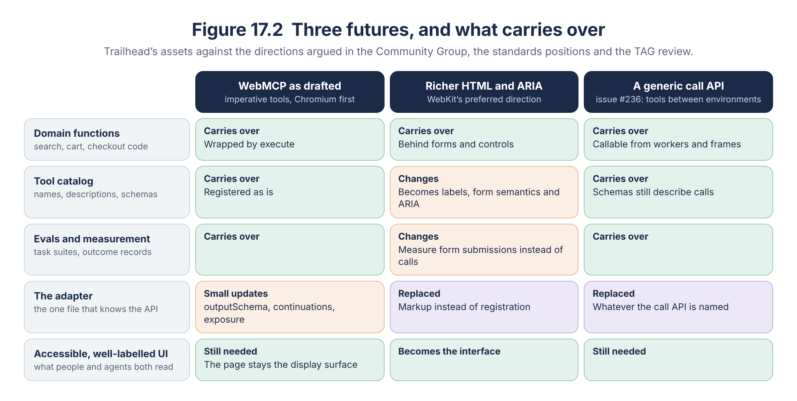

*Part VI · Strategy and the future*

# Chapter 17: The Road Ahead

> *“As the WebMCP proposal continues to evolve with community and stakeholder feedback, we are tracking several active design discussions and technical challenges.”*
>
> — WebMCP explainer, “Open Questions”[^1]

## Kari’s second whiteboard

Three weeks after the Monday meeting in Chapter 16, Trailhead’s first release is live behind the origin trial. Agents can search and compare tents, the measurement wrapper is counting outcomes, and Jonas has stopped getting paged about the adapter. Kari has wiped the whiteboard and written a new question: *What are we betting on, and what happens if we lose the bet?*

It is the right question for the end of a book about a draft. Everything in the previous sixteen chapters was checked against the specification as it stood on a particular day and against what one browser actually did. Both will move. The Community Group draft that this chapter reads is dated 14 October 2026.[^2] Chrome’s origin trial now runs to Chrome 162, and Chrome Platform Status still lists the feature as “Proposed”, with no shipping milestone.[^3] Edge’s trial expires on 30 March 2027.[^4] Some of the questions that will decide what WebMCP becomes are being argued in issues opened in the last few weeks, and one of them was opened and closed the day before this chapter was written.

This chapter is a map of those questions and a way to build so that your work survives the answers. It looks at the questions in five groups (Figure 17.1): what a tool can declare, what happens during a single call, what happens when the work outlives the document, who gets to see a tool, and what the platform as a whole becomes. For each it gives the state of play as of mid-October 2026 and what to do about it now. It then sets out three competing futures and ends with a checklist and three short listings that Trailhead uses to keep its bets small.



*Figure 17.1: The open questions, by layer. Each chip shows where the question stood on GitHub and in the draft on 14 October 2026.*

## How to read an open question

Before the questions themselves, a word on how to weigh them, because the WebMCP repository contains many kinds of “open”.

An *explainer section* is the lightest. The main explainer’s “Open Questions” list is a statement of intent from its authors: these are things they believe the API needs and haven’t designed yet.[^1] A *supplementary explainer*, such as the one for service workers or for continuations, is a worked proposal with an API sketch but no spec text.[^5][^6] An *issue* can be anything from a drive-by idea to a design thread with a formal *resolution* recorded in the Community Group’s minutes. A *pull request* against the spec is the closest thing to a decision before it lands, and an *implementation experiment* in Chromium is a strong signal of which way the browser that ships the trial is leaning.

Two recent events show why the distinction matters. On 8 October 2026 the Community Group merged pull request #338, which removed the declarative API from the specification and left it to be “explored in the Declarative API Explainer”. In the same thread, a Chrome engineer wrote that “the Chrome team plans to ship the imperative API **first**, with the declarative API following shortly after.”[^7] Something that had been spec text for months became an explainer again, while the browser running the trial kept shipping it. Chapter 8 covers what that means for forms. Here it is a reminder that the spec, the explainers and Chromium are three separate sources of truth, and you have to track all three.

Table 17.1 summarises the questions this chapter covers.

*Table 17.1: Open questions that could change your tools, as of 14 October 2026*

| Question | Where it lives | Status | What to do now |
|---|---|---|---|
| Output schemas | Issue #9, PR #254 | Resolved in principle (Feb 2026); PR open; Chromium experimenting | Write `outputSchema` in your catalog today |
| Multimodal inputs and outputs | Issues #41, #81 | Open | Return references and compact JSON, not blobs |
| Streaming arguments and progress | Issue #82; explainer | Open | Keep calls short; show progress on the page |
| Cross-document responses | Issue #135; continuations explainer | Group exploring continuation tokens | Finish tool calls in one document; keep state server-side |
| Service-worker tools | Service-workers explainer | Explainer only | Keep tools as thin wrappers over domain code |
| Built-in agent exposure | Explainer (`native-agent`) | Under consideration | Set `exposedTo` deliberately |
| Host-controlled iframe topologies | Issue #317, PR #326 | Open | Use Permissions Policy and explicit origins |
| Result after a caller aborts | Issue #299 | Closed: standard `AbortSignal` semantics | Report partial work through your own UI or state |
| Cancel racing with a start | Issue #344 | Closed: no stronger guarantee | Make consequential tools idempotent |
| Event ordering | Issue #332 | Open: spec and Chromium disagree | Don’t depend on `toolactivated` timing |
| Sensitive reads | Issue #331 | Open | Treat sensitive reads like consequential ones |
| A generic call API | Issue #236 | Open | Keep the API shape behind one adapter |

## Output schemas

Every Trailhead tool already returns structured data. `search_products` answers with an object that has a `products` array, each with an SKU, a name, a price in NOK, a rating and a stock flag. What the agent doesn’t get is a description of that shape. It has to infer what `inStock: false` means from the value itself, and it can’t tell in advance whether the tool will return prices at all.

The request for an output schema is one of the oldest in the repository. Issue #9 was opened in August 2025, pointing out that MCP had just added `outputSchema` to its tool definition. On 5 February 2026 the Community Group resolved to “add outputSchema to the imperative API and investigate how to associate outputSchema with declarative WebMCP.”[^8] Pull request #254, opened on 21 August 2026, adds an optional `outputSchema` member to both `ModelContextTool` and `RegisteredTool`, so that the page can declare it and an in-page agent can read it back from `getTools()`. The PR explains that the name was chosen over `responseConstraint`, which is specific to the Prompt API, to align with MCP. It was still open on 14 October. On 11 September its author wrote that he had “started experimenting with `outputSchema` in Chromium” in a code review.[^9]

On the MCP side, the 2026-07-28 tools specification already defines `outputSchema` as an optional JSON Schema for the result, and `structuredContent` as the field that carries the conforming value. For backwards compatibility, a tool that returns structured content “SHOULD also return the serialized JSON in a TextContent block.”[^10]

What does Chromium 156 do today if you include `outputSchema`? We tried it. Registration succeeds, the member is silently dropped, and `getTools()` returns a tool without it.[^11] That is ordinary Web IDL dictionary behaviour: members the browser doesn’t know about are ignored. It also means there is no cost to writing the schema now. Listing 17.1 is Trailhead’s search tool written as plain data, with an output schema next to the input schema.

*Listing 17.1: `search_products` as plain data, with an output schema the draft doesn’t have yet*

```js
// catalog.js: Trailhead's search tool as plain data plus a plain function.
// Nothing here touches document.modelContext; adapter.js does (Listing 17.2).
import { searchProducts } from './products.js';

const price = {
  type: 'object',
  properties: {
    amount: { type: 'number', description: 'Price in Norwegian kroner' },
    currency: { type: 'string', enum: ['NOK'] },
  },
  required: ['amount', 'currency'],
};

export const catalog = [
  {
    name: 'search_products',
    title: 'Search products',
    description:
      'Search Trailhead outdoor gear by keyword, with optional category, ' +
      'maximum price in NOK and an in-stock filter. Shows the results on ' +
      'the page and returns up to 10 products with SKU, name, price and rating.',
    inputSchema: {
      type: 'object',
      properties: {
        query: { type: 'string', description: 'Keywords, e.g. "2 person tent"' },
        category: {
          type: 'string',
          enum: ['tents', 'sleeping-bags', 'backpacks', 'footwear', 'clothing'],
        },
        maxPrice: { type: 'number', minimum: 0, description: 'Maximum price in NOK' },
        inStockOnly: { type: 'boolean' },
      },
      required: ['query'],
    },
    // Not in the draft yet (issue #9, PR #254). Browsers that don't know it ignore it.
    outputSchema: {
      type: 'object',
      properties: {
        products: {
          type: 'array',
          maxItems: 10,
          items: {
            type: 'object',
            properties: {
              sku: { type: 'string' },
              name: { type: 'string' },
              price,
              rating: { type: 'number', minimum: 0, maximum: 5 },
              inStock: { type: 'boolean' },
            },
            required: ['sku', 'name', 'price', 'inStock'],
          },
        },
      },
      required: ['products'],
    },
    annotations: { readOnlyHint: true },
    run: (input) => ({ products: searchProducts(input) }),
  },
];
```

Three choices in Listing 17.1 are deliberate. First, the definition doesn’t touch `document.modelContext` at all: it is data plus a `run()` function, and Listing 17.2 turns it into a WebMCP tool. Second, the output schema is checked in the tests, not just written. The demos repository runs `run()` against several inputs and validates each result against `outputSchema`, which catches the day someone adds a field to the result and forgets the schema.[^11] Third, `currency` is an `enum` of one value. That looks pedantic, but it is exactly the kind of fact an agent comparing stores needs and won’t guess.

> **Still in flux: output schemas**
>
> PR #254 was open on 14 October 2026, and the draft has no `outputSchema`. Whether a browser will validate results against it, as issue #92 asks for inputs, is undecided.[^12] If the PR lands as written, the schema you write today becomes visible to in-page agents through `getTools()`. If the name or shape changes, it is one field in your catalog.

## Multimodal and streaming data

Trailhead’s tools return text and numbers. A store that lets customers upload a photo of a broken tent pole, or a design tool that returns an image, needs more. The explainer lists “multimodal input/output” as an open question and notes that agents “are increasingly multimodal”.[^1] Issue #41, opened in October 2025, asks for image inputs and outputs and suggests “something web specific, allowing devs to use image elements for this”.[^13] Issue #81 proposes file attachments for the imperative API.[^14]

The more telling decision is a closure. Issue #86 asked WebMCP to adopt MCP’s content types for results (text, image, resource). On 28 September 2026 Dominic Farolino, who has driven most of the specification’s recent evolution, closed it in favour of #41, writing that he was “less convinced we should adopt MCP’s content model directly, or standardize presentation-specific types like `html`, `table`, or `link` as part of WebMCP.”[^15] Expect a web-shaped answer, perhaps built on `Blob` or elements, rather than base64 strings copied from MCP.

Streaming has the same status. Issue #82, opened in February 2026, asks for tool arguments to stream into the page while the model is still generating them, so a long email body could appear as it is written.[^14] The explainer adds streaming outputs and progress reporting for long-running tools to the list, and points at MCP’s own progress utility as prior art.[^1] None of this is in the draft.

What to do now is mostly restraint. Return compact JSON with identifiers and URLs the agent can pass back to another tool, not large payloads. Keep the page as the place where images, previews and progress bars are shown. That is good practice anyway (Chapter 16 argued that showing results on the page keeps the agent a guest), and it means that when a multimodal result type arrives, it will be an addition to tools that already work.

## When the work outlives the document

WebMCP tools live in a document. When the document goes, the tool and any call in progress go with it. Two open questions are about relaxing that: responses that survive a navigation, and tools that don’t need a document at all.

### Cross-document responses and continuation tokens

Most stores have a checkout spread over several pages. Trailhead’s goes from cart to delivery to payment to confirmation, with a full navigation at each step. An agent that calls `checkout` on the cart page gets nothing back once the page navigates away: the promise belongs to a document that no longer exists.

Issue #135, opened in March 2026, asked how a tool should respond when it causes a navigation. It started with declarative forms and the idea of using the target page’s JSON-LD as the response. On 16 April 2026 the group resolved to “explore `<context>` element without committing to form submission response with it.”[^16] The design that has since gained ground is different. In late September a Chrome engineer published an explainer for *continuation tokens*, merged into the repository on 2 October as pull request #327.[^6] On 1 October the group resolved that it “explores the Continuation Tokens design outlined in the explainer and welcomes further feedback.”[^16]

The explainer starts from the limitation directly: “tool calls are restricted to execute in a single document, and a single Promise per tool call.” Its proposal has two halves. A tool’s `execute` callback receives an `invocation` object and can call `requestToken()` to get a string token for the current call. The site carries that token to the next page, in a URL parameter or in storage, and calls `document.modelContext.resumeTool(token, callback)` there. The browser invokes the callback with the original input and returns the final result to the agent only when the whole chain has finished.[^6] The conditions are strict. A token can be redeemed once, only by a same-origin document in the same browsing context, and it is revoked if the caller cancels. The browser may also limit its lifetime, which the explainer expects to “probably fall around 60 seconds”.[^6]

A Microsoft engineer described a different prototype in the same issue: a tool returns a sentinel value such as `continueAfterNavigation: true`, and the browser invokes the same tool again on the next page. The explainer’s author replied that the proposal differs in two ways: the site asks for a continuation through an explicit API, and the next page doesn’t have to register the tool again to handle it.[^16]

Our probe (Listing 17.3) found neither `invocation` nor `resumeTool()` in Chromium 156. The only option `execute` receives is `signal`.[^11] So for now the advice is to design each tool call to finish in one document. Trailhead’s `checkout` stops at the order summary, as Chapter 16 planned, and returns the summary. Keep any state that has to survive a navigation on the server, keyed by an identifier you return to the agent. That design is ready for continuation tokens if they arrive, because the token becomes one more thing the next page reads.

MCP went the same way in its 2026-07-28 revision. It removed protocol-level sessions and the `Mcp-Session-Id` header, and said that servers needing state across calls should use “explicit, server-minted handles passed as ordinary tool arguments.”[^17] The two protocols are converging on the same idea: state that crosses a boundary should be explicit.

### Tools for sites that aren’t open

The second question is bigger. Today an agent can only use Trailhead’s tools while a Trailhead tab is open, a limitation Chrome’s overview lists under “Tool discoverability”: clients and browsers “must visit a site directly to know if it has callable tools.”[^18] The service-worker explainer, first published on 28 August 2025, proposes that a site’s service worker register tools with a `modelContext` object in its global scope, “the service worker counterpart of the `document.modelContext` object”, so that an agent can call them with no window open.[^5]

The explainer goes further than registration. It proposes just-in-time installation of a site’s service worker when an agent recommends it, building on the `serviceworker` manifest field from the Payment Handler API. It proposes a session identifier on each call, so that a worker serving two conversations can keep two carts apart. And on security it suggests limiting an agent conversation to a single origin once it touches a worker’s tools, to blunt the combination of private data, untrusted content and external communication.[^5] Tools that need the user, for payment or confirmation, would open a window and talk to it with `postMessage`.[^5]

This is an explainer with no spec text, and the main explainer still lists it as an open question.[^1] But it is a strong argument for a design rule you should follow anyway: keep tools thin. If `search_products` is a wrapper over a search function that doesn’t depend on the DOM, the same function can be registered from a worker later. If the tool reads its results from the rendered grid, it can’t.

## Who sees your tools by default

Chapter 7 covered `exposedTo`, `fromOrigins` and the `tools` Permissions Policy. Three open questions could change the defaults.

The first is the browser’s own agent. The `exposedTo` array accepts only origins, so a page can’t say whether the browser’s built-in assistant should see a tool. The explainer says its authors are “considering introducing a new keyword like `native-agent`”. The running idea is that a missing `exposedTo` in the top-level document would expose tools to the built-in agent, while in iframes a missing `exposedTo` would not.[^1] If that lands, the default for most pages stays the same, and embedded widgets such as Supportly’s Helpdesk Widget become invisible to the browser’s agent unless they opt in.

The second comes from composed applications. Issue #317, opened on 23 September 2026, describes a host page with an agent in one iframe and several cross-origin apps in others. The host wants the agent to use the apps’ tools without the apps being able to see each other’s. Today that requires every app to know the agent’s origin in advance through `exposedTo`, and the agent to name every app in `fromOrigins`. The issue proposes host-controlled roles. Farolino’s first reply pointed at the crux: what the host really wants is for a tool provider “to not have to know which origins to expose tools to explicitly.”[^19]

The third is documentation, and it matters for reviewers. The draft’s §6.3.4, “Violation of Same-Origin Boundaries”, is still a `TODO` in the 14 October draft.[^2] Pull request #326, opened on 28 September, would fill it with a description of the two-sided opt-in model: Permissions Policy delegation by the embedder, `exposedTo` by the provider and `fromOrigins` by the consumer. A reviewer has suggested retitling the section, since most of what it describes is “the careful design that prevents cross-document exposure without permission.”[^20] Until it merges, the explainer and Chapter 7 are your best written account of the model.

What to do now: never rely on defaults for exposure. If a tool should be visible to a specific embedding origin, say so in `exposedTo`. If it shouldn’t leave the top-level document, don’t delegate the `tools` policy to frames. Listing 17.2 passes `exposedTo` through only when the caller asks for it, which keeps that decision in one visible place.

## Smaller questions that still bite

Not every open question is a new feature. Some are about the semantics of what already ships, and they are the ones most likely to change behaviour under your existing code.

*What a cancelled call returns.* Issue #299 asked whether a tool could still deliver a final result, such as how many items of a batch it had applied, after the caller aborted. Farolino closed it on 25 September 2026. Once the caller aborts, he wrote, “its promise rejects and any eventual result from the tool is discarded,” which is how `AbortSignal` already works elsewhere on the platform, for example with `fetch()`. If an application needs to expose the resulting state, that is for the application to do.[^21] So a tool that applies changes incrementally should record its progress somewhere the user and the agent can see it afterwards, on the page or on the server.

*A cancel that races with a start.* Issue #344 was opened and closed on 14 October 2026, the day before this chapter was written. It pointed out that a call cancelled almost immediately can still start, with a fresh signal that isn’t aborted. Farolino declined to give a stronger guarantee than `AbortSignal` provides elsewhere: “once execution has begun, aborting can race with work that the tool has already performed,” and there can’t be a guarantee “that no side effect occurred”. Anything stronger would need a separate commit or transaction mechanism. He did agree that the ordering of parallel steps in the spec had a real bug and said he would file it separately.[^22] The practical lesson: make consequential tools idempotent, and check the signal before each irreversible step, not just at the start.

*When `toolactivated` fires.* Issue #332, opened on 1 October 2026, notes that the draft fires `toolactivated` before invoking `execute`, while Chromium and the web-platform tests fire it after, so that listeners see the tool’s effects.[^23] Either may change. Don’t write code that depends on the order of the event and the callback.

*Sensitive reads.* `consequentialHint` describes actions that are “significant, real-world, or non-reversible”. Issue #331 points out that this leaves high-risk *read* tools, such as ones that return health or financial records, ambiguous. Participants have proposed a separate `sensitiveHint` that would let an agent say “will read private data” instead of “will do something consequential”, and keep such outputs out of logs and long-term memory.[^24] Until something is decided, treat a sensitive read like a consequential action: ask for confirmation on the page. Don’t invent your own annotation names either. Chromium 156 drops unknown annotations silently, as our probe shows: it registered a tool with `sensitiveHint` and got back only the four annotations the browser knows (`consequentialHint`, `debugging`, `readOnlyHint` and `untrustedContentHint`).[^11]

*Asking the user mid-call.* Elicitation is still unresolved. In June 2026 the group agreed to specify an “interactive” mode first, in pull request #204, which proposes replacing `requestUserInteraction()` with `requestUserInput()`. Both were still open on 14 October.[^25] Meanwhile Chrome’s security guide still says that “the spec draft includes requestUserInteraction()”.[^26] The 14 October draft doesn’t contain that method.[^2] Chapter 13 shows how to confirm on your own page, which works whatever the API becomes.

*Grouping tools.* Proposals for “skills” (#161) and tool collections with progressive disclosure (#255) would change how many tools a page can sensibly expose. On 3 September 2026 the group resolved to “seek explicit model harness creator feedback and defer the tool collections feature.”[^27] Keep your tool count small, as Chapter 16 recommended, and nothing here will catch you out.

> **Still in flux: semantics under your feet**
>
> The closures of #299 and #344 make WebMCP’s cancellation behave like the rest of the platform, which is good news for stability. The ordering bug Farolino promised to file, the `toolactivated` question in #332 and the hint proposals in #331 could still change observable behaviour. Pin these down in tests against each Chrome release (Chapter 14), and keep the expectations in one place so that a change shows up as a failing test rather than a support ticket.

## Competing futures

Step back from individual issues and there are three broad directions WebMCP could take. They aren’t mutually exclusive, but they lead to different APIs, and the people arguing for them are not the same.

### WebMCP as drafted, Chromium first

The first is the path the specification is on: an imperative API on `document.modelContext`, extended with output schemas, continuations and exposure controls, shipped first in Chromium. Its supporters are the people writing the specification and the Chromium teams. Chrome Platform Status lists seven owners, an origin trial from M149 to M156 and an extension to M162 recorded on 28 September 2026.[^3] Chrome has said it plans to ship the imperative API first.[^7] In this future the code in this book needs small updates, not a rewrite.

### Richer HTML and ARIA semantics

The second is the direction WebKit prefers. Its standards position is “oppose”. Its argument, covered in Chapter 4, is that “when a site’s actions are hard for an agent to use, that is a gap in the page’s own semantics,” and the fix belongs in HTML and ARIA, “where the user, assistive technology, and agents all benefit.” WebKit also argues that a parallel tool layer moves the brittleness rather than removing it, “from the DOM into the tool descriptions”, and that an agent acting for a user “is, in effect, assistive technology.”[^28] In this future, the tool catalog becomes labels, form semantics and accessible names, and the declarative API, now an explainer again, is the closest thing WebMCP has to a bridge.[^29]

### A generic cross-environment call API

The third came from Jake Archibald in issue #236, opened on 3 August 2026: reposition WebMCP “as a general way to call functions in other environments.” Function calls between windows and workers are painful enough that libraries exist to make them easier. If registering a tool were simply a way for one environment to expose a function to another, with schemas and descriptions, then exposing functions to “the browser” would make them available to WebDriver and to agents, and “the LLM capability just falls out of the other capabilities provided.” A service worker could register functions at install time. A tool could ask not to return until the next page was ready, which would make multi-page automation possible.[^30]

The thread that followed is one of the most substantive in the repository. Farolino discussed tool objects that act as handles to a tool’s unique identifier, which could be passed across `postMessage()` to environments that have no direct access to each other. Archibald replied that this made `tool.call(…)` a more natural shape than a separate `callTool()`.[^30] Mozilla’s position thread, which settled on “neutral”, points to #236, and Archibald is one of the Mozillians it names as able to provide input.[^31] Some of the questions above, such as service-worker tools, continuations and the handle-based `executeTool()`, are partial moves in this direction already.

### Who decides

None of these futures has the support a web standard needs yet. The W3C TAG’s review of WebMCP is still open, with pending focus areas for API design, web architecture, security, privacy, accessibility and internationalization, and the label “Missing: Multi-stakeholder support”.[^32] Mozilla is neutral, WebKit is opposed, and the Chromium-based browsers are running trials. Chapter 15 covers the politics in detail. For your planning, the point is that every one of the three futures keeps some of your work and changes some of it (Figure 17.2).

The venue is moving too. In June 2026 the W3C staff proposed adding WebMCP to the scope of the Web Machine Learning *Working Group* charter, the step that would move it from incubation onto the standards track. In August an Apple representative recorded that Apple was “opposed to this going working group” and that the W3C should “expect a formal objection if this is merged,” while saying Apple would be open to “a different venue at the W3C and doing this properly from first principles.” The pull request was closed without being merged on 13 October 2026.[^33] Its replacement is a draft charter for a new Agentic Web Working Group, “to develop specifications that facilitate web pages and applications to be leveraged by LLMs and AI agents.” The draft lists WebMCP as its one normative deliverable, adopted from the Community Group. Charter refinement began on 1 October, and the W3C team estimated that it would last until approximately 10 November 2026.[^34] Whether that charter survives review, and on what terms, is the nearest decision point after this book goes to press.



*Figure 17.2: Three futures, and what carries over. The assessment is the author’s; the futures are the directions argued in the Community Group, the standards positions and the TAG review.*

The pattern in Figure 17.2 is the basis of the checklist that follows. Domain code, accessible UI and the knowledge captured in your catalog and evals survive every future. The adapter is the part that changes. So the adapter should be small, and it should be the only thing that knows the API’s shape.

## A future-proofing checklist

Trailhead uses the following list as a release gate. None of it needs WebMCP to win.

1. **Keep tools as data plus functions.** Define each tool’s name, description, schemas and annotations as plain data, and its behaviour as a function over your domain code that doesn’t read the DOM (Listing 17.1). The same definitions can feed WebMCP, a backend MCP server (Chapter 3) or a service worker.
2. **Put the API shape in one file.** Only the adapter calls `document.modelContext` (Listing 17.2). When `outputSchema`, continuations or a new exposure keyword arrive, or the API is renamed again (Appendix D covers the last rename), one file changes.
3. **Validate inputs yourself.** The browser doesn’t check calls against `inputSchema`, and native validation is an open question (#92).[^12] Return a recoverable error the agent can act on.
4. **Write `outputSchema` now, and test results against it.** Browsers that don’t know it ignore it.[^11]
5. **Finish each call in one document.** Keep cross-page state on the server, keyed by identifiers you return.
6. **Never rely on exposure defaults.** Set `exposedTo` and the `tools` policy explicitly.
7. **Make consequential tools idempotent, and confirm on your own page.** Don’t depend on cancellation stopping side effects (#299, #344), or on any particular elicitation API.
8. **Don’t depend on unspecified behaviour.** That includes `getTools()` order, `toolactivated` timing and how plain strings are serialised. Use only annotations the spec defines.
9. **Keep the page accessible and well labelled.** It is what people use, it is what WebKit’s future builds on, and it is the fallback for every agent that doesn’t speak WebMCP.
10. **Probe every browser release.** Run a capability probe (Listing 17.3) and your evals (Chapter 14) against each new Chrome and Edge milestone, and read the diff.
11. **Give someone the job of tracking the spec.** Watch the issues in Table 17.1, and send your findings to the Community Group. The authors keep asking for implementation experience, and several of the threads in this chapter changed because someone reported what they saw.

Listing 17.2 is Trailhead’s adapter. It is deliberately boring.

*Listing 17.2: The adapter, the only file that knows the WebMCP API shape*

```js
// adapter.js: the only file that knows the shape of the WebMCP API.
import { checkInput } from './check-input.js';

export function webmcpAvailable() {
  return typeof document !== 'undefined'
    && typeof document.modelContext?.registerTool === 'function';
}

export async function registerCatalog(catalog, { signal, exposedTo } = {}) {
  if (!webmcpAvailable()) return [];
  const registered = [];
  for (const def of catalog) {
    const tool = {
      name: def.name,
      title: def.title,
      description: def.description,
      inputSchema: def.inputSchema,
      outputSchema: def.outputSchema,
      annotations: def.annotations,
      async execute(input, { signal: callSignal } = {}) {
        // The browser does not check input against inputSchema. We do.
        const problems = checkInput(def.inputSchema, input);
        if (problems.length > 0) {
          return { error: { code: 'invalid_input', message: problems.join('; ') } };
        }
        return def.run(input, { signal: callSignal });
      },
    };
    const options = { signal };
    if (exposedTo) options.exposedTo = exposedTo;
    await document.modelContext.registerTool(tool, options);
    registered.push(def.name);
  }
  return registered;
}
```

The adapter feature-detects the current entry point and registers nothing if it isn’t there, so the page works the same without WebMCP. It passes `outputSchema` through, even though Chromium 156 drops it today. It wraps each `run()` in input validation, returning `invalid_input` with every problem listed so the agent can correct the call in one go. In our tests, a call with no `query` and a negative `maxPrice` reaches the page untouched in Chromium 156, and the adapter answers with both problems.[^11] One `AbortSignal` unregisters the whole catalog, as in Chapter 5. The input checker, `check-input.js`, is a small subset of JSON Schema written for these tests. In production you would use a full validator.

Listing 17.3 is the probe from item 10. It asks the browser what it actually supports: whether the current and the legacy entry points exist, whether the methods from the continuations explainer are there, whether `outputSchema` survives a round trip through `getTools()`, which annotations are kept and which options `execute` receives.

*Listing 17.3: A capability probe to run against each browser release*

```js
// probe.js: what does this browser's WebMCP actually support today?
// Run it on a test page in CI, once per browser release. Not for production pages.
export async function probeWebMCP() {
  const mc = globalThis.document?.modelContext;
  const report = {
    documentModelContext: Boolean(mc),
    legacyNavigatorModelContext: 'modelContext' in (globalThis.navigator ?? {}),
    getTools: typeof mc?.getTools === 'function',
    executeTool: typeof mc?.executeTool === 'function',
    resumeTool: typeof mc?.resumeTool === 'function',   // continuations explainer
    outputSchemaReflected: null,
    annotationsKept: null,
    executeOptions: null,
  };
  if (!report.documentModelContext || !report.getTools || !report.executeTool) {
    return report;
  }
  const controller = new AbortController();
  const name = `probe_${Math.random().toString(36).slice(2, 10)}`;
  try {
    await mc.registerTool({
      name,
      description: 'Feature probe for tests. Returns the option names it receives.',
      inputSchema: { type: 'object', properties: {} },
      outputSchema: { type: 'object', properties: { options: { type: 'array' } } },
      annotations: { readOnlyHint: true, sensitiveHint: false },
      execute: async (_input, options = {}) => ({ options: Object.keys(options) }),
    }, { signal: controller.signal });
    const tool = (await mc.getTools()).find((t) => t.name === name);
    report.outputSchemaReflected = 'outputSchema' in tool;
    report.annotationsKept = Object.keys(tool.annotations ?? {}).sort();
    const raw = await mc.executeTool(tool, {});
    report.executeOptions = (typeof raw === 'string' ? JSON.parse(raw) : raw).options;
  } finally {
    controller.abort();
  }
  return report;
}
```

The probe registers a tool, so run it on a test page in CI, not on production pages, where an agent could see the probe tool for the instant it exists. It cleans up with `abort()` in a `finally` block, and the tests check that nothing is left behind. Here is what it reported in Chromium 156.0.8078.4 with `--enable-features=WebMCPTesting`:[^11]

```json
{
  "documentModelContext": true,
  "legacyNavigatorModelContext": false,
  "getTools": true,
  "executeTool": true,
  "resumeTool": false,
  "outputSchemaReflected": false,
  "annotationsKept": ["consequentialHint", "debugging", "readOnlyHint", "untrustedContentHint"],
  "executeOptions": ["signal"]
}
```

Each `false` in that report is a question from this chapter that the browser hasn’t answered yet. When one of them flips in a future release, the test that asserts it fails, and you know it is time to read the release notes and update the adapter. The demos repository runs all three listings against a `document.modelContext` mock and against Chromium 156’s own implementation, and all thirteen checks pass in both modes.[^11]

> **Still in flux: this chapter**
>
> This is the chapter most likely to date. Every status here was read on 14 and 15 October 2026. One issue it covers was opened and closed the day before it was written, the Working Group plan it describes was dropped two days before, and the declarative API left the spec a week earlier. Before relying on any row of Table 17.1, open the issue. The book’s companion repository keeps the probe and its expected results up to date.

## Closing the book

Chapter 1 began with Lars, a tent and an agent dragging a price slider back and forth, taking a screenshot after every nudge. The rest of the book has been about replacing that with something better: a page that says what it can do, in the page’s own code, with the user watching and the site in control.

Whether that something is called WebMCP in two years, whether it lives on `document.modelContext`, and whether Safari ever implements it are open questions, and this chapter has tried to be honest about how open they are. The work behind a good tool is not open to question. Deciding which journeys matter, describing them in words a model can act on, giving them clear inputs and honest results, confirming consequential steps with the person they affect, measuring what happens and keeping the page usable by everyone are what make a site agent-ready. Those carry over to every future in Figure 17.2. The API is the adapter. The rest is the product.

## Chapter summary

- WebMCP is a Community Group draft (14 October 2026) in origin trials that run to Chrome 162 and, in Edge, to 30 March 2027. Chrome Platform Status lists it as “Proposed”. Chrome plans to ship the imperative API first. The declarative API left the spec on 8 October and is an explainer again.
- Weigh open questions by where they live: explainer, issue, resolution, pull request or Chromium experiment. Track the spec, the explainers and Chromium separately.
- Output schemas are resolved in principle and in an open PR (#254), with Chromium experimenting. Chromium 156 accepts and ignores `outputSchema`, so write it now and test results against it.
- Multimodal results, file inputs, streaming and progress are open (#41, #81, #82). The editor prefers a web-shaped design to MCP’s content model (#86). Return compact JSON and references, and show rich output on the page.
- Cross-document responses are being explored as continuation tokens (`requestToken()`, `resumeTool()`), single-use, same-origin and short-lived. Service-worker tools are an explainer. Chromium 156 has neither. Finish calls in one document and keep tools thin.
- Exposure defaults may change: a `native-agent` keyword is under consideration, host-controlled iframe topologies are proposed (#317) and the spec’s cross-origin section is still a `TODO` (PR #326). Set exposure explicitly.
- Cancellation follows standard `AbortSignal` semantics (#299, #344 closed): an aborted call’s result is discarded, and side effects can still happen. Event ordering (#332), sensitive reads (#331), elicitation (#165, PR #204) and tool grouping (#161, #255) are open.
- Three futures are argued: WebMCP as drafted, richer HTML and ARIA (WebKit), and a generic cross-environment call API (#236). The TAG review is open and notes missing multi-stakeholder support. The plan to move WebMCP into the Web Machine Learning Working Group was dropped on 13 October 2026 after Apple warned of a formal objection; a draft Agentic Web Working Group charter that names WebMCP is in refinement until about 10 November 2026. Domain code, accessible UI, the tool catalog and evals carry over; the adapter changes.
- Build so that the API shape lives in one adapter (Listing 17.2), tools are data plus functions (Listing 17.1), and a probe (Listing 17.3) runs against every browser release.

## Notes

[^1]: WebMCP explainer, “Open Questions” (multimodal input/output, cross-document tool response, built-in agent exposure by default, transferable/streamable inputs and outputs, schema validation, skills, output schema, user prompting and elicitation, tool progress reporting, service workers integration), webmachinelearning/webmcp, accessed 15 October 2026. <https://github.com/webmachinelearning/webmcp#open-questions>
[^2]: WebMCP specification, Draft Community Group Report, 14 October 2026: §4.2 ModelContext Interface and its dictionaries, §6.3.4 Violation of Same-Origin Boundaries (a TODO in this draft), and the IDL index. <https://webmachinelearning.github.io/webmcp/>
[^3]: Chrome Platform Status, “WebMCP” (feature 5117755740913664): Chrome status “Proposed”, developer trial from M146, origin trial M149–M156, extension to M162, seven listed owners; last updated 28 September 2026; accessed 15 October 2026. <https://chromestatus.com/feature/5117755740913664>
[^4]: Microsoft Edge Origin Trials, “WebMCP” (trial expiration date 30 March 2027), accessed 15 October 2026. <https://developer.microsoft.com/en-us/microsoft-edge/origin-trials/trials/0b76fe60-b266-458e-a285-04e375c0c31a>
[^5]: Brandon Walderman, “WebMCP for Service Workers” (supplementary explainer, first published 28 August 2025): “TL;DR”, “Discovery and Installation”, “Tool Registration and Use”, “Session Management” and “Security Considerations”. <https://github.com/webmachinelearning/webmcp/blob/main/docs/service-workers.md>
[^6]: Mark A. Foltz, “Continuation Tokens” (explainer, added by pull request #327, merged 2 October 2026): “Overview”, “Proposal” (token creation and redemption) and “Agent Behaviors”. <https://github.com/webmachinelearning/webmcp/blob/main/continuations-explainer.md>
[^7]: webmachinelearning/webmcp pull request #338, “Remove declarative API from spec” (opened 7 October 2026, merged 8 October 2026), including the author’s comment on Chrome’s shipping plan. <https://github.com/webmachinelearning/webmcp/pull/338>
[^8]: webmachinelearning/webmcp issue #9, “Introduce `outputSchema` (was: Should output also have a schema?)” (opened 12 August 2025; open on 14 October 2026), including the Community Group resolution of 5 February 2026. <https://github.com/webmachinelearning/webmcp/issues/9>
[^9]: webmachinelearning/webmcp pull request #254, “Add `outputSchema` to `ModelContextTool` and `RegisteredTool`” (opened 21 August 2026; open on 14 October 2026), including the author’s comment of 11 September 2026. <https://github.com/webmachinelearning/webmcp/pull/254>
[^10]: Model Context Protocol specification, version 2026-07-28, “Server Features › Tools”: tool definition (`outputSchema`), “Structured Content” and “Output Schema”. <https://modelcontextprotocol.io/specification/2026-07-28/server/tools>
[^11]: Tested by the author on 15 October 2026 with Playwright 1.64 and Chromium 156.0.8078.4, both with a `document.modelContext` mock and with the browser’s own implementation (`--enable-features=WebMCPTesting`). Code and tests: vibeprogrammer/webmcp-book-demos, chapters/17-the-road-ahead. Results describe this build only.
[^12]: webmachinelearning/webmcp issue #92, “Who owns the validation layer?” (opened 17 February 2026; open on 14 October 2026). <https://github.com/webmachinelearning/webmcp/issues/92>
[^13]: webmachinelearning/webmcp issue #41, “Support multimodal tool input/output” (opened 17 October 2025; open on 14 October 2026). <https://github.com/webmachinelearning/webmcp/issues/41>
[^14]: webmachinelearning/webmcp issue #81, “Proposal: Support file attachments via imperative WebMCP API” (opened 11 February 2026), and issue #82, “Proposal: Stream Tool Arguments” (opened 13 February 2026); both open on 14 October 2026. <https://github.com/webmachinelearning/webmcp/issues/82>
[^15]: webmachinelearning/webmcp issue #86, “Proposal: Tool result content types beyond text” (opened 14 February 2026, closed 28 September 2026 in favour of #41), closing comment by Dominic Farolino. <https://github.com/webmachinelearning/webmcp/issues/86>
[^16]: webmachinelearning/webmcp issue #135, “Cross-document tool response mechanism” (opened 9 March 2026; open on 14 October 2026), including the resolutions of 16 April and 1 October 2026 and the comments of 5 and 6 October 2026. <https://github.com/webmachinelearning/webmcp/issues/135>
[^17]: Model Context Protocol specification, version 2026-07-28, “Key Changes” (changelog): removal of protocol-level sessions (SEP-2567) and of the initialize handshake (SEP-2575). <https://modelcontextprotocol.io/specification/2026-07-28/changelog>
[^18]: Chrome for Developers, “WebMCP” (published 18 May 2026, updated 7 October 2026), “Limitations” and “Permissions policy”. <https://developer.chrome.com/docs/ai/webmcp>
[^19]: webmachinelearning/webmcp issue #317, “Host-controlled WebMCP access between iframes” (opened 23 September 2026; open on 14 October 2026), including Dominic Farolino’s comment of 24 September 2026. <https://github.com/webmachinelearning/webmcp/issues/317>
[^20]: webmachinelearning/webmcp pull request #326, “Document cross-origin tool exposure and two-sided opt-in in Section 6.3.4” (opened 28 September 2026; open on 14 October 2026), including review comments of 30 September 2026. <https://github.com/webmachinelearning/webmcp/pull/326>
[^21]: webmachinelearning/webmcp issue #299, “Let a tool deliver a final result on caller abort” (opened 6 September 2026, closed 25 September 2026), closing comment by Dominic Farolino. <https://github.com/webmachinelearning/webmcp/issues/299>
[^22]: webmachinelearning/webmcp issue #344, “Don’t start a tool whose `executeTool()` call was already cancelled” (opened and closed 14 October 2026), including Dominic Farolino’s comment. <https://github.com/webmachinelearning/webmcp/issues/344>
[^23]: webmachinelearning/webmcp issue #332, “Fire `toolactivated` after invoking `execute`” (opened 1 October 2026; open on 14 October 2026). <https://github.com/webmachinelearning/webmcp/issues/332>
[^24]: webmachinelearning/webmcp issue #331, “Scope of `consequentialHint` for high-risk read tools” (opened 30 September 2026; open on 14 October 2026), including the `sensitiveHint` proposals of 1–3 October 2026. <https://github.com/webmachinelearning/webmcp/issues/331>
[^25]: webmachinelearning/webmcp issue #165, “WebMCP elicitation via requestUserInteraction()” (opened 16 April 2026), including the resolution of 11 June 2026, and pull request #204, “Replace requestUserInteraction with requestUserInput” (opened 9 June 2026); both open on 14 October 2026. <https://github.com/webmachinelearning/webmcp/issues/165>
[^26]: Chrome for Developers, “WebMCP tool security” (published 9 June 2026, updated 1 September 2026), “Next steps”. <https://developer.chrome.com/docs/ai/webmcp/secure-tools>
[^27]: webmachinelearning/webmcp issue #161, “Proposal: Skills — workflow-level context for tool composition” (opened 3 April 2026), and issue #255, “Tool collections: coarse-grained grouping with progressive disclosure” (opened 22 August 2026), including the resolution of 3 September 2026; both open on 14 October 2026. <https://github.com/webmachinelearning/webmcp/issues/255>
[^28]: WebKit standards-positions issue #670, “WebMCP” (position: oppose; topics include meaningful user consent and forms), accessed 15 October 2026. <https://github.com/WebKit/standards-positions/issues/670>
[^29]: WebMCP, “Declarative API Explainer”, webmachinelearning/webmcp. <https://github.com/webmachinelearning/webmcp/blob/main/declarative-api-explainer.md>
[^30]: webmachinelearning/webmcp issue #236, “Reposition feature as a generic communication tool?” (opened by Jake Archibald, 3 August 2026; open on 14 October 2026), including comments of 27 August, 22 September and 24 September 2026. <https://github.com/webmachinelearning/webmcp/issues/236>
[^31]: Mozilla standards-positions issue #1412, “WebMCP” (position: neutral; closed), which names Jake Archibald among the Mozillians who can provide input and refers to webmcp issue #236. <https://github.com/mozilla/standards-positions/issues/1412>
[^32]: W3C TAG design review #1238, “Incubation: WebMCP” (open on 15 October 2026; labels include “Missing: Multi-stakeholder support” and pending focus areas). <https://github.com/w3ctag/design-reviews/issues/1238>
[^33]: w3c/charter-drafts pull request #829, “[wg/webmachinelearning] Adds WebMCP in scope” (opened 9 June 2026, closed without merging 13 October 2026), including Marcos Cáceres’s comment of 13 August 2026 and Philippe le Hégaret’s comment of 28 September 2026. <https://github.com/w3c/charter-drafts/pull/829>
[^34]: W3C, “Agentic Web Working Group Charter” (draft, accessed 15 October 2026), “Scope” and “Deliverables”; w3c/strategy issue #576 (opened 28 September 2026); and Xueyuan Jia, “Start of refinement for a draft Agentic Web Working Group charter”, public-new-work@w3.org, 2 October 2026. <https://w3c.github.io/charter-drafts/2026/agenticweb-wg.html>
